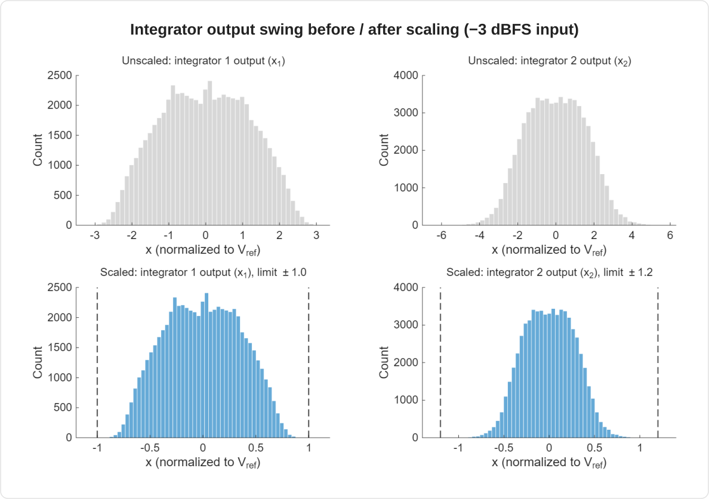
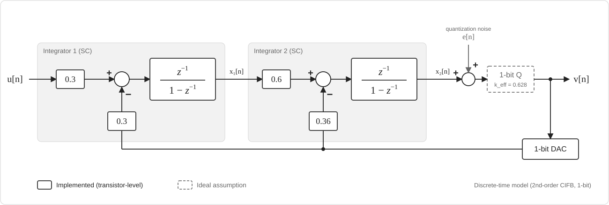
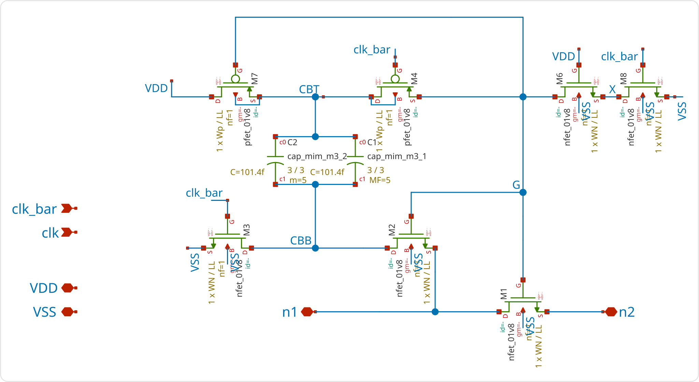
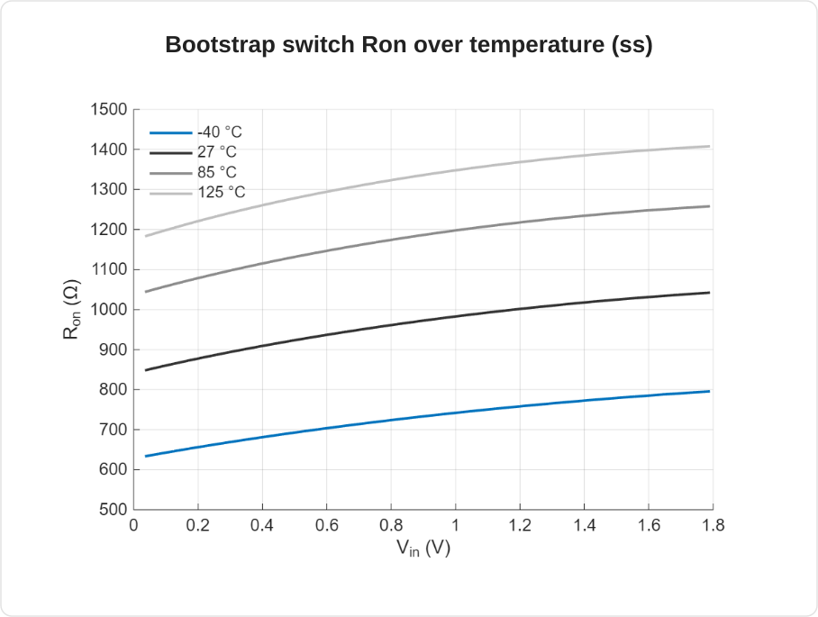
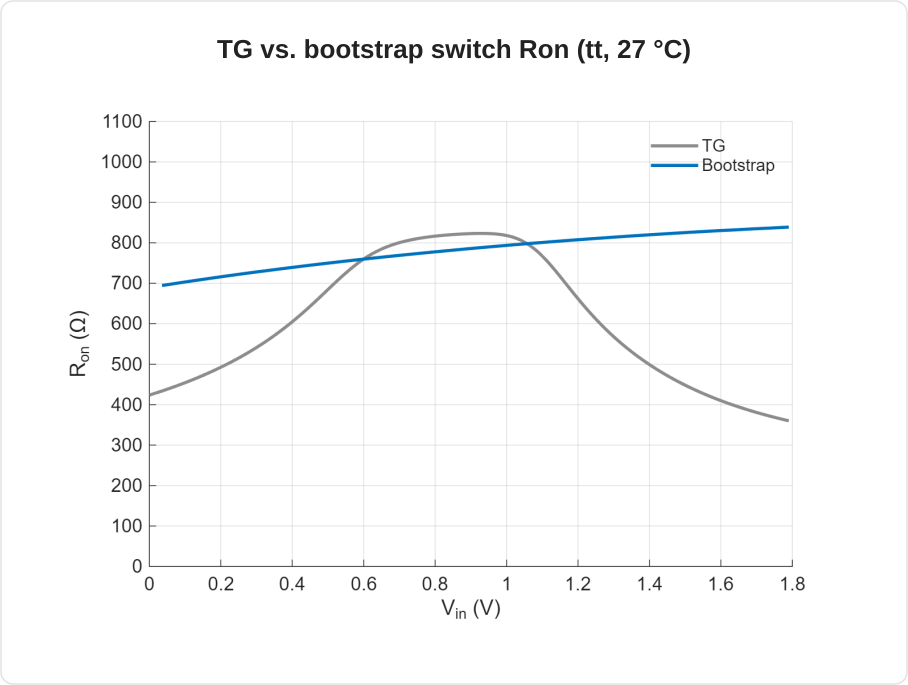
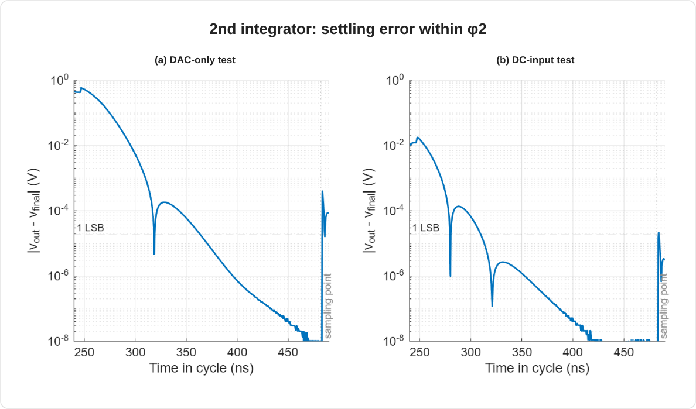
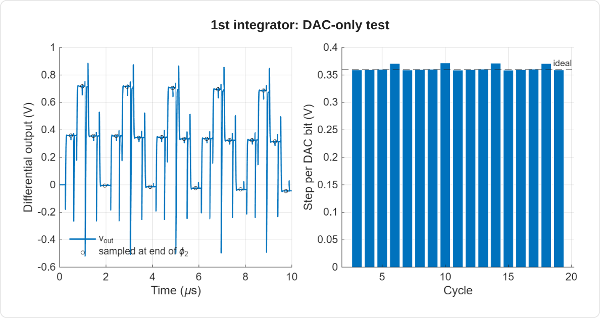

# 2nd-Order 1-bit Switched-Capacitor ΔΣ Modulator in SKY130

MEMS 가속도 센서 인터페이스용 트랜지스터 레벨(SKY130, Xschem / ngspice) 2차 1-bit fully differential switched-capacitor ΔΣ modulator. 스펙은 센서 요구사항에서 MATLAB으로 도출함.

| Item | Value |
|---|---|
| Process / supply | SKY130A / 1.8 V |
| Architecture | 2nd-order, 1-bit, CIFB, fully differential SC, 1st integrator에 chopper |
| $f_s$ / OSR / BW | 2.048 MHz / 512 / 2 kHz |
| SNDR requirement / design target | $\ge$ 95.2 dB (15.5 bit) / $\approx$ 98.1 dB (16 bit) |
| Full scale | ±1.2 V differential (VREFp 1.5 V / VREFn 0.3 V), 입력 −6 dBFS |
| Power | 684 µW (`.op`, static bias only) |

---

## Highlights

- 스펙(GBW, DC gain, slew rate, $C_s$, switch $R_{on}$)을 센서 잡음과 16 bit 목표에서 단계별로 도출함 (Specifications 참조).
- 이상 behavioral model: SNDR 109.8 dB. 트랜지스터 레벨(out-of-band PSD로 추정, 잡음 없음, pre-layout): $\approx$ 108–109 dB. 잡음을 주입한 트랜지스터 레벨 run의 측정 SNDR은 solver의 수치 floor 때문에 68–70 dB에 그치며, noise budget 추정은 $\approx$ 96 dB (15.7 bit)로 요구(95.2 dB)는 만족하고 설계 목표(98.1 dB)는 못 미친다. 정확한 SNDR 측정은 시뮬레이션 시간 때문에 제한된다(Limitations 참조).
- Integrator 테스트가 이상 계수와 일치함 (2nd integrator: DAC step 0.4355 V vs. 0.436 V, input step −12.04 mV vs. −12.1 mV; 1st integrator: DAC step +0.65 %, input step −2 ~ −5 %이며 chopper에 의한 홀짝 교대가 있음).
- TG의 switch $R_{on}$은 모든 corner와 온도에서 0.9 kΩ 이하이며, bootstrap switch는 입력단에서 monotonic한 $R_{on}$을 보임.
- Power 684 µW는 static `.op` 기준이다(transient 평균은 측정하지 않음).

---

## Specifications

스펙은 타겟 스펙(센서 요구)에서 출발해 시스템 레벨, 회로 레벨 요구, 구현 선택 순서로 도출함. 도출은 `matlab/behav_model.m`(원본 `SystemModeling/ADC.mlx`)의 모델링 코드를 따름.


### 1. Target Spec

| Item | Value | Note |
|---|---|---|
| Application | MEMS 가속도 센서 인터페이스 | 기준 센서: ADXL356C (±10 g / ±40 g) |
| Input range | ±40 g | 센서 full scale = ADC 입력 −6 dBFS (ADC full scale은 약 ±80 g에 해당) |
| Signal BW | 2 kHz | |
| Input amplitude | −6 dBFS = 센서 full scale (40 g peak, 28.3 g rms) | 0.6 V differential peak. 센서 출력 VCM / 레벨은 ADC 앞단에서 맞춰진 것으로 가정 (ideal) |
| Full scale (diff.) | ±1.2 V (VREFp 1.5 V / VREFn 0.3 V) | PDK 출력 스윙은 0.3–1.5 V보다 넓을 것으로 예상 (PDK MOS LUT [6], [7]의 $V_{DS,sat}$ 기준) |
| VCM | 0.9 V | VDD (1.8 V)와 VSS의 중간값 |
| ADC noise target | 센서 잡음보다 20 dB 낮게 | 병목이 되지 않도록 함 |
| SNDR / ENOB | 요구 $\ge$ 95.2 dB / 15.5 bit (센서 노이즈보다 20 dB 낮음). 설계 목표 $\approx$ 98.1 dB / 16 bit (3 dB 마진) | 아래 도출 참조 |


*기준 센서에서 modulator까지의 신호 체인. 센서와 single-ended to differential 변환은 ideal로 취급함.*

**Reference sensor (MEMS 자체는 구현하지 않으므로 datasheet 값을 사용)**

| Item | ADXL356C | Source |
|---|---|---|
| Range / sensitivity | ±10 g (80 mV/g) / ±40 g (20 mV/g) | Rev. 0 Table 1 (V1P8ANA에 ratiometric) |
| Output | 축별 single-ended (XOUT / YOUT / ZOUT), 0 g = V1P8ANA / 2 (= 0.9 V), 직렬 저항 32 kΩ | Rev. 0 Table 1 (differential 변환과 scaling: 아래 AFE assumption 참조) |
| Noise density (±40 g) | 110 $\mu\mathrm{g}/\sqrt{\mathrm{Hz}}$ | Datasheet [1] (±10 g는 80, 제품 페이지 [2]에서는 75) |
| Output BW | 내부 low-pass 1.5 kHz (고정), 공진 약 5.5 kHz | Rev. 0 Table 1 |

- **AFE assumption**: single-ended 센서 출력은 AFE의 FDA로 differential 변환하고, instrumentation amplifier가 입력을 scaling함 (±0.8 V → 0.6 V differential peak, VCM 0.9 V). AFE의 잡음과 오차는 무시함 (Ideal Assumptions 참조).
- **Design BW**: 센서 BW 1.5 kHz에 decimation filter용 transition band 0.5 kHz를 더해 신호 대역을 2 kHz로 함.

**역산: ADC 잡음은 센서보다 몇 dB 낮은가?** (noise density 110 $\mu\mathrm{g}/\sqrt{\mathrm{Hz}}$)

| Item | Value |
|---|---|
| 센서 잡음 (BW 2 kHz) | 110 $\mu\mathrm{g}/\sqrt{\mathrm{Hz}}$ × $\sqrt{2000}$ $\approx$ 4.92 mg rms |
| Full scale (40 g peak)에서 센서 SNR | $20\log(28.3\,\mathrm{g} / 4.92\,\mathrm{mg})$ $\approx$ 75.2 dB |
| ADC 잡음 (SNDR 98.1 dB, input-referred) | 28.3 g / 80,100 $\approx$ 353 µg rms ($\approx$ 7.9 $\mu\mathrm{g}/\sqrt{\mathrm{Hz}}$) |
| 센서 대비 ADC 잡음 | $\approx$ 22.9 dB 낮음 (20 dB 목표 충족) |
| 20 dB 마진만 요구할 때의 SNDR | $\approx$ 95.2 dB ($\approx$ 15.5 bit) |

- 잡음 전력은 더해지므로, 센서보다 20 dB 낮은 ADC의 SNR 손실은 약 0.04 dB에 불과함 (10 dB 차이면 약 0.4 dB).
- ADXL356C 기준으로 16 bit는 최소 요구($\approx$ 15.5 bit)보다 약 3 dB 여유가 있으며, 센서 잡음 대비 20 dB 마진을 주는 최소에 가까운 해상도임.
- 입력을 −6 dBFS 이하로 제한하면 입력이 1-bit 2nd-order modulator의 안정 범위 안에 머물고, ±40 g를 넘는 과입력에 대한 headroom도 확보됨.

### 2. System-level
**2차와 OSR 512를 선택한 이유** — in-band quantization noise가 목표 SQNR(= SNDR 98.1 dB + 10 dB $\approx$ 108 dB)을 만족해야 함 (1-bit quantizer, −6 dBFS 입력, ideal model 기준).

| Order / OSR | Ideal SQNR | Verdict |
|---|---|---|
| 1st / 512 | 71.8 dB | 부족 (약 12 bit) |
| 2nd / 128 | 88.2 dB | 부족 |
| 2nd / 256 | 103.3 dB | 부족 ($k_{eff}$ 적용 시 99.2 dB) |
| **2nd / 512** | **118.3 dB** | 충분 ($k_{eff}$ 적용 시 114.3 dB, ENOB $\approx$ 17) |

- OSR 512의 2차가 16 bit에 도달하는 최소 조합임 (OSR은 2의 거듭제곱으로 탐색).
- 3차 modulator는 OSR을 낮출 수 있으나 OTA가 하나 더 필요해 전력이 늘고, phase margin이 주된 문제가 됨: 추가 integrator가 loop에 pole을 하나 더하므로 loop 안정을 위해 더 많은 compensation이 필요함. 따라서 선택하지 않음.

**1 bit를 선택한 이유**
- 1-bit DAC는 레벨이 두 개뿐이므로 **본질적으로 linear**함. capacitor mismatch에 의한 DAC 비선형이 없고 DEM 같은 보정이 필요 없으며, 이는 16 bit linearity에 중요함.
- Comparator 하나면 충분하므로 회로가 단순하고 작으며 전력이 낮음.
- 신호 대역이 2 kHz에 불과하여 OSR 512에서도 sampling rate는 2.048 MHz임. 1 bit의 낮은 해상도를 OSR로 보상하는 비용이 작음.
- **Why 1 bit**: 1-bit quantizer는 comparator와 2-level DAC만 필요하고, 2-level DAC는 본질적으로 linear함 (DAC element mismatch가 없고 DEM / DWA logic도 필요 없음). multi-bit loop는 flash quantizer와 매칭된 multi-level capacitor DAC가 필요하며 DAC 비선형이 출력에 그대로 들어감. 1 bit의 대가는 더 큰 quantization noise이며, 이는 OSR 512로 보상함.

**Noise budget과 modeling**
- Noise budget: 전체의 10 %를 quantization noise에, 90 %를 thermal noise에 할당함.
- 입력은 −6 dBFS, differential peak 0.6 V이므로 $P_{signal} = 0.18\ \mathrm{V^2}$이고, OSR 512를 선택함 (ENOB $\approx$ 17).
- In-band quantization noise (Taylor approximation) [3]:

$$
IBQN=\frac{\pi^{2L}\,\Delta^2}{12\,(2L+1)\,OSR^{2L+1}}
$$

- 1-bit quantizer의 effective gain은 $k_{eff} = 0.628$ (behavioral simulation에서 $y\cdot v$ covariance로 추출)이며, $IBQN_{actual} = IBQN / k_{eff}^2$임. 이 값으로도 ENOB 17이 확인됨.
- Dynamic range scaling (허용 최대 입력 −3 dBFS 기준): 표준 MOD2는 $\max\lvert x_1\rvert \approx 3.17$, $\max\lvert x_2\rvert \approx 6.27$에 도달함. $s_1 = 0.3$, $s_2 = 0.18$로 하면 bitstream은 동일하게 유지되면서 0.95 / 1.13으로 줄어듦 (한계 1.0 / 1.2).
- 일반적인 −6 dBFS 입력에서는 swing이 더 작아 $\max\lvert x_1\rvert \approx 0.82$, $\max\lvert x_2\rvert \approx 0.76$임 (계수를 worst-case 입력 기준으로 정했으므로 margin이 있음).
- Capacitor 비율이 회로의 계수를 정한다: 1st stage $C_s / C_i = C_d / C_i$ = 6 / 20 = 0.3 (정확히 $s_1$); 2nd stage $c_2 = C_{s2}/C_{i2}$ = 20 / 33 = 0.606, $a_2 = C_{d2}/C_{i2}$ = 12 / 33 = 0.364로 0.6, 0.36보다 각각 1.01 % 크다. 이는 $s_2$ = 0.1818과 같아서 NTF(DC의 zero)와 SQNR은 변하지 않고(두 경우 모두 115.6 dB) $x_2$의 swing만 1 % 커진다(−3 dBFS에서 $\max\lvert x_2\rvert$ = 1.14, 한계 1.2).


*Dynamic range scaling 전후의 integrator 출력 swing (−3 dBFS 입력).*

### 3. Circuit-level requirements

#### GBW (Settling)

**1) 2차 시스템의 step response와 error envelope** (underdamped, damping ratio $\zeta$, natural frequency $\omega_n$)

$$
v(t)=1-\frac{e^{-\zeta\omega_n t}}{\sqrt{1-\zeta^2}}\sin(\omega_d t+\phi)\;\;\Rightarrow\;\;\varepsilon(t)\le\frac{e^{-\zeta\omega_n t}}{\sqrt{1-\zeta^2}}
$$

**2) Error budget** — settling error를 $N = 16$ bit에서 1/2 LSB로 제한

$$
\varepsilon_{max}=2^{-(N+1)}=7.63\times10^{-6}
$$

**3) 필요한 time constant 수 $n_\tau$**

$$
\zeta\omega_n T_{settle}\ge\ln\frac{1}{\varepsilon_{max}}+\ln\frac{1}{\sqrt{1-\zeta^2}}=n_\tau
$$

$\zeta = 1/\sqrt{2}$일 때 $n_\tau$ = 11.78 + 0.35 = **12.13**

**4) $\zeta = 0.707$ 선택 (PM $\approx$ 65.5°)** — 2-stage OTA(second pole $\omega_{p2}$)를 가정하면 loop gain은 다음과 같음

$$
L(s)=\frac{\omega_u}{s\left(1+s/\omega_{p2}\right)},\qquad \omega_u=2\pi\beta\,GBW
$$

$$
\omega_n^2=\omega_u\,\omega_{p2},\qquad \zeta=\frac{\omega_n}{2\omega_u}\;\Rightarrow\;\zeta=\tfrac{1}{\sqrt2}:\;\; \omega_{p2}=2\omega_u,\;\; \zeta\omega_n=\omega_u
$$

- maximally flat (Butterworth) 응답이며, overshoot 없이 가장 빠른 settling을 줌.
- 정확한 PM은 $\arctan\!\left(\dfrac{2\zeta}{\sqrt{\sqrt{1+4\zeta^4}-2\zeta^2}}\right) \approx 65.5^\circ$임 (근사식 $90^\circ-\arctan\!\left(\dfrac{1}{4\zeta^2}\right)$는 $63.4^\circ$).

**5) GBW 요구사항**

$$
n_\tau=\omega_u T_{settle}=2\pi\beta\,GBW\,T_{settle}\;\Rightarrow\;GBW\ge\frac{n_\tau}{2\pi\beta\,T_{settle}}
$$

- $\beta$: 1st integrator의 feedback factor (capacitor / scaling 계수로 결정, 약 0.6)
- $T_{int} = 1 / (2f_s)$ = 244 ns 중 75 %를 linear settling에 사용하므로 $T_{settle}$ = 183 ns (나머지 25 %는 slewing용).
- $GBW \ge 12.13 / (2\pi \cdot 0.6 \cdot 183\,\mathrm{ns})$ = **17.6 MHz**


*2차 응답의 settling error envelope와 1/2 LSB 한계.*

#### DC gain

**1) Finite gain → integrator leakage**

$$
I_i(z)=\frac{z^{-1}}{1-p_i z^{-1}},\qquad p_i=1-\mu_i,\qquad \mu_i=\frac{g_i}{A_0}
$$

- $g_i$ = summing node에 연결된 capacitor 비의 합 (입력 계수 + DAC 계수), 기생 capacitance는 무시
- 1st: $g_1 = s_1 + s_1 = 0.6$, 2nd: $g_2 = s_2/s_1 + 2 s_2 = 0.96$

**2) NTF zero의 이동 (저주파 근사)**

$$
D(z)=(z-p_1)(z-p_2)=(z-1)^2+(\mu_1+\mu_2)(z-1)+\mu_1\mu_2
$$

$$
|\Delta NTF(e^{j\omega})|^2\approx(\mu_1+\mu_2)^2\,\omega^2
$$

- 두 stage는 하나의 effective leakage $\mu_{eff} = \mu_1 + \mu_2 = (g_1 + g_2) / A_0$로 작용함.
- 정확한 식 $\mu_1^2 + \mu_2^2$의 cross term $2\mu_1\mu_2$를 포함하므로 상한(보수적)임.

**3) In-band quantization noise 적분** ($\omega_B = \pi / OSR$)

$$
IBQN=IBQN_{ideal}+\Delta IBQN,\qquad \Delta IBQN=\frac{\Delta^2}{12k_{eff}^2}\cdot\frac{\pi^2(\mu_1+\mu_2)^2}{3\,OSR^3}
$$

**4) 허용 $\mu$**: $\Delta IBQN$ = 1.94e-12 − 4.68e-13 = 1.48e-12 (normalized)

$$
\mu_{max}=\sqrt{\frac{36\,k_{eff}^2\,OSR^3\,\Delta IBQN}{\pi^2\Delta^2}}=8.4\times10^{-3}
$$

**5) 최소 DC gain**

$$
A_0\ge\frac{g_1+g_2}{\mu_{max}}=\frac{0.6+0.96}{8.4\times10^{-3}}\approx186\;(45.3\text{ dB})
$$

- 정확한 (root-sum-square) 형태는 $\sqrt{g_1^2 + g_2^2} / \mu_{max} \approx 135$ (42.6 dB)이므로, 위 근사는 약 2.7 dB 보수적임.


*OTA DC gain에 따른 SQNR (보수적 모델, $\mu_1 + \mu_2$)과 스펙 gain에서 각 stage의 leakage 기여.*

#### Slew rate

**1) Worst-case step** — 1st integrator의 한 phase 내 최대 출력 변화는 입력 peak와 DAC reference의 극성이 반대일 때 발생 (single-ended)

$$
\Delta V_{max}=s_1\,(A_{in}+V_{ref})=0.3\times(0.3+0.6)=0.27\;\text{V}
$$

- $A_{in}$ = 0.3 V (일반 −6 dBFS 입력, single-ended peak), $V_{ref}$ = 0.6 V ($V_{REFp} - V_{CM}$)
- differential로는 0.54 V

**2) 시간 배분** — phase 시간 $T_{int}$ = 244 ns 중 25 %를 slewing($T_{slew}$ = 61 ns)에, 75 %를 linear settling(183 ns, GBW 도출과 동일)에 할당함.

**3) 필요한 slew rate**

$$
SR\ge\frac{\Delta V_{max}}{T_{slew}}=\frac{0.27\text{ V}}{61\text{ ns}}=\mathbf{4.42\;V/\mu s}\;\;(+50\%\text{ margin}: 6.64\;V/\mu s)
$$

- 과입력(센서 출력이 −3.5 dBFS까지)으로 인한 추가 step은 포함하지 않음. 설계는 일반 −6 dBFS 입력 기준임.

#### OTA current / $g_m$ allocation

**1) 2-stage Miller OTA의 slew current 조건**

$$
I_{tail}\ge SR\cdot C_c,\qquad I_{out}\ge SR\cdot(C_c+C_L)
$$

- $C_s$ = 4 pF에서 effective load는 $C_L$ $\approx$ 6.8 pF × 1.2 margin이고, $C_c / C_L = 0.15$로 $C_c$ $\approx$ **1.22 pF**. $C_L$은 OTA 출력에서 보이는 총 capacitance로, 대략 출력의 CMFB capacitor, feedback 경로의 capacitor, 다음 stage의 $C_s$ 등임.
- 최소 slew current: $I_{tail}$ ≥ 5.4 µA, $I_{out}$ ≥ 35.5 µA

**2) GBW로부터 $g_m$** — 목표 GBW 30 MHz (요구 17.6 MHz 대비 약 1.7× margin)

$$
g_{m1}=2\pi\cdot GBW\cdot C_c\approx231\;\mu S,\qquad g_{m2}=\frac{g_{m1}}{C_c/C_L\text{ ratio}}=\frac{g_{m1}}{0.15}\approx1540\;\mu S
$$

**3) Currents** [7] — $g_m/I_D = 15$는 다음과 같이 선택함: Miller pole splitting의 pole 근사 조건을 만족하는 $C_{gg}$를 먼저 정하고, 그로부터 $f_T$가 정해지며, 이후 $g_m/I_D$를 결정함.

$$
I_{tail}=\frac{2g_{m1}}{15}\approx30.8\;\mu A,\qquad I_{out}=\frac{g_{m2}}{15}\approx102.5\;\mu A
$$

- 이 값들은 최소 slew current (5.4 / 35.5 µA)보다 약 3 ~ 6배 크므로 **$g_m$ 조건이 지배적**이며 slew 요구는 자동으로 만족됨.

#### Capacitors (kT/C)
- kT/C model [4], 2 branches × 2 phases × 2 sides: $C_{s,min} = \dfrac{8kT}{P_{thermal}\cdot OSR}$ → **최소 2.57 pF**
- margin을 두고 $C_s$ $\approx$ 4 pF를 사용 (구현값 4.2 pF)하며, kT/C noise는 $\approx$ 1.6e-11 V²임.
- 나머지 capacitor는 scaling 계수로부터 정해짐 (입력 / DAC 계수 = $C_s / C_i = C_d / C_i$).

| Stage | Coefficients | Capacitor ratio | Value |
|---|---|---|---|
| 1st | $a_1 = s_1 = 0.3$ | $C_s : C_d : C_i$ = 6 : 6 : 20 | 4.20 / 4.20 / 14.0 pF (unit 0.70 pF) |
| 2nd | $c_2 = s_2/s_1 = 0.6$, $a_2 = 2 s_2 = 0.36$ | $C_{s2} : C_{d2} : C_{i2}$ = 20 : 12 : 33 ($\approx$ 15 : 9 : 25) | 4.23 / 2.54 / 6.98 pF (unit 0.21 pF) |

- 비율은 동일한 개수의 MIM unit cell로 구현함.

#### Switch $R_{on}$

**1) Error budget → 필요한 RC time constant 수** — sampling 중 RC settling error를 1/2 LSB로 제한 ($N = 16$ bit)

$$
e^{-t/\tau}\le 2^{-(N+1)}\;\Rightarrow\;\frac{t}{\tau}\ge N_{err}=(N+1)\ln2=11.78
$$

**2) 시간과 load capacitance** — phase 시간 244 ns를 10 ns 단위로 내림하여 $t$ = 240 ns. 같은 switch가 $C_s$와 $C_d$를 구동하므로 $C_{eff} = C_s + C_d$.

**3) $R_{on}$ 한계**

$$
R_{on}\le\frac{t}{N_{err}\,(C_s+C_d)}
$$

| Condition | $C_{eff}$ | $R_{on}$ limit |
|---|---|---|
| $C_s = C_d$ = 4.2 pF (구현값) | 8.4 pF | **2.43 kΩ** |
| (참고) $C_s = C_d$ = 4 pF | 8 pF | 2.55 kΩ |
| (참고) $C_s$만 | 4.2 pF | 4.85 kΩ |

- capacitor가 커졌으므로 한계가 이전 설계의 4.85 kΩ ($C_s$ = 2.1 pF, modeling code 기준)보다 낮음.
- summing node 쪽 switch는 OTA loop 안에 있음. 안정적인 PM을 위해 그 pole을 loop crossover에서 충분히 멀리 유지해야 하므로 $R_{on}$ 한계가 더 낮음 (이전 한계 1 kΩ, 현재 목표 $R_{on}$은 약 0.5 kΩ이며 더 큰 switch W는 추후 적용 예정).

### 4. Implementation choices
- **CMFB**: 시스템에 clock이 있으므로 SC CMFB를 사용함.
- **Clock**: ideal clock 가정 (Architecture의 Ideal Assumptions 참조).
- **Switch**: 위치에 따라 TG / bootstrap / basic switch. 시정수가 settling을 제한하지 않도록 $R_{on}$은 시뮬레이션으로 선택함.

### 5. Derived spec summary

| Item | Required (modeling) | Design | Result |
|---|---|---|---|
| Order / quantizer | 2nd / 1-bit | CIFB | |
| $f_s$ / OSR / BW | — | 2.048 MHz / 512 / 2 kHz | |
| Scaling $a_1$ / $c_2$ / $a_2$ | $\max\lvert x_1\rvert \le 1$, $\max\lvert x_2\rvert \le 1.2$ | 0.3 / 0.6 / 0.36 ($s_1$ = 0.3, $s_2$ = 0.18) | |
| Quantizer gain $k_{eff}$ | — | 0.628 | |
| In-band Q noise | — | 4.68e-13 V² (SQNR 114.3 dB) | |
| Q : thermal budget | 1 : 9 | Q 2.8e-12 V² / thermal 2.5e-11 V² | |
| 1st stage $C_s$ | ≥ 2.57 pF | 4.2 pF (4 pF designed) | |
| OTA DC gain | ≥ 45.3 dB | | OTA 1: 58.5 dB / OTA 2: 55.3 dB (25 °C, `dc_loop_gain_db`) |
| OTA GBW | ≥ 17.6 MHz | | Loop crossover `f_u_loop` (closed-loop AC, $\beta$ 포함; 필요 $\beta\cdot GBW$는 OTA 1($\beta_1$ = 0.6)에서 10.6 MHz, OTA 2($\beta_2$ = 0.508)에서 8.9 MHz): OTA 1: 14.57 MHz (equivalent GBW 24.3 MHz) / OTA 2: 13.28 MHz (equivalent GBW 26.1 MHz) (25 °C) |
| Phase margin | $\approx$ 65.5° ($\zeta$ = 0.707) | | OTA 1: 65.0° / OTA 2: 62.5° (25 °C) |
| Slew rate | ≥ 4.42 V/µs (+50 %: 6.64) | | |
| Switch $R_{on}$ (sampling, $C_s + C_d$ 구동) | ≤ 2.43 kΩ | Bootstrap 1 / 0.15 µm | 0.85–1.04 kΩ (ss, 27 °C), ≤ 1.41 kΩ (125 °C) |
| Switch $R_{on}$ (summing-node side, loop 내부) | $\approx$ 0.5 kΩ (pole을 loop crossover에서 분리) | TG 4 / 14 / 0.35 µm | ≤ 0.9 kΩ (all corners): width 증가 필요 |
| Supply / power | 1.8 V / 684 µW | | `.op` (380 µA from VDD), static bias only |

---

## Architecture

### Overall Block Diagram

*Modulator의 discrete-time model. 실선 박스는 트랜지스터 레벨로 구현, 점선 박스는 ideal 가정.*

- Fully-differential, 2nd-order, 1-bit CIFB 구조 ($a_1$ = 0.3, $c_2$ = 0.6, $a_2$ = 0.36)
- 아래 블록은 트랜지스터 레벨로 구현함. 나머지는 ideal model로 대체함 (Ideal Assumptions 참조).

### Transistor-level Blocks

#### SC Integrator

*1st integrator ($C_s = C_d$ = 4.2 pF, $C_i$ = 14.0 pF)*


*2nd integrator ($C_s : C_d : C_i$ = 4.23 : 2.54 : 6.98 pF)*

- sampling($C_s$)과 DAC($C_d$) capacitor가 분리된 fully-differential, parasitic-insensitive SC integrator
- early / delayed phase ($\phi_{1e}$ / $\phi_{1d}$, $\phi_{2e}$ / $\phi_{2d}$)를 사용한 bottom-plate sampling
- 1st stage: $C_s$ / $C_d$ / $C_i$ = 4.20 / 4.20 / 14.0 pF (6 : 6 : 20 units), 2nd stage: 4.23 / 2.54 / 6.98 pF (20 : 12 : 33 units)
- Capacitor ratio 정확도: 동일한 MIM unit cell을 적층 (cap_mim_m3_1 + cap_mim_m3_2)하고, unit 개수로 비율을 정함.
- 입력 sampling switch는 bootstrap switch임. VCM, summing-node, chopper switch는 TG임 (아래 Switches 참조).

#### OTA

*1st integrator의 OTA ($C_c$ = 1.19 pF)*


*2nd integrator의 OTA ($C_c$ = 0.59 pF)*

- 2-stage OTA, PMOS (LVT) 입력 쌍, nulling resistor를 사용한 Miller compensation
- SC CMFB (아래 CMFB 참조)
- 설계 목표: DC gain ≥ 45.3 dB, GBW ≥ 17.6 MHz, PM $\approx$ 65.5° (Specifications 참조)

**Transistor sizes** (1st와 2nd integrator의 OTA는 compensation capacitor를 제외하면 구조와 size가 동일; m × W / L [µm])

| Device | Role | Type | Size |
|---|---|---|---|
| Itail, M9 | 1st-stage tail current source / bias mirror | pfet_01v8 | 9 × 2.5 / 0.7 |
| M1, M2 | Input pair | pfet_01v8_lvt | 10 × 7.3 / 1.0 |
| M3, M4 | 1st-stage load | nfet_01v8 | 1 × 2.5 / 0.45 |
| M5, M6 | 2nd-stage driver | nfet_01v8 | 3 × 5 / 0.45 |
| M7, M8 | 2nd-stage current source (SC CMFB controlled) | pfet_01v8 | 9 × 2.5 / 0.45 |
| R1, R2 | Nulling resistor | res_high_po | 1 kΩ (1.013 kΩ) |
| R5, R9 | 1st-stage resistive CMFB | res_xhigh_po_0p35 | 302.9 kΩ |
| C3 ~ C6 | 1st-stage CMFB capacitors | cap_mim_m3_1 + m3_2 | 13.9 fF × 2 |
| $C_c$ | Miller compensation | cap_mim_m3_1 + m3_2 | 1st OTA 594.2 fF × 2 ($\approx$ 1.19 pF), 2nd OTA 297.1 fF × 2 ($\approx$ 0.59 pF) |

- M3 / M4의 면적은 약 1.1 µm²에 불과하므로 OTA flicker noise가 이 소자들에 집중됨 (Noise analysis 참조).
- 1st OTA의 $C_c$ ($\approx$ 1.19 pF)는 modeling 값 ($\approx$ 1.22 pF)과 일치함.
- Operating point (`.op`, 25 °C):

| | OTA 1 | OTA 2 |
|---|---|---|
| 1st-stage PMOS (xm1, xm2) $I_D$ | 각 14.69 µA (tail 약 29.4 µA) | 각 7.39 µA (tail 약 14.8 µA) |
| 2nd-stage NMOS (xm5, xm6) $I_D$ | 각 101.5 µA | 각 52.6 µA |
| Output CM (`v(outp)`, `v(outn)`) | 0.9020 V | 0.9023 V |

  OTA 전류의 합 (약 232 µA + 121 µA)에 bias branch를 더하면 VDD에서 측정한 380 µA와 일치함.
- OTA 1의 소자 operating point (`.op`, 25 °C; 모든 소자가 saturation, $V_{DS} > V_{dsat}$):

| Device | $I_D$ | $g_m$ | $g_m/I_D$ | $V_{dsat}$ | $V_{DS}$ |
|---|---|---|---|---|---|
| Itail | 29.4 µA | 0.312 mS | 10.6 | 0.163 V | 0.382 V |
| M1, M2 (input pair) | 14.69 µA | 0.211 mS | 14.4 | 0.095 V | 0.652 V |
| M3, M4 (1st-stage load) | 14.69 µA | 0.180 mS | 12.2 | 0.131 V | 0.767 V |
| M5, M6 (2nd-stage driver) | 101.5 µA | 1.198 mS | 11.8 | 0.135 V | 0.902 V |
| M7, M8 (2nd-stage current source) | 101.5 µA | 0.776 mS | 7.6 | 0.232 V | 0.898 V |
| M9 (bias mirror) | 30.8 µA | 0.327 mS | 10.6 | 0.164 V | 1.129 V |

  입력 쌍은 작은 전류로 transconductance를 얻기 위해 $g_m/I_D$가 가장 크고 (moderate inversion), PMOS current source M7 / M8은 noise 기여를 줄이기 위해 $g_m/I_D$가 가장 작음.

#### Switches (Bootstrap / TG)

*Bootstrap switch*


*Transmission-gate switch (LVT)*

측정한 $R_{on}$ 곡선은 Verification (6. Switches)에 있음.

| Location | Switch | Reason |
|---|---|---|
| Input sampling | Bootstrap NMOS (nfet_01v8 1 × 1 / 0.15, bootstrap capacitor $\approx$ 203 fF) | 신호 의존적 $R_{on}$ 변동(distortion)을 최소화 [5] |
| Fixed nodes (VCM, $\phi_{1e}$ / $\phi_2$) | TG, LVT (Wn 3 / Wp 10 / L 0.35) | node 전압이 고정되어 linearity가 필요 없으므로 worst-case $R_{on}$ (0.9 V에서)만 만족하면 됨 |
| Signal path, OTA의 summing-node side ($\phi_{2e}$) | TG, LVT (Wn 4 / Wp 14 / L 0.35) | virtual ground는 전압이 고정되어 있어 $R_{on}$의 신호 의존성이 distortion으로 이어지지 않음. 여기서 bootstrap switch는 이점이 없고 회로와 면적만 늘림. 이 switch는 OTA loop 안에 있고 그 pole을 loop crossover에서 분리해야 하므로 $R_{on}$ 한계가 더 낮아 switch를 더 크게 만듦 (목표 $R_{on}$ $\approx$ 0.5 kΩ, 더 큰 W는 추후 적용) |
| DAC references (VREFp / VREFn) | Basic switches: PMOS (1 × 2 / 0.15) → VREFp, NMOS (1 × 1 / 0.15) → VREFn | reference가 VDD / VSS에 가까우므로 단일 PMOS / NMOS로 충분하며 면적이 최소 |
| Chopper | TG, LVT (Wn 4 / Wp 14 / L 0.35) × 4 | chopper는 charge-transfer 경로 밖에 있으므로 $R_{on}$ 요구가 완화됨 (Architecture의 Chopper 참조) |

- 입력 sampling switch만 신호 전압을 직접 받으므로 $R_{on}$의 신호 의존성이 distortion이 됨. 따라서 여기에 bootstrap switch를 사용함.
- summing-node 쪽 switch는 integration 중 OTA loop 안에 있으므로, switch pole을 $\beta\cdot GBW$보다 충분히 높게 유지하기 위한 자체 $R_{on}$ 한계가 있음.
- 시정수가 settling을 제한하지 않도록 $R_{on}$은 시뮬레이션으로 선택함.
- 시뮬레이션한 $R_{on}$ (상세는 Verification 6):
  - Bootstrap (input sampling, ss corner): 27 °C에서 850–1040 Ω, 125 °C에서 최대 약 1.41 kΩ으로 2.43 kΩ 한계 이하.
  - TG 4 / 14 / 0.35 µm (summing node, chopper): tt / 27 °C에서 360–823 Ω, 모든 corner와 온도에서 최대 약 0.9 kΩ. 이는 summing-node switch의 0.5 kΩ 목표보다 높으므로 width를 늘려야 함 ($R_{on} \propto 1/W$이므로 약 2×).
  - Fixed node용 TG (3 / 10 / 0.35 µm)는 별도로 시뮬레이션하지 않음.

#### Chopper (1st integrator)

*Chopper (4 TGs, 경로당 2개)*

- **추가한 이유**: 잡음 측정에서 OTA의 flicker noise가 매우 크고 in-band noise의 병목이 되었음 (Verification의 Noise analysis 참조).
- OTA의 offset과 flicker noise가 chopper 주파수로 변조되어 신호 대역에서 제거됨.
- **CDS를 쓰지 않은 이유**: Correlated double sampling도 discrete-time 회로에서 offset과 flicker noise를 억제하며 성능이 좋지만, 추가 capacitor가 필요하여 OTA phase margin을 처음부터 다시 설계해야 함. chopper는 신호 경로에 capacitance를 더하지 않으므로 OTA 설계를 그대로 유지할 수 있음.
- Clock $\phi_{ch}$ (`clkCh`, $f_{ch} = f_s / 2$). 극성은 $\phi_1$ 중간에 전환되며 integration 중에는 전환되지 않음.
- $C_s$, $C_d$, $C_i$, 다음 stage의 $C_s$, CMFB sensing은 chopper 밖에 있으므로 신호 경로는 영향받지 않음.
- 1st OTA의 input-referred flicker noise (`.noise`, $I_{tail}$ = 30.8 µA, chopper 없음): 1 Hz에서 17.9 µV/√Hz, 1 kHz에서 0.98 µV/√Hz로 $f^{-0.84}$를 따름. 1 Hz – 2 kHz 대역에서 4.7e-9 V² (capacitor ratio 적용 전). 이상적인 chopper가 $f_{ch}$ = 1.024 MHz에서 동작하면 flicker noise가 $f_{ch}$로 옮겨져 대역에는 $f_{ch}$에서의 noise 밀도(3.2e-15 V²/Hz)만 남는다: 2 kHz에서 6.5e-12 V², capacitor ratio 4를 곱하면 2.6e-11 V²로, chopper 없는 경우의 1.9e-8 V²보다 작다. 이 추정은 약 730배(28.6 dB) 개선을 준다. 이상적인 chopping을 가정하고 sampling에 의한 OTA 열잡음 folding과 chopper 비이상성은 포함하지 않았으므로 실제 개선은 이보다 작다.

#### CMFB

SC CMFB 회로는 위에 나온 SC Integrator schematic의 일부임.

- **2nd stage**: 시스템에 clock이 있으므로 SC CMFB를 사용함 (output CM 목표 0.9 V).
- **1st stage**: resistive CMFB. 저항은 약 300 kΩ (302.9 kΩ, res_xhigh_po)으로 DC gain이 허용하는 한 크게 선택했고, capacitor는 대략적으로 size함 (13.9 fF × 2).
- **2nd stage의 SC CMFB capacitor**: 출력 node에 약 517 fF, VCM / Vbias 쪽에 약 139 fF.
- 1st-stage CMFB capacitor는 대략적으로 size했으며 더 이상 최적화하지 않음.
- **Output CM**: SC CMFB reference를 $V_{bias}$로 trim함. 최종 값은 $V_{bias}$ = 0.62 V (1st integrator, output CM 0.9017 V), $V_{bias}$ = 0.69 V (2nd integrator).

#### Clocking

*Modulator의 clock timing ($f_s$ = 2.048 MHz, $T$ = 488.28 ns). (A)는 $\phi_1 \to \phi_2$ 천이를 확대한 것.*

| Clock | High interval (within one period) | Purpose |
|---|---|---|
| $\phi_1$ | about 2 ~ 240 ns | Sampling |
| $\phi_{1e}$ | about 2 ~ 239 ns | $\phi_1$보다 1 ns 먼저 꺼짐 |
| $\phi_2$ | about 246 ~ 484 ns | Integration + DAC |
| $\phi_{2e}$ | about 246 ~ 483 ns | $\phi_2$보다 1 ns 먼저 꺼짐 |
| $\phi_{ch}$ (`clkCh`) | 두 주기마다 한 번 toggle ($f_s/2$) | Chopper, $\phi_1$ 중간에 toggle |

- Two-phase non-overlapping clock. gap은 $\phi_1 \to \phi_2$와 $\phi_2 \to$ 다음 $\phi_1$ 모두 약 6 ns.
- $\phi_{1e}$ / $\phi_{2e}$는 $\phi_1$ / $\phi_2$보다 1 ns 먼저 꺼져 bottom-plate sampling이 됨 (summing-node 쪽 switch가 먼저 열려 charge가 고정됨).
- chopper는 120 ns + $k\cdot$488.28 ns에서, 즉 모든 $\phi_1$의 중간에서 toggle함 (integration 중에는 toggle하지 않음).
- 각 블록 내부에서 모든 clock은 NAND2 + INV를 거쳐 `clk` / `clk_b`를 생성함. DAC를 쓰지 않는 경로에도 dummy NAND2를 두어 모든 경로의 delay를 같게 함.
- DAC clock: $\mathrm{clkDp} = D\cdot\phi_2$, $\mathrm{clkDn} = \bar{D}\cdot\phi_2$ ($D$ = DFF 출력 bit)
- Quantization: B-source comparator → DFF (`dfxbp_1`). bit는 $\phi_1$의 rising edge에서 capture되고 같은 주기의 $\phi_2$에서 DAC를 구동함.
- clock source 자체는 ideal임 (Ideal Assumptions 참조).

**1st integrator에서 clock이 사용되는 곳**

| Clock | Switch | Role |
|---|---|---|
| $\phi_1$ | Input bootstrap (x3, x4) | 입력을 $C_s$의 왼쪽 plate에 sampling |
| $\phi_1$ | $C_d$ left plate → VCM (x5, x11) | $C_d$ reset |
| $\phi_{1e}$ | $C_s$, $C_d$ right plate → VCM (x6, x9) | Bottom-plate switch (먼저 열림) |
| $\phi_2$ | $C_s$ left plate → VCM (x2, x8) | Charge transfer |
| $\phi_2 \times$ DAC | VREFp / VREFn → $C_d$ (XM1 ~ XM4) | DAC charge injection |
| $\phi_{2e}$ | Summing-node connection (x7, x13) | Integration (먼저 열림) |
| $\phi_1$ / $\phi_2$ | SC CMFB (x23, x28 / x22, x30, etc.) | $\phi_1$에서 output CM 검출, $\phi_2$에서 refresh |
| chopper | CH1 (OTA input), CH2 (OTA output) | $f_s/2$에서 극성 반전 |

### Ideal Assumptions

트랜지스터 레벨 대신 ideal로 모델링한 블록과 그 계획.

| Block | Modeled as | Planned implementation |
|---|---|---|
| Comparator | Ideal comparator + DFF | StrongARM + SR latch |
| Bias current | Ideal current source | Constant-gm bias |
| VREF / VCM generation | Ideal voltage sources (1.5 V / 0.3 V / 0.9 V) | Reference buffer |
| Clock generator | Ideal non-overlapping clocks | Digital clock generator (chopper clock: $f_s/2$ divider) |
| Sensor AFE | Single-ended 센서 출력 (약 0.8 V)을 FDA로 differential 변환하고 instrumentation amplifier로 0.6 V differential peak로 scaling (잡음과 오차 무시) | FDA + instrumentation amplifier |
| Device noise | Transient simulation에 포함하지 않음 | ngspice `trnoise`로 주입 (Verification 참조) |

---

## Verification

모든 결과는 transient simulation (ngspice)에서 얻음. 이전 값은 capacitor 변경 ($C_s$ = 4.2 pF) 후 다시 확인해야 함.

### 1. OTA (standalone)
Loop를 DC에서만 닫은(inductor) OTA의 closed-loop AC 시뮬레이션, 25 °C, tt (OTA 1은 `tb_FD_OTA`, OTA 2는 같은 testbench에 OTA 2 적용). Loop gain은 $T = A\beta$이고 crossover와 phase margin은 $|T|$ = 0 dB에서 읽는다. Feedback factor는 OTA 1이 $\beta_1$ = 0.6(testbench의 capacitor network로 측정), OTA 2가 $\beta_2 = C_{i2} / (C_{s2} + C_{d2} + C_{i2})$ = 33 / 65 = 0.508(unit capacitor와 무관)이다. OTA 2 testbench는 아직 $\beta$ = 0.6을 쓰므로 loop gain에 0.508 / 0.6을 곱했다(phase는 동일).

| Metric | Required | OTA 1 | OTA 2 |
|---|---|---|---|
| DC loop gain (`dc_loop_gain_db`) | ≥ 45.3 dB | 58.5 dB | 55.3 dB |
| Loop crossover $f_{u,loop}$ ($\beta$ 포함) | ≥ $\beta\cdot GBW$ = 10.6 MHz (OTA 1, $\beta_1$ = 0.6) / 8.9 MHz (OTA 2, $\beta_2$ = 0.508), GBW = 17.6 MHz | 14.57 MHz (등가 GBW 24.3 MHz) | 13.28 MHz (등가 GBW 26.1 MHz) |
| Phase margin | $\approx$ 65.5° ($\zeta$ = 0.707) | 65.0° | 62.5° |
| Output common mode | 0.9 V | 0.9020 V | 0.9023 V |
| 1st-stage tail current $I_{tail}$ | — | 29.4 µA | 14.8 µA |
| 2nd-stage current $I_{out}$ (한쪽) | — | 101.5 µA | 52.6 µA |

- 두 OTA 모두 DC gain과 crossover를 만족한다. OTA 1의 phase margin(65.0°)은 목표 수준이고, OTA 2(62.5°)는 목표 65.5°보다 3.0° 낮지만 60° 이상이다. Integrator 테스트에서 출력이 sampling point 전에 1 LSB 아래로 settle되는 것을 확인했다(Integrator 참조).
- OTA 1의 모든 소자가 saturation에 있다(OTA 설명의 operating-point 표). OTA의 noise는 Noise analysis에서 분석한다.
- 확인하지 않은 것: slew rate(≥ 4.42 V/µs)는 따로 시뮬레이션하지 않았고, OTA는 25 °C, tt corner에서만 시뮬레이션했다.


*OTA 1($\beta_1$ = 0.6)과 OTA 2($\beta_2$ = 0.508)의 loop gain $T = A\beta$, 25 °C. 범례에 DC loop gain, crossover, phase margin을 적었다.*

### 2. Switches (standalone)
$R_{on}$은 switch가 on인 동안 10 mV sense source를 둔 느린 입력 ramp로 추출함 ($R_{on} = 10\ \mathrm{mV} / \lvert i\rvert$). 시뮬레이션한 size: TG $W_n / W_p / L$ = 4 / 14 / 0.35 µm (summing node와 chopper에 쓰는 size), bootstrap switch NMOS 1 / 0.15 µm.


*TG, tt corner, −40 ~ 125 °C.*

**Corner별 TG** ($R_{on}$, 전체 $V_{in}$ sweep, rail에서의 최솟값 – 중간 전압의 peak, 단위 Ω):

| Temperature | tt | ss | ff |
|---|---|---|---|
| −40 °C | 307 – 836 | 252 – 903 | 194 – 431 |
| 27 °C | 360 – 823 | 301 – 815 | 224 – 454 |
| 85 °C | 398 – 844 | 332 – 812 | 249 – 490 |
| 125 °C | 424 – 873 | 352 – 830 | 266 – 520 |

- 모든 corner와 온도에서 TG의 최악은 약 0.9 kΩ(ss, −40 °C)으로 한계 2.43 kΩ보다 한참 작다. $R_{on}$은 $V_{in}$에 대해 종 모양이며 peak는 중간 전압(tt에서 약 0.9 V)에 있다.


*Bootstrap switch (ss), −40 ~ 125 °C: −40 °C에서 635–795 Ω, 125 °C에서 1185–1410 Ω.*

**Corner별 Bootstrap switch** ($R_{on}$, $V_{in}$ = 0.1 – 1.7 V 구간, 단위 Ω; `analyze_bs_corners.m`):

| Temperature | tt | ss | ff |
|---|---|---|---|
| −40 °C | 533 – 639 | 646 – 790 | 449 – 530 |
| 27 °C | 707 – 835 | 865 – 1037 | 591 – 691 |
| 85 °C | 865 – 1009 | 1063 – 1253 | 721 – 849 |
| 125 °C | 977 – 1141 | 1204 – 1403 | 815 – 1004 |

최악은 125 °C의 ss로 최대 1.40 kΩ이며, sampling switch의 한계 2.43 kΩ보다 작다. Bootstrap의 $R_{on}$은 $V_{in}$에 따라 단조 증가하며(범위 내 약 15–20 %), TG의 종 모양 곡선은 나타나지 않는다.


*TG와 bootstrap switch, tt corner, 27 °C.*

- tt, 27 °C에서 TG는 360 – 823 Ω(변화 약 460 Ω, 0.93 V에서 peak인 종 모양)이고, bootstrap switch는 단조 증가한다(707 – 835 Ω, 변화 약 130 Ω). Bootstrap의 값은 rail 근처에서 더 크지만 signal에 따라 변하는 부분이 작고 부드러워, 입력 sampling switch에 중요한 특성이 더 좋다.

**$R_{on}$ 곡률에 의한 distortion (추정)**: switch가 $C_s + C_d$ = 8.4 pF을 $t$ = 240 ns 동안 구동하므로, 추종한 전압의 미정착 성분은 $V_{in}\,e^{-t/(R_{on}(V_{in})\,C)}$이고, 이것이 $R_{on}$을 통해 $V_{in}$에 따라 달라지는 것이 distortion이다. 0.9 V 주변 진폭 0.3 V 사인에 대해 최악(ss, 125 °C)에서 가장 큰 미정착 전압은 1.0e-9 V(−181 dBFS)이고 2~9차 harmonic은 −194 dBc로, 목표 98 dB보다 훨씬 낮다. 27 °C에서는 −250 dBc 이하이다. 이 추정은 $R_{on}$ 곡선에 의한 settling만 다루며, bootstrap의 charge injection과 clock feedthrough는 포함하지 않는다.

### 3. Chopper
- 단독 시뮬레이션 (`tb_chopper_standalone.spice`, $f_{ch}$ = 1.024 MHz, 4/14/0.35 µm TG 4개, source 저항 1 kΩ과 출력당 load 0.5 pF 가정, tt, 25 °C):
  - Modulation: 20 kHz differential sine wave (0.6 V peak)가 $f_{ch} \pm f_{in}$에 입력 진폭의 0.65 / 0.64로 나타남 (ideal square-wave chopping: $2/\pi$ = 0.64). 입력 주파수는 변조된 tone 대비 −62 dB로 변조되지 않은 채 새어 나오며, 2nd chopper가 이를 다시 신호 대역 밖으로 옮김.
  - Switching spike (zero input): 단일 출력에서 14.3 mV peak (common mode). 양쪽의 load mismatch 5 %에서 differential spike는 0.58 mV임 (대칭 회로만으로는 상쇄됨). 출력은 최대 4.6 ns 안에 50 µV 이내로 settle되며, 이는 반주기 (488 ns)의 약 1 %이므로 integrator가 sampling하기 훨씬 전에 spike가 사라짐.
- Loop stability: chopper를 두 상태(straight / cross)로 고정한 PM과 crossover, 1st-stage OTA, $\beta$ = 0.6, 25 °C (`tb_ch_OTA`, chopper TG Wn/Wp/L = 4/14/0.35 µm). Loop crossover는 두 상태 모두 13.6 MHz, PM은 69.4° (DC loop gain 58.5 dB)이므로 chopper가 안정성을 제한하지 않음. chopper 없는 동일 loop (14.57 MHz, PM 65.0°)와 비교하면 crossover는 약 7 % 낮고 (chopper TG의 직렬 $R_{on}$) PM은 4° 높음. crossover는 여전히 필요한 $\beta \cdot GBW$ = 10.6 MHz보다 높음.

*(a) chopper clock edge에서의 differential 출력 spike (zero input, 5 % load mismatch): 0.58 mV peak, 수 ns 안에 settle. (b) 20 kHz 입력에 대한 differential 출력 spectrum: 신호가 1.024 MHz 근처의 $f_{ch} \pm f_{in}$으로 변조됨.*


*chopper를 두 상태로 둔 경우와 chopper가 없는 경우의 1st-stage OTA loop gain ($\beta$ = 0.6): chopper 포함 시 13.6 MHz, PM 69.4° (두 상태 동일), 없을 때 14.57 MHz, PM 65.0°.*

### 4. Integrator (standalone)
- DAC-only 및 DC-input 테스트. 계수는 $\phi_2$ 끝에서 취한 샘플(원)로부터 MATLAB에서 추출함.

**2nd integrator, DAC-only test** (ideal step $= \tfrac{12}{33}\cdot 1.2\ \mathrm{V} = 0.436\ \mathrm{V}$)


*왼쪽: differential 출력. 오른쪽: DAC bit당 step과 ideal 값 (점선).*

**2nd integrator, DC-input test** (주기당 ideal step: $-12.1\ \mathrm{mV}$)


*왼쪽: 출력 ramp. 오른쪽: 주기당 step으로, 첫 주기 이후 ideal 값과 일치함.*

- spike는 clock edge의 switching transient이며, 출력을 sampling하는 $\phi_2$ 끝 이전에 settle됨.

| Metric | Ideal | Result |
|---|---|---|
| DAC step (2nd integrator) | 0.436 V | 0.4355 V (−0.19 %) |
| Input step (2nd integrator) | −12.1 mV | −12.04 mV (−0.66 %) |
| Output CM (2nd integrator, $V_{bias}$ = 0.69 V) | 0.9 V | 0.9013 V (ripple 1.4 mV, 100 cycle = 49 µs 후 1 mV 이내) |
| Settling residue, $\phi_2$ 마지막 40 ns (2nd integrator) | < 0.5 LSB | DAC 0.25 µV (0.014 LSB), input 0.01 µV |


*한 cycle 안에서 2nd integrator 출력 오차 (log scale, 1 LSB = 18.3 µV): DAC step은 488 ns cycle의 약 360 ns, DC-input step은 약 310 ns에 1 LSB 아래로 settle되어 485 ns의 sampling point보다 한참 앞선다. Sampling point의 spike는 clock edge의 switching transient이다.*

**1st integrator** ($C_s = C_d$ = 4.2 pF, $C_i$ = 14.0 pF, $V_{bias}$ = 0.62 V; 이상적인 DAC step $0.3 \times 1.2\ \mathrm{V}$ = 0.360 V, 20 mV 입력에 대한 이상적 input step −6.0 mV)


*DAC-only test. 왼쪽: differential output. 오른쪽: DAC bit당 step과 이상값(점선).*


*DC-input test. 왼쪽: output ramp. 오른쪽: cycle당 step과 이상값(점선).*


*한 cycle 안에서 1st integrator 출력 오차 (log scale, 1 LSB = 18.3 µV): DAC step은 약 370 ns, DC-input step은 약 310 ns에 1 LSB 아래로 settle되어 485 ns의 sampling point보다 앞선다.*

| Metric | Ideal | Result |
|---|---|---|
| DAC step (1st integrator) | 0.360 V | 0.3623 V (+0.65 %, 17 cycle 평균; cycle별 0.358 – 0.371 V) |
| Input step (1st integrator) | −6.00 mV | −5.70 mV (−4.9 %, cycle 3 – 39 평균); 홀수 cycle −6.26 mV, 짝수 cycle −5.09 mV (cycle 3 – 38) |
| Output CM | 0.9 V | 0.9017 V (ripple 1.3 mV) |
| Settling residue, $\phi_2$ 마지막 40 ns | < 0.5 LSB | DAC 5.2 µV (0.28 LSB), input 3.7 µV (0.20 LSB) |

- Input step이 홀수/짝수 cycle에서 평균을 중심으로 번갈아 어긋나며, 39 cycle 동안 교대 폭이 커진다: cycle 10 부근 약 ±0.3 mV, 평균 ±0.6 mV, 마지막 cycle들에서 ±1.2 mV (홀수 cycle −6.3 ~ −6.8 mV, 짝수 cycle −5.1 ~ −4.1 mV). 평균 step도 커지는 동안 이상값에서 멀어지므로(처음 19 cycle −2.4 %, 39 cycle −4.9 %) step이 일정하지 않아 오차를 하나의 gain error로 말할 수 없다.
- 1st integrator에는 chopper가 있어 cycle마다 극성이 바뀌므로($f_{ch} = f_s/2$) 교대 성분은 chopper 성분(offset / charge injection)일 가능성이 가장 높다. Chopper가 없는 2nd integrator는 교대가 없다(홀짝 차이 0.01 mV). 교대 성분은 $f_s/2$, 즉 signal band 밖에 있고 두 cycle 평균에서 상쇄된다. 시간에 따라 커지는 이유는 찾지 못했다. 이 20 µs 동안 common mode가 아직 수렴 중인 것이 관련 있을 수 있다.
- DAC step이 0.65 % 큰 것은 parasitic을 포함한 capacitor 비율 때문일 수 있다(확인 안 함).

### 5. 2nd-order modulator
- 40 dB/dec noise shaping
- 같은 입력과 길이의 ideal 2nd-order model 대비 PSD가 +0.3 dB 이내
- 복원된 sine 진폭 0.5948 V (입력 0.6 V)


*잡음을 주입한 트랜지스터 레벨 modulator(32 ms, 65536 sample)의 출력 spectrum과 같은 입력의 ideal behavioral model 비교. (a) 약 20 kHz 이상에서는 두 shaped noise가 일치한다. 대역 안에서 트랜지스터 레벨의 floor는 bin당 약 −92 dBFS로 평탄하며 ideal model보다 훨씬 높다. (b) Decimation filter를 거친 대역 내(점선은 1.5 kHz와 2 kHz).*

- 트랜지스터 레벨 run의 대역 내 floor는 회로 잡음이 아니다: 같은 solver 옵션의 잡음 없는 run에서도 같은 floor가 나타나므로(4–16 kHz에서 ideal model 1.2e-13 대비 약 1.5e-11) solver 허용 오차에 의한 수치 잡음이다(SNDR과 Limitations 참조).

### 6. SNDR
**Methodology**
- Coherent sampling: $f_{in} = k\,f_s / N$ ($k$ = 11, $N$ = 65536 → 343.75 Hz)
- clock 주기당 1 bit, DAC 출력이 안정될 때 sampling
- Blackman-Harris window; 잡음은 DC와 signal bin을 제외하고 **대역 내(0–2 kHz)에서만** 적분(`analyze_modulator_psd.m`). 두 번째 추정은 bit stream을 먼저 filter(sinc³ ×32, 통과 대역 1.5 kHz / 저지 대역 2 kHz의 Kaiser FIR, ×4)해서 shaped noise와 chopper noise가 대역으로 새지 않게 한다.
- 32 ms run의 ngspice options: `reltol = 1e-4`, `vntol = 1e-6`, `abstol = 1e-10`, `chgtol = 1e-15`, `trtol = 7`. 이후에 쓴 options는 더 엄격하다(`method = gear`, `reltol = 3e-6`, `vntol = 3e-8`, `abstol = 1e-12`, `trtol = 2`).

| Result | Value | Condition |
|---|---|---|
| Ideal behavioral model | 109.8 dB | $N$ = 65536 |
| Ideal model, 아래 트랜지스터 레벨과 같은 script | 115.5 dB (full rate) / 99.4 dB (decimation filter 후) | 2 kHz 대역. filter 후 값은 출력 329 sample의 filter chain 한계 |
| Transistor level, 측정 | 68.4 dB (ENOB 11.1) full rate / 69.9 dB (ENOB 11.3) filter 후 | 2 kHz 대역, kT/C + flicker 주입, 32 ms, $N$ = 65536, pre-layout. Solver floor에 의해 제한되며 회로의 SNDR이 **아님** |
| Transistor level, 측정, 1.5 kHz 대역 | 69.6 dB full rate / 70.4 dB filter 후 | 같은 run |
| Transistor level (out-of-band PSD로 추정) | $\approx$ 108~109 dB | 잡음 없음, pre-layout (20 kHz 이상의 shaped noise에서 외삽) |
| Noise budget에서 추정 | $\approx$ 96 dB (ENOB 15.7) | Quantization + kT/C + chopper 적용 OTA 1 noise; Noise analysis 참조 |

- 측정값 68–70 dB는 하한일 뿐이다. 이 run의 대역 내 floor는 solver 허용 오차에 의한 수치 잡음이며, 잡음을 주입하지 않아도 이미 존재한다. 허용 오차를 엄격히 하면 floor는 내려가지만 run이 약 10배 느려져서 65536 sample record를 끝내지 못했다(Limitations 참조).
- Noise budget은 약 96 dB로, 요구(95.2 dB)보다 약 0.9 dB 높고 설계 목표(98.1 dB)보다 약 2 dB 낮다. 이 추정은 트랜지스터 레벨 run으로 확인되지 않았다.

### 7. Noise analysis
Transient simulation에는 device noise가 포함되지 않으므로, 잡음을 별도로 분석하고 ngspice `trnoise` source로 주입함.

**Noise budget** (input-referred, in band)

| Source | Power (V²) | SNR alone | Method |
|---|---|---|---|
| Quantization | 6.7e-13 V² | 114.3 dB | Ideal behavioral model ($k_{eff}$ = 0.628); FS = 1 (1.2 V) 단위로 4.68e-13, V²로는 × 1.44. 예산: 2.8e-12 V² |
| kT/C ($8kT/C_s$) | 1.53e-11 V² | 100.7 dB | 해석적 (2 branches × 2 phases × 2 sides): $8kT/C_s$ = 7.84e-9 V² (25 °C, $C_s$ = 4.2 pF)를 OSR = 512로 나눔 |
| OTA flicker (chopper 없음) | 1.9e-8 V² | 69.8 dB | `.noise` (4.75e-9 V², 1 Hz – 2 kHz) × $\left(\dfrac{C_s+C_d}{C_s}\right)^2$ = 4 |

- OTA flicker noise가 in-band noise의 병목이며, 이것이 chopper를 도입한 이유임 (Architecture 참조).
- 소자별 기여: 1st stage의 NMOS load가 지배적. OTA 1의 1 Hz – 2 kHz input-referred noise (`.noise`, 25 °C), 합계 4.75e-9 V² (68.9 µV rms):

| Device (pair) | Power (V²) | Share |
|---|---|---|
| M3, M4 (1st-stage load) | 4.73e-9 | 99.6 % |
| M1, M2 (input pair) | 1.68e-11 | 0.35 % |
| M5, M6 (2nd-stage driver) | 1.75e-12 | 0.04 % |
| M7, M8 (2nd-stage current source) | 1.3e-13 | 0.003 % |
| Itail, M9, CMFB resistors | < 1e-14 | ≈ 0 |

  각 소자 기여의 98.6 % (M1 / M2) ~ 99.99 % (M3 / M4)가 flicker noise이며(M3 / M4 쌍의 열잡음 성분은 5e-13 V²), 원인은 M3 / M4의 작은 면적(약 1.1 µm²)이다. Tail 전류원은 차동 출력에서 상쇄된다.


*(a) OTA 1의 input-referred noise 밀도: 1 Hz에서 17.9 µV/√Hz, 1 kHz에서 0.98 µV/√Hz. (b) 1 Hz – 2 kHz 대역에서 소자 쌍별 비중.*

**Noise injection**
- kT/C: modulator 두 입력에 `trnoise` source. Flicker: chopper CH1과 1st OTA 입력 사이에 주입.
- `trnoise` 파라미터는 source만 단독으로 돌린 시뮬레이션에서 확인함 (`tb_trnoise_check.spice`, 100 ms, `check_trnoise.m`; 균일한 0.2 µs grid로 보간한 후 $2^{16}$ 점 Hann window의 Welch PSD).
  - kT/C source `trnoise(63.7u 488.28n 0 0)`: source 하나의 white PSD는 $2\,NA^2\,NT$ = 3.96e-15 V²/Hz. 측정값: 10–100 kHz에서 3.98e-15 V²/Hz (1.00×), 1–10 kHz에서 3.81e-15 V²/Hz (0.96×). 두 source를 합치면 2 kHz 대역에서 1.6e-11 V²임 (100–1000 Hz bin이 0.80×에 그치는 것은 저주파에서 Welch bin 수가 적기 때문). 63.7 µV는 $C_s$ = 4 pF 기준 값이며, 구현된 4.2 pF에서는 표의 값이 1.53e-11 V²이므로 주입된 kT/C noise가 약 3.5 % 더 커서 약간 보수적임.
  - Flicker source `trnoise(0 1u 0.85 66.4u)`: white 성분 없음 (NA = 0), NT = 1 µs, 지수 NALPHA = 0.85, 진폭 NAMP = 66.4 µ; 측정된 기울기 $f^{-0.81}$, 1 kHz에서 9.7e-13 V²/Hz (100–300 Hz에서 2.9e-12, 1–3 kHz에서 6.3e-13, 10–30 kHz에서 9.4e-14).
    - NAMP는 비례 scaling으로 정함: NAMP = 1 µ로 단독 실행하여 PSD 계수 $K = S(f)\,f^{0.85}$ (1–100 kHz 평균, 8.9e-14 V²)를 얻고, 목표 $K_{target}$ = 4e-10 V² (1 Hz에서 1st OTA `.noise`, 2e-5 V/√Hz)로 $NAMP = 1\,\mu \times \sqrt{K_{target}/K_{meas}}$를 계산하면 66.4 µ가 됨. PSD는 NAMP²에 비례하고 NT에 의존하므로, modulator와 같은 NT = 1 µs를 사용함.
    - 목표는 이전 OTA에서 가져온 것임. 현재 OTA (`.noise`, $I_{tail}$ = 30.8 µA)의 1 kHz PSD는 9.67e-13 V²/Hz이며 이는 주입된 9.67e-13 V²/Hz와 같음. 주입된 잡음은 100–300 Hz에서 OTA의 30 % 이내 (OTA 기울기 $f^{-0.84}$ 대 $f^{-0.81}$)이고, 1–30 kHz에서 수 % 이내임.
- 비교 실행: (A) 잡음 없음, (B) chopper 없이 잡음 포함, (C) chopper 포함 잡음. Chopper와 잡음을 포함한 run(C, 32 ms)만 완료했고 A와 B는 실행 시간 때문에 하지 못했다(Limitations 참조).
- 2nd OTA의 flicker noise는 주입하지 않았다. Modulator 입력으로 환산하면 1st integrator의 gain(1 kHz에서 약 98)만큼 감쇠되며 대역 내 1e-12 – 3e-12 V²(noise budget의 몇 %, 약 0.1 – 0.3 dB)로 추정된다.

## Limitations & Next Steps

**결과의 한계**
- **SNDR을 정확하게 측정하지 못했다.** 병목은 시뮬레이션 시간이다. 트랜지스터 레벨 modulator(OTA 2개, chopper, SC CMFB)는 느슨한 solver 허용 오차에서 32 ms(65536 cycle)에 약 16시간이 걸렸고, 16-bit floor를 분해하는 데 필요한 허용 오차(오차 약 1e-5 이하)로는 run이 약 10배 느려진다(시간당 약 0.2 ms). 측정한 SNDR 68–70 dB는 solver의 수치 floor에 의해 제한된 값이며 회로의 SNDR이 아니다.
- 따라서 달성 SNDR은 noise budget의 추정으로 제시한다: $\approx$ 96 dB (ENOB 15.7)로, 요구(95.2 dB)는 약 0.9 dB 차이로 만족하고 설계 목표(98.1 dB)는 약 2 dB 못 미친다. Chopper 이후 남는 OTA 1 noise가 가장 큰 항이다(전체 4.2e-11 V² 중 2.6e-11). 이 추정은 sampling에 의한 OTA 열잡음 folding을 무시하므로 낙관적일 가능성이 높다.
- Flicker noise의 chopper 개선(28.6 dB)은 이상적인 chopper를 가정한 해석적 추정이다. 잡음 없는 run과 chopper 없는 run(A, B)은 완료하지 못했다.
- 2nd OTA의 noise는 주입하지 않았다(0.1 – 0.3 dB로 추정). 1st integrator는 input step의 홀짝 교대를 보이며 test 동안 커지고, 원인은 확인하지 못했다.
- Pre-layout만 수행했다: parasitic extraction 없음, modulator의 process corner와 온도 없음(switch와 OTA만 있음), clock과 reference는 이상적, power는 static `.op` 값.

**Next steps**
- 가능한 시간 안에 엄격한 허용 오차의 트랜지스터 레벨 run을 완료한다. 예를 들어 checkpoint(`stop` / `resume`) 시뮬레이션을 cloud 머신에서 돌리거나, 긴 run에서는 2nd integrator와 switch를 behavioral model로 대체해 비용을 줄인다. 그런 다음 잡음 유무와 chopper 유무(A / B / C)별 SNDR을 측정한다.
- Chopper 이후 SNDR을 제한하는 1st OTA의 noise를 줄인다(입력쌍의 $g_m$ 증가, $g_{m3}/g_{m1}$ 감소, M3 / M4 면적 증가).
- OTA 전력이 큼 ($C_s$ = 4 pF가 kT/C로 요구되어 load capacitance가 커지고, 실제 회로에서 1st-stage OTA 전류는 한쪽당 $I_{tail}$ = 29.4 µA, $I_{out}$ = 101.5 µA, 총 684 µW). 전력 최적화를 위해 이후 stage (2nd integrator, 2nd-stage OTA)의 스펙을 완화해야 함.
- 전류를 줄이기 위해 Indirect Miller compensation [8]을 고려: Miller capacitor를 출력 대신 내부 node (예: cascode node)에 연결하면 같은 GBW / PM에 필요한 $g_{m2}$ (따라서 $I_{out}$)가 줄어듦.

---

## Repository Structure

```
.
├── README.md / README.ko.md
├── docs/figures/                                                      README에 쓴 그림 (SVG 카드와 PNG 원본)
├── xschem/
│   ├── lib/Analog/                                                    symbol과 schematic (OTA 1 / 2, integrator, switch, chopper)
│   ├── top/                                                           top-level schematic (2nd-order modulator)
│   └── testbenches/                                                   Xschem testbench / netlist (OTA, OTA noise, trnoise 포함 modulator)
├── netlists/                                                          ngspice testbench (integrator, TG / bootstrap switch, chopper, chopper flicker, trnoise 확인, run_corners.sh)
├── matlab/
│   ├── behav_model.m                                                  behavioral model과 spec 도출
│   ├── spec_figures.m                                                 spec 그래프 (scaling, settling, gain vs. SQNR)
│   ├── analyze_tb_results.m                                           integrator 결과 분석
│   ├── plot_switch_ron.m / analyze_bs_corners.m                       switch Ron 그림, bootstrap corner와 distortion 추정
│   ├── analyze_chopper.m / plot_ch_ota_bode.m / analyze_ch_flicker.m  chopper 단독, loop gain, flicker rejection
│   ├── check_trnoise.m / plot_ota_noise.m / plot_ota_bode.m           trnoise source 확인, OTA noise (PSD, 소자별 비중), OTA loop gain
│   └── analyze_modulator_psd.m                                        modulator spectrum과 SNDR
└── results/                                                           선별한 simulation 결과 (큰 ngspice 출력은 git에 없음, .gitignore 참조; netlist로 다시 만들 수 있음)
```

---

## References

1. Analog Devices, *ADXL356/ADXL357 Data Sheet*, Rev. 0 (Table 1: sensitivity, noise density, bandwidth), [analog.com](https://www.analog.com/media/en/technical-documentation/data-sheets/adxl356-357.pdf)
2. Analog Devices, ADXL356 product page, [analog.com](https://www.analog.com/en/products/adxl356.html)
3. S. Pavan, R. Schreier, G. C. Temes, *Understanding Delta-Sigma Data Converters*, 2nd ed., Wiley-IEEE Press, 2017.
4. R. Schreier, J. Silva, J. Steensgaard, G. C. Temes, "Design-oriented estimation of thermal noise in switched-capacitor circuits," *IEEE Trans. Circuits Syst. I*, vol. 52, no. 11, pp. 2358–2368, Nov. 2005.
5. B. Razavi, "The bootstrapped switch [A circuit for all seasons]," *IEEE Solid-State Circuits Magazine*, vol. 7, no. 3, pp. 12–15, Summer 2015.
6. SkyWater SKY130 PDK documentation, [skywater-pdk.readthedocs.io](https://skywater-pdk.readthedocs.io)
7. Open-LUT (SKY130 MOS look-up tables), [open-lut.org](https://www.open-lut.org/)
8. V. Saxena, "Indirect feedback compensation techniques for multi-stage operational amplifiers," M.S. thesis, Dept. of Electrical Engineering, Boise State University, 2007. Available at [cmosedu.com](https://cmosedu.com/cmos1/bad_design/bad_design12/bad_design_12.htm)
