# 2nd-Order 1-bit Switched-Capacitor ΔΣ Modulator in SKY130

MEMS 가속도 센서 인터페이스용 2차 1-bit fully differential switched-capacitor ΔΣ modulator를 트랜지스터 레벨(SKY130, Xschem / ngspice)로 설계함. 스펙은 센서 요구사항에서 MATLAB으로 도출함.

| Item | Value |
|---|---|
| Process / supply | SKY130A / 1.8 V |
| Architecture | 2nd-order, 1-bit, CIFB, fully differential SC, 1st integrator에 chopper |
| $f_s$ / OSR / BW | 2.048 MHz / 512 / 2 kHz |
| SNDR requirement / design target | $\ge$ 95.2 dB (15.5 bit) / $\approx$ 98.1 dB (16 bit) |
| Full scale | ±1.2 V differential (VREFp 1.5 V / VREFn 0.3 V), 입력 −6 dBFS |
| Power | 684 µW (`.op`, static bias only) |

---

## Highlights

- 스펙(GBW, DC gain, slew rate, $C_s$, switch $R_{on}$)을 센서 잡음과 16 bit 목표에서 단계별로 도출함 (Specifications, Circuit-level Requirements 참조).
- SNDR: 최종 값은 coherent 8 ms run(375 Hz 입력, 잡음 주입 유무)에서 구하며, 지금 시뮬레이션 중임: [estimating] dB. Non-coherent 13 ms record에서는 잡음 주입 없이 89.0 dB, 주입 시 89.6 dB로, 같은 길이로 자른 이상 model과 같은 값임. 즉 이 값은 record에서 오는 한계임 (SNDR 참조). 수정 전 회로는 chopper 극성이 바뀔 때마다 오차가 생겨 68–70 dB에 그쳤으며, 원인 두 가지(chopper clock overlap, 출력 chopper가 OTA 출력 node를 뒤집음)는 수정했음 (Integrator 참조).
- kT/C와 flicker noise를 포함하고 chopper가 ideal이라고 가정한 noise budget은 $\approx$ 96 dB (15.7 bit)로 추정되며, 요구(95.2 dB)보다 높고 설계 목표(98.1 dB)보다 낮음.
- Integrator 테스트: 2nd integrator는 이상 계수와 0.7 % 이내로 일치함. Chopper 수정 후 1st integrator는 DAC step −0.10 %, input step −0.62 %이고 홀짝 교대가 없음 (Integrator 참조).
- Switch: bootstrap switch의 $R_{on}$은 monotonic함 (최대 1.41 kΩ, 한계 2.43 kΩ 이하). TG는 0.9 kΩ에 달해 summing-node switch의 목표 0.5 kΩ보다 높으므로 width를 키워야 함.

**Modulator 결과** (simulation)

| Item | Result | Note |
|---|---|---|
| SNDR | [estimating] dB | Coherent 8 ms record (375 Hz), 잡음 주입 run 4개의 평균. Non-coherent 13 ms record에서는 89.0 dB, 잡음 주입 시 89.6 dB (record의 한계) |
| ENOB | [estimating] bit | 8 ms run 기준 |
| Noise budget 추정 | $\approx$ 96 dB (15.7 bit) | Quantization + kT/C + chopper 후 OTA noise, ideal chopper 가정 |
| 요구 / 설계 목표 | ≥ 95.2 dB / 98.1 dB | 15.5 bit / 16 bit |
| Power | 684 µW | Static bias만. Comparator, clock, reference는 ideal |

---

## Specifications

이 절에서는 센서 요구에서 타겟 스펙을 도출함. 시스템 레벨 선택과 Architecture가 이어지고, 회로 레벨 요구(capacitor, OTA, switch, chopper)는 그 뒤에서 도출함. 도출 과정은 `matlab/behav_model.m`(원본 `SystemModeling/ADC.mlx`)의 모델링 코드를 따름.

### Target Spec

| Item | Value | Note |
|---|---|---|
| Application | MEMS 가속도 센서 인터페이스 | 기준 센서: ADXL356C (±10 g / ±40 g) |
| Input range | ±40 g | 센서 full scale = −6 dBFS ¹ (ADC full scale ≈ ±80 g) |
| Signal BW | 2 kHz | |
| Input amplitude | 40 g peak (28.3 g rms) | 0.6 V differential peak |
| Full scale (diff.) | ±1.2 V (VREFp 1.5 V / VREFn 0.3 V) | OTA 스윙 > 0.3–1.5 V 예상 ² |
| VCM | 0.9 V | VDD (1.8 V)와 VSS의 중간값 |
| ADC 잡음 (rule of thumb) | 센서 잡음보다 20 dB 이상 낮게 | ADC가 병목이 되지 않도록 함 |
| SNDR / ENOB | ≥ 95.2 dB (15.5 bit); 설계 98.1 dB (16 bit) | 아래 도출 참조 |

¹ −6 dBFS이면 입력이 1-bit 2nd-order modulator의 안정 범위 안에 들어오고, ±40 g를 넘는 과입력에 대한 headroom도 생김 (Dynamic range scaling 참조). 센서 출력 레벨은 ADC 앞단에서 맞춰졌다고 가정 (ideal).

² PDK MOS LUT [6], [7]의 $V_{DS,sat}$ 기준.

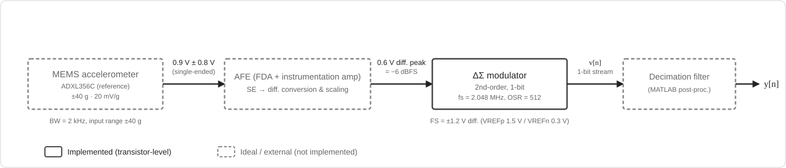
*기준 센서에서 modulator까지의 신호 체인. 센서와 single-ended-to-differential 변환은 ideal로 취급함.*

**Reference sensor** (MEMS 자체는 구현하지 않으므로 datasheet 값을 사용)

| Item | ADXL356C | Source |
|---|---|---|
| Range / sensitivity | ±10 g (80 mV/g) / ±40 g (20 mV/g) | Rev. 0 Table 1 (V1P8ANA에 ratiometric) |
| Output | Single-ended, 0 g = 0.9 V (V1P8ANA / 2), 직렬 저항 32 kΩ | Rev. 0 Table 1 |
| Noise density (±40 g) | 110 $\mu\mathrm{g}/\sqrt{\mathrm{Hz}}$ | Datasheet [1] (±10 g는 80, 제품 페이지 [2]에서는 75) |
| Output BW | 내부 low-pass 1.5 kHz (고정), 공진 약 5.5 kHz | Rev. 0 Table 1 |

- **AFE assumption**: instrumentation amplifier가 센서 출력을 scaling하고 FDA가 이를 differential로 변환함 (±0.8 V single-ended → 0.6 V differential peak, 출력 CM 0.9 V). AFE의 잡음과 오차는 무시함 (Ideal Assumptions 참조).
- **Design BW**: 센서 BW 1.5 kHz에 decimation filter용 transition band 0.5 kHz를 더해 신호 대역을 2 kHz로 정함.

**센서 잡음에서 필요한 해상도** (noise density 110 $\mu\mathrm{g}/\sqrt{\mathrm{Hz}}$)

| Item | Value |
|---|---|
| 센서 잡음 (BW 2 kHz) | 110 $\mu\mathrm{g}/\sqrt{\mathrm{Hz}}$ × $\sqrt{2000}$ $\approx$ 4.92 mg rms ¹ |
| Full scale (40 g peak)에서 센서 SNR | $`20\log(28.3\,\mathrm{g} / 4.92\,\mathrm{mg})`$ $\approx$ 75.2 dB |
| 필요한 ADC 잡음 | 센서 잡음보다 20 dB 이상 낮게 |
| 필요한 SNDR | $\approx$ 95.2 dB ($\approx$ 15.5 bit) |
| 선택한 해상도 | 16 bit (SNDR 98.1 dB) ² |
| 98.1 dB에서 ADC 잡음 (input-referred) | 28.3 g / 80,100 $\approx$ 353 µg rms ($\approx$ 7.9 $\mu\mathrm{g}/\sqrt{\mathrm{Hz}}$) |
| 센서 대비 ADC 잡음 | $\approx$ 22.9 dB 낮음 |

¹ 센서 BW는 1.5 kHz이고 신호 대역은 2 kHz이므로 2 kHz로 적분하면 보수적임 (1.5 kHz로 적분할 때보다 약 1.2 dB 높음).

² 필요한 15.5 bit를 다음 정수 bit로 올림하면 약 3 dB의 마진이 생김.

- 잡음 전력은 더해지므로, 센서보다 20 dB 낮은 ADC가 일으키는 SNR 손실은 약 0.04 dB에 불과함 (10 dB 차이면 약 0.4 dB).

---

## Architecture

### System-level

**Noise budget**: 전체 in-band 잡음의 10 %를 quantization noise에, 90 %를 thermal noise에 할당함 (시작 할당값).

**2차와 OSR 512를 선택한 이유** — in-band quantization noise가 목표 SQNR(= SNDR 98.1 dB + 10 dB $\approx$ 108 dB, noise budget의 10 %를 받으므로)을 만족해야 함 (1-bit quantizer, −6 dBFS 입력, ideal model 기준).

| Order / OSR | Ideal SQNR | Verdict |
|---|---|---|
| 1st / 512 | 71.8 dB | 부족 (약 12 bit) |
| 2nd / 128 | 88.2 dB | 부족 |
| 2nd / 256 | 103.3 dB | 부족 ($k_{eff}$ 적용 시 99.2 dB) |
| **2nd / 512** | **118.3 dB** | 충분 ($k_{eff}$ 적용 시 114.3 dB, ENOB $\approx$ 17) |

- OSR 512의 2차가 16 bit에 도달하는 최소 조합임 (OSR은 2의 거듭제곱으로 탐색).
- 3차 modulator는 OSR을 낮출 수 있지만 OTA가 하나 더 필요해 전력이 늘어남. 1-bit 3차 loop는 발산할 수 있음 (조건부 안정이며 안정 입력 범위가 줄어듦). 따라서 선택하지 않음.

**1 bit를 선택한 이유**
- 1-bit DAC는 레벨이 두 개뿐이므로 **본질적으로 linear**함. DAC element mismatch가 없고 DEM / DWA 같은 보정 logic도 필요 없으며, 이는 16 bit linearity에 중요함. multi-bit loop는 flash quantizer와 매칭된 multi-level capacitor DAC가 필요하고, DAC 비선형이 출력에 그대로 나타남.
- Comparator 하나면 충분하므로 회로가 단순하고 작으며 전력이 낮음.
- 신호 대역이 2 kHz에 불과하여 OSR 512에서도 sampling rate는 2.048 MHz임. 1 bit의 낮은 해상도를 OSR로 보상하는 비용이 작음.

**Quantization noise modeling**
- 입력이 −6 dBFS, differential peak 0.6 V이므로 $P_{signal} = 0.18\ \mathrm{V^2}$임. 여기에 OSR 512를 선택함 (ENOB $\approx$ 17).
- In-band quantization noise (Taylor approximation) [3]:

```math
IBQN=\frac{\pi^{2L}\,\Delta^2}{12\,(2L+1)\,OSR^{2L+1}}
```

- 1-bit quantizer의 effective gain은 $k_{eff} = 0.628$임 (behavioral simulation에서 $y\cdot v$ covariance로 추출). $IBQN_{actual} = IBQN / k_{eff}^2$이며, 이 값으로도 ENOB 17이 확인됨.


*Modulator의 discrete-time model. 실선 박스는 트랜지스터 레벨로 구현, 점선 박스는 ideal 가정.*

- Fully-differential, 2nd-order, 1-bit CIFB 구조 ($a_1$ = 0.3, $c_2$ = 0.6, $a_2$ = 0.36)

**Coefficients**
- $x_1$, $x_2$는 1st, 2nd integrator의 출력임. 표준 MOD2의 $x_1$, $x_2$에 scaling 계수 $s_1$, $s_2$를 적용하면 계수는 $a_1 = s_1$, $c_2 = s_2 / s_1$, $a_2 = 2 s_2$가 됨.

**Dynamic range scaling**
- Dynamic range scaling (허용 최대 입력 −3 dBFS 기준): 표준 MOD2의 integrator 출력은 $\max\lvert x_1\rvert \approx 3.17$, $\max\lvert x_2\rvert \approx 6.27$에 달함. $s_1 = 0.3$, $s_2 = 0.18$로 scaling하면 bitstream은 그대로이고 swing은 0.95 / 1.13으로 줄어듦 (한계 1.0 / 1.2: 1.0은 full scale이고, $x_2$의 1.2는 OTA 2 출력 swing이 reference 범위보다 넓어야 하는 가정 한계임).
- 일반적인 −6 dBFS 입력에서는 swing이 더 작아 $\max\lvert x_1\rvert \approx 0.82$, $\max\lvert x_2\rvert \approx 0.76$임. 계수를 worst-case 입력 기준으로 정했으므로 margin이 있음.


*Dynamic range scaling 전후의 integrator 출력 swing (−3 dBFS 입력).*

**블록별 구현 방식**

| Block | Implementation |
|---|---|
| Integrator (× 2) | $C_s$와 $C_d$가 분리된 fully differential, parasitic-insensitive SC integrator; 2-stage Miller OTA |
| 1-bit DAC | $\phi_2$에서 출력 bit에 따라 $C_d$를 VREFp / VREFn에 연결 |
| Quantizer | Comparator + DFF (ideal model) |
| Offset / flicker noise | 1st integrator에 chopper ($f_{ch} = f_s / 2$) |
| CMFB | OTA 출력은 SC CMFB, OTA 1단은 resistive CMFB |
| Switch | Bootstrap (입력 sampling), TG (VCM, summing node, chopper), 단일 MOS (DAC reference) |
| Clock | Early phase가 있는 two-phase non-overlapping clock (bottom-plate sampling); source는 ideal |

### Ideal Assumptions

트랜지스터 레벨 대신 ideal로 모델링한 블록과 그 계획.

| Block | Modeled as | Planned implementation |
|---|---|---|
| Comparator | Ideal comparator + DFF | StrongARM + SR latch |
| Bias current | Ideal current source | Constant-gm bias |
| VREF / VCM generation | Ideal voltage sources (1.5 V / 0.3 V / 0.9 V) | Reference buffer |
| Clock generator | Ideal non-overlapping clocks | Digital clock generator (chopper clock: $f_s/2$ divider) |
| Sensor AFE | Instrumentation amplifier + FDA, ideal (±0.8 V → 0.6 V differential peak) | INA + FDA |
| Device noise | Transient simulation에 포함하지 않음 | ngspice `trnoise`로 주입 (Verification 참조) |

### Transistor-level Blocks

#### OTA
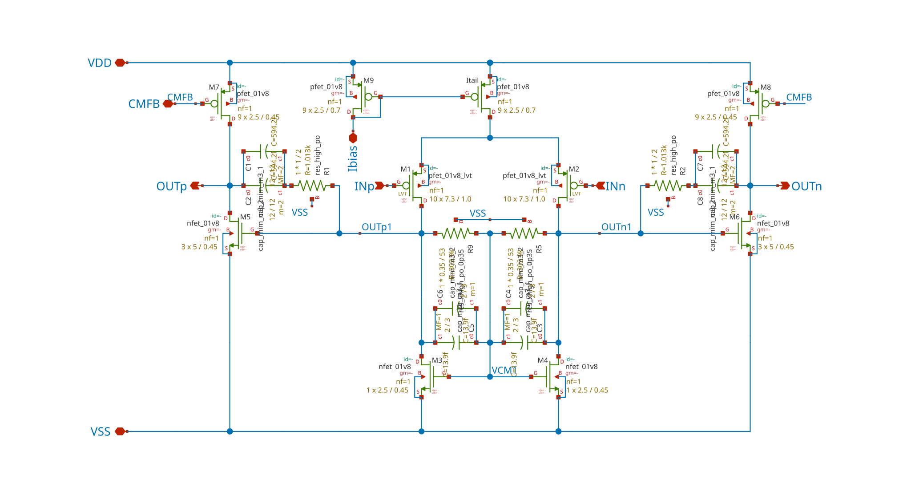
*1st integrator의 OTA, 1단과 2단 사이에 chopper CH2가 있음 (*$C_c$ *= 1.19 pF)*

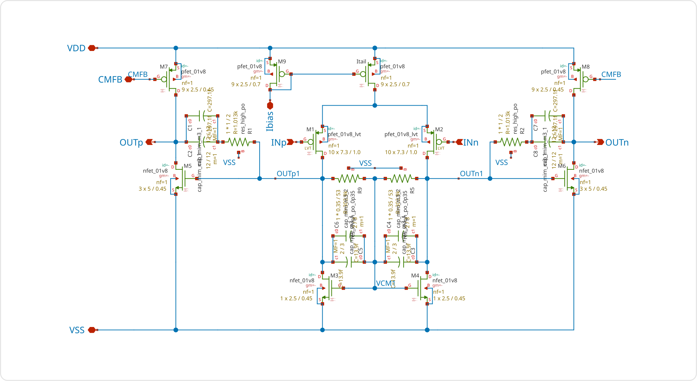
*2nd integrator의 OTA (*$C_c$ *= 0.59 pF)*

- 2-stage OTA, PMOS (LVT) 입력 쌍, nulling resistor를 사용한 Miller compensation
- 설계 목표: DC gain ≥ 45.3 dB, GBW ≥ 17.6 MHz, PM $\approx$ 65.5° (Circuit-level Requirements 참조)
- Transistor size와 operating point는 Circuit-level Requirements (OTA 전류, $g_m$, transistor sizing)에 있음.

#### CMFB
SC CMFB 회로는 아래의 SC Integrator schematic에 포함되어 있음.

- **OTA 2nd stage (출력단)**: SC CMFB (static power가 없고 출력 swing 손실이 없으며, clock이 이미 있음. output CM 목표 0.9 V).
- **OTA 1st stage**: resistive CMFB. 저항은 약 300 kΩ (302.9 kΩ, res_xhigh_po)으로, DC gain이 스펙을 만족하는 범위에서 면적을 줄이려고 5 MΩ에서 낮췄음. capacitor는 대략적으로 size했으며 (13.9 fF × 2) 더 이상 최적화하지 않음.
- **SC CMFB capacitor (OTA 출력단)**: 출력 node 쪽 약 517 fF, VCM / Vbias 쪽 약 139 fF.
- **Output CM**: SC CMFB reference를 $V_{bias}$로 trim함. 최종 값은 $V_{bias}$ = 0.62 V (1st integrator, output CM 0.9017 V), $V_{bias}$ = 0.69 V (2nd integrator).

#### SC Integrator
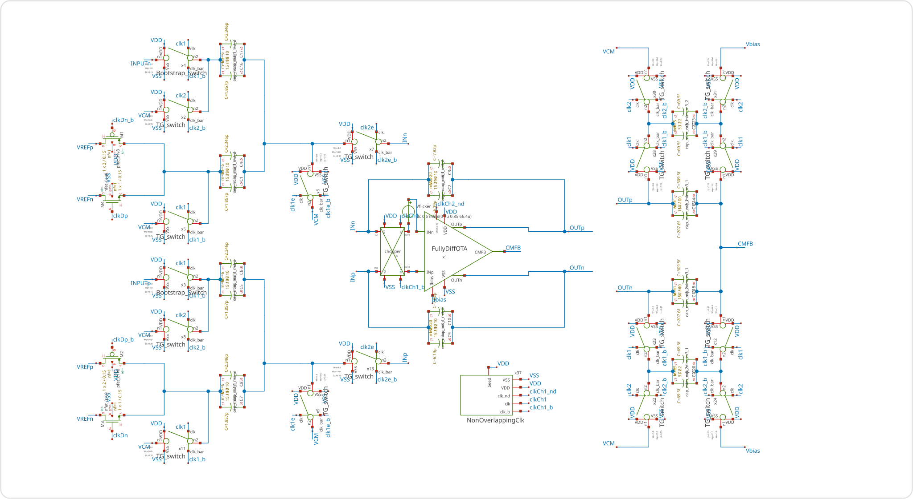
*1st integrator (*$C_s = C_d$ *= 4.2 pF,* $C_i$ *= 14.0 pF)*

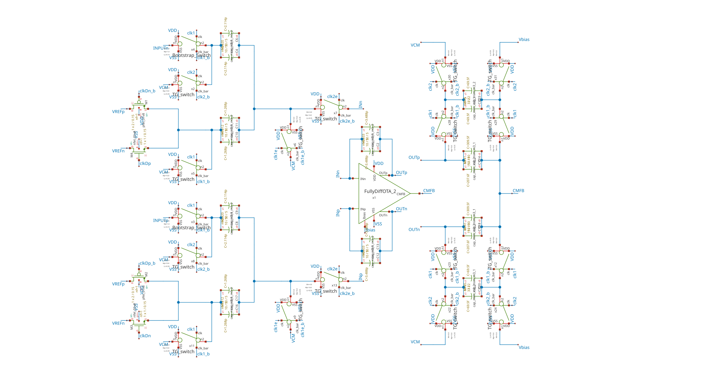
*2nd integrator (*$C_s : C_d : C_i$ *= 4.23 : 2.54 : 6.98 pF)*

- sampling($C_s$)과 DAC($C_d$) capacitor가 분리된 fully-differential, parasitic-insensitive SC integrator
- $\phi_1$, $\phi_2$보다 먼저 꺼지는 early phase ($\phi_{1e}$, $\phi_{2e}$)를 사용한 bottom-plate sampling (Clocking 참조)
- Capacitor ratio 정확도: 동일한 MIM unit cell을 적층 (cap_mim_m3_1 + cap_mim_m3_2)하고 unit 개수로 비율을 정함.

#### Chopper (1st integrator)
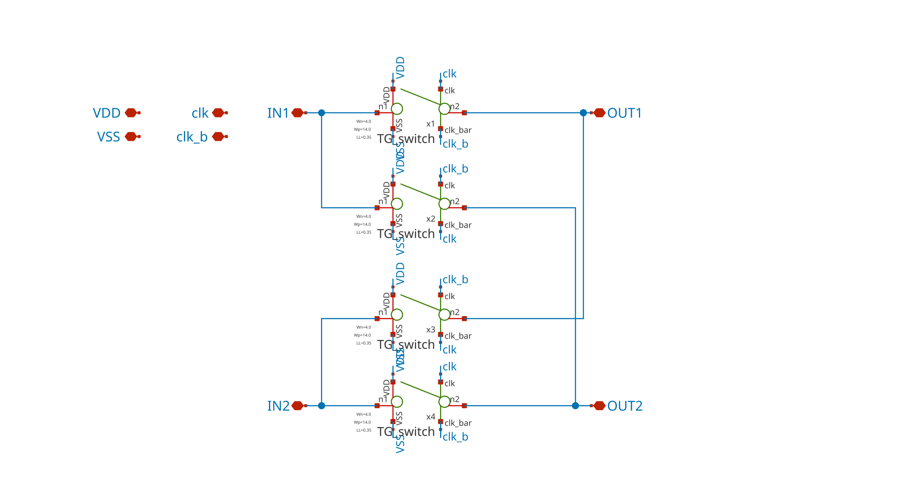
*Chopper (4 TGs, 경로당 2개)*

- OTA의 offset과 flicker noise가 chopper 주파수로 변조되어 신호 대역에서 제거됨.
- **Chopper 두 개**: CH1은 OTA 입력(summing node)에, CH2는 OTA 내부의 1단 출력(`OUTp1` / `OUTn1`)과 2단 gate(`ChOUTp1` / `ChOUTn1`) 사이에 있음. Miller 보상은 2단만 감싸므로 OTA 출력과 Miller capacitor는 flip되지 않음. Chopper는 1st integrator에만 있고, 2단과 SC CMFB는 CH2 밖에 있음.
- **CDS를 쓰지 않은 이유**: Correlated double sampling도 discrete-time 회로에서 offset과 flicker noise를 잘 억제하지만, 추가 capacitor가 필요해 OTA phase margin을 처음부터 다시 설계해야 함. chopper는 신호 경로에 capacitance를 더하지 않으므로 OTA 설계를 그대로 유지할 수 있음.
- Clock $\phi_{ch}$ (`clkCh`, $f_{ch} = f_s / 2$)의 극성은 $\phi_1$ 중간에 전환되며, integration 중에는 전환되지 않음. $f_s/2$는 사용할 수 있는 가장 높은 chopping 주파수이며 sampling clock과 동기됨.

#### Switches (Bootstrap / TG)

*Bootstrap switch*

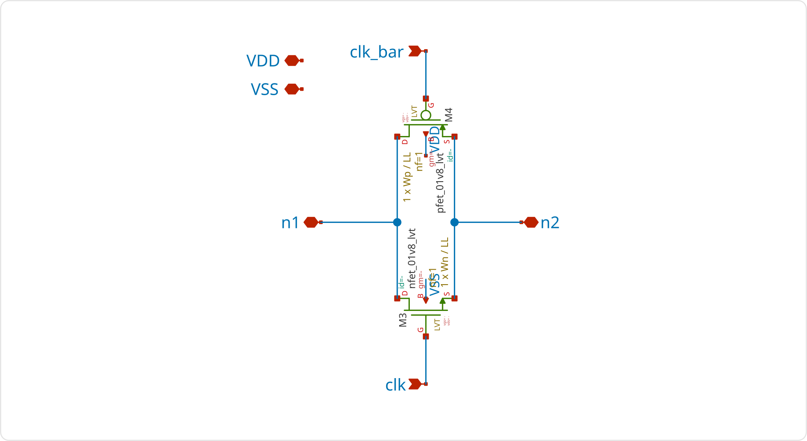
*Transmission-gate switch (LVT)*

측정한 $R_{on}$ 곡선은 Verification의 2번(Switches)에 있음.

| Location | Switch | Reason |
|---|---|---|
| Input sampling | Bootstrap NMOS (nfet_01v8 1 × 1 / 0.15, bootstrap capacitor $\approx$ 203 fF) | 신호 의존적 $R_{on}$ 변동(distortion)을 최소화 [5] |
| Fixed nodes (VCM, $\phi_{1e}$ / $\phi_2$) | TG, LVT (Wn 3 / Wp 10 / L 0.35) | node 전압이 고정되어 linearity가 필요 없으므로 worst-case $R_{on}$ (0.9 V에서)만 만족하면 됨 |
| Signal path, OTA의 summing-node side ($\phi_{2e}$) | TG, LVT (Wn 4 / Wp 14 / L 0.35) | 고정된 virtual-ground node, OTA loop 안 → 낮은 $R_{on}$ 필요 |
| DAC references (VREFp / VREFn) | Basic switches: PMOS (1 × 2 / 0.15) → VREFp, NMOS (1 × 1 / 0.15) → VREFn | reference가 VDD / VSS에 가까우므로 단일 PMOS / NMOS로 충분하며 면적이 최소 |
| Chopper | TG, LVT (Wn 4 / Wp 14 / L 0.35) × 4 | chopper는 charge-transfer 경로 밖에 있으므로 $R_{on}$ 요구가 완화됨 (Architecture의 Chopper 참조) |

- Fixed node용 TG (3 / 10 / 0.35 µm)는 별도로 시뮬레이션하지 않음.

#### Clocking
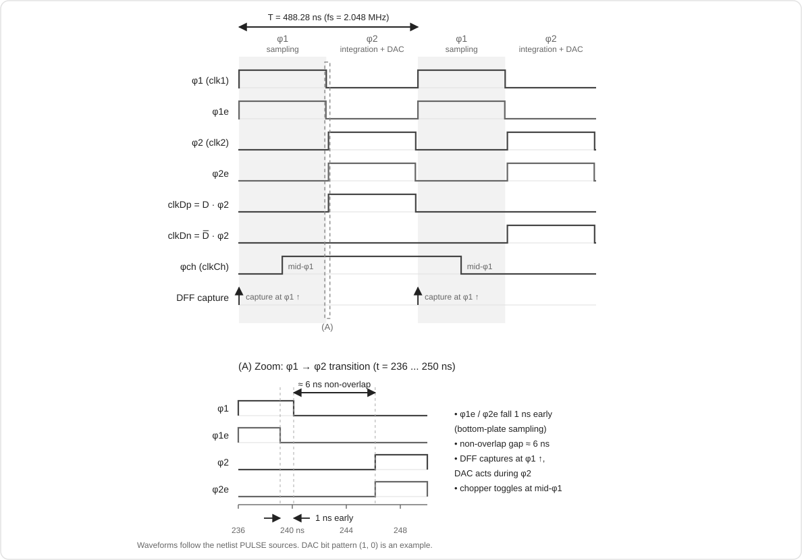<br>
*Modulator의 clock timing (*$f_s$ *= 2.048 MHz,* $T$ *= 488.28 ns). (A)는* $\phi_1 \to \phi_2$ *천이를 확대한 것.*

| Clock | High interval (within one period) | Purpose |
|---|---|---|
| $\phi_1$ | about 2–240 ns | Sampling |
| $\phi_{1e}$ | about 2–239 ns | $\phi_1$보다 1 ns 먼저 꺼짐 |
| $\phi_2$ | about 246–484 ns | Integration + DAC |
| $\phi_{2e}$ | about 246–483 ns | $\phi_2$보다 1 ns 먼저 꺼짐 |
| $\phi_{ch}$ (`clkCh`) | 두 주기마다 한 번 toggle ($f_s/2$) | Chopper, $\phi_1$ 중간에 toggle |

- Two-phase non-overlapping clock. gap은 $\phi_1 \to \phi_2$와 $\phi_2 \to$ 다음 $\phi_1$ 모두 약 6 ns임.
- $\phi_{1e}$ / $\phi_{2e}$는 $\phi_1$ / $\phi_2$보다 1 ns 먼저 꺼짐. summing-node 쪽 switch가 먼저 열려 charge가 고정되므로 bottom-plate sampling이 됨.
- chopper는 120 ns + $k\cdot$488.28 ns, 즉 모든 $\phi_1$의 중간에서 toggle하며 integration 중에는 toggle하지 않음.
- 각 블록 내부에서 위상 clock과 DAC clock은 NAND2 + INV를 거쳐 `clk` / `clk_b`(TG에 필요한 정확한 반전 신호)를 생성함. DAC를 쓰지 않는 경로에도 dummy NAND2를 두어 모든 경로의 delay를 같게 맞춤. `Seed`는 clock cell의 첫 NAND의 두 번째 입력임. DAC clock에서는 DAC bit가 여기로 들어가고, 다른 clock에서는 VDD에 묶어 NAND를 같은 delay의 inverter로 씀. Chopper clock은 예외임 (다음 항목).
- **Chopper clock에는 non-overlapping clock generator(NOC)를 씀.** NAND + INV 구조는 inverter 지연(약 143 ps)만큼 overlap이 생김. Chopper에서는 그동안 직선 경로와 교차 경로가 함께 켜져 OUTp와 OUTn이 short되고 $C_i$의 전하가 재분배됨 (Integrator 참조). 그래서 CH1과 CH2는 각각 자기 generator(`NonOverlappingClk`: NAND, 교차 결합 NOR 쌍, 지연 chain, 측정 gap 약 280 ps)를 가지며 같은 `clkCh_nd`로 구동됨. Chopper 안의 TG 4개는 4위상을 씀. `clk` / `clk_b`가 NMOS gate를, 그 반전인 `phiA` / `phiB`가 PMOS gate를 구동하므로 gap 동안 두 PMOS가 모두 꺼짐.
- DAC clock: $\mathrm{clkDp} = D\cdot\phi_2$, $\mathrm{clkDn} = \bar{D}\cdot\phi_2$ ($D$ = DFF 출력 bit)
- Quantization: B-source comparator → DFF (`dfxbp_1`). DFF는 $\phi_1$의 rising edge에서 bit를 capture하고, 이 bit가 같은 주기의 $\phi_2$에서 DAC를 구동함.

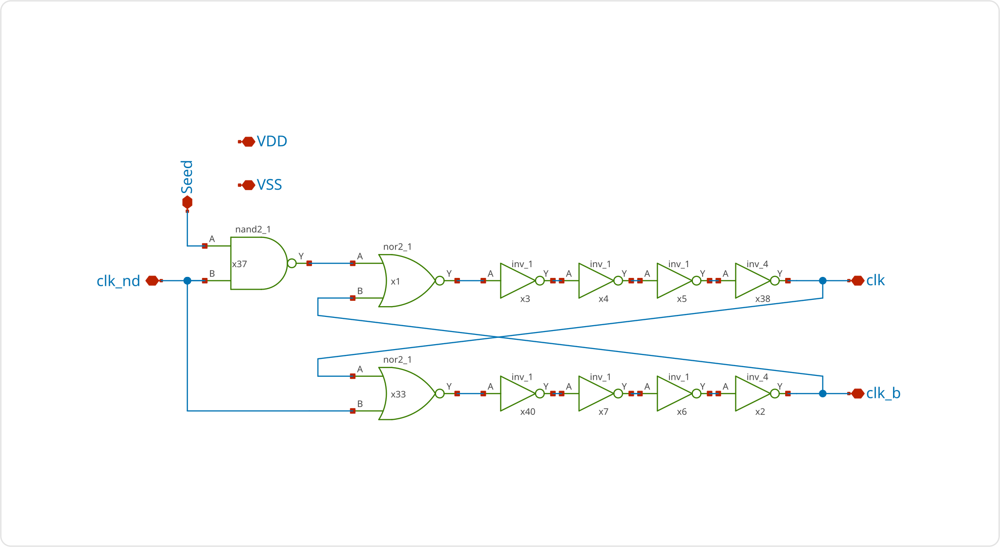
*Chopper clock용 non-overlapping clock cell (`Seed`는 VDD에 연결).*

---

## Circuit-level Requirements

### Capacitors (kT/C)
- kT/C model [4], 2 branches × 2 phases × 2 sides: $C_{s,min} = \dfrac{8kT}{P_{thermal}\cdot OSR}$ → **최소 2.57 pF**
- margin을 두어 $C_s$ $\approx$ 4 pF로 설계했고 구현값은 4.2 pF임. 이때 kT/C noise는 $\approx$ 1.6e-11 V²임. 최소값 2.57 pF에서는 kT/C noise만으로 thermal budget 전체(2.5e-11 V²)를 쓰게 되며, 4 pF에서는 약 64 %를 쓰고 나머지를 OTA 잡음에 남김.
- 나머지 capacitor는 scaling 계수에서 정함 (입력 / DAC 계수 = $C_s / C_i = C_d / C_i$).

| Stage | Coefficients | Capacitor ratio | Value |
|---|---|---|---|
| 1st | $a_1 = s_1 = 0.3$ | $C_s : C_d : C_i$ = 6 : 6 : 20 | 4.20 / 4.20 / 14.0 pF (unit 0.70 pF) |
| 2nd | $c_2 = s_2/s_1 = 0.6$, $a_2 = 2 s_2 = 0.36$ | $C_{s2} : C_{d2} : C_{i2}$ = 20 : 12 : 33 ($\approx$ 15 : 9 : 25) | 4.23 / 2.54 / 6.98 pF (unit 0.21 pF) |

- 비율은 동일한 개수의 MIM unit cell로 구현함.
- 2nd stage의 capacitor는 noise로 정해진 값이 아님: 2nd stage의 noise는 1st integrator의 gain만큼 감쇠되므로 더 작게 할 수 있음 (다음 단계, Limitations 참조).
- Capacitor 비율이 회로의 계수를 정함. 1st stage는 $C_s / C_i = C_d / C_i$ = 6 / 20 = 0.3으로 정확히 $s_1$과 같음.
- 2nd stage는 $c_2 = C_{s2}/C_{i2}$ = 20 / 33 = 0.606, $a_2 = C_{d2}/C_{i2}$ = 12 / 33 = 0.364로, 0.6, 0.36보다 각각 1.01 % 큼. 이는 $s_2$ = 0.1818과 같으므로 NTF(DC의 zero)와 SQNR은 변하지 않고 (두 경우 모두 115.6 dB) $x_2$의 swing만 1 % 커짐 (−3 dBFS에서 $\max\lvert x_2\rvert$ = 1.14, 한계 1.2).

### DC gain
**1) Finite gain → integrator leakage**

```math
I_i(z)=\frac{z^{-1}}{1-p_i z^{-1}},\qquad p_i=1-\mu_i,\qquad \mu_i=\frac{g_i}{A_0}
```

- $g_i$ = summing node에 연결된 capacitor 비의 합 (입력 계수 + DAC 계수), 기생 capacitance는 무시
- 1st: $g_1 = s_1 + s_1 = 0.6$, 2nd: $g_2 = s_2/s_1 + 2 s_2 = 0.96$

**2) NTF zero의 이동 (저주파 근사)**

```math
D(z)=(z-p_1)(z-p_2)=(z-1)^2+(\mu_1+\mu_2)(z-1)+\mu_1\mu_2
```

```math
|\Delta NTF(e^{j\omega})|^2\approx(\mu_1+\mu_2)^2\,\omega^2
```

- 두 stage는 하나의 effective leakage $\mu_{eff} = \mu_1 + \mu_2 = (g_1 + g_2) / A_0$로 작용함.

**3) In-band quantization noise 적분** ($\omega_B = \pi / OSR$)

```math
IBQN=IBQN_{ideal}+\Delta IBQN,\qquad \Delta IBQN=\frac{\Delta^2}{12k_{eff}^2}\cdot\frac{\pi^2(\mu_1+\mu_2)^2}{3\,OSR^3}
```

**4) 허용 $\mu$**: $\Delta IBQN$ = 1.94e-12 − 4.68e-13 = 1.48e-12 (normalized; 1.94e-12는 목표 SQNR 108.1 dB에서 허용되는 quantization noise이며, signal power는 FS = 1 단위로 0.125)

```math
\mu_{max}=\frac{6\,k_{eff}\,OSR^{3/2}\sqrt{\Delta IBQN}}{\pi\,\Delta}=8.4\times10^{-3}
```

**5) 최소 DC gain**

```math
A_0\ge\frac{g_1+g_2}{\mu_{max}}=\frac{0.6+0.96}{8.4\times10^{-3}}\approx186\;(45.3\text{ dB})
```

- 정확한 (root-sum-square) 형태는 $\sqrt{g_1^2 + g_2^2} / \mu_{max} \approx 135$ (42.6 dB)이므로, 위 근사는 약 2.7 dB 보수적임.

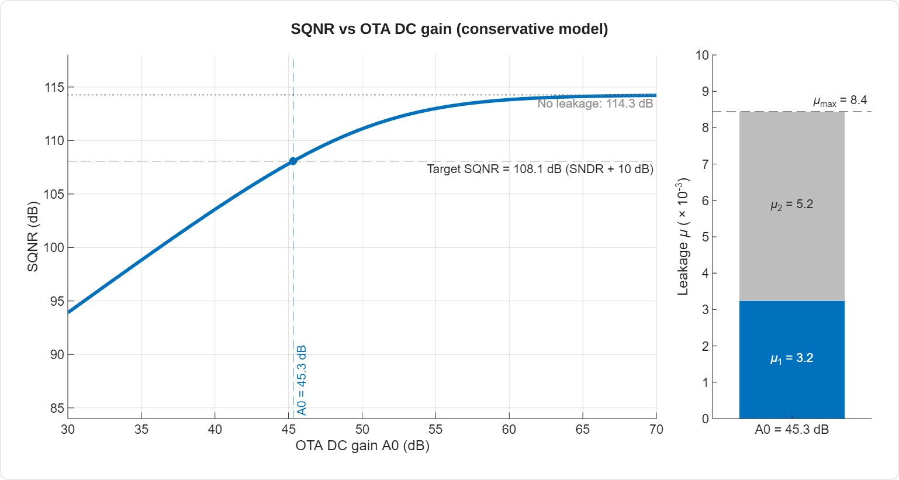
*OTA DC gain에 따른 SQNR (보수적 모델,* $\mu_1 + \mu_2$*)과 스펙 gain에서 각 stage의 leakage 기여.*

**Topology** — 2-stage Miller OTA를 쓴 이유는 위의 DC gain과 출력 swing 두 가지임. Integrator 출력은 1.8 V 전원에서 약 0.3–1.5 V를 움직여야 하므로 (Target Spec 참조) 위아래로 약 0.3 V씩만 남음. 따라서 출력단에 cascode를 쓸 수 없고, gain은 두 stage로 얻음.

### GBW (Settling)
**1) 2차 시스템의 step response와 error envelope** (underdamped, damping ratio $\zeta$, natural frequency $\omega_n$)

```math
v(t)=1-\frac{e^{-\zeta\omega_n t}}{\sqrt{1-\zeta^2}}\sin(\omega_d t+\phi)\;\;\Rightarrow\;\;\varepsilon(t)\le\frac{e^{-\zeta\omega_n t}}{\sqrt{1-\zeta^2}}
```

**2) Error budget** — settling error를 $N = 16$ bit에서 1/2 LSB로 제한

```math
\varepsilon_{max}=2^{-(N+1)}=7.63\times10^{-6}
```

**3) 필요한 time constant 수 $n_\tau$**

```math
\zeta\omega_n T_{settle}\ge\ln\frac{1}{\varepsilon_{max}}+\ln\frac{1}{\sqrt{1-\zeta^2}}=n_\tau
```

**4) $\zeta = 0.707$ 선택 (PM $\approx$ 65.5°)** — 위에서 정한 2-stage OTA(second pole $\omega_{p2}$)에서 loop gain은 다음과 같음

```math
L(s)=\frac{\omega_u}{s\left(1+s/\omega_{p2}\right)},\qquad \omega_u=2\pi\beta\,GBW
```

```math
\omega_n^2=\omega_u\,\omega_{p2},\qquad \zeta=\frac{\omega_n}{2\omega_u}\;\Rightarrow\;\zeta=\tfrac{1}{\sqrt2}:\;\; \omega_{p2}=2\omega_u,\;\; \zeta\omega_n=\omega_u
```

- maximally flat (Butterworth) 응답임. Step 응답에 작은 overshoot ($\approx$ 4.3 %)가 있으며, 빠른 settling을 위한 일반적인 선택임.
- $\zeta = 1/\sqrt{2}$일 때 time constant 수는 $n_\tau$ = 11.78 + 0.35 = **12.13**임.

**5) GBW 요구사항**

```math
n_\tau=\omega_u T_{settle}=2\pi\beta\,GBW\,T_{settle}\;\Rightarrow\;GBW\ge\frac{n_\tau}{2\pi\beta\,T_{settle}}
```

- $\beta$: 1st integrator의 feedback factor (capacitor 비와 scaling 계수로 정해지며 약 0.6)
- $T_{int} = 1 / (2f_s)$ = 244 ns 중 75 %를 linear settling에 쓰므로 $T_{settle}$ = 183 ns임. 나머지 25 %는 slewing에 씀 (이 배분은 설계 선택임).
- $`GBW \ge 12.13 / (2\pi \cdot 0.6 \cdot 183\,\mathrm{ns})`$ = **17.6 MHz**

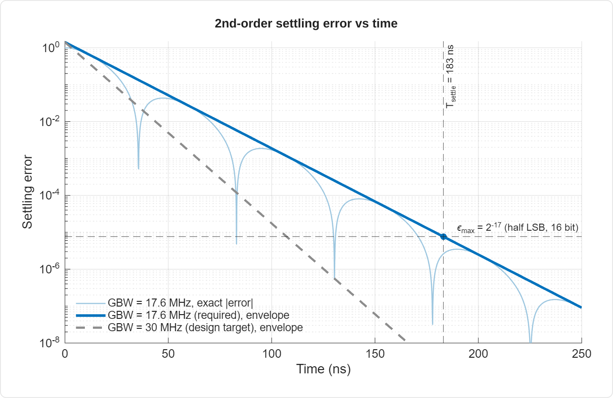
*2차 응답의 settling error envelope와 1/2 LSB 한계.*

### Slew rate
**1) Worst-case step** — 1st integrator는 입력 peak와 DAC reference의 극성이 반대일 때 한 phase 안의 출력 변화가 최대가 됨 (single-ended)

```math
\Delta V_{max}=s_1\,(A_{in}+V_{ref})=0.3\times(0.3+0.6)=0.27\;\text{V}
```

- $A_{in}$ = 0.3 V (일반 −6 dBFS 입력, single-ended peak), $V_{ref}$ = 0.6 V ($V_{REFp} - V_{CM}$)

**2) 시간 배분** — phase 시간 $T_{int}$ = 244 ns 중 25 %를 slewing($T_{slew}$ = 61 ns)에, 75 %를 linear settling(183 ns, GBW 도출과 동일)에 할당함. 이 배분은 설계 선택임.

**3) 필요한 slew rate**

```math
SR\ge\frac{\Delta V_{max}}{T_{slew}}=\frac{0.27\text{ V}}{61\text{ ns}}=\mathbf{4.42\;V/\mu s}\;\;(+50\%\text{ margin}: 6.64\;V/\mu s)
```

- 과입력(센서 출력이 −3.5 dBFS까지)에서 생기는 추가 step은 포함하지 않음. 설계는 일반 −6 dBFS 입력 기준임.

### OTA 전류, $g_m$, transistor sizing
**1) 2-stage Miller OTA의 slew current 조건**

```math
I_{tail}\ge SR\cdot C_c,\qquad I_{out}\ge SR\cdot(C_c+C_L)
```

- $C_s$ = 4 pF에서 effective load는 $C_L$ $\approx$ 6.8 pF × 1.2 margin이고, $C_c / C_L = 0.15$로 $C_c$ $\approx$ **1.22 pF**임.
- $C_L$은 OTA 출력에서 본 총 capacitance로, 출력의 CMFB capacitor, feedback 경로의 capacitor, 다음 stage의 $C_s$ 등이 대략 여기에 해당함.
- 최소 slew current: $I_{tail}$ ≥ 5.4 µA, $I_{out}$ ≥ 35.5 µA

**2) GBW로부터 $g_m$** — 목표 GBW 30 MHz (요구 17.6 MHz 대비 약 1.7× margin)

```math
g_{m1}=2\pi\cdot GBW\cdot C_c\approx231\;\mu S,\qquad g_{m2}=\frac{g_{m1}}{C_c/C_L\text{ ratio}}=\frac{g_{m1}}{0.15}\approx1540\;\mu S
```

**3) Currents** [7] — $g_m/I_D = 15$는 다음 순서로 선택함. 먼저 Miller pole splitting의 pole 근사 조건을 만족하도록 $C_{gg}$를 정하고, 그로부터 $f_T$를 구한 뒤 $g_m/I_D$를 결정함.

```math
I_{tail}=\frac{2g_{m1}}{15}\approx30.8\;\mu A,\qquad I_{out}=\frac{g_{m2}}{15}\approx102.5\;\mu A
```

- 이 값들은 최소 slew current (5.4 / 35.5 µA)보다 약 3–6배 크므로 **$g_m$ 조건이 지배적**이며 slew 요구는 자동으로 만족됨.
- 이 전류들의 도출 순서: kT/C가 capacitor를 정하고, capacitor가 load $C_L$을 정하고, $C_L$이 $C_c$를 정하고, $C_c$와 $C_L$이 $g_m$과 전류를 정함. OTA 2는 $C_c$가 더 작아서 (0.59 pF 대 1.19 pF) 전류가 약 절반임.

**Transistor sizes** (1st와 2nd integrator의 OTA는 compensation capacitor를 제외하면 구조와 size가 동일; m × W / L [µm])

| Device | Role | Type | Size |
|---|---|---|---|
| Itail, M9 | 1st-stage tail current source / bias mirror | pfet_01v8 | 9 × 2.5 / 0.7 |
| M1, M2 | Input pair | pfet_01v8_lvt | 10 × 7.3 / 1.0 |
| M3, M4 | 1st-stage load | nfet_01v8 | 1 × 2.5 / 0.45 |
| M5, M6 | 2nd-stage driver | nfet_01v8 | 3 × 5 / 0.45 |
| M7, M8 | 2nd-stage current source (SC CMFB controlled) | pfet_01v8 | 9 × 2.5 / 0.45 |
| R1, R2 | Nulling resistor | res_high_po | 1 kΩ (1.013 kΩ) |
| R5, R9 | 1st-stage resistive CMFB | res_xhigh_po_0p35 | 302.9 kΩ |
| C3–C6 | 1st-stage CMFB capacitors | cap_mim_m3_1 + m3_2 | 13.9 fF × 2 |
| $C_c$ | Miller compensation | cap_mim_m3_1 + m3_2 | 1st OTA 594.2 fF × 2 ($\approx$ 1.19 pF), 2nd OTA 297.1 fF × 2 ($\approx$ 0.59 pF) |

- M3 / M4의 면적은 약 1.1 µm²에 불과하므로 OTA flicker noise가 이 소자들에 집중됨 (Noise analysis 참조).
- 1st OTA의 $C_c$ ($\approx$ 1.19 pF)는 modeling 값 ($\approx$ 1.22 pF)과 일치함.
- OTA 전류의 합 (약 232 µA + 121 µA)에 bias branch를 더하면 VDD에서 측정한 380 µA와 일치함.
- OTA 1의 소자 operating point (`.op`, 25 °C; 모든 소자가 saturation, $V_{DS} > V_{dsat}$):

| Device | $I_D$ | $g_m$ | $g_m/I_D$ | $V_{dsat}$ | $V_{DS}$ |
|---|---|---|---|---|---|
| Itail | 29.4 µA | 0.312 mS | 10.6 | 0.163 V | 0.382 V |
| M1, M2 (input pair) | 14.69 µA | 0.211 mS | 14.4 | 0.095 V | 0.652 V |
| M3, M4 (1st-stage load) | 14.69 µA | 0.180 mS | 12.2 | 0.131 V | 0.767 V |
| M5, M6 (2nd-stage driver) | 101.5 µA | 1.198 mS | 11.8 | 0.135 V | 0.902 V |
| M7, M8 (2nd-stage current source) | 101.5 µA | 0.776 mS | 7.6 | 0.232 V | 0.898 V |
| M9 (bias mirror) | 30.8 µA | 0.327 mS | 10.6 | 0.164 V | 1.129 V |

  입력 쌍은 작은 전류로 transconductance를 얻어야 하므로 $g_m/I_D$가 가장 큼 (moderate inversion). PMOS current source M7 / M8은 noise 기여를 줄이려고 $g_m/I_D$를 가장 작게 함.

### Switch $R_{on}$
**1) Error budget → 필요한 RC time constant 수** — sampling 중 RC settling error를 1/2 LSB로 제한 ($N = 16$ bit)

```math
e^{-t/\tau}\le 2^{-(N+1)}\;\Rightarrow\;\frac{t}{\tau}\ge N_{err}=(N+1)\ln2=11.78
```

**2) 시간과 load capacitance** — phase 시간 244 ns를 10 ns 단위로 내림하여 $t$ = 240 ns. 같은 switch가 $C_s$와 $C_d$를 구동하므로 $C_{eff} = C_s + C_d$.

**3) $R_{on}$ 한계**

```math
R_{on}\le\frac{t}{N_{err}\,(C_s+C_d)}
```

| Condition | $C_{eff}$ | $R_{on}$ limit |
|---|---|---|
| $C_s = C_d$ = 4.2 pF (구현값) | 8.4 pF | **2.43 kΩ** |

- Switch 종류(TG, bootstrap, 단일 MOS)는 위치에 따라 다름 (Architecture의 Switches 참조). 시정수가 settling을 제한하지 않도록 $R_{on}$은 시뮬레이션으로 정함.

### Chopper
- **추가한 이유**: chopper가 없으면 OTA의 flicker noise가 in-band noise를 지배함: 1.9e-8 V² (SNR 69.8 dB)로, kT/C의 1.53e-11 V² (100.7 dB)와 비교됨. OTA flicker noise만으로 SNDR이 약 70 dB로 제한됨 (Verification의 Noise analysis 참조).
- 1st OTA의 input-referred flicker noise (`.noise`, $I_{tail}$ = 30.8 µA, chopper 없음)는 1 Hz에서 17.9 µV/√Hz, 1 kHz에서 0.98 µV/√Hz로 $f^{-0.84}$를 따름. 1 Hz – 2 kHz 대역에서는 4.7e-9 V²임 (capacitor ratio 적용 전).
- Chopper switch: summing-node switch와 같은 TG (Wn 4 / Wp 14 / L 0.35 µm). Chopper는 charge-transfer 경로 밖에 있으므로 $R_{on}$ 요구가 완화됨.

### Derived spec summary
| Item | Required (modeling) | Design |
|---|---|---|
| Order / quantizer | 2nd / 1-bit | CIFB |
| $f_s$ / OSR / BW | — | 2.048 MHz / 512 / 2 kHz |
| Scaling $a_1$ / $c_2$ / $a_2$ | $\max\lvert x_1\rvert \le 1$, $\max\lvert x_2\rvert \le 1.2$ | 0.3 / 0.6 / 0.36 ($s_1$ = 0.3, $s_2$ = 0.18) |
| Quantizer gain $k_{eff}$ | — | 0.628 |
| In-band Q noise | — | 4.68e-13 (FS = 1; 6.7e-13 V²), SQNR 114.3 dB |
| Q : thermal budget | 1 : 9 | Q 2.8e-12 V² / thermal 2.5e-11 V² |
| 1st stage $C_s$ | ≥ 2.57 pF | 4.2 pF (4 pF designed) |
| OTA DC gain | ≥ 45.3 dB | |
| OTA GBW | ≥ 17.6 MHz | |
| Phase margin | $\approx$ 65.5° | |
| Slew rate | ≥ 4.42 V/µs (+50 %: 6.64) | |
| Switch $R_{on}$ (sampling) | ≤ 2.43 kΩ | Bootstrap 1 / 0.15 µm |
| Switch $R_{on}$ (summing node) | $\approx$ 0.5 kΩ | TG 4 / 14 / 0.35 µm |
| Supply / power | 1.8 V / 684 µW | |

---

## Verification

모든 결과는 ngspice simulation에서 얻음 (OTA는 AC, 나머지는 transient). 별도 언급이 없으면 $C_s$ = 4.2 pF 기준임.
Chopper를 수정하기 전의 회로(2번째 chopper가 OTA 출력에 있고, Miller capacitor가 두 stage를 감싸던 회로)를 기준으로 한 절: OTA verification (1), 첫 설계의 modulator spectrum과 SNDR (6). 이들의 netlist와 그림은 다시 만들지 않았음. Chopper 시험 (3)과 1st integrator 시험 (4)은 수정한 회로로 다시 했음.

### 1. OTA (standalone)
Loop를 DC에서만 닫은(inductor) OTA의 closed-loop AC 시뮬레이션, 25 °C, tt (OTA 1은 `tb_FD_OTA`, OTA 2는 같은 testbench에 OTA 2 적용). Loop gain은 $T = A\beta$이고, crossover와 phase margin은 $|T|$ = 0 dB에서 읽음. Feedback factor는 OTA 1이 $\beta_1$ = 0.6 (testbench의 capacitor network로 측정), OTA 2가 $\beta_2 = C_{i2} / (C_{s2} + C_{d2} + C_{i2})$ = 33 / 65 = 0.508 (unit capacitor와 무관)임. OTA 2 testbench는 아직 $\beta$ = 0.6을 쓰므로 loop gain에 0.508 / 0.6을 곱함 (phase는 동일).

| Metric | Required | OTA 1 | OTA 2 |
|---|---|---|---|
| DC loop gain (`dc_loop_gain_db`) | ≥ 45.3 dB | 58.5 dB | 55.3 dB |
| Loop crossover $f_{u,loop}$ | ≥ 10.6 / 8.9 MHz ¹ | 14.57 MHz | 13.28 MHz |
| Phase margin | $\approx$ 65.5° ($\zeta$ = 0.707) | 65.0° | 62.5° |
| Output common mode | 0.9 V | 0.9020 V | 0.9023 V |
| 1st-stage tail current $I_{tail}$ | — | 29.4 µA | 14.8 µA |
| 2nd-stage current $I_{out}$ (한쪽) | — | 101.5 µA | 52.6 µA |

¹ 필요한 $\beta\cdot GBW$ (GBW = 17.6 MHz): OTA 1은 10.6 MHz ($\beta_1$ = 0.6), OTA 2는 8.9 MHz ($\beta_2$ = 0.508). Equivalent GBW = crossover / $\beta$: 24.3 MHz (OTA 1), 26.1 MHz (OTA 2).

- 두 OTA 모두 DC gain과 crossover 요구를 만족함. OTA 1의 phase margin(65.0°)은 목표 수준이고, OTA 2(62.5°)는 목표 65.5°보다 3.0° 낮지만 60° 이상임. Integrator 테스트에서 출력이 sampling point 전에 1 LSB 아래로 settle됨을 확인함 (Integrator 참조).
- OTA 1의 모든 소자는 saturation 영역에 있음 (Circuit-level Requirements의 operating-point 표). OTA noise는 Noise analysis에서 분석함.
- 확인하지 않은 것: slew rate(≥ 4.42 V/µs)는 따로 시뮬레이션하지 않았고, OTA는 25 °C, tt corner에서만 시뮬레이션함.

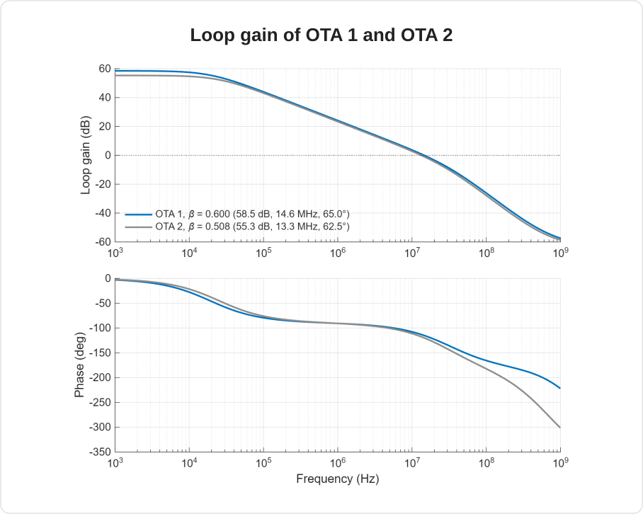
*OTA 1(*$\beta_1$ *= 0.6)과 OTA 2(*$\beta_2$ *= 0.508)의 loop gain* $T = A\beta$*, 25 °C. 범례에 DC loop gain, crossover, phase margin을 표기함.*

### 2. Switches
$R_{on}$은 switch가 on인 동안 10 mV sense source를 둔 느린 입력 ramp로 추출함 ($R_{on} = 10\ \mathrm{mV} / \lvert i\rvert$). 시뮬레이션한 size: TG $W_n / W_p / L$ = 4 / 14 / 0.35 µm (summing node와 chopper에 쓰는 size), bootstrap switch NMOS 1 / 0.15 µm.

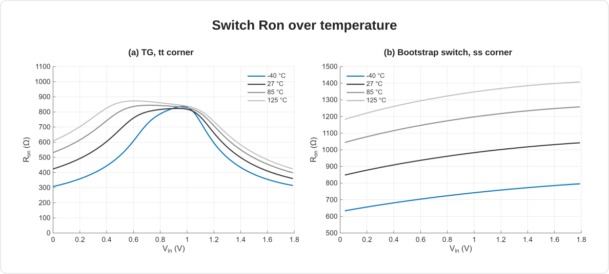
*(a) TG, tt corner. (b) Bootstrap switch, ss corner. −40–125 °C.*

**Corner별 TG** ($R_{on}$, 전체 $V_{in}$ sweep, rail에서의 최솟값 – 중간 전압의 peak, 단위 Ω):

| Temperature | tt | ss | ff |
|---|---|---|---|
| −40 °C | 307 – 836 | 252 – 903 | 194 – 431 |
| 27 °C | 360 – 823 | 301 – 815 | 224 – 454 |
| 85 °C | 398 – 844 | 332 – 812 | 249 – 490 |
| 125 °C | 424 – 873 | 352 – 830 | 266 – 520 |

- 모든 corner와 온도에서 TG의 최악값은 약 0.9 kΩ (ss, −40 °C)임. 이는 sampling switch의 한계 2.43 kΩ보다 한참 작지만 summing-node switch의 목표 0.5 kΩ (Architecture 참조)보다는 높으므로 TG width를 키워야 함. $R_{on}$은 $V_{in}$에 대해 종 모양이며 peak는 중간 전압(tt에서 약 0.9 V)에서 나타남.

**Corner별 Bootstrap switch** ($R_{on}$, $V_{in}$ = 0.1 – 1.7 V 구간, 단위 Ω; `analyze_bs_corners.m`):

| Temperature | tt | ss | ff |
|---|---|---|---|
| −40 °C | 533 – 639 | 646 – 790 | 449 – 530 |
| 27 °C | 707 – 835 | 865 – 1037 | 591 – 691 |
| 85 °C | 865 – 1009 | 1063 – 1253 | 721 – 849 |
| 125 °C | 977 – 1141 | 1204 – 1403 | 815 – 1004 |

최악은 125 °C의 ss로 최대 1.40 kΩ이며, sampling switch의 한계 2.43 kΩ보다 작음. Bootstrap의 $R_{on}$은 $V_{in}$에 따라 단조 증가하고 (범위 내 약 15–20 %), TG와 같은 종 모양 곡선은 나타나지 않음.

**$R_{on}$ 곡률에 의한 distortion (추정)**: sampling한 전압에서 settling이 덜 된 성분 $`V_{in}\,e^{-t/(R_{on}(V_{in})\,C)}`$ ($C$ = 8.4 pF, $t$ = 240 ns)이 $R_{on}$을 통해 $V_{in}$에 따라 달라짐. 0.9 V 주변 진폭 0.3 V 사인에 대해 최악(ss, 125 °C)에서 2–9차 harmonic은 −194 dBc로, 목표 98 dB보다 훨씬 낮음. Bootstrap의 charge injection과 clock feedthrough는 포함하지 않음.

### 3. Chopper
- 단독 시뮬레이션 (`tb_fixed_chopper_standalone.spice`: non-overlapping clock generator로 구동하는 4위상 chopper, $f_{ch}$ = 1.024 MHz, 4/14/0.35 µm TG 4개, source 저항 1 kΩ과 출력당 load 0.5 pF 가정, tt, 25 °C):
  - Modulation: 20 kHz differential sine wave (0.6 V peak)가 $f_{ch} \pm f_{in}$에 입력 진폭의 0.65 / 0.64로 나타남 (ideal square-wave chopping: $2/\pi$ = 0.64). 입력 주파수 성분은 변조된 tone 대비 −72.6 dB로 변조되지 않은 채 새어 나오며, 2nd chopper가 이를 다시 신호 대역 밖으로 옮김.
  - Switching spike (zero input): 단일 출력에서 9.45 mV peak (common mode). 양쪽 load mismatch 5 %에서 differential spike는 0.44 mV임 (대칭 회로만으로는 상쇄됨). 출력은 최대 4.7 ns 안에 50 µV 이내로 settle됨. 이는 반주기 (488 ns)의 약 1 %이므로 integrator가 sampling하기 훨씬 전에 spike가 사라짐.
- Loop stability (`tb_fixed_ch_ota.spice`, OTA 1, 25 °C, tt, 1st integrator의 feedback network: $C_i$ = 14 pF, $C_s + C_d$ = 8.4 pF): 두 chopper를 한 상태(straight / cross)로 고정함. CH1은 OTA 입력에, CH2는 OTA 내부에 있으며 TG는 Wn/Wp/L = 4/14/0.35 µm임. Loop crossover는 두 상태 모두 14.87 MHz, PM은 61.8°임 (DC loop gain 58.9 dB). 같은 OTA에서 두 chopper를 short로 바꾸면 (`tb_fixed_ota_nochop.spice`) 15.08 MHz, 64.2°로, 1절의 OTA 검증(14.57 MHz, 65.0°)과 가까움. Chopper 때문에 crossover가 1.4 %, PM이 2.4° 줄어듦. CH2의 TG가 2단의 Miller 경로에 들어가기 때문임. PM은 60° 이상이고 crossover는 필요한 $\beta \cdot GBW$ = 10.6 MHz보다 높음.
  - chopper 없는 동일 loop (14.57 MHz, PM 65.0°)와 비교하면 crossover는 약 7 % 낮고 (chopper TG의 직렬 $R_{on}$ 때문), PM은 4° 높음.
  - crossover는 여전히 필요한 $\beta \cdot GBW$ = 10.6 MHz보다 높음.
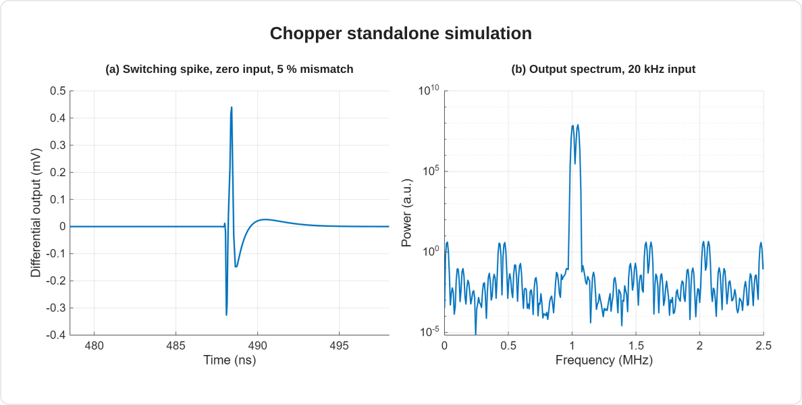
*(a) chopper clock edge에서의 differential 출력 spike (zero input, 5 % load mismatch): 0.44 mV peak, 수 ns 안에 settle. (b) 20 kHz 입력에 대한 differential 출력 spectrum: 신호가 1.024 MHz 근처의* $f_{ch} \pm f_{in}$*으로 변조됨.*

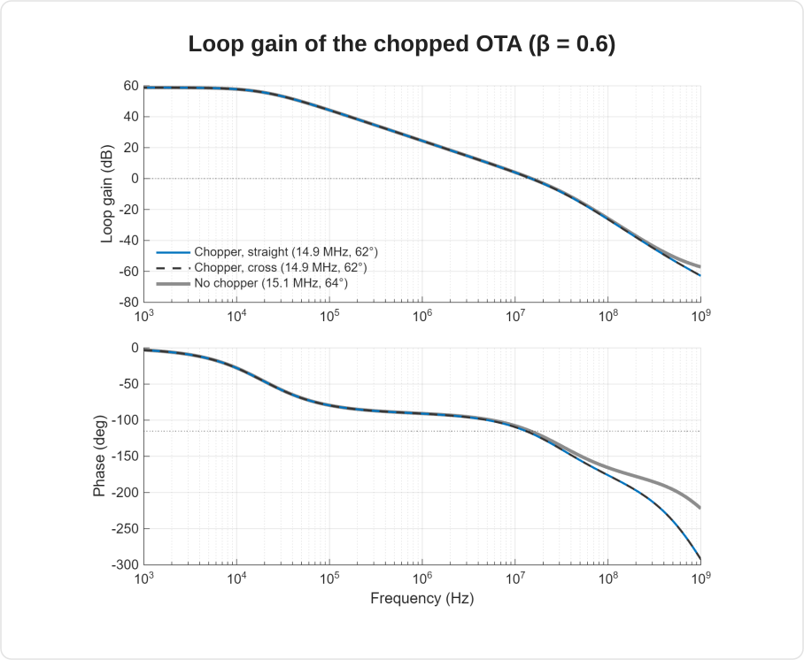
*수정한 chopper를 두 상태로 둔 경우와 chopper가 없는 경우의 OTA 1 loop gain: chopper 포함 시 14.87 MHz, PM 61.8° (두 상태 동일), 없을 때 15.08 MHz, PM 64.2°.*

### 4. Integrator (standalone)
- DAC-only 및 DC-input 테스트. 계수는 $\phi_2$ 끝에서 취한 샘플(원)로부터 MATLAB에서 추출함.

**1st integrator** ($`C_s = C_d`$ = 4.2 pF, $`C_i`$ = 14.0 pF, $`V_{bias}`$ = 0.62 V; 이상적인 DAC step $`0.3 \times 1.2\ \mathrm{V}`$ = 0.360 V, 20 mV 입력에 대한 이상적 input step −6.0 mV)

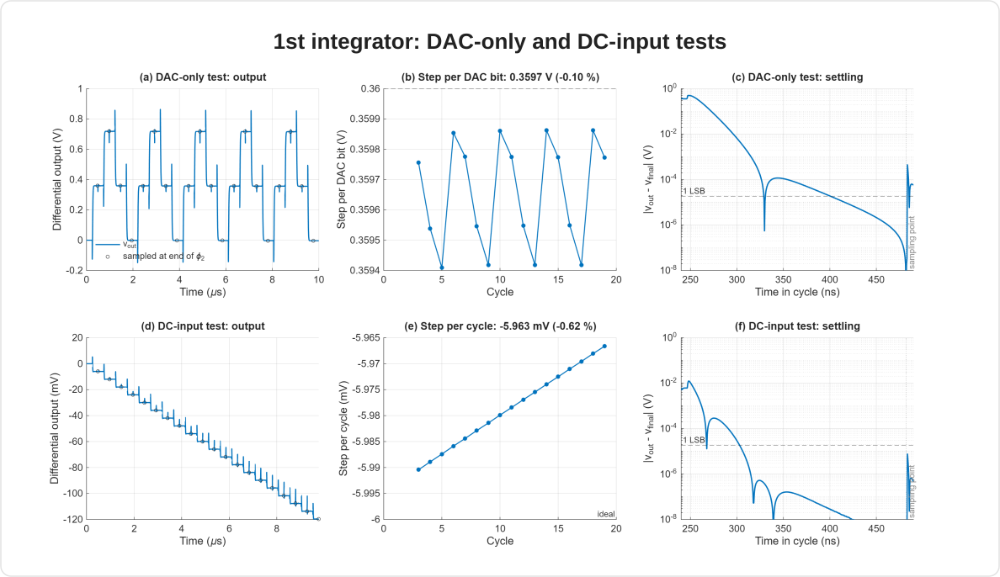
*1st integrator. 윗줄은 DAC-only test: (a) differential 출력, (b) DAC bit당 step과 이상값(점선), (c) 한 cycle 안의 출력 오차 (log scale, 1 LSB = 18.3 µV). 아랫줄은 DC-input test: (d) 출력 ramp, (e) cycle당 step과 이상값(점선), (f) 한 cycle 안의 출력 오차. DAC step은 약 400 ns, DC-input step은 약 300 ns에 1 LSB 아래로 settle되어 485 ns의 sampling point보다 앞섬. 수정 후 회로이며 integrator의 flicker source는 끔.*

| Metric | Ideal | 수정 후 회로 | 수정 전 회로 |
|---|---|---|---|
| DAC step | 0.360 V | 0.3597 V (−0.10 %) ¹ | 0.3623 V (+0.65 %) |
| Input step | −6.00 mV | −5.96 mV (−0.62 %) ² | −5.70 mV (−4.9 %) |
| Input step의 홀짝 교대 | 0 | rms 0.05 µV ³ | 0.6–0.8 mV |
| Output CM | 0.9 V | 0.8987 V (ripple 1.7 mV) | 0.9017 V (ripple 1.3 mV) |
| Settling residue, $\phi_2$ 마지막 40 ns | < 0.5 LSB | DAC 3.6 µV (0.20 LSB), input < 0.01 µV | DAC 5.2 µV (0.28 LSB), input 3.7 µV (0.20 LSB) |

¹ 17 cycle 평균. Step은 0.3594–0.3599 V이고 4 cycle 주기의 DAC 패턴을 따라 반복됨.

² 20 µs run의 cycle 3–40 평균. Step은 출력에 비례해 줄어듦 (cycle 3에서 −5.990 mV, cycle 19에서 −5.967 mV). Pole 오차로는 약 2.2e-4 / cycle임. 81 cycle run(출력 최대 0.48 V)에서는 평균 −5.94 mV (−1.0 %), Vo = 0으로 외삽하면 −5.996 mV임.

³ 81 cycle run의 값.

#### Chopper 반전 오차 (1st integrator): 발견과 수정

위의 그림과 표는 수정 후 회로의 결과임. 이 소절은 수정 전 회로에 있던 오차와 그 수정 과정을 설명함.

**1) 증상 (수정 전 회로)**
- Input step이 홀수 / 짝수 cycle에서 번갈아 달라지고, 그 차이가 출력 레벨에 따라 커짐 (cycle 10 부근 ±0.3 mV, 39 cycle의 마지막에서 ±1.2 mV, 출력 전압의 약 0.5 %).
- 평균 step은 −5.70 mV로, 이상값 −6.00 mV보다 4.9 % 작음.

**2) 원인은 chopper임**

| 시험 | 홀짝 교대 | 평균 step |
|---|---|---|
| 수정 전 회로 | 0.6–0.8 mV | −5.70 mV (−4.9 %) |
| Chopper clock을 low로 고정 | 0.00 mV | −5.97 mV (−0.5 %) |
| Integrator의 flicker noise source를 끔 | rms 0.81 mV | −5.71 mV |
| 2nd integrator (chopper 없음) | 0.01 mV | — |

- Chopper를 고정하면 오차가 사라지고 noise source를 꺼도 결과가 같으므로, 교대는 noise가 아니라 chopper에서 나옴.

**3) 원인 1: chopper clock의 overlap**
- 증상: chopper edge마다 최대 ±2 mV의 step 오차 (이상값 6 mV 대비)가 생기며, Vo에 비례하고 두 edge에서 크기가 다름 (+0.79 %, −0.30 %). Switch를 ideal로 바꾸거나 edge 위치를 바꿔도 결과는 같았음.
- 원인: `clkCh`와 `clkCh_b`를 NAND 뒤에 inverter를 직렬로 두어 만들었기 때문에 `clkCh`가 항상 inverter 지연만큼 `clkCh_b`보다 늦었음. 한쪽 edge에서는 둘이 약 143 ps 동안 동시에 high였고, 그동안 직선 경로와 교차 경로가 함께 켜져 OUTp와 OUTn이 short되고 $C_i$의 전하가 재분배됨.
- Chopper에서만 문제인 이유: $\phi_1$ / $\phi_2$ clock의 overlap은 $C_s$ 경로만 잠깐 이어서 gain 오차에 그치고, 이 clock은 source에서 이미 6 ns gap을 둠.
- 수정: chopper clock만 non-overlapping clock(측정 gap 약 280 ps)으로 바꾸고, chopper를 4위상으로 구동함. 신호 2개로는 gap 동안 두 경로의 PMOS가 같이 켜지기 때문임 (Clocking 참조). 위상 clock과 DAC clock은 NAND + INV를 유지함. TG는 정확한 반전 신호가 필요하고, DAC clock에 NOC를 쓰면 DAC bit가 0일 때 PMOS가 계속 toggle하기 때문임.

**4) 원인 2: 출력 chopper가 OTA 출력을 뒤집음** (overlap을 고친 뒤 발견)
- 증상: pole 오차 $\mu_{ch}$ = +1.6e-3 / cycle (integrator의 pole이 $z = 1$에서 벗어나, step이 일정하지 않고 Vo에 비례해 달라지는 오차. 여기서는 |Vo|가 클수록 step이 커짐. Chopper를 끄면 −2.4e-4), 약 250 mV 이상에서 gain 압축 (460 mV에서 12 %, ±VD에 대해 홀수차), ±35–56 µV의 교대.
- 원인 추적: chopper를 끈 run은 직선임 (ideal OTA, 트랜지스터 OTA 모두). 입력 chopper만 ideal로 하면 오차가 75 % 줄고, 출력 chopper만 ideal로 하면 거의 0이 됨. 파형에서는 뒤집는 순간 OUT이 +450 mV에서 −400 mV로 끌려감.
- 원인: 뒤집는 순간 OUT이, 아직 반대 극성 전압이 남아 있는 OTA 출력 node(Miller capacitor와 출력단 parasitic)에 연결됨. $\phi_1$ 동안 virtual ground는 떠 있어 OUT의 실효 capacitance가 작으므로, OUT이 거의 2|Vo|만큼 움직이고 virtual ground도 수백 mV 튐. 그 순간 입력 chopper TG가 switching하며, TG의 channel 전하, junction capacitance, OTA 입력 $C_{gs}$가 전압에 대해 비선형이어서 Vo에 의존하는 전하가 들어감. 작은 Vo에서는 선형 pole 오차로, 큰 Vo에서는 압축으로 나타남.
- 수정: 출력 chopper를 OTA 내부의 1단 출력과 2단 gate 사이로 옮기고, Miller 보상은 2단에만 걸리도록 바꿈. 이제 OTA 출력 node와 Miller capacitor는 뒤집히지 않고 1단 출력(약 Vo / A2, 수 mV)만 뒤집힘. Chopper는 1st integrator에만 둠. 2nd integrator의 오차는 1st integrator의 gain과 noise shaping으로 억제되기 때문임.

**5) 수정 결과** (1st integrator; 따로 적지 않으면 DC 입력 20 mV)

| 항목 | 수정 전 | 수정 후 |
|---|---|---|
| Pole 오차 $\mu_{ch}$ | +1.6e-3 / cycle | −2.2e-4 / cycle (chopper를 끈 수준) |
| 선형 범위 | 250 mV 이상에서 압축 | 480 mV까지 직선 (잔차 0.16 µV) |
| $f_s/2$ 교대 | 35–56 µV | 0.05 µV |
| 평균 input step | −5.70 mV | −5.94 mV (−1.0 %), Vo = 0으로 외삽하면 −5.996 mV |
| DAC step (DAC-only test) | 0.3623 V (+0.65 %) | 0.3597 V (−0.10 %) |

- 수정 전 회로의 DAC step +0.65 %는 4 cycle에 한 번 step이 약 3 % 커진 데서 나왔음 (0.359 V 대신 0.371 V). Chopper를 수정한 뒤에는 사라졌고, 4 cycle 주기의 DAC 패턴을 따라 ±0.25 mV의 변화만 남음.

**2nd integrator** (이상적인 DAC step $= \tfrac{12}{33}\cdot 1.2\ \mathrm{V} = 0.436\ \mathrm{V}$, cycle당 이상적인 input step $-12.1\ \mathrm{mV}$)

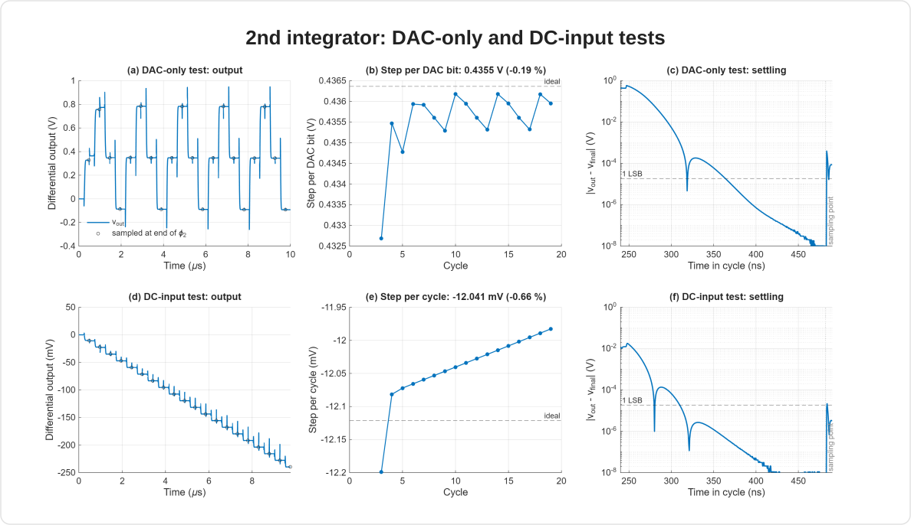
*2nd integrator, 배치는 위와 같음. Cycle당 step은 첫 cycle 이후 이상값과 일치함. DAC step은 488 ns cycle의 약 360 ns, DC-input step은 약 310 ns에 1 LSB 아래로 settle되어 485 ns의 sampling point보다 한참 앞섬. Sampling point의 spike는 clock edge의 switching transient임.*

- spike는 clock edge의 switching transient이며, 출력을 sampling하는 $\phi_2$ 끝 이전에 settle됨.

| Metric | Ideal | Result |
|---|---|---|
| DAC step (2nd integrator) | 0.436 V | 0.4355 V (−0.19 %) |
| Input step (2nd integrator) | −12.1 mV | −12.04 mV (−0.66 %) |
| Output CM (2nd integrator, $V_{bias}$ = 0.69 V) | 0.9 V | 0.9013 V ¹ |
| Settling residue, $\phi_2$ 마지막 40 ns (2nd integrator) | < 0.5 LSB | DAC 0.25 µV (0.014 LSB), input 0.01 µV |

¹ Ripple 1.4 mV; 100 cycle (49 µs) 후 1 mV 이내.

### 5. Noise analysis
Transient simulation에는 device noise가 포함되지 않으므로, 잡음을 별도로 분석하고 ngspice `trnoise` source로 주입함.

**Noise budget** (input-referred, in band)

| Source | Power (V²) | SNR alone | Method |
|---|---|---|---|
| Quantization | 6.7e-13 V² | 114.3 dB | Behavioral model ¹ |
| kT/C | 1.53e-11 V² | 100.7 dB | $8kT/C_s$ ÷ OSR ² |
| OTA flicker, no chopper | 1.9e-8 V² | 69.8 dB | `.noise` × 4 ³ |
| OTA noise with chopper (estimate) | 2.6e-11 V² | 98.4 dB | `.noise` at $f_{ch}$ × 4 ⁴ |
| Total with chopper (estimate) | 4.2e-11 V² | 96.3 dB | Quantization + kT/C + chopped OTA |

¹ $k_{eff}$ = 0.628; FS = 1 (1.2 V) 단위로 4.68e-13, V²로는 × 1.44. 예산: 2.8e-12 V².

² $8kT/C_s$ = 7.84e-9 V² (2 branches × 2 phases × 2 sides, 25 °C, $C_s$ = 4.2 pF)를 OSR = 512로 나눔.

³ 4.75e-9 V² (1 Hz – 2 kHz)에 capacitor ratio $\left(\dfrac{C_s+C_d}{C_s}\right)^2$ = 4를 곱함.

⁴ Ideal chopper: flicker noise가 $f_{ch}$ = 1.024 MHz로 이동함 (아래 참조).

- OTA flicker noise가 in-band noise의 병목이며, 이 때문에 chopper를 도입함 (Circuit-level Requirements의 Chopper 참조).
- 이상적인 chopper가 $f_{ch}$ = 1.024 MHz에서 동작하면 flicker noise가 $f_{ch}$로 옮겨져, 대역에는 $f_{ch}$에서의 noise 밀도(3.2e-15 V²/Hz)만 남음. $f_{ch}$에서도 OTA noise는 대부분 flicker임 (flicker corner가 수 MHz이기 때문). 2 kHz에서 6.5e-12 V²이고, capacitor ratio 4를 곱하면 2.6e-11 V²로 chopper 없는 경우의 1.9e-8 V²보다 작음. 이 추정은 약 730배(28.6 dB) 개선에 해당함. 이 추정은 이상적인 chopping을 가정하며, sampling에 의한 OTA 열잡음 folding과 chopper 비이상성은 포함하지 않았음. 실제 개선은 이보다 작음.
- 소자별 기여는 1st stage의 NMOS load가 지배적임. 아래는 OTA 1의 1 Hz – 2 kHz input-referred noise (`.noise`, 25 °C)이며 합계는 4.75e-9 V² (68.9 µV rms)임.

| Device (pair) | Power (V²) | Share |
|---|---|---|
| M3, M4 (1st-stage load) | 4.73e-9 | 99.6 % |
| M1, M2 (input pair) | 1.68e-11 | 0.35 % |
| M5, M6 (2nd-stage driver) | 1.75e-12 | 0.04 % |
| M7, M8 (2nd-stage current source) | 1.3e-13 | 0.003 % |
| Itail, M9, CMFB resistors | < 1e-14 | ≈ 0 |

  각 소자 기여 중 flicker noise의 비중은 M1 / M2가 98.6 %, M3 / M4가 99.99 %임 (M3 / M4 쌍의 열잡음 성분은 5e-13 V²). 원인은 M3 / M4의 작은 면적(약 1.1 µm²)임. Tail 전류원은 차동 출력에서 상쇄됨.

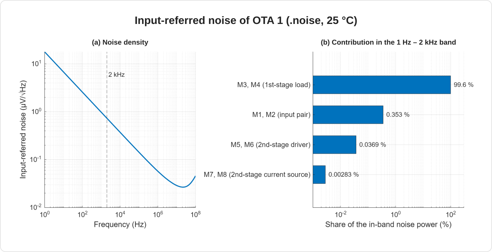
*(a) OTA 1의 input-referred noise 밀도: 1 Hz에서 17.9 µV/√Hz, 1 kHz에서 0.98 µV/√Hz. (b) 1 Hz – 2 kHz 대역에서 소자 쌍별 비중.*

**Noise injection**
- kT/C: modulator 두 입력에 `trnoise` source를 둠. Flicker: chopper CH1과 1st OTA 입력 사이에 주입함.
- `trnoise` 파라미터는 source만 단독으로 돌린 시뮬레이션에서 확인함 (`tb_trnoise_check.spice`, 100 ms, `check_trnoise.m`; 균일한 0.2 µs grid로 보간한 후 $2^{16}$ 점 Hann window의 Welch PSD).
  - kT/C source `trnoise(63.7u 488.28n 0 0)`: source 하나의 white PSD는 $`2\,NA^2\,NT`$ = 3.96e-15 V²/Hz. 측정값: 10–100 kHz에서 3.98e-15 V²/Hz (1.00×), 1–10 kHz에서 3.81e-15 V²/Hz (0.96×). 두 source를 합치면 2 kHz 대역에서 1.6e-11 V²임 (100–1000 Hz bin이 0.80×에 그치는 것은 저주파에서 Welch bin 수가 적기 때문).
  - 63.7 µV는 $C_s$ = 4 pF 기준 값임. 구현된 4.2 pF에서는 표의 값이 1.53e-11 V²이므로, 주입된 kT/C noise가 약 3.5 % 더 커서 약간 보수적임.
  - Flicker source `trnoise(0 1u 0.85 66.4u)`: white 성분 없음 (NA = 0), NT = 1 µs, 지수 NALPHA = 0.85, 진폭 NAMP = 66.4 µ; 측정된 기울기 $f^{-0.81}$, 1 kHz에서 9.7e-13 V²/Hz (100–300 Hz에서 2.9e-12, 1–3 kHz에서 6.3e-13, 10–30 kHz에서 9.4e-14).
    - NAMP는 NAMP = 1 µ 단독 run의 PSD를 1st OTA `.noise` 결과에 맞도록 scaling해서 정함. 현재 OTA 기준으로 주입 PSD는 1 kHz에서 OTA와 같고 (9.67e-13 V²/Hz), 100–300 Hz에서 30 % 이내임.
- 비교 실행: (A) 잡음 없음, (B) chopper 없이 잡음 포함, (C) chopper 포함 잡음. 수정한 회로는 A와 C를 coherent 8 ms record로 돌리며 (각 4개, 최종 결과), 13 ms record는 예시로 둠 (SNDR 참조). B는 실행 시간 때문에 돌리지 않음. 수정 전 회로에서는 C를 32 ms, A를 2.4 ms만 돌렸음.
- 2nd OTA의 flicker noise는 주입하지 않음. Modulator 입력으로 환산하면 1st integrator의 gain(1 kHz에서 $\approx$ 98)만큼 감쇠되어 대역 내 1e-12 – 3e-12 V² (noise budget의 몇 %, 약 0.1 – 0.3 dB)로 추정됨.

### 6. 2nd-order modulator: spectrum과 SNDR
<!-- TODO: 8 ms run이 끝나면 [estimating] 값을 채우고 PSD 그림을 넣은 뒤 이 주석을 지움. -->

**Setup**
- 입력: −6 dBFS sine, coherent sampling: $`f_{in} = k\,f_s / N`$ ($k$ = 3, $N$ = 16384 → 375 Hz). Record는 8 ms임 (bin당 125 Hz, 2 kHz 대역에 16 bin).
- 잡음을 주입한 run 4개 (kT/C와 flicker, Noise analysis 참조), 주입하지 않은 run 4개. SNDR은 run마다 구함. 표에는 평균과 산포를 적고, 그림의 PSD는 run들의 평균임.
- 잡음은 DC와 signal bin을 제외하고 대역 내(0–2 kHz)에서 적분함. Window: [estimating] (`analyze_modulator_fixed.m`).
- ngspice options: `method = gear`, `reltol = 3e-6`, `vntol = 3e-8`, `abstol = 1e-12`, `trtol = 2`.
- 기준: 같은 record에서 이상 behavioral model은 105.6 dB까지 구분하므로, 설계 목표(98.1 dB) 근처의 SNDR을 측정할 수 있음.

**결과**

<!-- TODO: 8 ms run의 PSD 그림 (run 평균, 잡음 주입 유무, 이상 model과 비교) -->

| Case | Runs | SNDR (평균) | 산포 (min – max) | ENOB | In-band floor (FS²/Hz) |
|---|---|---|---|---|---|
| 이상 behavioral model, 같은 record | 1 | 105.6 dB | — | 17.2 bit | [estimating] |
| 회로, 잡음 주입 없음 | 4 | [estimating] dB | [estimating] – [estimating] dB | [estimating] bit | [estimating] |
| 회로, 잡음 주입 (최종) | 4 | **[estimating] dB** | [estimating] – [estimating] dB | **[estimating] bit** | [estimating] |
| 요구 / 설계 목표 | | ≥ 95.2 dB / 98.1 dB | | 15.5 / 16 bit | |

- 40 dB/dec noise shaping. 약 20 kHz 이상에서는 shaped noise가 이상 model을 따라감.
- 잡음을 주입한 SNDR은 요구(95.2 dB)를 [estimating] dB 차이로 [만족함 / 만족하지 못함]. 설계 목표(98.1 dB)보다는 [estimating] dB [높음 / 낮음].

**Noise breakdown**
- 잡음을 주입하지 않은 회로는 이상 model보다 [estimating] dB 낮음. 회로 자체의 손실임 (settling, 유한한 gain, chopper 잔류 오차).
- 잡음을 주입하면 [estimating] dB 더 낮아짐. kT/C noise와 chopper 후 남는 OTA noise의 영향임.
- 잡음 주입 run 4개의 산포는 [estimating] dB이므로, 이보다 작은 차이는 의미가 없음.
- 시뮬레이션하지 않은 것: chopper 없이 잡음만 주입한 경우. Chopper에 의한 개선 28.6 dB는 해석적 추정으로 남음 (Noise analysis 참조).

**Noise budget과의 비교**
- Budget 추정은 $\approx$ 96 dB (quantization + kT/C + chopper 후 OTA noise, ideal chopper 가정). 시뮬레이션은 [estimating] dB로, 차이는 [estimating] dB임.
- [차이의 원인: sampling에 의한 OTA 열잡음 folding, chopper 비이상성, ...]

**예시: non-coherent 13 ms record**
- Coherent run 전에 수정한 회로를 13 ms record로 시뮬레이션했음 (입력 343.75 Hz, 약 26000 sample, non-coherent). 잡음 주입 없이 89.0 dB, 주입 시 89.6 dB임.
- 같은 길이의 record에서는 이상 behavioral model도 같은 값이 나옴 (89.0, 90.0 dB. 65536 sample에서는 115.5 dB). 따라서 이 값은 회로가 아니라 non-coherent 신호의 leakage에서 오는 한계임. 3–6 kHz의 대역 내 floor(3.3e-14, 4.9e-14 FS²/Hz)는 이상 model(4.1e-14) 수준임.
- 최종 run에 coherent record를 쓰는 이유가 이것임.

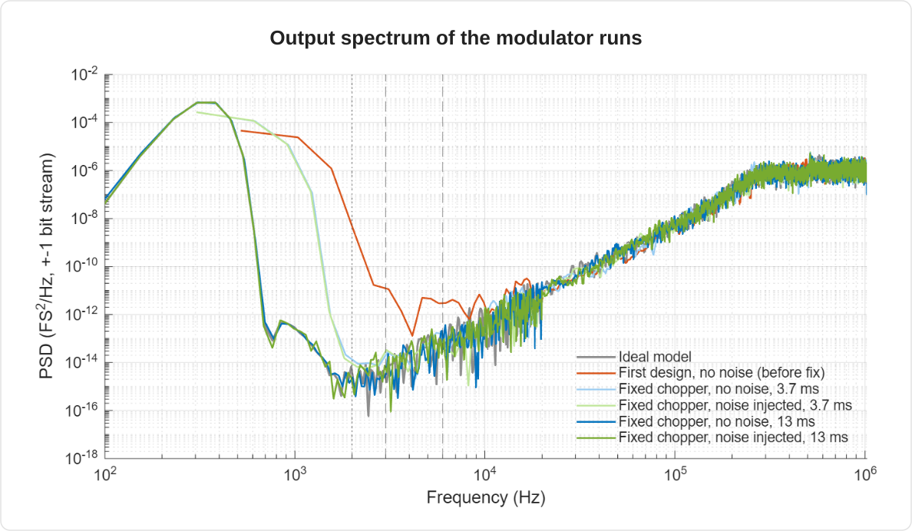
*13 ms run(수정한 회로, 잡음 주입 유무)과 수정 전 회로의 출력 PSD를 이상 model과 비교.*

**수정 전 회로 (chopper 수정 전)**
- 수정 전 회로는 잡음 주입 시 68.4 dB (32 ms record), 잡음 없이 $\approx$ 70 dB에 그쳤음. 대역 내 floor가 이상 model보다 약 100배 높았고 (3–6 kHz에서 4.2e-12 대 4.1e-14 FS²/Hz), 잡음 없이도 나타났음.
- 이 floor는 chopper 반전 오차에서 나옴. Behavioral model에 1st-integrator 시험에서 측정한 state 오차(±0.53 %, cycle마다 부호 반전)를 넣으면 같은 floor가 나옴 (약 1e-11 FS²/Hz). 원인과 수정은 Integrator의 Chopper 반전 오차 참조.

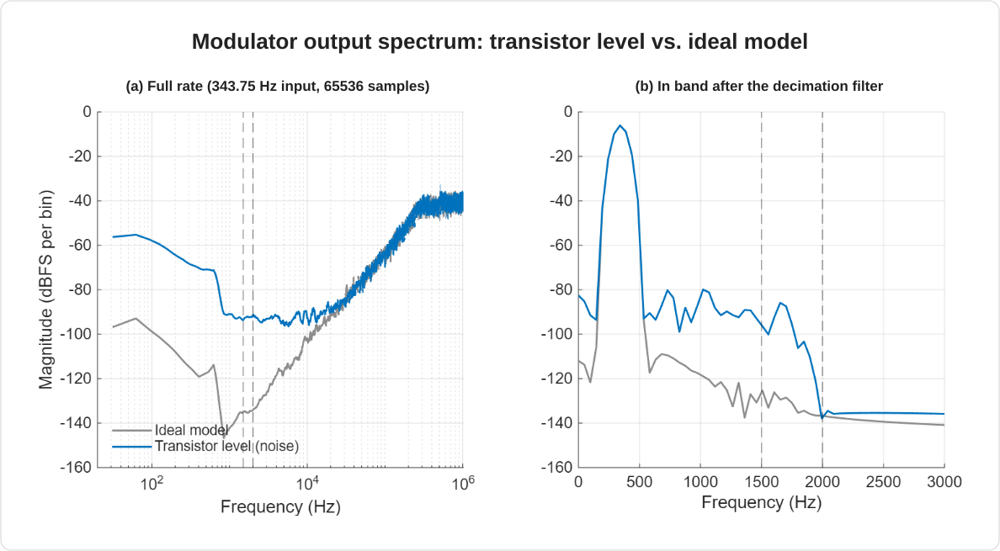
*수정 전 회로: 잡음을 주입한 출력 spectrum (32 ms, 65536 sample)과 이상 behavioral model의 비교. (a) 약 20 kHz 이상에서는 두 shaped noise가 일치함. 대역 안의 floor는 bin당 약 −92 dBFS로 평탄함. (b) Decimation filter를 거친 대역 내 spectrum.*

### 7. 결과 정리

| Item | Required | Result | Status |
|---|---|---|---|
| OTA DC gain | ≥ 45.3 dB | OTA 1: 58.5 dB / OTA 2: 55.3 dB ¹ | 만족 |
| OTA GBW | ≥ 17.6 MHz | OTA 1: 24.3 MHz / OTA 2: 26.1 MHz ² | 만족 |
| Phase margin | $\approx$ 65.5° | OTA 1: 65.0° / OTA 2: 62.5° ¹ | OTA 2가 3° 낮음 |
| Slew rate | ≥ 4.42 V/µs | — | 미검증 |
| Switch $R_{on}$ (sampling) | ≤ 2.43 kΩ | ≤ 1.41 kΩ (worst case) ³ | 만족 |
| Switch $R_{on}$ (summing node) | $\approx$ 0.5 kΩ | ≤ 0.9 kΩ ⁴ | 미달, width 증가 필요 |
| 1st integrator step | DAC 0.360 V, input −6.00 mV | 0.3597 V (−0.10 %), −5.96 mV (−0.62 %), 수정 후 회로 | |
| 2nd integrator step | DAC 0.436 V, input −12.1 mV | 0.4355 V (−0.19 %), −12.04 mV (−0.66 %) | |
| Settling residue | < 0.5 LSB | 1st: 0.20 LSB, 2nd: 0.014 LSB | 만족 |
| Noise budget | SNDR ≥ 95.2 dB | $\approx$ 96 dB (ideal chopper) | 추정 |
| SNDR | ≥ 95.2 dB (설계 목표 98.1 dB) | 잡음 주입 시 [estimating] dB (coherent 8 ms run). Non-coherent 13 ms record에서는 89.0 dB, 잡음 주입 시 89.6 dB | 8 ms run 진행 중 |
| Power | — | 684 µW, VDD에서 380 µA ⁵ | |

¹ 25 °C, closed-loop AC (feedback factor $\beta$ 포함 loop gain). PM은 $\zeta$ = 0.707 기준 요구값.

² Equivalent GBW = loop crossover / $\beta$: OTA 1은 14.57 MHz ($\beta_1$ = 0.6), OTA 2는 13.28 MHz ($\beta_2$ = 0.508). 필요한 loop crossover는 $\beta\cdot GBW$ = 10.6 MHz (OTA 1), 8.9 MHz (OTA 2).

³ ss, 27 °C에서 0.85–1.04 kΩ이며 worst case는 ss, 125 °C임. 2.43 kΩ 한계는 $C_s + C_d$ = 8.4 pF로 정해짐.

⁴ 모든 corner와 온도 기준. 목표는 pole을 loop crossover보다 충분히 높게 두는 것이므로 width를 키워야 함 (약 2×).

⁵ Static `.op`, bias only.

- OTA 행은 chopper 수정 전의 OTA testbench 값임. 수정한 chopper를 넣은 OTA 1의 loop는 crossover 14.87 MHz, PM 61.8°로, chopper가 없을 때보다 PM이 2.4° 낮음 (Chopper 참조).

## Limitations & Next Steps

**결과의 한계**
- **최종 SNDR은 아직 시뮬레이션 중임.** Coherent 8 ms run(375 Hz, 16384 sample, 잡음 주입 4개와 미주입 4개)은 이상 model 기준 105.6 dB까지 구분할 수 있음. 끝나기 전까지는 non-coherent 13 ms record만 있고, 이 record는 신호의 leakage 때문에 약 89 dB로 제한됨 (SNDR 참조).
- **전체 record로 SNDR을 측정하지 못함.** 트랜지스터 레벨 modulator(OTA 2개, chopper, SC CMFB)는 느슨한 solver 허용 오차에서 32 ms(65536 cycle)에 약 16시간이 걸렸고, 허용 오차를 엄격히 하면 run이 약 10배 느려짐 (시간당 약 0.2 ms).
- Noise budget으로 계산하면 $\approx$ 96 dB (ENOB 15.7)로, 요구(95.2 dB)보다 약 0.9 dB 높고 설계 목표(98.1 dB)보다 약 2 dB 낮음. Chopper 이후 남는 OTA 1 noise가 가장 큰 항임 (전체 4.2e-11 V² 중 2.6e-11). Ideal chopper를 가정하고 sampling에 의한 OTA 열잡음 folding을 무시한 값이므로 낙관적일 가능성이 높음.
- Chopper에 의한 flicker noise 감소(28.6 dB)는 ideal chopper를 가정한 해석적 추정임. 잡음이 있고 chopper가 없는 run(B)은 완료하지 못함.

**Next steps**
- **수정한 회로로 OTA 검증 다시 하기** (두 OTA, corner). Chopper를 넣으면 OTA 1의 PM이 61.8°로 목표 65.5°보다 낮으므로, 보상을 다시 조정해야 할 수 있음.
- 1st OTA의 noise를 줄임 (입력쌍의 $g_m$ 증가, $g_{m3}/g_{m1}$ 감소, M3 / M4 면적 증가). OTA의 flicker corner는 수 MHz로 $f_{ch}$ = 1.024 MHz보다 높으므로 $f_{ch}$에 남는 noise(3.2e-15 V²/Hz)도 대부분 flicker이며, chopper 이후 budget에서 가장 큰 항임.
- OTA 전력 감소 (총 684 µW): kT/C로 정해진 $C_s$ = 4 pF 때문에 load가 크므로, 뒤 stage(2nd integrator와 그 OTA)의 스펙을 완화할 예정.
- 전류를 줄이려면 Indirect Miller compensation [8]을 고려함. Miller capacitor를 출력 대신 내부 node (예: cascode node)에 연결하면 같은 GBW / PM에 필요한 $g_{m2}$ (따라서 $I_{out}$)가 줄어듦.

---

## Repository Structure

```
.
├── README.md / README.ko.md
├── docs/figures/                                                      README에 쓴 그림 (SVG 카드와 PNG 원본)
├── xschem/
│   ├── lib/Analog/                                                    symbol과 schematic (OTA 1 / 2, integrator, switch, chopper)
│   ├── top/                                                           top-level schematic (2nd-order modulator)
│   └── testbenches/                                                   Xschem testbench / netlist (OTA, OTA noise, trnoise 포함 modulator)
├── netlists/                                                          ngspice testbench (integrator, integrator chopper timing, TG / bootstrap switch, chopper, chopper flicker, trnoise 확인, run_corners.sh)
├── matlab/
│   ├── behav_model.m                                                  behavioral model과 spec 도출
│   ├── spec_figures.m                                                 spec 그래프 (scaling, settling, gain vs. SQNR)
│   ├── analyze_tb_results.m / analyze_chopper_timing.m                integrator 시험 (2 x 3 그림), chopper 반전 오차
│   ├── plot_switch_ron.m / analyze_bs_corners.m                       switch Ron 그림, bootstrap corner와 distortion 추정
│   ├── analyze_chopper.m / plot_ch_ota_bode.m / analyze_ch_flicker.m  chopper 단독, loop gain, flicker rejection
│   ├── check_trnoise.m / plot_ota_noise.m / plot_ota_bode.m           trnoise source 확인, OTA noise (PSD, 소자별 비중), OTA loop gain
│   └── analyze_modulator_psd.m / analyze_modulator_fixed.m            modulator spectrum과 SNDR (수정 전 / 수정 후 회로)
└── results/                                                           선별한 simulation 결과 (큰 ngspice 출력은 git에 없음, .gitignore 참조; netlist로 다시 만들 수 있음)
```

---

## References

1. Analog Devices, *ADXL356/ADXL357 Data Sheet*, Rev. 0 (Table 1: sensitivity, noise density, bandwidth), [analog.com](https://www.analog.com/media/en/technical-documentation/data-sheets/adxl356-357.pdf)
2. Analog Devices, ADXL356 product page, [analog.com](https://www.analog.com/en/products/adxl356.html)
3. S. Pavan, R. Schreier, G. C. Temes, *Understanding Delta-Sigma Data Converters*, 2nd ed., Wiley-IEEE Press, 2017.
4. R. Schreier, J. Silva, J. Steensgaard, G. C. Temes, "Design-oriented estimation of thermal noise in switched-capacitor circuits," *IEEE Trans. Circuits Syst. I*, vol. 52, no. 11, pp. 2358–2368, Nov. 2005.
5. B. Razavi, "The bootstrapped switch [A circuit for all seasons]," *IEEE Solid-State Circuits Magazine*, vol. 7, no. 3, pp. 12–15, Summer 2015.
6. SkyWater SKY130 PDK documentation, [skywater-pdk.readthedocs.io](https://skywater-pdk.readthedocs.io)
7. Open-LUT (SKY130 MOS look-up tables), [open-lut.org](https://www.open-lut.org/)
8. V. Saxena, "Indirect feedback compensation techniques for multi-stage operational amplifiers," M.S. thesis, Dept. of Electrical Engineering, Boise State University, 2007. Available at [cmosedu.com](https://cmosedu.com/cmos1/bad_design/bad_design12/bad_design_12.htm)
