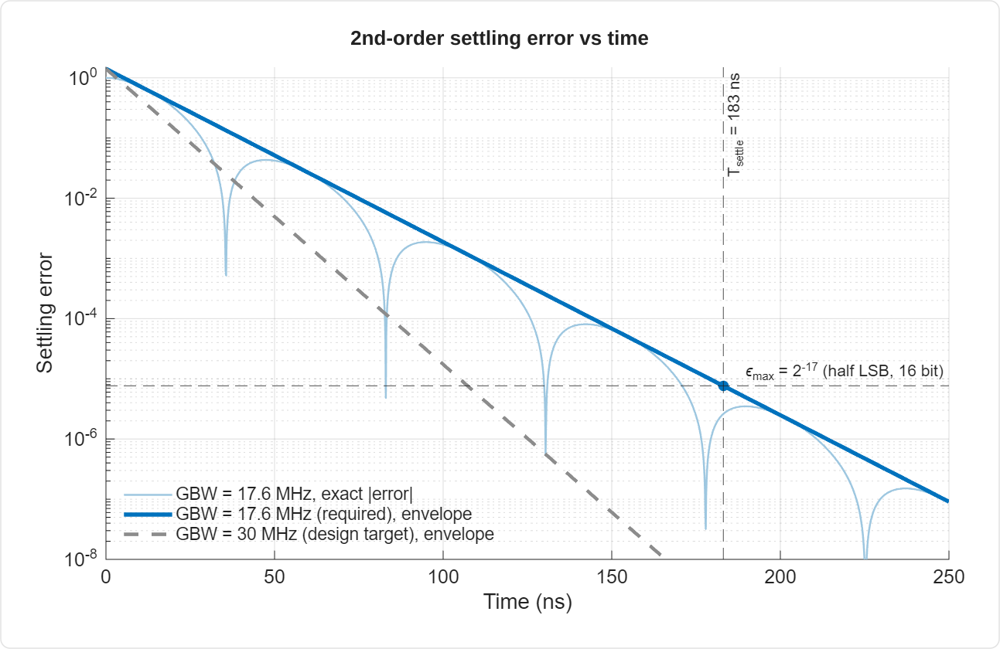
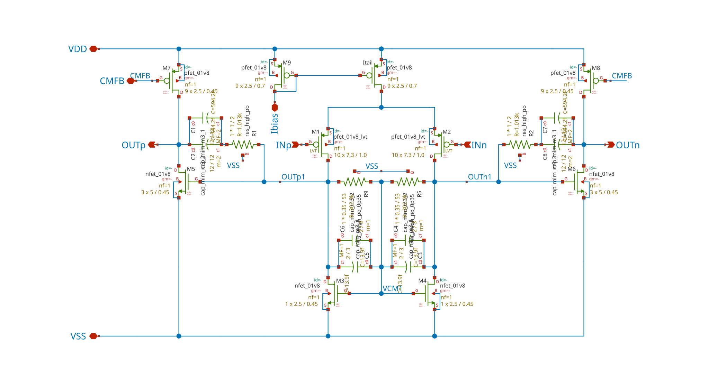
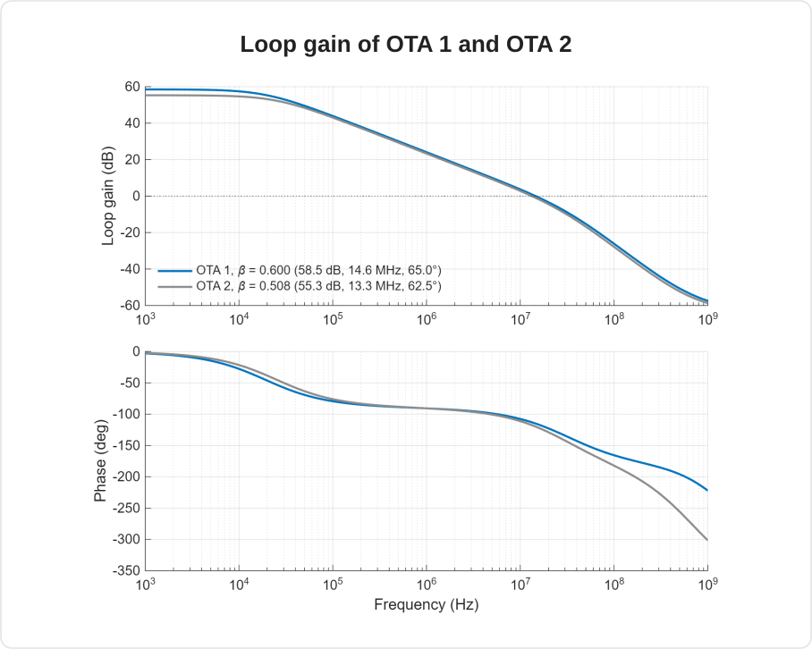
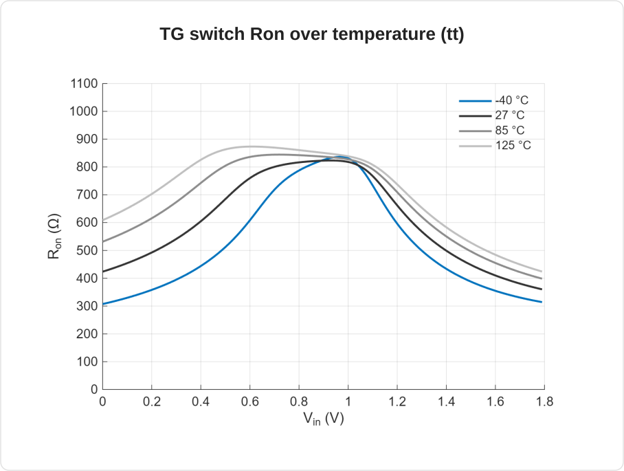
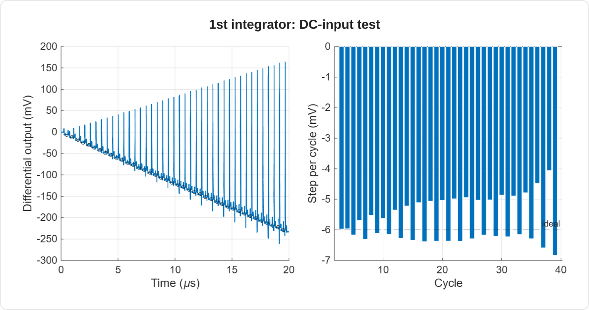

# 2nd-Order 1-bit Switched-Capacitor ΔΣ Modulator in SKY130

A transistor-level (SKY130, Xschem / ngspice) 2nd-order 1-bit fully differential switched-capacitor ΔΣ modulator for a MEMS accelerometer interface, with the specifications derived from the sensor requirements in MATLAB.

| Item | Value |
|---|---|
| Process / supply | SKY130A / 1.8 V |
| Architecture | 2nd-order, 1-bit, CIFB, fully differential SC, chopper in the 1st integrator |
| $f_s$ / OSR / BW | 2.048 MHz / 512 / 2 kHz |
| SNDR requirement / design target | $\ge$ 95.2 dB (15.5 bit) / $\approx$ 98.1 dB (16 bit) |
| Full scale | ±1.2 V differential (VREFp 1.5 V / VREFn 0.3 V), input −6 dBFS |
| Power | 684 µW (`.op`, static bias only) |

---

## Highlights

- The specifications (GBW, DC gain, slew rate, $C_s$, switch $R_{on}$) are derived step by step from the sensor noise and the 16 bit target (see Specifications).
- Ideal behavioral model: SNDR 109.8 dB; transistor level (estimated from the out-of-band PSD, no noise, pre-layout): $\approx$ 108–109 dB. The measured SNDR of the noisy transistor-level run is only 68–70 dB because of the numerical floor of the solver; the noise budget estimates $\approx$ 96 dB (15.7 bit), which meets the requirement (95.2 dB) but not the design target (98.1 dB). An accurate SNDR measurement is limited by the simulation time (see Limitations).
- Integrator tests match the ideal coefficients (2nd integrator: DAC step 0.4355 V vs. 0.436 V, input step −12.04 mV vs. −12.1 mV; 1st integrator: DAC step +0.65 %, input step −2 to −5 % with an odd / even alternation from the chopper).
- Switch $R_{on}$ is below 0.9 kΩ for the TG over all corners and temperatures, and the bootstrap switch gives a monotonic $R_{on}$ at the input.
- Power is 684 µW from a static `.op` (the transient average is not measured).

---

## Specifications

The specifications are derived from the target spec (sensor requirements), through system-level and circuit-level requirements, down to implementation choices. The derivation follows the modeling code in `matlab/behav_model.m` (originally `SystemModeling/ADC.mlx`).


### 1. Target Spec

| Item | Value | Note |
|---|---|---|
| Application | MEMS accelerometer interface | Reference sensor: ADXL356C (±10 g / ±40 g) |
| Input range | ±40 g | Sensor full scale = ADC input at −6 dBFS (the ADC full scale corresponds to about ±80 g) |
| Signal BW | 2 kHz | |
| Input amplitude | −6 dBFS = sensor full scale (40 g peak, 28.3 g rms) | 0.6 V differential peak. Sensor output VCM / level is assumed to be matched in front of the ADC (ideal) |
| Full scale (diff.) | ±1.2 V (VREFp 1.5 V / VREFn 0.3 V) | PDK output swing expected to be wider than 0.3–1.5 V (based on $V_{DS,sat}$ from the PDK MOS LUT [6], [7]) |
| VCM | 0.9 V | Midpoint of VDD (1.8 V) and VSS |
| ADC noise target | 20 dB below the sensor noise | Avoid becoming the bottleneck |
| SNDR / ENOB | Requirement $\ge$ 95.2 dB / 15.5 bit (20 dB below the sensor noise). Design target $\approx$ 98.1 dB / 16 bit (3 dB margin) | See the derivation below |


*Signal chain from the reference sensor to the modulator. The sensor and the single-ended to differential conversion are treated as ideal.*

**Reference sensor (the MEMS itself is not implemented, so datasheet values are used)**

| Item | ADXL356C | Source |
|---|---|---|
| Range / sensitivity | ±10 g (80 mV/g) / ±40 g (20 mV/g) | Rev. 0 Table 1 (ratiometric to V1P8ANA) |
| Output | Single-ended per axis (XOUT / YOUT / ZOUT), 0 g = V1P8ANA / 2 (= 0.9 V), 32 kΩ series resistance | Rev. 0 Table 1 (differential conversion and scaling: see the AFE assumption below) |
| Noise density (±40 g) | 110 $\mu\mathrm{g}/\sqrt{\mathrm{Hz}}$ | Datasheet [1] (80 for ±10 g, 75 on the product page [2]) |
| Output BW | Internal low-pass 1.5 kHz (fixed), resonance about 5.5 kHz | Rev. 0 Table 1 |

- **AFE assumption**: the single-ended sensor output is converted to differential by an FDA in the AFE, and an instrumentation amplifier scales the input (±0.8 V → 0.6 V differential peak, VCM 0.9 V). The noise and errors of the AFE are ignored (see Ideal Assumptions).
- **Design BW**: the sensor BW of 1.5 kHz plus a 0.5 kHz transition band for the decimation filter gives a signal band of 2 kHz.

**Back-calculation: how many dB below the sensor is the ADC noise?** (noise density 110 $\mu\mathrm{g}/\sqrt{\mathrm{Hz}}$)

| Item | Value |
|---|---|
| Sensor noise (BW 2 kHz) | 110 $\mu\mathrm{g}/\sqrt{\mathrm{Hz}}$ × $\sqrt{2000}$ $\approx$ 4.92 mg rms |
| Sensor SNR at full scale (40 g peak) | $20\log(28.3\,\mathrm{g} / 4.92\,\mathrm{mg})$ $\approx$ 75.2 dB |
| ADC noise (SNDR 98.1 dB, input-referred) | 28.3 g / 80,100 $\approx$ 353 µg rms ($\approx$ 7.9 $\mu\mathrm{g}/\sqrt{\mathrm{Hz}}$) |
| ADC noise relative to the sensor | $\approx$ 22.9 dB lower (meets the 20 dB target) |
| SNDR needed for a 20 dB margin only | $\approx$ 95.2 dB ($\approx$ 15.5 bit) |

- Noise powers add, so an ADC that is 20 dB below the sensor costs only about 0.04 dB of SNR (about 0.4 dB for a 10 dB difference).
- For the ADXL356C, 16 bit has about 3 dB of margin over the minimum requirement ($\approx$ 15.5 bit), so it is close to the minimum resolution that gives a 20 dB margin against the sensor noise.
- Limiting the input to −6 dBFS or below keeps the input inside the stable range of the 1-bit 2nd-order modulator and also gives headroom for overloads beyond ±40 g.

### 2. System-level
**Why 2nd order and OSR 512** — the in-band quantization noise must meet the target SQNR (= SNDR 98.1 dB + 10 dB $\approx$ 108 dB), for a 1-bit quantizer, a −6 dBFS input and the ideal model.

| Order / OSR | Ideal SQNR | Verdict |
|---|---|---|
| 1st / 512 | 71.8 dB | Not enough (about 12 bit) |
| 2nd / 128 | 88.2 dB | Not enough |
| 2nd / 256 | 103.3 dB | Not enough (99.2 dB with $k_{eff}$) |
| **2nd / 512** | **118.3 dB** | Enough (114.3 dB with $k_{eff}$, ENOB $\approx$ 17) |

- 2nd order with OSR 512 is the minimum combination that reaches 16 bit (OSR is searched in powers of two).
- A 3rd-order modulator would allow a lower OSR, but it needs one more OTA (more power) and the phase margin becomes the main problem: the extra integrator adds another pole to the loop, so more compensation effort would be needed to keep the loop stable. It was therefore not chosen.

**Why 1 bit**
- A 1-bit DAC has only two levels, so it is **inherently linear**. There is no DAC nonlinearity from capacitor mismatch and no need for correction such as DEM, which matters for 16-bit linearity.
- One comparator is enough, so the circuit is simple and small, with low power.
- The signal band is only 2 kHz, so even with OSR 512 the sampling rate is just 2.048 MHz. Compensating the low resolution of 1 bit with OSR is cheap.
- **Why 1 bit**: a 1-bit quantizer needs only a comparator and a two-level DAC, and a two-level DAC is inherently linear (no DAC element mismatch and no DEM / DWA logic). A multi-bit loop would need a flash quantizer and a matched multi-level capacitor DAC, and its DAC non-linearity would go directly into the output. The cost of 1 bit is the larger quantization noise, which is covered by the OSR of 512.

**Noise budget and modeling**
- Noise budget: 10 % of the total goes to quantization noise and 90 % to thermal noise.
- The input is −6 dBFS with a differential peak of 0.6 V, so $P_{signal} = 0.18\ \mathrm{V^2}$, and OSR 512 was selected (ENOB $\approx$ 17).
- In-band quantization noise (Taylor approximation) [3]:

$$
IBQN=\frac{\pi^{2L}\,\Delta^2}{12\,(2L+1)\,OSR^{2L+1}}
$$

- The effective gain of the 1-bit quantizer is $k_{eff} = 0.628$ (extracted from the behavioral simulation as the $y\cdot v$ covariance), so $IBQN_{actual} = IBQN / k_{eff}^2$. ENOB 17 is confirmed with this value as well.
- Dynamic range scaling (for the maximum allowed input of −3 dBFS): the standard MOD2 reaches $\max\lvert x_1\rvert \approx 3.17$ and $\max\lvert x_2\rvert \approx 6.27$. With $s_1 = 0.3$ and $s_2 = 0.18$ they drop to 0.95 / 1.13 while the bitstream stays identical (limits 1.0 / 1.2).
- For the normal −6 dBFS input the swing is smaller, $\max\lvert x_1\rvert \approx 0.82$ and $\max\lvert x_2\rvert \approx 0.76$ (there is margin because the coefficients were chosen for the worst-case input).
- The capacitor ratios give the coefficients of the circuit: 1st stage $C_s / C_i = C_d / C_i$ = 6 / 20 = 0.3 (exactly $s_1$); 2nd stage $c_2 = C_{s2}/C_{i2}$ = 20 / 33 = 0.606 and $a_2 = C_{d2}/C_{i2}$ = 12 / 33 = 0.364 instead of 0.6 and 0.36. Both are 1.01 % larger, which is the same as $s_2$ = 0.1818, so the NTF (zeros at DC) and the SQNR do not change (115.6 dB in both cases) and only the swing of $x_2$ grows by 1 % ($\max\lvert x_2\rvert$ = 1.14 at −3 dBFS, limit 1.2).


*Integrator output swing before and after dynamic range scaling (−3 dBFS input).*

### 3. Circuit-level requirements

#### GBW (Settling)

**1) Step response of a 2nd-order system and its error envelope** (underdamped, damping ratio $\zeta$, natural frequency $\omega_n$)

$$
v(t)=1-\frac{e^{-\zeta\omega_n t}}{\sqrt{1-\zeta^2}}\sin(\omega_d t+\phi)\;\;\Rightarrow\;\;\varepsilon(t)\le\frac{e^{-\zeta\omega_n t}}{\sqrt{1-\zeta^2}}
$$

**2) Error budget** — the settling error is limited to half an LSB at $N = 16$ bit

$$
\varepsilon_{max}=2^{-(N+1)}=7.63\times10^{-6}
$$

**3) Required number of time constants $n_\tau$**

$$
\zeta\omega_n T_{settle}\ge\ln\frac{1}{\varepsilon_{max}}+\ln\frac{1}{\sqrt{1-\zeta^2}}=n_\tau
$$

For $\zeta = 1/\sqrt{2}$, $n_\tau$ = 11.78 + 0.35 = **12.13**

**4) Choosing $\zeta = 0.707$ (PM $\approx$ 65.5°)** — assuming a 2-stage OTA (second pole $\omega_{p2}$), the loop gain is

$$
L(s)=\frac{\omega_u}{s\left(1+s/\omega_{p2}\right)},\qquad \omega_u=2\pi\beta\,GBW
$$

$$
\omega_n^2=\omega_u\,\omega_{p2},\qquad \zeta=\frac{\omega_n}{2\omega_u}\;\Rightarrow\;\zeta=\tfrac{1}{\sqrt2}:\;\; \omega_{p2}=2\omega_u,\;\; \zeta\omega_n=\omega_u
$$

- This is the maximally flat (Butterworth) response, which gives the fastest settling without overshoot.
- The exact PM is $\arctan\!\left(\dfrac{2\zeta}{\sqrt{\sqrt{1+4\zeta^4}-2\zeta^2}}\right) \approx 65.5^\circ$ (the approximation $90^\circ-\arctan\!\left(\dfrac{1}{4\zeta^2}\right)$ gives $63.4^\circ$).

**5) GBW requirement**

$$
n_\tau=\omega_u T_{settle}=2\pi\beta\,GBW\,T_{settle}\;\Rightarrow\;GBW\ge\frac{n_\tau}{2\pi\beta\,T_{settle}}
$$

- $\beta$: feedback factor of the 1st integrator (set by the capacitors / scaling coefficients, about 0.6)
- Of $T_{int} = 1 / (2f_s)$ = 244 ns, 75 % is used for linear settling, so $T_{settle}$ = 183 ns (the remaining 25 % is for slewing).
- $GBW \ge 12.13 / (2\pi \cdot 0.6 \cdot 183\,\mathrm{ns})$ = **17.6 MHz**


*Settling error envelope of the 2nd-order response and the half-LSB limit.*

#### DC gain

**1) Finite gain → integrator leakage**

$$
I_i(z)=\frac{z^{-1}}{1-p_i z^{-1}},\qquad p_i=1-\mu_i,\qquad \mu_i=\frac{g_i}{A_0}
$$

- $g_i$ = sum of the capacitor ratios attached to the summing node (input coefficient + DAC coefficient), parasitic capacitance ignored
- 1st: $g_1 = s_1 + s_1 = 0.6$, 2nd: $g_2 = s_2/s_1 + 2 s_2 = 0.96$

**2) Shift of the NTF zeros (low-frequency approximation)**

$$
D(z)=(z-p_1)(z-p_2)=(z-1)^2+(\mu_1+\mu_2)(z-1)+\mu_1\mu_2
$$

$$
|\Delta NTF(e^{j\omega})|^2\approx(\mu_1+\mu_2)^2\,\omega^2
$$

- The two stages act as one effective leakage $\mu_{eff} = \mu_1 + \mu_2 = (g_1 + g_2) / A_0$.
- This includes the cross term $2\mu_1\mu_2$ of the exact expression $\mu_1^2 + \mu_2^2$, so it is an upper bound (conservative).

**3) Integrating the in-band quantization noise** ($\omega_B = \pi / OSR$)

$$
IBQN=IBQN_{ideal}+\Delta IBQN,\qquad \Delta IBQN=\frac{\Delta^2}{12k_{eff}^2}\cdot\frac{\pi^2(\mu_1+\mu_2)^2}{3\,OSR^3}
$$

**4) Allowed $\mu$**: $\Delta IBQN$ = 1.94e-12 − 4.68e-13 = 1.48e-12 (normalized)

$$
\mu_{max}=\sqrt{\frac{36\,k_{eff}^2\,OSR^3\,\Delta IBQN}{\pi^2\Delta^2}}=8.4\times10^{-3}
$$

**5) Minimum DC gain**

$$
A_0\ge\frac{g_1+g_2}{\mu_{max}}=\frac{0.6+0.96}{8.4\times10^{-3}}\approx186\;(45.3\text{ dB})
$$

- The exact (root-sum-square) form gives $\sqrt{g_1^2 + g_2^2} / \mu_{max} \approx 135$ (42.6 dB), so the approximation above is about 2.7 dB conservative.


*SQNR versus OTA DC gain (conservative model, $\mu_1 + \mu_2$) and the leakage contribution of each stage at the spec gain.*

#### Slew rate

**1) Worst-case step** — the largest output change of the 1st integrator in one phase occurs when the input peak and the DAC reference have opposite polarity (single-ended)

$$
\Delta V_{max}=s_1\,(A_{in}+V_{ref})=0.3\times(0.3+0.6)=0.27\;\text{V}
$$

- $A_{in}$ = 0.3 V (normal −6 dBFS input, single-ended peak), $V_{ref}$ = 0.6 V ($V_{REFp} - V_{CM}$)
- 0.54 V differentially

**2) Time allocation** — of the phase time $T_{int}$ = 244 ns, 25 % is allotted to slewing ($T_{slew}$ = 61 ns) and 75 % to linear settling (183 ns, the same as in the GBW derivation).

**3) Required slew rate**

$$
SR\ge\frac{\Delta V_{max}}{T_{slew}}=\frac{0.27\text{ V}}{61\text{ ns}}=\mathbf{4.42\;V/\mu s}\;\;(+50\%\text{ margin}: 6.64\;V/\mu s)
$$

- The extra step caused by an overload (sensor output up to −3.5 dBFS) is not included. The design is based on the normal −6 dBFS input.

#### OTA current / $g_m$ allocation

**1) Slew current conditions of the 2-stage Miller OTA**

$$
I_{tail}\ge SR\cdot C_c,\qquad I_{out}\ge SR\cdot(C_c+C_L)
$$

- With $C_s$ = 4 pF the effective load is $C_L$ $\approx$ 6.8 pF × 1.2 margin, and $C_c / C_L = 0.15$ gives $C_c$ $\approx$ **1.22 pF**. $C_L$ is the total capacitance seen at the OTA output, roughly the CMFB capacitors at the output, the capacitors in the feedback path, and $C_s$ of the next stage, etc.
- Minimum slew currents: $I_{tail}$ ≥ 5.4 µA, $I_{out}$ ≥ 35.5 µA

**2) $g_m$ from the GBW** — target GBW 30 MHz (about 1.7× margin over the required 17.6 MHz)

$$
g_{m1}=2\pi\cdot GBW\cdot C_c\approx231\;\mu S,\qquad g_{m2}=\frac{g_{m1}}{C_c/C_L\text{ ratio}}=\frac{g_{m1}}{0.15}\approx1540\;\mu S
$$

**3) Currents** [7] — $g_m/I_D = 15$ was chosen as follows: the $C_{gg}$ that satisfies the pole-approximation condition for Miller pole splitting is fixed first, $f_T$ follows from it, and $g_m/I_D$ is then decided.

$$
I_{tail}=\frac{2g_{m1}}{15}\approx30.8\;\mu A,\qquad I_{out}=\frac{g_{m2}}{15}\approx102.5\;\mu A
$$

- These are about 3 to 6 times larger than the minimum slew currents (5.4 / 35.5 µA), so **the $g_m$ condition dominates** and the slew requirement is met automatically.

#### Capacitors (kT/C)
- kT/C model [4], with 2 branches × 2 phases × 2 sides: $C_{s,min} = \dfrac{8kT}{P_{thermal}\cdot OSR}$ → **at least 2.57 pF**
- With margin, $C_s$ $\approx$ 4 pF is used (4.2 pF implemented), giving a kT/C noise of $\approx$ 1.6e-11 V².
- The remaining capacitors follow from the scaling coefficients (input / DAC coefficient = $C_s / C_i = C_d / C_i$).

| Stage | Coefficients | Capacitor ratio | Value |
|---|---|---|---|
| 1st | $a_1 = s_1 = 0.3$ | $C_s : C_d : C_i$ = 6 : 6 : 20 | 4.20 / 4.20 / 14.0 pF (unit 0.70 pF) |
| 2nd | $c_2 = s_2/s_1 = 0.6$, $a_2 = 2 s_2 = 0.36$ | $C_{s2} : C_{d2} : C_{i2}$ = 20 : 12 : 33 ($\approx$ 15 : 9 : 25) | 4.23 / 2.54 / 6.98 pF (unit 0.21 pF) |

- The ratios are implemented with identical numbers of MIM unit cells.

#### Switch $R_{on}$

**1) Error budget → required number of RC time constants** — the RC settling error during sampling is limited to half an LSB ($N = 16$ bit)

$$
e^{-t/\tau}\le 2^{-(N+1)}\;\Rightarrow\;\frac{t}{\tau}\ge N_{err}=(N+1)\ln2=11.78
$$

**2) Time and load capacitance** — the phase time of 244 ns is rounded down to 10 ns steps, so $t$ = 240 ns. The same switch drives $C_s$ and $C_d$, so $C_{eff} = C_s + C_d$.

**3) $R_{on}$ limit**

$$
R_{on}\le\frac{t}{N_{err}\,(C_s+C_d)}
$$

| Condition | $C_{eff}$ | $R_{on}$ limit |
|---|---|---|
| $C_s = C_d$ = 4.2 pF (implemented) | 8.4 pF | **2.43 kΩ** |
| (reference) $C_s = C_d$ = 4 pF | 8 pF | 2.55 kΩ |
| (reference) $C_s$ only | 4.2 pF | 4.85 kΩ |

- The limit is lower than the 4.85 kΩ of the earlier design ($C_s$ = 2.1 pF, from the modeling code) because the capacitors are larger.
- The switch on the summing-node side sits inside the OTA loop. Its pole must be kept well away from the loop crossover for a stable PM, so its $R_{on}$ limit is lower (previous limit 1 kΩ, now a target $R_{on}$ of about 0.5 kΩ; the larger switch W will be applied later).

### 4. Implementation choices
- **CMFB**: SC CMFB is used because the system has a clock.
- **Clock**: ideal clock assumed (see Ideal Assumptions in Architecture).
- **Switch**: TG / bootstrap / basic switch depending on the location. $R_{on}$ is chosen by simulation so that the time constants do not limit settling.

### 5. Derived spec summary

| Item | Required (modeling) | Design | Result |
|---|---|---|---|
| Order / quantizer | 2nd / 1-bit | CIFB | |
| $f_s$ / OSR / BW | — | 2.048 MHz / 512 / 2 kHz | |
| Scaling $a_1$ / $c_2$ / $a_2$ | $\max\lvert x_1\rvert \le 1$, $\max\lvert x_2\rvert \le 1.2$ | 0.3 / 0.6 / 0.36 ($s_1$ = 0.3, $s_2$ = 0.18) | |
| Quantizer gain $k_{eff}$ | — | 0.628 | |
| In-band Q noise | — | 4.68e-13 V² (SQNR 114.3 dB) | |
| Q : thermal budget | 1 : 9 | Q 2.8e-12 V² / thermal 2.5e-11 V² | |
| 1st stage $C_s$ | ≥ 2.57 pF | 4.2 pF (4 pF designed) | |
| OTA DC gain | ≥ 45.3 dB | | OTA 1: 58.5 dB / OTA 2: 55.3 dB (25 °C, `dc_loop_gain_db`) |
| OTA GBW | ≥ 17.6 MHz | | Loop crossover `f_u_loop` (closed-loop AC, $\beta$ included; required $\beta\cdot GBW$ = 10.6 MHz for OTA 1 with $\beta_1$ = 0.6 and 8.9 MHz for OTA 2 with $\beta_2$ = 0.508): OTA 1: 14.57 MHz (equivalent GBW 24.3 MHz) / OTA 2: 13.28 MHz (equivalent GBW 26.1 MHz) (25 °C) |
| Phase margin | $\approx$ 65.5° ($\zeta$ = 0.707) | | OTA 1: 65.0° / OTA 2: 62.5° (25 °C) |
| Slew rate | ≥ 4.42 V/µs (+50 %: 6.64) | | |
| Switch $R_{on}$ (sampling, drives $C_s + C_d$) | ≤ 2.43 kΩ | Bootstrap 1 / 0.15 µm | 0.85–1.04 kΩ (ss, 27 °C), ≤ 1.41 kΩ (125 °C) |
| Switch $R_{on}$ (summing-node side, inside the loop) | $\approx$ 0.5 kΩ (pole separated from the loop crossover) | TG 4 / 14 / 0.35 µm | ≤ 0.9 kΩ (all corners): width to be increased |
| Supply / power | 1.8 V / 684 µW | | `.op` (380 µA from VDD), static bias only |

---

## Architecture

### Overall Block Diagram

*Discrete-time model of the modulator. Solid boxes are implemented at transistor level, the dashed box is an ideal assumption.*

- Fully-differential, 2nd-order, 1-bit CIFB structure ($a_1$ = 0.3, $c_2$ = 0.6, $a_2$ = 0.36)
- The blocks below are implemented at transistor level. Everything else is replaced by ideal models (see Ideal Assumptions).

### Transistor-level Blocks

#### SC Integrator

*1st integrator ($C_s = C_d$ = 4.2 pF, $C_i$ = 14.0 pF)*


*2nd integrator ($C_s : C_d : C_i$ = 4.23 : 2.54 : 6.98 pF)*

- Fully-differential, parasitic-insensitive SC integrator with separate sampling ($C_s$) and DAC ($C_d$) capacitors
- Bottom-plate sampling with early / delayed phases ($\phi_{1e}$ / $\phi_{1d}$, $\phi_{2e}$ / $\phi_{2d}$)
- 1st stage: $C_s$ / $C_d$ / $C_i$ = 4.20 / 4.20 / 14.0 pF (6 : 6 : 20 units), 2nd stage: 4.23 / 2.54 / 6.98 pF (20 : 12 : 33 units)
- Capacitor ratio accuracy: identical MIM unit cells are stacked (cap_mim_m3_1 + cap_mim_m3_2), and the ratio is set by the number of units.
- The input sampling switch is a bootstrap switch. The VCM, summing-node and chopper switches are TGs (see Switches below).

#### OTA

*OTA of the 1st integrator ($C_c$ = 1.19 pF)*


*OTA of the 2nd integrator ($C_c$ = 0.59 pF)*

- 2-stage OTA, PMOS (LVT) input pair, Miller compensation with a nulling resistor
- SC CMFB (see CMFB below)
- Design targets: DC gain ≥ 45.3 dB, GBW ≥ 17.6 MHz, PM $\approx$ 65.5° (see Specifications)

**Transistor sizes** (the OTAs of the 1st and 2nd integrators have the same structure and sizes except for the compensation capacitor; m × W / L [µm])

| Device | Role | Type | Size |
|---|---|---|---|
| Itail, M9 | 1st-stage tail current source / bias mirror | pfet_01v8 | 9 × 2.5 / 0.7 |
| M1, M2 | Input pair | pfet_01v8_lvt | 10 × 7.3 / 1.0 |
| M3, M4 | 1st-stage load | nfet_01v8 | 1 × 2.5 / 0.45 |
| M5, M6 | 2nd-stage driver | nfet_01v8 | 3 × 5 / 0.45 |
| M7, M8 | 2nd-stage current source (SC CMFB controlled) | pfet_01v8 | 9 × 2.5 / 0.45 |
| R1, R2 | Nulling resistor | res_high_po | 1 kΩ (1.013 kΩ) |
| R5, R9 | 1st-stage resistive CMFB | res_xhigh_po_0p35 | 302.9 kΩ |
| C3 ~ C6 | 1st-stage CMFB capacitors | cap_mim_m3_1 + m3_2 | 13.9 fF × 2 |
| $C_c$ | Miller compensation | cap_mim_m3_1 + m3_2 | 1st OTA 594.2 fF × 2 ($\approx$ 1.19 pF), 2nd OTA 297.1 fF × 2 ($\approx$ 0.59 pF) |

- The area of M3 / M4 is only about 1.1 µm², so the OTA flicker noise is concentrated in these devices (see Noise analysis).
- The $C_c$ of the 1st OTA ($\approx$ 1.19 pF) matches the modeled value ($\approx$ 1.22 pF).
- Operating point (`.op`, 25 °C):

| | OTA 1 | OTA 2 |
|---|---|---|
| 1st-stage PMOS (xm1, xm2) $I_D$ | 14.69 µA each (tail about 29.4 µA) | 7.39 µA each (tail about 14.8 µA) |
| 2nd-stage NMOS (xm5, xm6) $I_D$ | 101.5 µA each | 52.6 µA each |
| Output CM (`v(outp)`, `v(outn)`) | 0.9020 V | 0.9023 V |

  The sum of the OTA currents (about 232 µA + 121 µA) plus the bias branches matches the 380 µA measured from VDD.
- Device operating points of OTA 1 (`.op`, 25 °C; all devices are in saturation, $V_{DS} > V_{dsat}$):

| Device | $I_D$ | $g_m$ | $g_m/I_D$ | $V_{dsat}$ | $V_{DS}$ |
|---|---|---|---|---|---|
| Itail | 29.4 µA | 0.312 mS | 10.6 | 0.163 V | 0.382 V |
| M1, M2 (input pair) | 14.69 µA | 0.211 mS | 14.4 | 0.095 V | 0.652 V |
| M3, M4 (1st-stage load) | 14.69 µA | 0.180 mS | 12.2 | 0.131 V | 0.767 V |
| M5, M6 (2nd-stage driver) | 101.5 µA | 1.198 mS | 11.8 | 0.135 V | 0.902 V |
| M7, M8 (2nd-stage current source) | 101.5 µA | 0.776 mS | 7.6 | 0.232 V | 0.898 V |
| M9 (bias mirror) | 30.8 µA | 0.327 mS | 10.6 | 0.164 V | 1.129 V |

  The input pair has the largest $g_m/I_D$ (moderate inversion) to get the transconductance with a small current, while the PMOS current source M7 / M8 has the smallest $g_m/I_D$ so that it contributes little noise.

#### Switches (Bootstrap / TG)

*Bootstrap switch*


*Transmission-gate switch (LVT)*

The measured $R_{on}$ curves are shown in Verification (6. Switches).

| Location | Switch | Reason |
|---|---|---|
| Input sampling | Bootstrap NMOS (nfet_01v8 1 × 1 / 0.15, bootstrap capacitor $\approx$ 203 fF) | Minimizes the signal-dependent $R_{on}$ variation (distortion) [5] |
| Fixed nodes (VCM, $\phi_{1e}$ / $\phi_2$) | TG, LVT (Wn 3 / Wp 10 / L 0.35) | The node voltage is fixed, so linearity is not needed and only the worst-case $R_{on}$ (at 0.9 V) has to be met |
| Signal path, summing-node side of the OTA ($\phi_{2e}$) | TG, LVT (Wn 4 / Wp 14 / L 0.35) | The virtual ground has a fixed voltage, so the signal dependence of $R_{on}$ does not turn into distortion. A bootstrap switch brings no benefit here and only adds circuit and area. The switch is inside the OTA loop and its pole must be separated from the loop crossover, so the $R_{on}$ limit is lower and the switch is made larger (target $R_{on}$ $\approx$ 0.5 kΩ, larger W to be applied later) |
| DAC references (VREFp / VREFn) | Basic switches: PMOS (1 × 2 / 0.15) → VREFp, NMOS (1 × 1 / 0.15) → VREFn | The references are close to VDD / VSS, so a single PMOS / NMOS is enough, with minimum area |
| Chopper | TG, LVT (Wn 4 / Wp 14 / L 0.35) × 4 | The chopper is outside the charge-transfer path, so the $R_{on}$ requirement is relaxed (see Chopper in Architecture) |

- Only the input sampling switch sees the signal voltage directly, so the signal dependence of $R_{on}$ would become distortion. This is why a bootstrap switch is used there.
- The switch on the summing-node side is inside the OTA loop during integration, so it has its own $R_{on}$ limit to keep the switch pole well above $\beta\cdot GBW$.
- $R_{on}$ is chosen by simulation so that the time constants do not limit settling.
- Simulated $R_{on}$ (details in Verification 6):
  - Bootstrap (input sampling, ss corner): 850–1040 Ω at 27 °C, up to about 1.41 kΩ at 125 °C, below the 2.43 kΩ limit.
  - TG 4 / 14 / 0.35 µm (summing node, chopper): 360–823 Ω at tt / 27 °C and at most about 0.9 kΩ over all corners and temperatures. This is above the 0.5 kΩ target of the summing-node switch, so its width has to be increased (roughly 2×, since $R_{on} \propto 1/W$).
  - The TG for the fixed nodes (3 / 10 / 0.35 µm) was not simulated separately.

#### Chopper (1st integrator)

*Chopper (4 TGs, 2 per path)*

- **Why it was added**: in the noise measurement the flicker noise of the OTA was very large and became the bottleneck of the in-band noise (see Noise analysis in Verification).
- The OTA offset and flicker noise are modulated to the chopper frequency, which removes them from the signal band.
- **Why not CDS?** Correlated double sampling also suppresses offset and flicker noise in discrete-time circuits and performs well, but it needs extra capacitors, which would force the OTA phase margin to be redesigned from the start. The chopper adds no capacitance to the signal path, so the OTA design stays as is.
- Clock $\phi_{ch}$ (`clkCh`, $f_{ch} = f_s / 2$). The polarity switches in the middle of $\phi_1$ and never during integration.
- $C_s$, $C_d$, $C_i$, the $C_s$ of the next stage and the CMFB sensing are outside the chopper, so the signal path is not affected.
- Input-referred flicker noise of the 1st OTA (`.noise`, $I_{tail}$ = 30.8 µA, no chopper): 17.9 µV/√Hz at 1 Hz and 0.98 µV/√Hz at 1 kHz, following $f^{-0.84}$; 4.7e-9 V² in the 1 Hz – 2 kHz band (before the capacitor ratio). With an ideal chopper at $f_{ch}$ = 1.024 MHz the flicker noise is moved to $f_{ch}$, so only the noise density at $f_{ch}$ (3.2e-15 V²/Hz) remains in the band: 6.5e-12 V² in 2 kHz, 2.6e-11 V² with the capacitor ratio of 4, against 1.9e-8 V² without the chopper. This estimate gives an improvement of about 730 times (28.6 dB). It assumes ideal chopping and does not include the folding of the OTA thermal noise by the sampling nor the chopper non-idealities, so the real improvement is smaller.

#### CMFB

The SC CMFB circuit is part of the SC Integrator schematic shown above.

- **2nd stage**: SC CMFB is used because the system has a clock (output CM target 0.9 V).
- **1st stage**: resistive CMFB. The resistor is about 300 kΩ (302.9 kΩ, res_xhigh_po), chosen as large as the DC gain allows, and the capacitors were sized roughly (13.9 fF × 2).
- **SC CMFB capacitors of the 2nd stage**: about 517 fF on the output nodes and about 139 fF on the VCM / Vbias side.
- The 1st-stage CMFB capacitors were sized roughly and not optimized further.
- **Output CM**: the SC CMFB reference is trimmed with $V_{bias}$. The final values are $V_{bias}$ = 0.62 V (1st integrator, output CM 0.9017 V) and $V_{bias}$ = 0.69 V (2nd integrator).

#### Clocking

*Clock timing of the modulator ($f_s$ = 2.048 MHz, $T$ = 488.28 ns). (A) zooms in on the $\phi_1 \to \phi_2$ transition.*

| Clock | High interval (within one period) | Purpose |
|---|---|---|
| $\phi_1$ | about 2 ~ 240 ns | Sampling |
| $\phi_{1e}$ | about 2 ~ 239 ns | Turns off 1 ns before $\phi_1$ |
| $\phi_2$ | about 246 ~ 484 ns | Integration + DAC |
| $\phi_{2e}$ | about 246 ~ 483 ns | Turns off 1 ns before $\phi_2$ |
| $\phi_{ch}$ (`clkCh`) | Toggles once every two periods ($f_s/2$) | Chopper, toggles in the middle of $\phi_1$ |

- Two-phase non-overlapping clocks. The gap is about 6 ns for both $\phi_1 \to \phi_2$ and $\phi_2 \to$ next $\phi_1$.
- $\phi_{1e}$ / $\phi_{2e}$ turn off 1 ns before $\phi_1$ / $\phi_2$, which gives bottom-plate sampling (the switches on the summing-node side open first, so the charge is frozen).
- The chopper toggles at 120 ns + $k\cdot$488.28 ns, that is, in the middle of every $\phi_1$ (never during integration).
- Inside each block, every clock goes through NAND2 + INV to generate `clk` / `clk_b`. A dummy NAND2 is also placed in the paths that do not use the DAC, so all paths have the same delay.
- DAC clocks: $\mathrm{clkDp} = D\cdot\phi_2$, $\mathrm{clkDn} = \bar{D}\cdot\phi_2$ ($D$ = DFF output bit)
- Quantization: B-source comparator → DFF (`dfxbp_1`). The bit is captured at the rising edge of $\phi_1$ and drives the DAC in $\phi_2$ of the same period.
- The clock sources themselves are ideal (see Ideal Assumptions).

**Where the clocks are used in the 1st integrator**

| Clock | Switch | Role |
|---|---|---|
| $\phi_1$ | Input bootstrap (x3, x4) | Samples the input onto the left plate of $C_s$ |
| $\phi_1$ | $C_d$ left plate → VCM (x5, x11) | Resets $C_d$ |
| $\phi_{1e}$ | $C_s$, $C_d$ right plate → VCM (x6, x9) | Bottom-plate switch (opens first) |
| $\phi_2$ | $C_s$ left plate → VCM (x2, x8) | Charge transfer |
| $\phi_2 \times$ DAC | VREFp / VREFn → $C_d$ (XM1 ~ XM4) | DAC charge injection |
| $\phi_{2e}$ | Summing-node connection (x7, x13) | Integration (opens first) |
| $\phi_1$ / $\phi_2$ | SC CMFB (x23, x28 / x22, x30, etc.) | Detects the output CM in $\phi_1$, refreshes in $\phi_2$ |
| chopper | CH1 (OTA input), CH2 (OTA output) | Reverses the polarity at $f_s/2$ |

### Ideal Assumptions

Blocks that are modeled ideally instead of being implemented at transistor level, and the plan for them.

| Block | Modeled as | Planned implementation |
|---|---|---|
| Comparator | Ideal comparator + DFF | StrongARM + SR latch |
| Bias current | Ideal current source | Constant-gm bias |
| VREF / VCM generation | Ideal voltage sources (1.5 V / 0.3 V / 0.9 V) | Reference buffer |
| Clock generator | Ideal non-overlapping clocks | Digital clock generator (chopper clock: $f_s/2$ divider) |
| Sensor AFE | Single-ended sensor output (about 0.8 V) converted to differential by an FDA and scaled to a 0.6 V differential peak by an instrumentation amplifier (noise and errors ignored) | FDA + instrumentation amplifier |
| Device noise | Not included in the transient simulation | Injected with ngspice `trnoise` (see Verification) |

---

## Verification

All results are from transient simulations (ngspice). The earlier values must be re-checked after the capacitor change ($C_s$ = 4.2 pF).

### 1. OTA (standalone)
Closed-loop AC simulation of the OTA with the loop closed at DC only (inductors), 25 °C, tt (`tb_FD_OTA` for OTA 1, the same testbench with OTA 2). The loop gain is $T = A\beta$, and the crossover and the phase margin are read at $|T|$ = 0 dB. The feedback factor is $\beta_1$ = 0.6 for OTA 1 (measured with the capacitor network of the testbench) and $\beta_2 = C_{i2} / (C_{s2} + C_{d2} + C_{i2})$ = 33 / 65 = 0.508 for OTA 2 (independent of the unit capacitor); the OTA 2 testbench still uses $\beta$ = 0.6, so its loop gain is scaled by 0.508 / 0.6 (the phase is the same).

| Metric | Required | OTA 1 | OTA 2 |
|---|---|---|---|
| DC loop gain (`dc_loop_gain_db`) | ≥ 45.3 dB | 58.5 dB | 55.3 dB |
| Loop crossover $f_{u,loop}$ ($\beta$ included) | ≥ $\beta\cdot GBW$ = 10.6 MHz (OTA 1, $\beta_1$ = 0.6) / 8.9 MHz (OTA 2, $\beta_2$ = 0.508), GBW = 17.6 MHz | 14.57 MHz (equivalent GBW 24.3 MHz) | 13.28 MHz (equivalent GBW 26.1 MHz) |
| Phase margin | $\approx$ 65.5° ($\zeta$ = 0.707) | 65.0° | 62.5° |
| Output common mode | 0.9 V | 0.9020 V | 0.9023 V |
| 1st-stage tail current $I_{tail}$ | — | 29.4 µA | 14.8 µA |
| 2nd-stage current $I_{out}$ (per side) | — | 101.5 µA | 52.6 µA |

- Both OTAs meet the DC gain and the crossover. The phase margin of OTA 1 (65.0°) is at the target, and that of OTA 2 (62.5°) is 3.0° below the 65.5° target but above 60°. The integrator tests show that the output settles below 1 LSB before the sampling point (see Integrator).
- All devices of OTA 1 are in saturation (operating-point table in the OTA description). The noise of the OTA is analyzed in Noise analysis.
- Not verified: the slew rate (≥ 4.42 V/µs) is not simulated separately, and the OTA was simulated at 25 °C and the tt corner only.


*Loop gain $T = A\beta$ of OTA 1 ($\beta_1$ = 0.6) and OTA 2 ($\beta_2$ = 0.508), 25 °C. The legend gives the DC loop gain, the crossover and the phase margin.*

### 2. Switches (standalone)
$R_{on}$ is extracted from a slow input ramp with a 10 mV sense source ($R_{on} = 10\ \mathrm{mV} / \lvert i\rvert$) while the switch is on. Simulated sizes: TG $W_n / W_p / L$ = 4 / 14 / 0.35 µm (the size used at the summing node and in the chopper), bootstrap switch NMOS 1 / 0.15 µm.


*TG at the tt corner, −40 to 125 °C.*

**TG over corners** ($R_{on}$ over the whole $V_{in}$ sweep, minimum at the rails – peak at mid-range, in Ω):

| Temperature | tt | ss | ff |
|---|---|---|---|
| −40 °C | 307 – 836 | 252 – 903 | 194 – 431 |
| 27 °C | 360 – 823 | 301 – 815 | 224 – 454 |
| 85 °C | 398 – 844 | 332 – 812 | 249 – 490 |
| 125 °C | 424 – 873 | 352 – 830 | 266 – 520 |

- The worst case of the TG over all corners and temperatures is about 0.9 kΩ (ss, −40 °C), well below the 2.43 kΩ limit. The $R_{on}$ has a bell shape over $V_{in}$ with the peak at mid-range (about 0.9 V at tt).


*Bootstrap switch (ss), −40 to 125 °C: 635–795 Ω at −40 °C up to 1185–1410 Ω at 125 °C.*

**Bootstrap switch over corners** ($R_{on}$ over $V_{in}$ = 0.1 – 1.7 V, in Ω; `analyze_bs_corners.m`):

| Temperature | tt | ss | ff |
|---|---|---|---|
| −40 °C | 533 – 639 | 646 – 790 | 449 – 530 |
| 27 °C | 707 – 835 | 865 – 1037 | 591 – 691 |
| 85 °C | 865 – 1009 | 1063 – 1253 | 721 – 849 |
| 125 °C | 977 – 1141 | 1204 – 1403 | 815 – 1004 |

The worst case is ss at 125 °C with at most 1.40 kΩ, below the 2.43 kΩ limit of the sampling switch. The bootstrap $R_{on}$ rises monotonically with $V_{in}$ (about 15–20 % over the range), without the bell shape of the TG.


*TG and bootstrap switch at the tt corner, 27 °C.*

- At tt and 27 °C the TG varies between 360 and 823 Ω (about 460 Ω of variation, bell shape with the peak at 0.93 V), while the bootstrap switch is monotonic (707–835 Ω, about 130 Ω of variation). The bootstrap value is higher at the rails, but its signal-dependent part is smaller and smoother, which is what matters for the input sampling switch.

**Distortion from the $R_{on}$ curvature (estimate)**: the switch drives $C_s + C_d$ = 8.4 pF for $t$ = 240 ns, so the unsettled part of the tracked voltage is $V_{in}\,e^{-t/(R_{on}(V_{in})\,C)}$ and its dependence on $V_{in}$ through $R_{on}$ is the distortion. For a sine of 0.3 V amplitude around 0.9 V, the largest unsettled voltage is 1.0e-9 V at the worst case (ss, 125 °C; −181 dBFS) and the harmonics 2–9 are at −194 dBc, far below the 98 dB target. At 27 °C it is below −250 dBc. This estimate covers only the settling with the $R_{on}$ curve; the charge injection and the clock feedthrough of the bootstrap are not included.

### 3. Chopper
- Standalone simulation (`tb_chopper_standalone.spice`, $f_{ch}$ = 1.024 MHz, 4 TGs of 4/14/0.35 µm, 1 kΩ source resistance and 0.5 pF load per output assumed, tt, 25 °C):
  - Modulation: a 20 kHz differential sine wave (0.6 V peak) appears at $f_{ch} \pm f_{in}$ with 0.65 / 0.64 of the input amplitude (ideal square-wave chopping: $2/\pi$ = 0.64). The input frequency leaks through unmodulated at −62 dB relative to the modulated tone; the 2nd chopper moves it out of the signal band again.
  - Switching spike (zero input): 14.3 mV peak at a single output (common mode). The differential spike is 0.58 mV with a 5 % load mismatch between the two sides (the symmetric circuit alone cancels it). The output settles to within 50 µV in 4.6 ns at most, about 1 % of the half period (488 ns), so the spike is gone long before the integrator samples.
- Loop stability: PM and crossover with the chopper held in both states (straight / cross), 1st-stage OTA, $\beta$ = 0.6, 25 °C (`tb_ch_OTA`, chopper TGs at Wn/Wp/L = 4/14/0.35 µm). The loop crossover is 13.6 MHz and the PM is 69.4° in both states (DC loop gain 58.5 dB), so the chopper does not limit the stability. Compared with the same loop without the chopper (14.57 MHz, PM 65.0°), the crossover is about 7 % lower (series $R_{on}$ of the chopper TGs) and the PM is 4° higher. The crossover is still above the required $\beta \cdot GBW$ = 10.6 MHz.

*(a) Differential output spike at a chopper clock edge (zero input, 5 % load mismatch): 0.58 mV peak, settled within a few ns. (b) Differential output spectrum for a 20 kHz input: the signal is modulated to $f_{ch} \pm f_{in}$ around 1.024 MHz.*


*Loop gain ($\beta$ = 0.6) of the 1st-stage OTA with the chopper in both states and without the chopper: 13.6 MHz and PM 69.4° with the chopper (identical in both states), 14.57 MHz and PM 65.0° without it.*

### 4. Integrator (standalone)
- DAC-only and DC-input tests. The coefficients are extracted in MATLAB from the samples taken at the end of $\phi_2$ (circles).

**2nd integrator, DAC-only test** (ideal step $= \tfrac{12}{33}\cdot 1.2\ \mathrm{V} = 0.436\ \mathrm{V}$)


*Left: differential output. Right: step per DAC bit and the ideal value (dashed).*

**2nd integrator, DC-input test** (ideal step per cycle: $-12.1\ \mathrm{mV}$)


*Left: output ramp. Right: step per cycle, which matches the ideal value after the first cycle.*

- The spikes are the switching transients at the clock edges; they settle before the end of $\phi_2$, where the output is sampled.

| Metric | Ideal | Result |
|---|---|---|
| DAC step (2nd integrator) | 0.436 V | 0.4355 V (−0.19 %) |
| Input step (2nd integrator) | −12.1 mV | −12.04 mV (−0.66 %) |
| Output CM (2nd integrator, $V_{bias}$ = 0.69 V) | 0.9 V | 0.9013 V (ripple 1.4 mV, within 1 mV after 100 cycles = 49 µs) |
| Settling residue, last 40 ns of $\phi_2$ (2nd integrator) | < 0.5 LSB | DAC 0.25 µV (0.014 LSB), input 0.01 µV |


*Output error of the 2nd integrator within one cycle (log scale; 1 LSB = 18.3 µV): the DAC step settles below 1 LSB at about 360 ns and the DC-input step at about 310 ns of the 488 ns cycle, well before the sampling point at 485 ns. The spike at the sampling point is the switching transient of the clock edge.*

**1st integrator** ($C_s = C_d$ = 4.2 pF, $C_i$ = 14.0 pF, $V_{bias}$ = 0.62 V; ideal DAC step $0.3 \times 1.2\ \mathrm{V}$ = 0.360 V, ideal input step −6.0 mV for 20 mV)


*DAC-only test. Left: differential output. Right: step per DAC bit and the ideal value (dashed).*


*DC-input test. Left: output ramp. Right: step per cycle and the ideal value (dashed).*


*Output error of the 1st integrator within one cycle (log scale; 1 LSB = 18.3 µV): the DAC step settles below 1 LSB at about 370 ns and the DC-input step at about 310 ns, before the sampling point at 485 ns.*

| Metric | Ideal | Result |
|---|---|---|
| DAC step (1st integrator) | 0.360 V | 0.3623 V (+0.65 %, mean of 17 cycles; 0.358 – 0.371 V per cycle) |
| Input step (1st integrator) | −6.00 mV | −5.70 mV (−4.9 %, mean of cycles 3 – 39); odd cycles −6.26 mV, even cycles −5.09 mV (cycles 3 – 38) |
| Output CM | 0.9 V | 0.9017 V (ripple 1.3 mV) |
| Settling residue, last 40 ns of $\phi_2$ | < 0.5 LSB | DAC 5.2 µV (0.28 LSB), input 3.7 µV (0.20 LSB) |

- The input step alternates between odd and even cycles around the mean, and the alternation grows during the 39 cycles: about ±0.3 mV at cycle 10, ±0.6 mV on average and ±1.2 mV in the last cycles (odd cycles −6.3 to −6.8 mV, even cycles −5.1 to −4.1 mV). The mean step also moves away from the ideal value while it grows (−2.4 % over the first 19 cycles, −4.9 % over 39 cycles), so the step is not constant and the error cannot be given as a single gain error.
- The 1st integrator has the chopper, which reverses the polarity every cycle ($f_{ch} = f_s/2$), so the alternating part is most likely a chopper component (offset / charge injection); the 2nd integrator has no chopper and shows no alternation (odd / even difference 0.01 mV). The alternating component is at $f_s/2$, outside the signal band, and cancels in the average of two cycles. Why it grows with time has not been found; the common mode is still converging in these 20 µs, which may be related.
- The 0.65 % larger DAC step may come from the capacitor ratio including parasitics (not verified).

### 5. 2nd-order modulator
- 40 dB/dec noise shaping
- PSD within +0.3 dB of an ideal 2nd-order model with the same input and length
- Recovered sine amplitude 0.5948 V (input 0.6 V)


*Output spectrum of the transistor-level modulator (noise injected, 32 ms, 65536 samples) against the ideal behavioral model with the same input. (a) Above about 20 kHz the shaped noise of the two agrees. In band the transistor-level floor is flat at about −92 dBFS per bin, far above the ideal model. (b) In band after the decimation filter (the dashed lines are 1.5 kHz and 2 kHz).*

- The in-band floor of the transistor-level run is not the circuit noise: a noise-free run with the same solver options shows the same floor (about 1.5e-11 against 1.2e-13 for the ideal model at 4–16 kHz), so it is the numerical noise of the solver tolerances (see SNDR and Limitations).

### 6. SNDR
**Methodology**
- Coherent sampling: $f_{in} = k\,f_s / N$ ($k$ = 11, $N$ = 65536 → 343.75 Hz)
- One bit per clock cycle, sampled when the DAC output is stable
- Blackman-Harris window; the noise is integrated **only in band (0–2 kHz)**, with the DC and signal bins excluded (`analyze_modulator_psd.m`). A second estimate filters the bit stream first (sinc³ ×32, Kaiser FIR with a 1.5 kHz passband and a 2 kHz stopband, ×4) so that the shaped noise and the chopper noise cannot leak into the band.
- ngspice options of the 32 ms run: `reltol = 1e-4`, `vntol = 1e-6`, `abstol = 1e-10`, `chgtol = 1e-15`, `trtol = 7`. The options used later are tighter (`method = gear`, `reltol = 3e-6`, `vntol = 3e-8`, `abstol = 1e-12`, `trtol = 2`).

| Result | Value | Condition |
|---|---|---|
| Ideal behavioral model | 109.8 dB | $N$ = 65536 |
| Ideal model, same script as the transistor level below | 115.5 dB (full rate) / 99.4 dB (after the decimation filter) | 2 kHz band; the filtered value is the limit of the filter chain with 329 output samples |
| Transistor level, measured | 68.4 dB (ENOB 11.1) full rate / 69.9 dB (ENOB 11.3) filtered | 2 kHz band, kT/C + flicker injected, 32 ms, $N$ = 65536, pre-layout. Limited by the solver floor, **not** the SNDR of the circuit |
| Transistor level, measured, 1.5 kHz band | 69.6 dB full rate / 70.4 dB filtered | Same run |
| Transistor level (estimated from the out-of-band PSD) | $\approx$ 108~109 dB | No noise, pre-layout (extrapolation from the shaped noise above 20 kHz) |
| Estimate from the noise budget | $\approx$ 96 dB (ENOB 15.7) | Quantization + kT/C + OTA 1 noise with the chopper; see Noise analysis |

- The measured 68–70 dB is only a lower bound. The in-band floor of the run is the numerical noise of the solver tolerances, which is already present without injected noise. The tighter tolerances lower the floor but make the run about 10 times slower, so a 65536-sample record could not be completed (see Limitations).
- The noise budget gives about 96 dB, which is above the requirement (95.2 dB) by about 0.9 dB and about 2 dB below the design target (98.1 dB). The estimate has not been confirmed by a transistor-level run.

### 7. Noise analysis
The transient simulation does not include device noise, so the noise is analyzed separately and injected with ngspice `trnoise` sources.

**Noise budget** (input-referred, in band)

| Source | Power (V²) | SNR alone | Method |
|---|---|---|---|
| Quantization | 6.7e-13 V² | 114.3 dB | Ideal behavioral model ($k_{eff}$ = 0.628); 4.68e-13 in units of FS = 1 (1.2 V), × 1.44 to V². Budget: 2.8e-12 V² |
| kT/C ($8kT/C_s$) | 1.53e-11 V² | 100.7 dB | Analytical (2 branches × 2 phases × 2 sides): $8kT/C_s$ = 7.84e-9 V² (25 °C, $C_s$ = 4.2 pF), divided by OSR = 512 |
| OTA flicker (no chopper) | 1.9e-8 V² | 69.8 dB | `.noise` (4.75e-9 V², 1 Hz – 2 kHz) × $\left(\dfrac{C_s+C_d}{C_s}\right)^2$ = 4 |

- The OTA flicker noise is the bottleneck of the in-band noise, which is why the chopper was introduced (see Architecture).
- Per-device contribution: the NMOS loads of the 1st stage dominate. Input-referred noise of OTA 1 in 1 Hz – 2 kHz (`.noise`, 25 °C), total 4.75e-9 V² (68.9 µV rms):

| Device (pair) | Power (V²) | Share |
|---|---|---|
| M3, M4 (1st-stage load) | 4.73e-9 | 99.6 % |
| M1, M2 (input pair) | 1.68e-11 | 0.35 % |
| M5, M6 (2nd-stage driver) | 1.75e-12 | 0.04 % |
| M7, M8 (2nd-stage current source) | 1.3e-13 | 0.003 % |
| Itail, M9, CMFB resistors | < 1e-14 | ≈ 0 |

  The flicker noise is 98.6 % (M1 / M2) to 99.99 % (M3 / M4) of each device's contribution (the thermal part of the M3 / M4 pair is 5e-13 V²), and the small area of M3 / M4 (about 1.1 µm²) is the cause. The tail current source cancels in the differential output.


*(a) Input-referred noise density of OTA 1: 17.9 µV/√Hz at 1 Hz and 0.98 µV/√Hz at 1 kHz. (b) Share of each device pair in the 1 Hz – 2 kHz band.*

**Noise injection**
- kT/C: `trnoise` sources at both modulator inputs. Flicker: injected between chopper CH1 and the input of the 1st OTA.
- The `trnoise` parameters are checked on a standalone simulation of the sources alone (`tb_trnoise_check.spice`, 100 ms, `check_trnoise.m`; Welch PSD with a Hann window of $2^{16}$ points after interpolation to a uniform 0.2 µs grid).
  - kT/C source `trnoise(63.7u 488.28n 0 0)`: the white PSD of one source is $2\,NA^2\,NT$ = 3.96e-15 V²/Hz. Measured: 3.98e-15 V²/Hz at 10–100 kHz (1.00×) and 3.81e-15 V²/Hz at 1–10 kHz (0.96×). The two sources together give 1.6e-11 V² in the 2 kHz band (the 100–1000 Hz bin gives 0.80× only because there are few Welch bins at low frequency). The 63.7 µV is the value for $C_s$ = 4 pF; for the implemented 4.2 pF the table value is 1.53e-11 V², so the injected kT/C noise is about 3.5 % larger, which is slightly conservative.
  - Flicker source `trnoise(0 1u 0.85 66.4u)`: no white part (NA = 0), NT = 1 µs, exponent NALPHA = 0.85, amplitude NAMP = 66.4 µ; measured slope $f^{-0.81}$ and 9.7e-13 V²/Hz at 1 kHz (2.9e-12 at 100–300 Hz, 6.3e-13 at 1–3 kHz, 9.4e-14 at 10–30 kHz).
    - NAMP was set by proportional scaling: a standalone run with NAMP = 1 µ gives the PSD coefficient $K = S(f)\,f^{0.85}$ (mean over 1–100 kHz, 8.9e-14 V²), and $NAMP = 1\,\mu \times \sqrt{K_{target}/K_{meas}}$ with the target $K_{target}$ = 4e-10 V² (the 1st OTA `.noise` at 1 Hz, 2e-5 V/√Hz) gives 66.4 µ. The PSD scales with NAMP² and depends on NT, so the same NT = 1 µs as in the modulator was used.
    - The target was taken from an earlier OTA. For the current OTA (`.noise`, $I_{tail}$ = 30.8 µA) the PSD at 1 kHz is 9.67e-13 V²/Hz, which equals the injected 9.67e-13 V²/Hz. The injected noise is within 30 % of the OTA at 100–300 Hz (the OTA slope is $f^{-0.84}$ against $f^{-0.81}$) and within a few % at 1–30 kHz.
- Comparison runs: (A) no noise, (B) noise without chopper, (C) noise with chopper. Only a run with noise and the chopper (C, 32 ms) was completed; A and B were not, because of the run time (see Limitations).
- The flicker noise of the 2nd OTA is not injected. Referred to the modulator input it is attenuated by the gain of the 1st integrator ($\approx$ 98 at 1 kHz), and the estimate is 1e-12 – 3e-12 V² in band (a few % of the noise budget, about 0.1 – 0.3 dB).

## Limitations & Next Steps

**Limitations of the results**
- **The SNDR could not be measured accurately.** The bottleneck is the simulation time. The transistor-level modulator (2 OTAs, choppers, SC CMFB) took about 16 h for 32 ms (65536 cycles) with loose solver tolerances, and the tolerances needed to resolve a 16-bit floor (errors below about 1e-5) make the run about 10 times slower (about 0.2 ms per hour). The measured SNDR of 68–70 dB is limited by the numerical floor of the solver and is not the SNDR of the circuit.
- The achieved SNDR is therefore given as an estimate from the noise budget: $\approx$ 96 dB (ENOB 15.7), which meets the requirement (95.2 dB) by about 0.9 dB and misses the design target (98.1 dB) by about 2 dB. The OTA 1 noise remaining after the chopper is the largest term (2.6e-11 of 4.2e-11 V²). The estimate ignores the folding of the OTA thermal noise by the sampling, so it is probably optimistic.
- The chopper improvement of the flicker noise (28.6 dB) is an analytic estimate for an ideal chopper. The comparison runs without noise and without the chopper (A, B) were not completed.
- The noise of the 2nd OTA is not injected (estimated at 0.1 – 0.3 dB). The 1st integrator shows an odd / even alternation of the input step, which grows during the test and whose cause is not confirmed.
- Pre-layout only: no parasitic extraction, no process corners or temperature for the modulator (only for the switches and the OTA), the clocks and the references are ideal, and the power is a static `.op` value.

**Next steps**
- Complete a transistor-level run with tight tolerances in the time available, for example by running the checkpointed simulation (`stop` / `resume`) on a cloud machine, or reduce the cost by replacing the 2nd integrator and the switches by behavioral models for the long run. Then measure the SNDR with and without the noise and with and without the chopper (A / B / C).
- Reduce the noise of the 1st OTA (more $g_m$ of the input pair, a smaller $g_{m3}/g_{m1}$, a larger area of M3 / M4), because it limits the SNDR after the chopper.
- The OTA power is large ($C_s$ = 4 pF is required by kT/C, so the load capacitance grows, and the 1st-stage OTA current is $I_{tail}$ = 29.4 µA and $I_{out}$ = 101.5 µA per side in the real circuit, 684 µW in total). The specs of the later stages (2nd integrator, 2nd-stage OTA) need to be relaxed to optimize the power.
- Consider Indirect Miller compensation [8] to reduce the current: connecting the Miller capacitor to an internal node (for example the cascode node) instead of the output reduces the $g_{m2}$ (and therefore $I_{out}$) needed for the same GBW / PM.

---

## Repository Structure

```
.
├── README.md / README.ko.md
├── docs/figures/                                                      figures used in this README (SVG cards with the PNG sources)
├── xschem/
│   ├── lib/Analog/                                                    symbols and schematics (OTA 1 / 2, integrators, switches, chopper)
│   ├── top/                                                           top-level schematics (2nd-order modulator)
│   └── testbenches/                                                   Xschem testbenches / netlists (OTA, OTA noise, modulator with trnoise)
├── netlists/                                                          ngspice testbenches (integrators, TG / bootstrap switches, chopper, chopper flicker, trnoise check, run_corners.sh)
├── matlab/
│   ├── behav_model.m                                                  behavioral model and spec derivation
│   ├── spec_figures.m                                                 spec graphs (scaling, settling, gain vs. SQNR)
│   ├── analyze_tb_results.m                                           integrator results
│   ├── plot_switch_ron.m / analyze_bs_corners.m                       switch Ron figures, bootstrap corners and distortion estimate
│   ├── analyze_chopper.m / plot_ch_ota_bode.m / analyze_ch_flicker.m  chopper standalone, loop gain, flicker rejection
│   ├── check_trnoise.m / plot_ota_noise.m / plot_ota_bode.m           trnoise source check, OTA noise (PSD, per-device share), OTA loop gain
│   └── analyze_modulator_psd.m                                        modulator spectrum and SNDR
└── results/                                                           selected simulation outputs (the large ngspice dumps are not in git, see .gitignore; the netlists regenerate them)
```

---

## References

1. Analog Devices, *ADXL356/ADXL357 Data Sheet*, Rev. 0 (Table 1: sensitivity, noise density, bandwidth), [analog.com](https://www.analog.com/media/en/technical-documentation/data-sheets/adxl356-357.pdf)
2. Analog Devices, ADXL356 product page, [analog.com](https://www.analog.com/en/products/adxl356.html)
3. S. Pavan, R. Schreier, G. C. Temes, *Understanding Delta-Sigma Data Converters*, 2nd ed., Wiley-IEEE Press, 2017.
4. R. Schreier, J. Silva, J. Steensgaard, G. C. Temes, "Design-oriented estimation of thermal noise in switched-capacitor circuits," *IEEE Trans. Circuits Syst. I*, vol. 52, no. 11, pp. 2358–2368, Nov. 2005.
5. B. Razavi, "The bootstrapped switch [A circuit for all seasons]," *IEEE Solid-State Circuits Magazine*, vol. 7, no. 3, pp. 12–15, Summer 2015.
6. SkyWater SKY130 PDK documentation, [skywater-pdk.readthedocs.io](https://skywater-pdk.readthedocs.io)
7. Open-LUT (SKY130 MOS look-up tables), [open-lut.org](https://www.open-lut.org/)
8. V. Saxena, "Indirect feedback compensation techniques for multi-stage operational amplifiers," M.S. thesis, Dept. of Electrical Engineering, Boise State University, 2007. Available at [cmosedu.com](https://cmosedu.com/cmos1/bad_design/bad_design12/bad_design_12.htm)
