# 2nd-Order 1-bit Switched-Capacitor ΔΣ Modulator in SKY130

A transistor-level (SKY130, Xschem / ngspice) 2nd-order 1-bit fully differential switched-capacitor ΔΣ modulator for a MEMS accelerometer interface, with the specifications derived from the sensor requirements in MATLAB.

| Item | Value |
|---|---|
| Process / supply | SKY130A / 1.8 V |
| Architecture | 2nd-order, 1-bit, CIFB, fully differential SC, chopper in the 1st integrator |
| $f_s$ / OSR / BW | 2.048 MHz / 512 / 2 kHz |
| SNDR requirement / design target | $\ge$ 95.2 dB (15.5 bit) / $\approx$ 98.1 dB (16 bit) |
| Full scale | ±1.2 V differential (VREFp 1.5 V / VREFn 0.3 V), input −6 dBFS |
| Power | 684 µW (`.op`, static bias only) |

---

## Highlights

- The specifications (GBW, DC gain, slew rate, $C_s$, switch $R_{on}$) are derived step by step from the sensor noise and the 16-bit target (see Specifications).
- SNDR: 115.5 dB for the ideal behavioral model. The first transistor-level design measured only 68–70 dB, with and without injected noise, because the chopper added an error at every polarity reversal. The chopper removes the flicker limit of about 70 dB (estimated improvement 28.6 dB), but the error limited the SNDR to the same value. Its two causes (chopper clock overlap, and the output chopper flipping the OTA output node; see Integrator) are fixed. The 1st-integrator alternation dropped from 35–56 µV to 0.05 µV, and the in-band floor of the 3.7 ms runs is about 70 times lower and within a factor of 1.5 of the ideal model. These records are too short to give an SNDR (see SNDR), so the full-length measurement is still to be done. With kT/C and flicker noise and an ideal chopper, the noise budget estimates $\approx$ 96 dB (15.7 bit): above the requirement (95.2 dB) and below the design target (98.1 dB).
- Integrator tests: the 2nd integrator is within 0.7 % of the ideal coefficients (DAC step 0.4355 V vs. 0.436 V, input step −12.04 mV vs. −12.1 mV). The 1st integrator of the first design has a DAC step +0.65 % and an input step −2 to −5 % with an odd / even alternation that is caused by the chopper (fixed afterwards: alternation 0.05 µV, see Integrator).
- Switches: the bootstrap switch has a monotonic $R_{on}$ (at most 1.41 kΩ, below the 2.43 kΩ limit). The TG reaches 0.9 kΩ, above the 0.5 kΩ target of the summing-node switch, so its width has to be increased.

---

## Specifications

The specifications are derived from the target spec (sensor requirements), through system-level and circuit-level requirements, down to implementation choices. The derivation follows the modeling code in `matlab/behav_model.m` (originally `SystemModeling/ADC.mlx`).

### 1. Target Spec

| Item | Value | Note |
|---|---|---|
| Application | MEMS accelerometer interface | Reference sensor: ADXL356C (±10 g / ±40 g) |
| Input range | ±40 g | Sensor full scale = −6 dBFS ¹ (ADC full scale ≈ ±80 g) |
| Signal BW | 2 kHz | |
| Input amplitude | 40 g peak (28.3 g rms) | 0.6 V differential peak |
| Full scale (diff.) | ±1.2 V (VREFp 1.5 V / VREFn 0.3 V) | OTA swing > 0.3–1.5 V expected ² |
| VCM | 0.9 V | Midpoint of VDD (1.8 V) and VSS |
| ADC noise (rule of thumb) | At least 20 dB below the sensor noise | Avoid being the bottleneck |
| SNDR / ENOB | ≥ 95.2 dB (15.5 bit); design 98.1 dB (16 bit) | See the derivation below |

¹ −6 dBFS keeps the input inside the stable range of the 1-bit 2nd-order modulator and leaves headroom for overloads beyond ±40 g (see Dynamic range scaling). The sensor output level is assumed to be matched in front of the ADC (ideal).

² Based on $V_{DS,sat}$ from the PDK MOS LUT [6], [7].

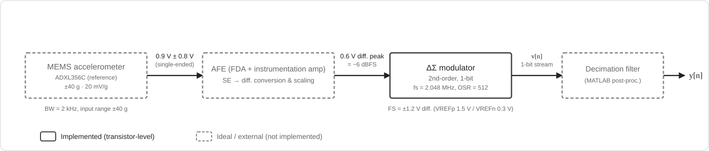
*Signal chain from the reference sensor to the modulator. The sensor and the single-ended to differential conversion are treated as ideal.*

**Reference sensor (the MEMS itself is not implemented, so datasheet values are used)**

| Item | ADXL356C | Source |
|---|---|---|
| Range / sensitivity | ±10 g (80 mV/g) / ±40 g (20 mV/g) | Rev. 0 Table 1 (ratiometric to V1P8ANA) |
| Output | Single-ended, 0 g = 0.9 V (V1P8ANA / 2), 32 kΩ series resistance | Rev. 0 Table 1 |
| Noise density (±40 g) | 110 $\mu\mathrm{g}/\sqrt{\mathrm{Hz}}$ | Datasheet [1] (80 for ±10 g, 75 on the product page [2]) |
| Output BW | Internal low-pass 1.5 kHz (fixed), resonance about 5.5 kHz | Rev. 0 Table 1 |

- **AFE assumption**: an instrumentation amplifier scales the sensor output and an FDA converts it to differential (±0.8 V single-ended → 0.6 V differential peak, output CM 0.9 V). The noise and errors of the AFE are ignored (see Ideal Assumptions).
- **Design BW**: the sensor BW of 1.5 kHz plus a 0.5 kHz transition band for the decimation filter gives a signal band of 2 kHz.

**Required resolution from the sensor noise** (noise density 110 $\mu\mathrm{g}/\sqrt{\mathrm{Hz}}$)

| Item | Value |
|---|---|
| Sensor noise (BW 2 kHz) | 110 $\mu\mathrm{g}/\sqrt{\mathrm{Hz}}$ × $\sqrt{2000}$ $\approx$ 4.92 mg rms ¹ |
| Sensor SNR at full scale (40 g peak) | $`20\log(28.3\,\mathrm{g} / 4.92\,\mathrm{mg})`$ $\approx$ 75.2 dB |
| Required ADC noise | At least 20 dB below the sensor noise |
| Required SNDR | $\approx$ 95.2 dB ($\approx$ 15.5 bit) |
| Chosen resolution | 16 bit (SNDR 98.1 dB) ² |
| ADC noise at 98.1 dB (input-referred) | 28.3 g / 80,100 $\approx$ 353 µg rms ($\approx$ 7.9 $\mu\mathrm{g}/\sqrt{\mathrm{Hz}}$) |
| ADC noise relative to the sensor | $\approx$ 22.9 dB lower |

¹ The sensor BW is 1.5 kHz and the signal band is 2 kHz, so integrating over 2 kHz is conservative (about 1.2 dB higher than over 1.5 kHz).

² The required 15.5 bit is rounded up to the next integer bit, which gives about 3 dB of margin.

- Noise powers add, so an ADC whose noise is 20 dB below the sensor's costs only about 0.04 dB of SNR (0.4 dB if it is 10 dB below).

### 2. System-level
**Noise budget**: 10 % of the total in-band noise is allotted to quantization noise and 90 % to thermal noise (a starting allocation).

**Why 2nd order and OSR 512** — the in-band quantization noise must meet the target SQNR (= SNDR 98.1 dB + 10 dB $\approx$ 108 dB, because it gets 10 % of the noise budget), for a 1-bit quantizer, a −6 dBFS input and the ideal model.

| Order / OSR | Ideal SQNR | Verdict |
|---|---|---|
| 1st / 512 | 71.8 dB | Not enough (about 12 bit) |
| 2nd / 128 | 88.2 dB | Not enough |
| 2nd / 256 | 103.3 dB | Not enough (99.2 dB with $k_{eff}$) |
| **2nd / 512** | **118.3 dB** | Enough (114.3 dB with $k_{eff}$, ENOB $\approx$ 17) |

- A 2nd-order modulator with OSR 512 is the smallest combination that reaches 16 bit (the OSR was searched in powers of two).
- A 3rd-order modulator would allow a lower OSR, but it needs one more OTA (more power), and a 1-bit 3rd-order loop can diverge (it is only conditionally stable and its stable input range shrinks). It was therefore not chosen.

**Why 1 bit**
- A 1-bit DAC has only two levels, so it is **inherently linear**: there is no DAC nonlinearity from capacitor mismatch and no need for correction such as DEM / DWA, which matters for 16-bit linearity. A multi-bit loop would need a flash quantizer and a matched multi-level capacitor DAC, and its DAC nonlinearity would go straight into the output.
- One comparator is enough, so the circuit is simple, small and low-power.
- The price of 1 bit is a larger quantization noise. Oversampling covers it: the signal band is only 2 kHz, so even with OSR 512 the sampling rate is just 2.048 MHz.

**Quantization noise modeling**
- The input is −6 dBFS with a differential peak of 0.6 V, so $P_{signal} = 0.18\ \mathrm{V^2}$, and OSR 512 gives an ENOB of $\approx$ 17.
- In-band quantization noise (Taylor approximation) [3]:

```math
IBQN=\frac{\pi^{2L}\,\Delta^2}{12\,(2L+1)\,OSR^{2L+1}}
```

- The effective gain of the 1-bit quantizer is $k_{eff} = 0.628$ (extracted from the behavioral simulation as the $y\cdot v$ covariance), so $IBQN_{actual} = IBQN / k_{eff}^2$. ENOB 17 is confirmed with this value as well.
- Dynamic range scaling (for the maximum allowed input of −3 dBFS): the standard MOD2 reaches $\max\lvert x_1\rvert \approx 3.17$ and $\max\lvert x_2\rvert \approx 6.27$. With $s_1 = 0.3$ and $s_2 = 0.18$ they drop to 0.95 / 1.13 while the bitstream stays identical (limits 1.0 / 1.2: 1.0 is the full scale, and 1.2 for $x_2$ is an assumed bound that needs an OTA 2 output swing wider than the reference range).
- For the normal −6 dBFS input the swing is smaller, $\max\lvert x_1\rvert \approx 0.82$ and $\max\lvert x_2\rvert \approx 0.76$ (there is margin because the coefficients were chosen for the worst-case input).
- The capacitor ratios give the coefficients of the circuit: 1st stage $C_s / C_i = C_d / C_i$ = 6 / 20 = 0.3 (exactly $s_1$); 2nd stage $c_2 = C_{s2}/C_{i2}$ = 20 / 33 = 0.606 and $a_2 = C_{d2}/C_{i2}$ = 12 / 33 = 0.364 instead of 0.6 and 0.36. Both are 1.01 % larger, which is the same as $s_2$ = 0.1818, so the NTF (zeros at DC) and the SQNR do not change (115.6 dB in both cases) and only the swing of $x_2$ grows by 1 % ($\max\lvert x_2\rvert$ = 1.14 at −3 dBFS, limit 1.2).

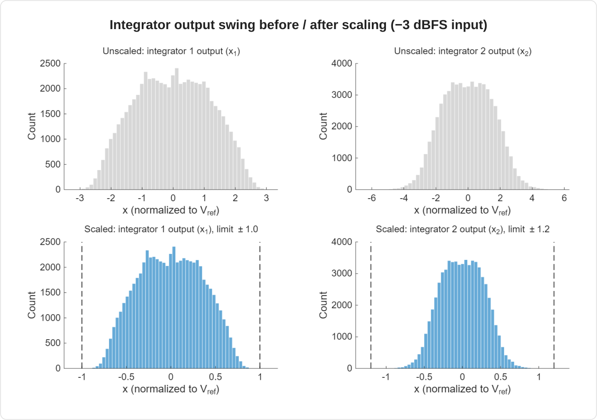
*Integrator output swing before and after dynamic range scaling (−3 dBFS input).*

### 3. Circuit-level requirements

#### GBW (Settling)

**1) Step response of a 2nd-order system and its error envelope** (underdamped, damping ratio $\zeta$, natural frequency $\omega_n$)

```math
v(t)=1-\frac{e^{-\zeta\omega_n t}}{\sqrt{1-\zeta^2}}\sin(\omega_d t+\phi)\;\;\Rightarrow\;\;\varepsilon(t)\le\frac{e^{-\zeta\omega_n t}}{\sqrt{1-\zeta^2}}
```

**2) Error budget** — the settling error is limited to half an LSB at $N = 16$ bit

```math
\varepsilon_{max}=2^{-(N+1)}=7.63\times10^{-6}
```

**3) Required number of time constants $n_\tau$**

```math
\zeta\omega_n T_{settle}\ge\ln\frac{1}{\varepsilon_{max}}+\ln\frac{1}{\sqrt{1-\zeta^2}}=n_\tau
```

**4) Choosing $\zeta = 0.707$ (PM $\approx$ 65.5°)** — assuming a 2-stage OTA (second pole $\omega_{p2}$), the loop gain is

```math
L(s)=\frac{\omega_u}{s\left(1+s/\omega_{p2}\right)},\qquad \omega_u=2\pi\beta\,GBW
```

```math
\omega_n^2=\omega_u\,\omega_{p2},\qquad \zeta=\frac{\omega_n}{2\omega_u}\;\Rightarrow\;\zeta=\tfrac{1}{\sqrt2}:\;\; \omega_{p2}=2\omega_u,\;\; \zeta\omega_n=\omega_u
```

- This is the maximally flat (Butterworth) response. Its step response has a small overshoot ($\approx$ 4.3 %), and it is a common choice for fast settling.
- The exact PM is $`\arctan\!\big(2\zeta\,/\sqrt{\sqrt{1+4\zeta^4}-2\zeta^2}\big) \approx 65.5^\circ`$ (the approximation $`90^\circ-\arctan\!\big(1/(4\zeta^2)\big)`$ gives $63.4^\circ$).
- With $\zeta = 1/\sqrt{2}$, the number of time constants is $n_\tau$ = 11.78 + 0.35 = **12.13**.

**5) GBW requirement**

```math
n_\tau=\omega_u T_{settle}=2\pi\beta\,GBW\,T_{settle}\;\Rightarrow\;GBW\ge\frac{n_\tau}{2\pi\beta\,T_{settle}}
```

- $\beta$: feedback factor of the 1st integrator (set by the capacitors / scaling coefficients, about 0.6)
- The phase time $T_{int} = 1 / (2f_s)$ = 244 ns is split into 75 % for linear settling ($T_{settle}$ = 183 ns) and 25 % for slewing (the split is a design choice).
- $`GBW \ge 12.13 / (2\pi \cdot 0.6 \cdot 183\,\mathrm{ns})`$ = **17.6 MHz**


*Settling error envelope of the 2nd-order response and the half-LSB limit.*

#### DC gain

**1) Finite gain → integrator leakage**

```math
I_i(z)=\frac{z^{-1}}{1-p_i z^{-1}},\qquad p_i=1-\mu_i,\qquad \mu_i=\frac{g_i}{A_0}
```

- $g_i$ = sum of the capacitor ratios attached to the summing node (input coefficient + DAC coefficient), parasitic capacitance ignored
- 1st: $g_1 = s_1 + s_1 = 0.6$, 2nd: $g_2 = s_2/s_1 + 2 s_2 = 0.96$

**2) Shift of the NTF zeros (low-frequency approximation)**

```math
D(z)=(z-p_1)(z-p_2)=(z-1)^2+(\mu_1+\mu_2)(z-1)+\mu_1\mu_2
```

```math
|\Delta NTF(e^{j\omega})|^2\approx(\mu_1+\mu_2)^2\,\omega^2
```

- The two stages act as one effective leakage $\mu_{eff} = \mu_1 + \mu_2 = (g_1 + g_2) / A_0$.
- Compared with the exact expression $\mu_1^2 + \mu_2^2$, this adds the cross term $2\mu_1\mu_2$, so it is an upper bound (conservative).

**3) Integrating the in-band quantization noise** ($\omega_B = \pi / OSR$)

```math
IBQN=IBQN_{ideal}+\Delta IBQN,\qquad \Delta IBQN=\frac{\Delta^2}{12k_{eff}^2}\cdot\frac{\pi^2(\mu_1+\mu_2)^2}{3\,OSR^3}
```

**4) Allowed $\mu$**: $\Delta IBQN$ = 1.94e-12 − 4.68e-13 = 1.48e-12 (normalized; 1.94e-12 is the quantization noise allowed at the target SQNR of 108.1 dB, with a signal power of 0.125 in units of FS = 1)

```math
\mu_{max}=\frac{6\,k_{eff}\,OSR^{3/2}\sqrt{\Delta IBQN}}{\pi\,\Delta}=8.4\times10^{-3}
```

**5) Minimum DC gain**

```math
A_0\ge\frac{g_1+g_2}{\mu_{max}}=\frac{0.6+0.96}{8.4\times10^{-3}}\approx186\;(45.3\text{ dB})
```

- The exact (root-sum-square) form gives $\sqrt{g_1^2 + g_2^2} / \mu_{max} \approx 135$ (42.6 dB), so the approximation above is about 2.7 dB conservative.

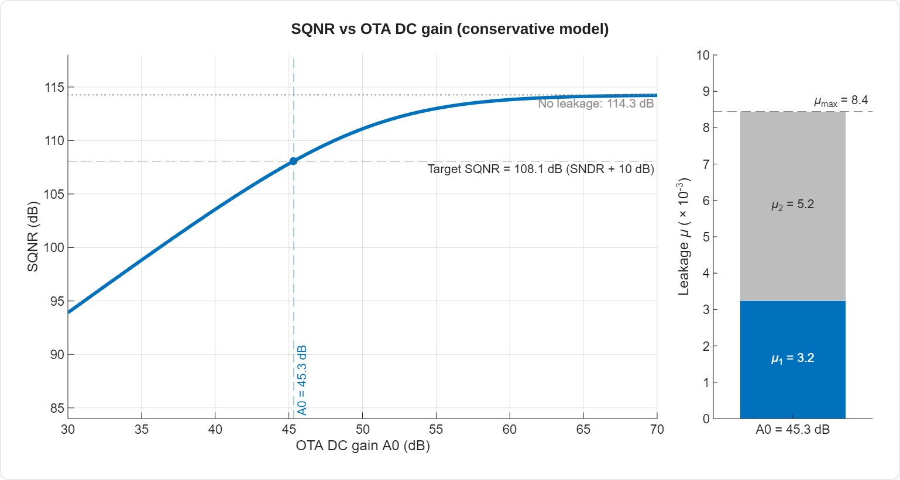
*SQNR versus OTA DC gain (conservative model,* $\mu_1+\mu_2$*) and the leakage contribution of each stage at the spec gain.*

#### Slew rate

**1) Worst-case step** — the largest output change of the 1st integrator in one phase occurs when the input peak and the DAC reference have opposite polarity (single-ended)

```math
\Delta V_{max}=s_1\,(A_{in}+V_{ref})=0.3\times(0.3+0.6)=0.27\;\text{V}
```

- $A_{in}$ = 0.3 V (normal −6 dBFS input, single-ended peak), $V_{ref}$ = 0.6 V ($V_{REFp} - V_{CM}$)
- 0.54 V differentially

**2) Time allocation** — the phase time $T_{int}$ = 244 ns is split into 25 % for slewing ($T_{slew}$ = 61 ns) and 75 % for linear settling (183 ns, as in the GBW derivation); the split is a design choice.

**3) Required slew rate**

```math
SR\ge\frac{\Delta V_{max}}{T_{slew}}=\frac{0.27\text{ V}}{61\text{ ns}}=\mathbf{4.42\;V/\mu s}\;\;(+50\%\text{ margin}: 6.64\;V/\mu s)
```

- The extra step caused by an overload (sensor output up to −3.5 dBFS) is not included. The design is based on the normal −6 dBFS input.

#### OTA current / $g_m$ allocation

**1) Slew current conditions of the 2-stage Miller OTA**

```math
I_{tail}\ge SR\cdot C_c,\qquad I_{out}\ge SR\cdot(C_c+C_L)
```

- With $C_s$ = 4 pF the effective load is $C_L$ $\approx$ 6.8 pF × 1.2 margin, and $C_c / C_L = 0.15$ gives $C_c$ $\approx$ **1.22 pF**. $C_L$ is the total capacitance seen at the OTA output, roughly the CMFB capacitors at the output, the capacitors in the feedback path, and the $C_s$ of the next stage.
- Minimum slew currents: $I_{tail}$ ≥ 5.4 µA, $I_{out}$ ≥ 35.5 µA

**2) $g_m$ from the GBW** — target GBW 30 MHz (about 1.7× margin over the required 17.6 MHz)

```math
g_{m1}=2\pi\cdot GBW\cdot C_c\approx231\;\mu S,\qquad g_{m2}=\frac{g_{m1}}{C_c/C_L\text{ ratio}}=\frac{g_{m1}}{0.15}\approx1540\;\mu S
```

**3) Currents** [7] — $g_m/I_D = 15$ was chosen as follows: the $C_{gg}$ that satisfies the pole-approximation condition for Miller pole splitting is fixed first, $f_T$ follows from it, and $g_m/I_D$ is then decided.

```math
I_{tail}=\frac{2g_{m1}}{15}\approx30.8\;\mu A,\qquad I_{out}=\frac{g_{m2}}{15}\approx102.5\;\mu A
```

- These are about 3 to 6 times larger than the minimum slew currents (5.4 / 35.5 µA), so **the $g_m$ condition dominates** and the slew requirement is met automatically.
- The chain behind these currents: kT/C sets the capacitors, the capacitors set the load $C_L$, $C_L$ sets $C_c$, and $C_c$ and $C_L$ set $g_m$ and the currents. OTA 2 has a smaller $C_c$ (0.59 pF against 1.19 pF) and therefore about half of the currents.

#### Capacitors (kT/C)
- kT/C model [4], with 2 branches × 2 phases × 2 sides: $C_{s,min} = \dfrac{8kT}{P_{thermal}\cdot OSR}$ → **at least 2.57 pF**
- With margin, $C_s$ $\approx$ 4 pF is used (4.2 pF implemented), giving a kT/C noise of $\approx$ 1.6e-11 V². At the minimum of 2.57 pF the kT/C noise alone would use the whole thermal budget (2.5e-11 V²); with 4 pF it uses about 64 % and leaves the rest for the OTA noise.
- The remaining capacitors follow from the scaling coefficients (input / DAC coefficient = $C_s / C_i = C_d / C_i$).

| Stage | Coefficients | Capacitor ratio | Value |
|---|---|---|---|
| 1st | $a_1 = s_1 = 0.3$ | $C_s : C_d : C_i$ = 6 : 6 : 20 | 4.20 / 4.20 / 14.0 pF (unit 0.70 pF) |
| 2nd | $c_2 = s_2/s_1 = 0.6$, $a_2 = 2 s_2 = 0.36$ | $C_{s2} : C_{d2} : C_{i2}$ = 20 : 12 : 33 ($\approx$ 15 : 9 : 25) | 4.23 / 2.54 / 6.98 pF (unit 0.21 pF) |

- Each ratio is realized with an integer number of identical MIM unit cells.
- The 2nd-stage capacitors are not set by noise: the noise of the 2nd stage is attenuated by the gain of the 1st integrator, so they can be smaller (a next step, see Limitations).

#### Switch $R_{on}$

**1) Error budget → required number of RC time constants** — the RC settling error during sampling is limited to half an LSB ($N = 16$ bit)

```math
e^{-t/\tau}\le 2^{-(N+1)}\ \Rightarrow\ \frac{t}{\tau}\ge N_{err}=(N+1)\ln2=11.78
```

**2) Time and load capacitance** — the phase time of 244 ns is rounded down to 10 ns steps, so $t$ = 240 ns. The same switch drives $C_s$ and $C_d$, so $C_{eff} = C_s + C_d$.

**3) $R_{on}$ limit**

```math
R_{on}\le\frac{t}{N_{err}\,(C_s+C_d)}
```

| Condition | $C_{eff}$ | $R_{on}$ limit |
|---|---|---|
| $C_s = C_d$ = 4.2 pF (implemented) | 8.4 pF | **2.43 kΩ** |
| (reference) $C_s = C_d$ = 4 pF | 8 pF | 2.55 kΩ |
| (reference) $C_s$ only | 4.2 pF | 4.85 kΩ |

- The limit is lower than the 4.85 kΩ of the earlier design ($C_s$ = 2.1 pF, from the modeling code) because the capacitors are larger.
- The switch on the summing-node side sits inside the OTA loop. Its pole must be kept well away from the loop crossover for a stable PM, so its $R_{on}$ limit is lower (the target is about 0.5 kΩ, down from the previous limit of 1 kΩ; the larger switch W is still to be applied).

### 4. Implementation choices
- **CMFB**: SC CMFB (no static power and no loss of output swing; the clock is available).
- **Clock**: ideal (see Ideal Assumptions in Architecture).
- **Switch**: TG, bootstrap or basic switch depending on the location. $R_{on}$ is sized by simulation so that the RC time constants do not limit the settling.

### 5. Derived spec summary

| Item | Required (modeling) | Design | Result |
|---|---|---|---|
| Order / quantizer | 2nd / 1-bit | CIFB | |
| $f_s$ / OSR / BW | — | 2.048 MHz / 512 / 2 kHz | |
| Scaling $a_1$ / $c_2$ / $a_2$ | $\max\lvert x_1\rvert \le 1$, $\max\lvert x_2\rvert \le 1.2$ | 0.3 / 0.6 / 0.36 ($s_1$ = 0.3, $s_2$ = 0.18) | |
| Quantizer gain $k_{eff}$ | — | 0.628 | |
| In-band Q noise | — | 4.68e-13 (FS = 1; 6.7e-13 V²), SQNR 114.3 dB | |
| Q : thermal budget | 1 : 9 | Q 2.8e-12 V² / thermal 2.5e-11 V² | |
| 1st stage $C_s$ | ≥ 2.57 pF | 4.2 pF (4 pF designed) | |
| OTA DC gain | ≥ 45.3 dB | | OTA 1: 58.5 dB / OTA 2: 55.3 dB ¹ |
| OTA GBW | ≥ 17.6 MHz | | OTA 1: 24.3 MHz / OTA 2: 26.1 MHz ² |
| Phase margin | $\approx$ 65.5° | | OTA 1: 65.0° / OTA 2: 62.5° ¹ |
| Slew rate | ≥ 4.42 V/µs (+50 %: 6.64) | | |
| Switch $R_{on}$ (sampling) | ≤ 2.43 kΩ | Bootstrap 1 / 0.15 µm | ≤ 1.41 kΩ (worst case) ³ |
| Switch $R_{on}$ (summing node) | $\approx$ 0.5 kΩ | TG 4 / 14 / 0.35 µm | ≤ 0.9 kΩ, too high ⁴ |
| Supply / power | 1.8 V / 684 µW | | 380 µA from VDD ⁵ |

¹ 25 °C, closed-loop AC (loop gain with the feedback factor $\beta$); PM required for $\zeta$ = 0.707.

² Equivalent GBW = loop crossover / $\beta$: OTA 1 14.57 MHz with $\beta_1$ = 0.6, OTA 2 13.28 MHz with $\beta_2$ = 0.508. The required loop crossover is $\beta\cdot GBW$ = 10.6 MHz (OTA 1) and 8.9 MHz (OTA 2).

³ 0.85–1.04 kΩ at ss, 27 °C; the worst case is ss, 125 °C. The 2.43 kΩ limit is set by $C_s + C_d$ = 8.4 pF.

⁴ Over all corners and temperatures; the target is for a pole well above the loop crossover, so the width has to be increased (about 2×).

⁵ Static `.op`, bias only.

---

## Architecture

### Overall Block Diagram
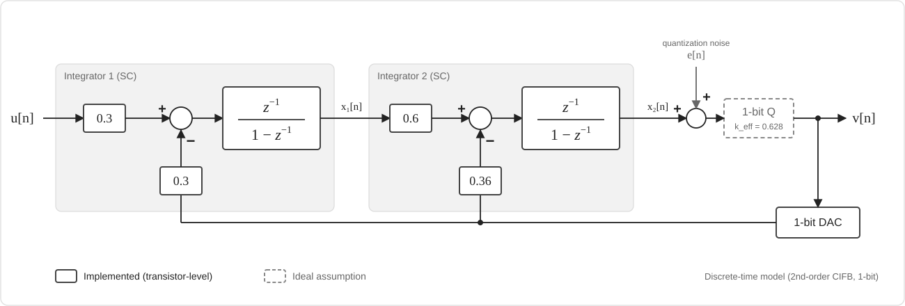
*Discrete-time model of the modulator. Solid boxes are implemented at transistor level, the dashed box is an ideal assumption.*

- Fully-differential, 2nd-order, 1-bit CIFB structure ($a_1$ = 0.3, $c_2$ = 0.6, $a_2$ = 0.36)
- The blocks below are implemented at transistor level. Everything else is replaced by ideal models (see Ideal Assumptions).

### Transistor-level Blocks

#### SC Integrator
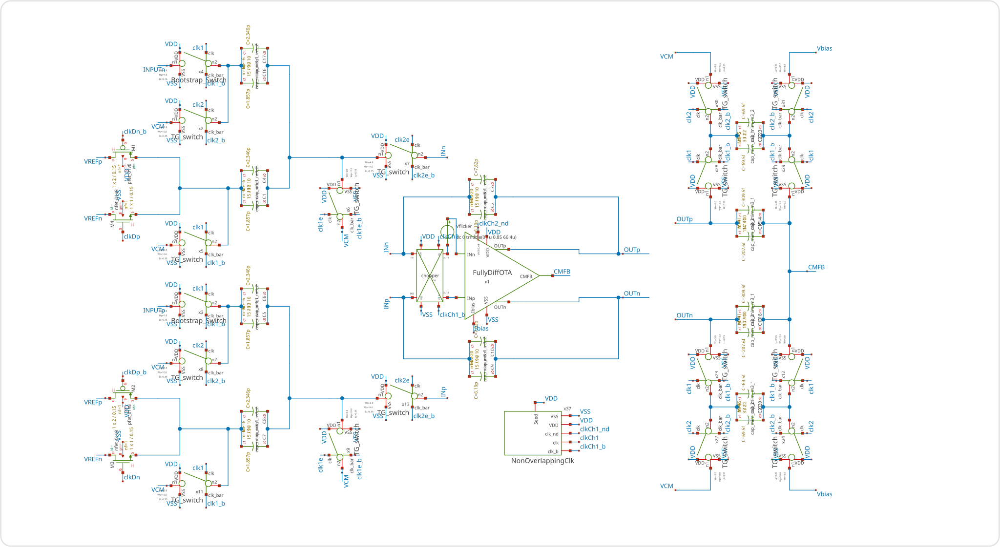
*1st integrator (*$C_s = C_d$ *= 4.2 pF,* $C_i$ *= 14.0 pF)*

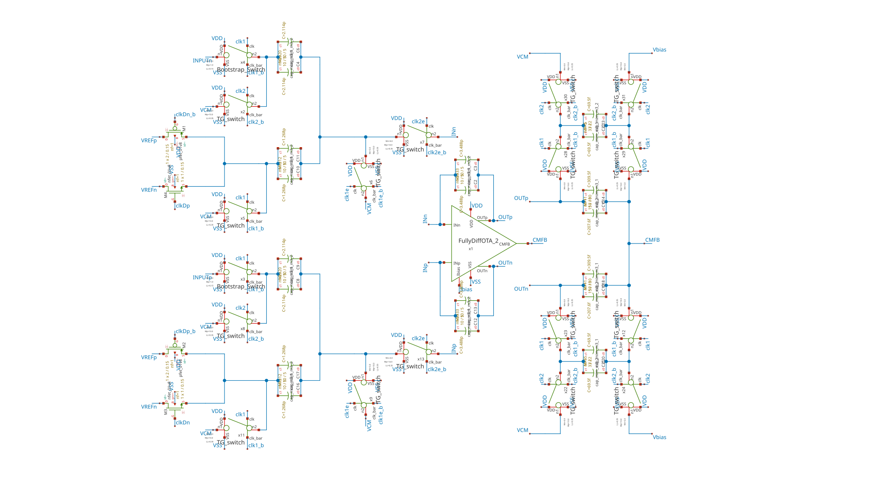
*2nd integrator (*$C_s : C_d : C_i$ *= 4.23 : 2.54 : 6.98 pF)*

- Fully-differential, parasitic-insensitive SC integrator with separate sampling ($C_s$) and DAC ($C_d$) capacitors
- Bottom-plate sampling with early phases ($\phi_{1e}$, $\phi_{2e}$) that turn off before $\phi_1$, $\phi_2$ (see Clocking)
- 1st stage: $C_s$ / $C_d$ / $C_i$ = 4.20 / 4.20 / 14.0 pF (6 : 6 : 20 units), 2nd stage: 4.23 / 2.54 / 6.98 pF (20 : 12 : 33 units)
- Capacitor ratio accuracy: identical MIM unit cells are stacked (cap_mim_m3_1 + cap_mim_m3_2), and the ratio is set by the number of units.
- The input sampling switch is a bootstrap switch. The VCM, summing-node and chopper switches are TGs (see Switches below).

#### OTA

*OTA of the 1st integrator (*$C_c$ *= 1.19 pF)*


*OTA of the 2nd integrator (*$C_c$ *= 0.59 pF)*

- 2-stage OTA, PMOS (LVT) input pair, Miller compensation with a nulling resistor
- SC CMFB (see CMFB below)
- Design targets: DC gain ≥ 45.3 dB, GBW ≥ 17.6 MHz, PM $\approx$ 65.5° (see Specifications)

**Transistor sizes** (the OTAs of the 1st and 2nd integrators have the same structure and sizes except for the compensation capacitor; m × W / L [µm])

| Device | Role | Type | Size |
|---|---|---|---|
| Itail, M9 | 1st-stage tail current source / bias mirror | pfet_01v8 | 9 × 2.5 / 0.7 |
| M1, M2 | Input pair | pfet_01v8_lvt | 10 × 7.3 / 1.0 |
| M3, M4 | 1st-stage load | nfet_01v8 | 1 × 2.5 / 0.45 |
| M5, M6 | 2nd-stage driver | nfet_01v8 | 3 × 5 / 0.45 |
| M7, M8 | 2nd-stage current source (SC CMFB controlled) | pfet_01v8 | 9 × 2.5 / 0.45 |
| R1, R2 | Nulling resistor | res_high_po | 1 kΩ (1.013 kΩ) |
| R5, R9 | 1st-stage resistive CMFB | res_xhigh_po_0p35 | 302.9 kΩ |
| C3–C6 | 1st-stage CMFB capacitors | cap_mim_m3_1 + m3_2 | 13.9 fF × 2 |
| $C_c$ | Miller compensation | cap_mim_m3_1 + m3_2 | 1st OTA 594.2 fF × 2 ($\approx$ 1.19 pF), 2nd OTA 297.1 fF × 2 ($\approx$ 0.59 pF) |

- The area of M3 / M4 is only about 1.1 µm², so the OTA flicker noise is concentrated in these devices (see Noise analysis).
- The $C_c$ of the 1st OTA ($\approx$ 1.19 pF) matches the modeled value ($\approx$ 1.22 pF).
- Operating point (`.op`, 25 °C):

| | OTA 1 | OTA 2 |
|---|---|---|
| 1st-stage PMOS (xm1, xm2) $I_D$ | 14.69 µA each (tail about 29.4 µA) | 7.39 µA each (tail about 14.8 µA) |
| 2nd-stage NMOS (xm5, xm6) $I_D$ | 101.5 µA each | 52.6 µA each |
| Output CM (`v(outp)`, `v(outn)`) | 0.9020 V | 0.9023 V |

  The sum of the OTA currents (about 232 µA + 121 µA) plus the bias branches matches the 380 µA measured from VDD.
- Device operating points of OTA 1 (`.op`, 25 °C; all devices are in saturation, $V_{DS} > V_{dsat}$):

| Device | $I_D$ | $g_m$ | $g_m/I_D$ | $V_{dsat}$ | $V_{DS}$ |
|---|---|---|---|---|---|
| Itail | 29.4 µA | 0.312 mS | 10.6 | 0.163 V | 0.382 V |
| M1, M2 (input pair) | 14.69 µA | 0.211 mS | 14.4 | 0.095 V | 0.652 V |
| M3, M4 (1st-stage load) | 14.69 µA | 0.180 mS | 12.2 | 0.131 V | 0.767 V |
| M5, M6 (2nd-stage driver) | 101.5 µA | 1.198 mS | 11.8 | 0.135 V | 0.902 V |
| M7, M8 (2nd-stage current source) | 101.5 µA | 0.776 mS | 7.6 | 0.232 V | 0.898 V |
| M9 (bias mirror) | 30.8 µA | 0.327 mS | 10.6 | 0.164 V | 1.129 V |

  The input pair has the largest $g_m/I_D$ (moderate inversion) to get the transconductance with a small current, while the PMOS current source M7 / M8 has the smallest $g_m/I_D$ so that it contributes little noise.

#### Switches (Bootstrap / TG)
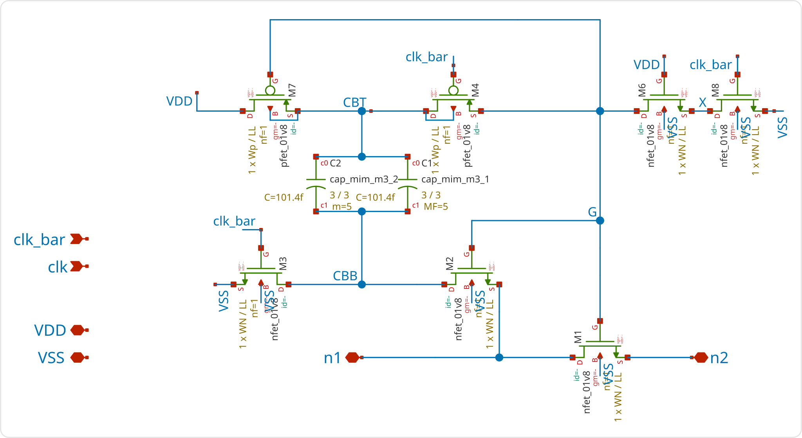
*Bootstrap switch*


*Transmission-gate switch (LVT)*

The measured $R_{on}$ curves are in Verification, section 2 (Switches).

| Location | Switch | Reason |
|---|---|---|
| Input sampling | Bootstrap NMOS (nfet_01v8 1 × 1 / 0.15, bootstrap capacitor $\approx$ 203 fF) | Minimizes the signal-dependent $R_{on}$ variation (distortion) [5] |
| Fixed nodes (VCM, $\phi_{1e}$ / $\phi_2$) | TG, LVT (Wn 3 / Wp 10 / L 0.35) | The node voltage is fixed, so linearity is not needed and only the worst-case $R_{on}$ (at 0.9 V) has to be met |
| Signal path, summing-node side of the OTA ($\phi_{2e}$) | TG, LVT (Wn 4 / Wp 14 / L 0.35) | Fixed virtual-ground node, inside the OTA loop → low $R_{on}$ needed |
| DAC references (VREFp / VREFn) | Basic switches: PMOS (1 × 2 / 0.15) → VREFp, NMOS (1 × 1 / 0.15) → VREFn | The references are close to VDD / VSS, so a single PMOS / NMOS is enough, with minimum area |
| Chopper | TG, LVT (Wn 4 / Wp 14 / L 0.35) × 4 | The chopper is outside the charge-transfer path, so the $R_{on}$ requirement is relaxed (see Chopper in Architecture) |

- The switch on the summing-node side is inside the OTA loop during integration, so it has its own $R_{on}$ limit to keep the switch pole well above $\beta\cdot GBW$.
- Simulated $R_{on}$ (details in Verification, section 2):
  - Bootstrap (input sampling, ss corner): 850–1040 Ω at 27 °C, up to about 1.41 kΩ at 125 °C, below the 2.43 kΩ limit.
  - TG 4 / 14 / 0.35 µm (summing node, chopper): 360–823 Ω at tt / 27 °C and at most about 0.9 kΩ over all corners and temperatures. This is above the 0.5 kΩ target of the summing-node switch, so its width has to be increased (roughly 2×, since $R_{on} \propto 1/W$).
  - The TG for the fixed nodes (3 / 10 / 0.35 µm) was not simulated separately.

#### Chopper (1st integrator)
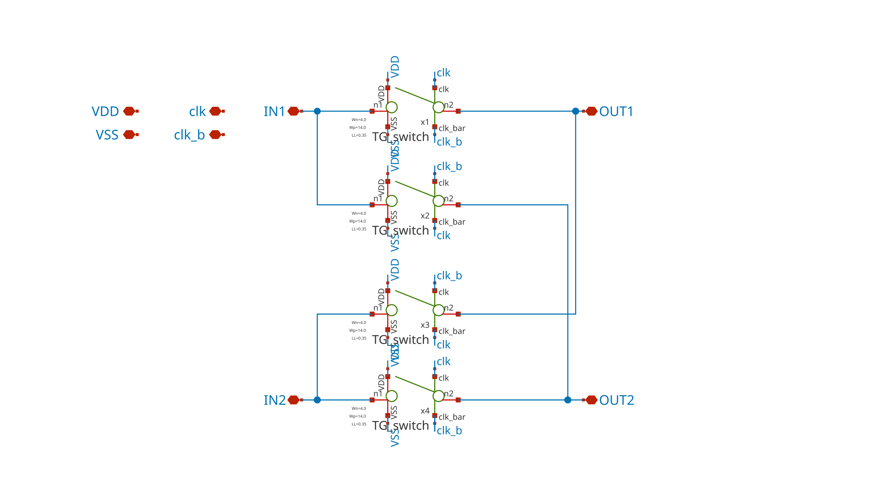
*Chopper (4 TGs, 2 per path)*

- **Why it was added**: without the chopper the flicker noise of the OTA dominates the in-band noise: 1.9e-8 V² (SNR 69.8 dB), against 1.53e-11 V² for kT/C (100.7 dB). The OTA flicker alone would limit the SNDR to about 70 dB (see Noise analysis in Verification).
- The chopper moves the OTA offset and flicker noise to the chopper frequency, out of the signal band.
- **Two choppers**: CH1 sits at the OTA input (summing nodes), CH2 sits inside the OTA between the 1st-stage output (`OUTp1` / `OUTn1`) and the 2nd-stage gates (`ChOUTp1` / `ChOUTn1`). The Miller compensation wraps the 2nd stage only, so the OTA output and the Miller capacitors are not flipped. Only the 1st integrator has choppers. The 2nd stage and the SC CMFB are outside CH2.
- **Why not CDS?** Correlated double sampling also suppresses offset and flicker noise in discrete-time circuits and works well, but it needs extra capacitors, and the OTA phase margin would have to be redesigned from scratch. The chopper adds no capacitance to the signal path, so the OTA design can stay as it is.
- Clock $\phi_{ch}$ (`clkCh`, $f_{ch} = f_s / 2$). The polarity switches in the middle of $\phi_1$ and never during integration. $f_s/2$ is the highest chopping frequency available and is synchronous with the sampling clock. CH1 and CH2 each have their own non-overlapping clock generator (`NonOverlappingClk`: NAND, cross-coupled NOR pair and delay chain), driven from the same `clkCh_nd`. Inside the chopper the four TGs use four phases: `clk` and `clk_b` from the generator drive the NMOS gates, and their inverses `phiA` / `phiB` drive the PMOS gates, so both PMOS are off in the gap.
- $C_s$, $C_d$, $C_i$, the $C_s$ of the next stage and the CMFB sensing are outside the chopper, so the signal path is not affected.
- Input-referred flicker noise of the 1st OTA (`.noise`, $I_{tail}$ = 30.8 µA, no chopper): 17.9 µV/√Hz at 1 Hz and 0.98 µV/√Hz at 1 kHz, following $f^{-0.84}$; 4.7e-9 V² in the 1 Hz – 2 kHz band (before the capacitor ratio).

#### CMFB

The SC CMFB circuit is part of the SC Integrator schematic shown above.

- **OTA 2nd stage (output)**: SC CMFB (no static power and no loss of output swing; output CM target 0.9 V).
- **OTA 1st stage**: resistive CMFB. The resistor is about 300 kΩ (302.9 kΩ, res_xhigh_po), reduced from 5 MΩ to save area while the DC gain still meets the spec, and the capacitors (13.9 fF × 2) were sized roughly.
- **SC CMFB capacitors (OTA output stage)**: about 517 fF on the output nodes and about 139 fF on the VCM / Vbias side.
- **Output CM**: the SC CMFB reference is trimmed with $V_{bias}$. The final values are $V_{bias}$ = 0.62 V (1st integrator, output CM 0.9017 V) and $V_{bias}$ = 0.69 V (2nd integrator).

#### Clocking

*Clock timing of the modulator (*$f_s$ *= 2.048 MHz,* $T$ *= 488.28 ns). (A) zooms in on the* $\phi_1 \to \phi_2$ *transition.*

| Clock | High interval (within one period) | Purpose |
|---|---|---|
| $\phi_1$ | about 2–240 ns | Sampling |
| $\phi_{1e}$ | about 2–239 ns | Turns off 1 ns before $\phi_1$ |
| $\phi_2$ | about 246–484 ns | Integration + DAC |
| $\phi_{2e}$ | about 246–483 ns | Turns off 1 ns before $\phi_2$ |
| $\phi_{ch}$ (`clkCh`) | Toggles once every two periods ($f_s/2$) | Chopper, toggles in the middle of $\phi_1$ |

- Two-phase non-overlapping clocks. The gap is about 6 ns for both $\phi_1 \to \phi_2$ and $\phi_2 \to$ next $\phi_1$.
- $\phi_{1e}$ / $\phi_{2e}$ turn off 1 ns before $\phi_1$ / $\phi_2$, which gives bottom-plate sampling (the switches on the summing-node side open first, so the charge is frozen).
- The chopper toggles at 120 ns + $k\cdot$488.28 ns, that is, in the middle of every $\phi_1$ (never during integration).
- Inside each block, the phase and DAC clocks go through NAND2 + INV to generate `clk` / `clk_b` (exact complements for the TGs). A dummy NAND2 is also placed in the paths that do not use the DAC, so all paths have the same delay. The chopper clocks are the exception: they use the non-overlapping generator above, because a NAND + INV pair overlaps by one inverter delay (see Integrator).
- DAC clocks: $\mathrm{clkDp} = D\cdot\phi_2$, $\mathrm{clkDn} = \bar{D}\cdot\phi_2$ ($D$ = DFF output bit)
- Quantization: B-source comparator → DFF (`dfxbp_1`). The bit is captured at the rising edge of $\phi_1$ and drives the DAC in $\phi_2$ of the same period.
- The clock sources themselves are ideal (see Ideal Assumptions).

**Where the clocks are used in the 1st integrator**

| Clock | Switch | Role |
|---|---|---|
| $\phi_1$ | Input bootstrap (x3, x4) | Samples the input onto the left plate of $C_s$ |
| $\phi_1$ | $C_d$ left plate → VCM (x5, x11) | Resets $C_d$ |
| $\phi_{1e}$ | $C_s$, $C_d$ right plate → VCM (x6, x9) | Bottom-plate switch (opens first) |
| $\phi_2$ | $C_s$ left plate → VCM (x2, x8) | Charge transfer |
| $\phi_2 \times$ DAC | VREFp / VREFn → $C_d$ (XM1–XM4) | DAC charge injection |
| $\phi_{2e}$ | Summing-node connection (x7, x13) | Integration (opens first) |
| $\phi_1$ / $\phi_2$ | SC CMFB (x23, x28 / x22, x30, etc.) | Detects the output CM in $\phi_1$, refreshes in $\phi_2$ |
| chopper | CH1 (OTA input), CH2 (inside the OTA, 1st-stage output → 2nd-stage gate) | Reverses the polarity at $f_s/2$ |

### Ideal Assumptions

Blocks that are modeled ideally instead of being implemented at transistor level, and the plan for them.

| Block | Modeled as | Planned implementation |
|---|---|---|
| Comparator | Ideal comparator + DFF | StrongARM + SR latch |
| Bias current | Ideal current source | Constant-gm bias |
| VREF / VCM generation | Ideal voltage sources (1.5 V / 0.3 V / 0.9 V) | Reference buffer |
| Clock generator | Ideal non-overlapping clocks | Digital clock generator (chopper clock: $f_s/2$ divider) |
| Sensor AFE | Instrumentation amplifier + FDA, ideal (±0.8 V → 0.6 V differential peak) | INA + FDA |
| Device noise | Not included in the transient simulation | Injected with ngspice `trnoise` (see Verification) |

---

## Verification

All results are from ngspice simulations (AC for the OTA, transient otherwise) with $C_s$ = 4.2 pF unless noted.
Sections based on the circuit before the chopper fixes (the 2nd chopper at the OTA output, the Miller capacitor around both stages): the OTA verification (1), the chopper standalone and loop-stability tests (3), the 1st-integrator tests (4) and the SNDR of the first design (6). Their netlists and figures have not been regenerated. In particular, the phase margin has to be measured again, because the CH2 TG now sits in the Miller path of the 2nd stage.

### 1. OTA (standalone)
Closed-loop AC simulation of the OTA with the loop closed at DC only (inductors), 25 °C, tt (`tb_FD_OTA` for OTA 1, the same testbench with OTA 2). The loop gain is $T = A\beta$, and the crossover and the phase margin are read at $|T|$ = 0 dB. The feedback factor is $\beta_1$ = 0.6 for OTA 1 (measured with the capacitor network of the testbench) and $\beta_2 = C_{i2} / (C_{s2} + C_{d2} + C_{i2})$ = 33 / 65 = 0.508 for OTA 2 (independent of the unit capacitor); the OTA 2 testbench still uses $\beta$ = 0.6, so its loop gain is scaled by 0.508 / 0.6 (the phase is the same).

| Metric | Required | OTA 1 | OTA 2 |
|---|---|---|---|
| DC loop gain (`dc_loop_gain_db`) | ≥ 45.3 dB | 58.5 dB | 55.3 dB |
| Loop crossover $f_{u,loop}$ | ≥ 10.6 / 8.9 MHz ¹ | 14.57 MHz | 13.28 MHz |
| Phase margin | $\approx$ 65.5° ($\zeta$ = 0.707) | 65.0° | 62.5° |
| Output common mode | 0.9 V | 0.9020 V | 0.9023 V |
| 1st-stage tail current $I_{tail}$ | — | 29.4 µA | 14.8 µA |
| 2nd-stage current $I_{out}$ (per side) | — | 101.5 µA | 52.6 µA |

¹ Required $\beta\cdot GBW$ with GBW = 17.6 MHz: 10.6 MHz for OTA 1 ($\beta_1$ = 0.6) and 8.9 MHz for OTA 2 ($\beta_2$ = 0.508). Equivalent GBW = crossover / $\beta$: 24.3 MHz (OTA 1) and 26.1 MHz (OTA 2).

- Both OTAs meet the DC gain and the crossover. The phase margin of OTA 1 (65.0°) is at the target, and that of OTA 2 (62.5°) is 3.0° below the 65.5° target but above 60°. The integrator tests show that the output settles below 1 LSB before the sampling point (see Integrator).
- All devices of OTA 1 are in saturation (operating-point table in the OTA description). The noise of the OTA is analyzed in Noise analysis.
- Not verified: the slew rate (≥ 4.42 V/µs) is not simulated separately, and the OTA was simulated at 25 °C and the tt corner only.
- The OTA 2 loop gain is scaled from the testbench with $\beta$ = 0.6; the crossover and the phase margin were read again on the scaled curve (13.28 MHz, 62.5°). The load of the testbench (150 fF per output and the feedback network of OTA 1) is not the real load of OTA 2, so the OTA 2 numbers are approximate.


*Loop gain* $T = A\beta$ *of OTA 1 (*$\beta_1$ *= 0.6) and OTA 2 (*$\beta_2$ *= 0.508), 25 °C. The legend gives the DC loop gain, the crossover and the phase margin.*

### 2. Switches (standalone)
$R_{on}$ is extracted from a slow input ramp with a 10 mV sense source ($R_{on} = 10\ \mathrm{mV} / \lvert i\rvert$) while the switch is on. Simulated sizes: TG $W_n / W_p / L$ = 4 / 14 / 0.35 µm (the size used at the summing node and in the chopper), bootstrap switch NMOS 1 / 0.15 µm.


*TG at the tt corner, −40 to 125 °C.*

**TG over corners** ($R_{on}$ over the whole $V_{in}$ sweep, minimum at the rails – peak at mid-range, in Ω):

| Temperature | tt | ss | ff |
|---|---|---|---|
| −40 °C | 307 – 836 | 252 – 903 | 194 – 431 |
| 27 °C | 360 – 823 | 301 – 815 | 224 – 454 |
| 85 °C | 398 – 844 | 332 – 812 | 249 – 490 |
| 125 °C | 424 – 873 | 352 – 830 | 266 – 520 |

- The worst case of the TG over all corners and temperatures is about 0.9 kΩ (ss, −40 °C). This is far below the 2.43 kΩ limit of the sampling switch, but above the 0.5 kΩ target of the summing-node switch (see Architecture), so the TG width has to be increased. The $R_{on}$ has a bell shape over $V_{in}$ with the peak at mid-range (about 0.9 V at tt).

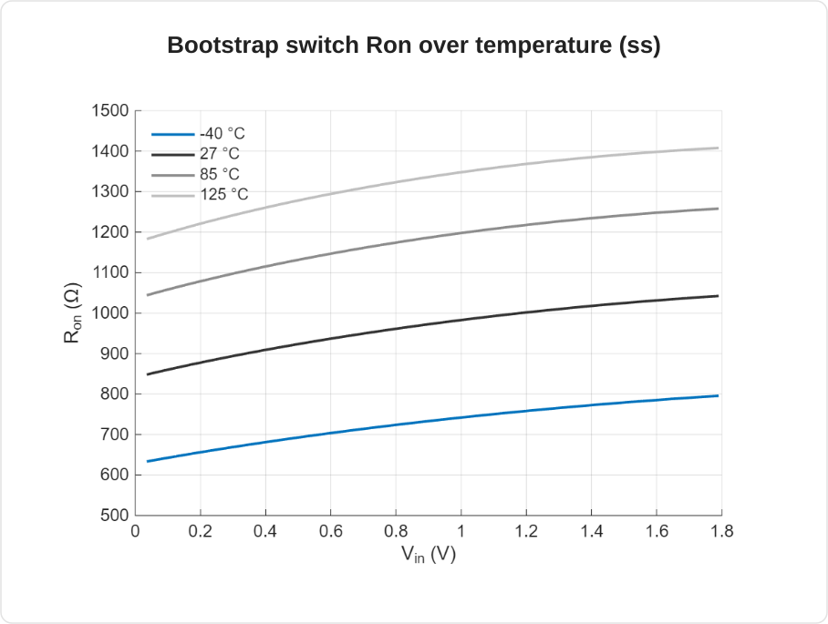
*Bootstrap switch (ss), −40 to 125 °C: 635–795 Ω at −40 °C up to 1185–1410 Ω at 125 °C.*

**Bootstrap switch over corners** ($R_{on}$ over $V_{in}$ = 0.1 – 1.7 V, in Ω; `analyze_bs_corners.m`):

| Temperature | tt | ss | ff |
|---|---|---|---|
| −40 °C | 533 – 639 | 646 – 790 | 449 – 530 |
| 27 °C | 707 – 835 | 865 – 1037 | 591 – 691 |
| 85 °C | 865 – 1009 | 1063 – 1253 | 721 – 849 |
| 125 °C | 977 – 1141 | 1204 – 1403 | 815 – 1004 |

The worst case is ss at 125 °C with at most 1.40 kΩ, below the 2.43 kΩ limit of the sampling switch. The bootstrap $R_{on}$ rises monotonically with $V_{in}$ (about 15–20 % over the range), without the bell shape of the TG.

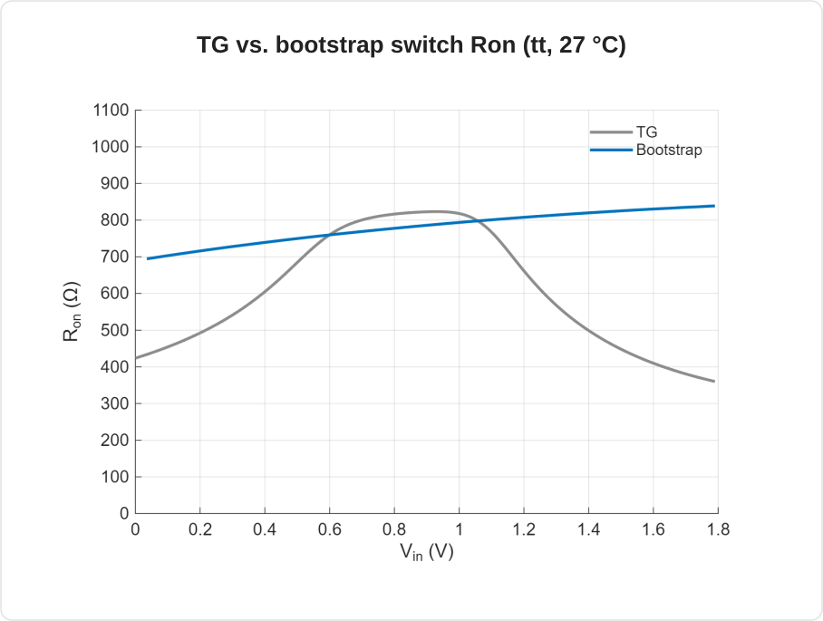
*TG and bootstrap switch at the tt corner, 27 °C.*

- At tt and 27 °C the TG varies between 360 and 823 Ω (about 460 Ω of variation, bell shape with the peak at 0.93 V), while the bootstrap switch is monotonic (707–835 Ω, about 130 Ω of variation). The bootstrap value is higher at the rails, but its signal-dependent part is smaller and smoother, which is what matters for the input sampling switch.

**Distortion from the $R_{on}$ curvature (estimate)**: the switch drives $C_s + C_d$ = 8.4 pF for $t$ = 240 ns, so the unsettled part of the tracked voltage is $`V_{in}\,e^{-t/(R_{on}(V_{in})\,C)}`$ and its dependence on $V_{in}$ through $R_{on}$ is the distortion. For a sine of 0.3 V amplitude around 0.9 V, the largest unsettled voltage is 1.0e-9 V at the worst case (ss, 125 °C; −181 dBFS) and the harmonics 2–9 are at −194 dBc, far below the 98 dB target. At 27 °C it is below −250 dBc. This estimate covers only the settling with the $R_{on}$ curve; the charge injection and the clock feedthrough of the bootstrap are not included.

### 3. Chopper
- Standalone simulation (`tb_chopper_standalone.spice`, $f_{ch}$ = 1.024 MHz, 4 TGs of 4/14/0.35 µm, 1 kΩ source resistance and 0.5 pF load per output assumed, tt, 25 °C):
  - Modulation: a 20 kHz differential sine wave (0.6 V peak) appears at $f_{ch} \pm f_{in}$ with 0.65 / 0.64 of the input amplitude (ideal square-wave chopping: $2/\pi$ = 0.64). The input frequency leaks through unmodulated at −62 dB relative to the modulated tone; the 2nd chopper moves it out of the signal band again.
  - Switching spike (zero input): 14.3 mV peak at a single output (common mode). The differential spike is 0.58 mV with a 5 % load mismatch between the two sides (the symmetric circuit alone cancels it). The output settles to within 50 µV in 4.6 ns at most, about 1 % of the half period (488 ns), so the spike is gone long before the integrator samples.
- Loop stability: PM and crossover with the chopper held in both states (straight / cross), 1st-stage OTA, $\beta$ = 0.6, 25 °C (`tb_ch_OTA`, chopper TGs at Wn/Wp/L = 4/14/0.35 µm). The loop crossover is 13.6 MHz and the PM is 69.4° in both states (DC loop gain 58.5 dB), so the chopper does not limit the stability. Compared with the same loop without the chopper (14.57 MHz, PM 65.0°), the crossover is about 7 % lower (series $R_{on}$ of the chopper TGs) and the PM is 4° higher. The crossover is still above the required $\beta \cdot GBW$ = 10.6 MHz.
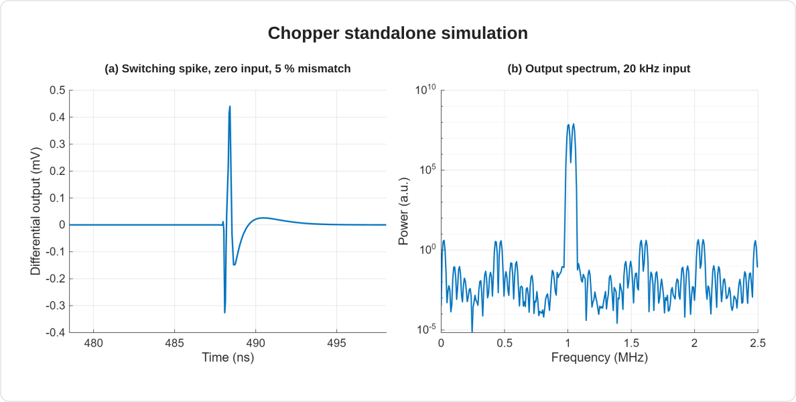
*(a) Differential output spike at a chopper clock edge (zero input, 5 % load mismatch): 0.58 mV peak, settled within a few ns. (b) Differential output spectrum for a 20 kHz input: the signal is modulated to* $f_{ch} \pm f_{in}$ *around 1.024 MHz.*


*Loop gain (*$\beta$ *= 0.6) of the 1st-stage OTA with the chopper in both states and without the chopper: 13.6 MHz and PM 69.4° with the chopper (identical in both states), 14.57 MHz and PM 65.0° without it.*

### 4. Integrator (standalone)
- DAC-only and DC-input tests. The coefficients are extracted in MATLAB from the samples taken at the end of $\phi_2$ (circles).

**1st integrator** ($`C_s = C_d`$ = 4.2 pF, $`C_i`$ = 14.0 pF, $`V_{bias}`$ = 0.62 V; ideal DAC step $`0.3 \times 1.2\ \mathrm{V}`$ = 0.360 V, ideal input step −6.0 mV for 20 mV)

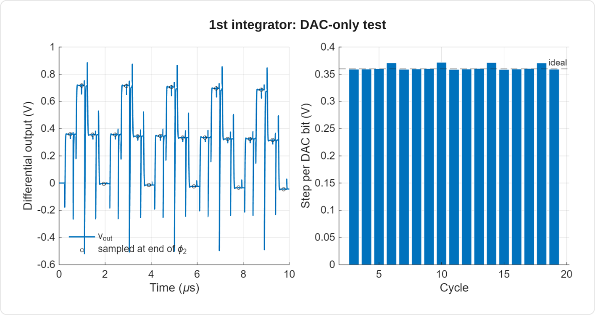
*DAC-only test. Left: differential output. Right: step per DAC bit and the ideal value (dashed).*


*DC-input test. Left: output ramp. Right: step per cycle and the ideal value (dashed).*

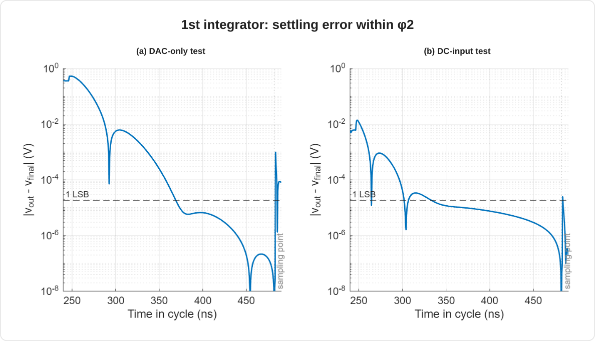
*Output error of the 1st integrator within one cycle (log scale; 1 LSB = 18.3 µV): the DAC step settles below 1 LSB at about 370 ns and the DC-input step at about 310 ns, before the sampling point at 485 ns.*

| Metric | Ideal | Result |
|---|---|---|
| DAC step (1st integrator) | 0.360 V | 0.3623 V (+0.65 %) ² |
| Input step (1st integrator) | −6.00 mV | −5.70 mV (−4.9 %) ¹ |
| Output CM | 0.9 V | 0.9017 V (ripple 1.3 mV) |
| Settling residue, last 40 ns of $\phi_2$ | < 0.5 LSB | DAC 5.2 µV (0.28 LSB), input 3.7 µV (0.20 LSB) |

¹ Mean of cycles 3–39; odd cycles −6.26 mV, even cycles −5.09 mV (cycles 3–38). See the bullets below.

² Mean of 17 cycles; 0.358–0.371 V per cycle.

- The table and the first bullets below are from the first design, before the chopper fixes described at the end of this list.
- The input step alternates between odd and even cycles around the mean, and the alternation grows with the output level during the 39 cycles (±0.3 mV at cycle 10, ±1.2 mV in the last cycles, about 0.5 % of the output voltage). The mean step is −4.9 % off the ideal value.
- **The chopper is the cause.** With the chopper clock held low the alternation is 0.00 mV and the mean step is −5.97 mV (−0.5 %). The 2nd integrator has no chopper and shows no alternation (0.01 mV). The integrator symbol contains a flicker noise source (`trnoise`, 66.4 µ), which was on in the earlier integrator tests and is switched off in the chopper timing runs (`fl` = 0). The alternation is the same in both (0.6–0.8 mV in the earlier tests, 0.81 mV rms with the source off) and the mean step is −5.70 mV against −5.71 mV, so the alternation is not noise.
- The error does not depend on when the polarity is reversed: 30 ns, 120 ns and 200 ns after the start of the cycle give the same 0.81 mV rms, so it is not a settling problem after the reversal. It depends on how often the polarity is reversed: with a reversal every 2 or 4 cycles ($f_{ch} = f_s/4$, $f_s/8$) the alternation is 0.34 and 0.25 mV and the mean step error is −2.5 % and −1.3 %. Each reversal changes the stored output by about 0.5 % of its value.
- **Cause 1: overlap of the chopper clocks.**
  - Symptom: a step of up to ±2 mV at every chopper edge (against 6 mV ideal), proportional to Vo and different for the two edges (+0.79 % and −0.30 %). Ideal switches or a different edge position did not change it.
  - Cause: `clkCh` and `clkCh_b` came from a NAND followed by an inverter, so `clkCh` always lagged `clkCh_b` by one inverter delay. At one edge both were high for about 143 ps, so the straight and the crossed paths were on together, shorted OUTp to OUTn and redistributed the charge of $C_{int}$.
  - Why only the chopper: the same overlap in the $\phi_1$ / $\phi_2$ clocks only joins the $C_s$ path for a moment (a gain error), and the source already leaves a 6 ns gap there.
  - Fix: a non-overlapping clock (cross-coupled NOR with delay, measured gap about 280 ps) for the chopper only, and four phases in the chopper (`clk`, `clk_b`, `phiA`, `phiB`; see Chopper), because with two signals both PMOS would be on during the gap. The phase and DAC clocks stay with NAND + INV: the TG needs exact complements, and a NOC DAC clock toggles the PMOS continuously when the DAC bit is 0. (`Seed` is the second input of the first NAND of the clock cell, where the DAC bit enters for the DAC clocks. It is tied to VDD for the other clocks, which makes the NAND an inverter with the same delay.)
- **Cause 2: the output chopper flips the OTA output.**
  - Symptom (after the overlap fix): a pole error $\mu_{ch}$ = +1.6e-3 per cycle (the step grows with |Vo|; −2.4e-4 with the chopper off), a gain compression above about 250 mV (12 % at 460 mV, odd in ±VD) and a ±35–56 µV alternation.
  - How it was narrowed down: the runs with the chopper off are linear (ideal OTA and transistor OTA); an ideal input chopper removes 75 % of the effect and an ideal output chopper about all of it; the waveform shows OUT pulled from +450 to −400 mV at the flip.
  - Cause: at the flip, OUT is connected to the OTA output node (Miller capacitor and output-stage parasitics), which still holds the opposite polarity. During $\phi_1$ the virtual ground floats, so the effective capacitance at OUT is small, OUT moves by almost 2|Vo| and the virtual ground jumps by hundreds of mV. The input chopper TGs switch at that moment, and their channel charge, junction capacitance and the OTA input $C_{gs}$ are nonlinear, so charge that depends on Vo is injected. The result is a linear pole error at small Vo and compression at large Vo.
- **Fix:** the output chopper moves inside the OTA, between the 1st-stage output and the 2nd-stage gate, and the Miller compensation wraps only the 2nd stage. The OTA output node and the Miller capacitor no longer flip; only the 1st-stage output does (about Vo / A2, a few mV). The chopper is used in the 1st integrator only, because the error of the 2nd integrator is suppressed by the gain of the 1st and by the noise shaping.
- **Result of the fix** (1st integrator, DC input): $\mu_{ch}$ = −2.2e-4 per cycle (the chopper-off level) against +1.6e-3, linear up to 480 mV (residual 0.16 µV) against compression above 250 mV, and an $f_s/2$ alternation of 0.05 µV against 35–56 µV. The netlists and figures in this repository are not yet updated to the fixed circuit.
- The 0.65 % larger DAC step may come from the capacitor ratio including parasitics (not verified).

**2nd integrator, DAC-only test** (ideal step $= \tfrac{12}{33}\cdot 1.2\ \mathrm{V} = 0.436\ \mathrm{V}$)

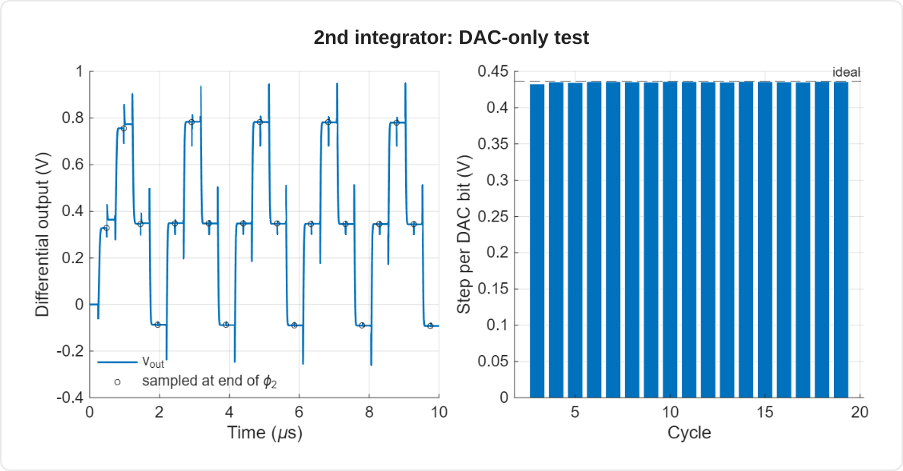
*Left: differential output. Right: step per DAC bit and the ideal value (dashed).*

**2nd integrator, DC-input test** (ideal step per cycle: $-12.1\ \mathrm{mV}$)

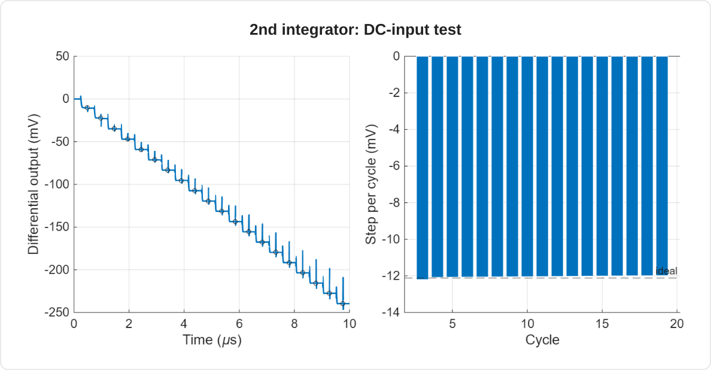
*Left: output ramp. Right: step per cycle, which matches the ideal value after the first cycle.*

- The spikes are the switching transients at the clock edges; they settle before the end of $\phi_2$, where the output is sampled.

| Metric | Ideal | Result |
|---|---|---|
| DAC step (2nd integrator) | 0.436 V | 0.4355 V (−0.19 %) |
| Input step (2nd integrator) | −12.1 mV | −12.04 mV (−0.66 %) |
| Output CM (2nd integrator, $V_{bias}$ = 0.69 V) | 0.9 V | 0.9013 V ¹ |
| Settling residue, last 40 ns of $\phi_2$ (2nd integrator) | < 0.5 LSB | DAC 0.25 µV (0.014 LSB), input 0.01 µV |

¹ Ripple 1.4 mV; within 1 mV after 100 cycles (49 µs).

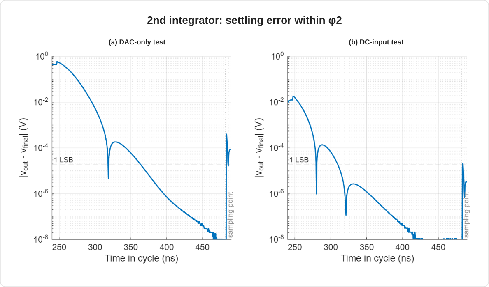
*Output error of the 2nd integrator within one cycle (log scale; 1 LSB = 18.3 µV): the DAC step settles below 1 LSB at about 360 ns and the DC-input step at about 310 ns of the 488 ns cycle, well before the sampling point at 485 ns. The spike at the sampling point is the switching transient of the clock edge.*

### 5. 2nd-order modulator
- 40 dB/dec noise shaping.
- Earlier noiseless run (before the capacitor change, 4 ms): PSD within +0.3 dB of an ideal 2nd-order model with the same input and length (out-of-band comparison), recovered sine amplitude 0.5948 V (input 0.6 V).

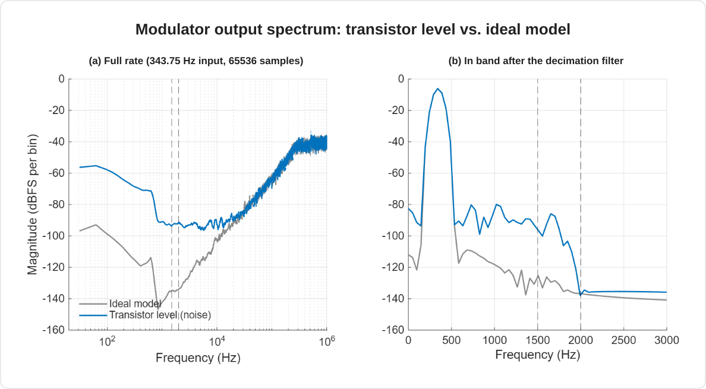
*Output spectrum of the transistor-level modulator (noise injected, 32 ms, 65536 samples) against the ideal behavioral model with the same input. (a) Above about 20 kHz the shaped noise of the two agrees. In band the transistor-level floor is flat at about −92 dBFS per bin, far above the ideal model. (b) In band after the decimation filter (the dashed lines are 1.5 kHz and 2 kHz).*

- The in-band floor of the transistor-level run is not caused by the injected noise: noise-free runs show the same floor (3–6 kHz: 5.9e-12 FS²/Hz against 4.1e-14 for the ideal model, `reltol` = 3e-6, 2.4 ms record; bit stream of ±1).
- **The floor is caused by the chopper.** A behavioral model of the 2nd-order loop with a state error of ±0.53 % that alternates in sign at every cycle (the size measured in the 1st-integrator test) gives about 1e-11 FS²/Hz at 3–6 kHz, against 2.6e-14 without the error (same model, 8192 samples) and 3–6e-12 measured in the noise-free transistor-level runs (the same order; an error of 0.2 % gives 1.5e-12). The error comes from the chopper (clock overlap and the position of the output chopper, see Integrator; both fixed afterwards); it multiplies the 1st-integrator output, which has large high-frequency content, and moves it into the band. It is mostly not the solver: a 33 times tighter `reltol` (1e-4 → 3e-6) lowered the floor only by 2–4 times (the tolerance has a small share), and with the chopper clock held low the step error of the 1st integrator disappears.

### 6. SNDR
**Methodology**
- Coherent sampling: $`f_{in} = k\,f_s / N`$ ($k$ = 11, $N$ = 65536 → 343.75 Hz)
- One bit per clock cycle, sampled when the DAC output is stable
- Blackman-Harris window; the noise is integrated **only in band (0–2 kHz)**, with the DC and signal bins excluded (`analyze_modulator_psd.m`). A second estimate filters the bit stream first (sinc³ ×32, Kaiser FIR with a 1.5 kHz passband and a 2 kHz stopband, ×4) so that the shaped noise and the chopper noise cannot leak into the band.
- ngspice options of the 32 ms run: `reltol = 1e-4`, `vntol = 1e-6`, `abstol = 1e-10`, `chgtol = 1e-15`, `trtol = 7`. The later runs use tighter options (`method = gear`, `reltol = 3e-6`, `vntol = 3e-8`, `abstol = 1e-12`, `trtol = 2`).

| Result | Value | Condition |
|---|---|---|
| Ideal behavioral model | 115.5 dB (full rate) / 99.4 dB (filtered) ¹ | $N$ = 65536, 2 kHz band |
| Transistor level, noisy | 68.4 dB (ENOB 11.1) / 69.9 dB (filtered) | 32 ms, first design (before the chopper fixes) ² |
| Transistor level, noisy, 1.5 kHz band | 69.6 dB / 70.4 dB (filtered) | Same run |
| Transistor level, noise-free, first design | $\approx$ 70 dB | 2.4 ms, `reltol` = 3e-6 ³ |
| Transistor level, fixed chopper, no injected noise | not resolved ⁵ | 3.7 ms, floor 6.0e-14 FS²/Hz at 3–6 kHz (ideal model 4.1e-14) |
| Transistor level, fixed chopper, noise injected | not resolved ⁵ | 3.7 ms, floor 3.2e-14 FS²/Hz at 3–6 kHz |
| Estimate from the noise budget | $\approx$ 96 dB (ENOB 15.7) | Ideal chopper ⁴ |

¹ The filtered value is the limit of the measurement chain (decimation filter, 329 output samples): it cannot resolve an SNDR near the design target (98.1 dB). The full-rate value is used for the comparison.

² The floor is the chopper reversal error (see 2nd-order modulator) and is also present without noise. The measurements were made before the chopper fixes (see Integrator) and have not been repeated.

³ From the floor at 3–6 kHz (5.9e-12 FS²/Hz over the 2.4 ms record; 4.2e-12 over the 3.9 ms record used for the comparison with the fixed circuit; bit stream of ±1), assumed flat in the band and integrated over 2 kHz. The same method gives only 91.8 dB for the ideal model (see ⁵), so it means something only for floors far above the ideal one, as here (about 100 times).

⁴ Quantization + kT/C + OTA 1 noise with an ideal chopper (see Noise analysis).

⁵ An SNDR cannot be derived from these records. The 3–6 kHz band is dominated by shaped quantization noise, so integrating its floor over 2 kHz as if it were flat overestimates the in-band noise: the same method applied to the ideal model (4.1e-14 FS²/Hz) gives 91.8 dB, against its real SNDR of 115.5 dB (the method would give 90 and 93 dB for these two runs). What the records show is that the fixed circuit cannot be told apart from the ideal model in this band (floor within a factor of 1.5, against about 100 times before the fix). The floor does not include the injected in-band noise, and with about 6600 samples (6–7 bins in band) the two values differ by less than the run-to-run scatter.

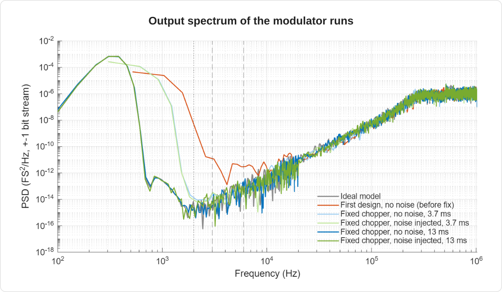
*Output PSD of the fixed circuit and of the first design against the ideal model.*

- In the figure above, the fixed circuit (with and without injected noise) follows the ideal model down to a floor of about 1e-14 FS²/Hz at 2–6 kHz (dashed lines), while the first design has a floor about 70 times higher at 3–6 kHz and stays orders of magnitude above the others toward 2 kHz. The records are short (about 6600 samples), so the spectrum is smoothed only above 20 kHz, the 2 kHz band (dotted line) holds 6–7 bins, and below about 1.5 kHz the curves show the skirt of the 343.75 Hz signal.

- The 68–70 dB belong to the first design, before the chopper fixes. The floor of the fixed circuit is about 70 times lower (4.2e-12 → 6.0e-14 and 3.2e-14 FS²/Hz) and within a factor of 1.5 of the ideal model, so the chopper error is gone, but these records do not resolve the SNDR. The noise budget gives about 96 dB, which is above the requirement (95.2 dB) by about 0.9 dB and about 2 dB below the design target (98.1 dB); it assumes an ideal chopper and still has to be confirmed with a full-length noisy run. The tighter tolerances make the run about 10 times slower, so a 65536-sample record could not be completed (see Limitations).

### 7. Noise analysis
The transient simulation does not include device noise, so the noise is analyzed separately and injected with ngspice `trnoise` sources.

**Noise budget** (input-referred, in band)

| Source | Power (V²) | SNR alone | Method |
|---|---|---|---|
| Quantization | 6.7e-13 V² | 114.3 dB | Behavioral model ¹ |
| kT/C | 1.53e-11 V² | 100.7 dB | $8kT/C_s$ ÷ OSR ² |
| OTA flicker, no chopper | 1.9e-8 V² | 69.8 dB | `.noise` × 4 ³ |
| OTA noise with chopper (estimate) | 2.6e-11 V² | 98.4 dB | `.noise` at $f_{ch}$ × 4 ⁴ |
| Total with chopper (estimate) | 4.2e-11 V² | 96.3 dB | Quantization + kT/C + chopped OTA |

¹ $k_{eff}$ = 0.628; 4.68e-13 in units of FS = 1 (1.2 V), × 1.44 to V². Budget: 2.8e-12 V².

² $8kT/C_s$ = 7.84e-9 V² (2 branches × 2 phases × 2 sides, 25 °C, $C_s$ = 4.2 pF), divided by OSR = 512.

³ 4.75e-9 V² (1 Hz – 2 kHz) times the capacitor ratio $\left(\dfrac{C_s+C_d}{C_s}\right)^2$ = 4.

⁴ Ideal chopper: the flicker noise moves to $f_{ch}$ = 1.024 MHz (see below).

- The OTA flicker noise is the bottleneck of the in-band noise, which is why the chopper was introduced (see Architecture).
- Estimated improvement with an ideal chopper at $f_{ch}$ = 1.024 MHz: the flicker noise moves to $f_{ch}$, so only the noise density at $f_{ch}$ (3.2e-15 V²/Hz) remains in the band; at $f_{ch}$ the OTA noise is still mostly flicker, because the flicker corner is a few MHz. That is 6.5e-12 V² in 2 kHz, or 2.6e-11 V² with the capacitor ratio of 4, against 1.9e-8 V² without the chopper: an improvement of about 730 times (28.6 dB). The estimate assumes ideal chopping and ignores both the folding of the OTA thermal noise by the sampling and the chopper non-idealities, so the real improvement is smaller.
- Per-device contribution: the NMOS loads of the 1st stage dominate. The input-referred noise of OTA 1 in 1 Hz – 2 kHz (`.noise`, 25 °C) totals 4.75e-9 V² (68.9 µV rms):

| Device (pair) | Power (V²) | Share |
|---|---|---|
| M3, M4 (1st-stage load) | 4.73e-9 | 99.6 % |
| M1, M2 (input pair) | 1.68e-11 | 0.35 % |
| M5, M6 (2nd-stage driver) | 1.75e-12 | 0.04 % |
| M7, M8 (2nd-stage current source) | 1.3e-13 | 0.003 % |
| Itail, M9, CMFB resistors | < 1e-14 | ≈ 0 |

  The flicker noise is 98.6 % (M1 / M2) to 99.99 % (M3 / M4) of each device's contribution (the thermal part of the M3 / M4 pair is 5e-13 V²). The cause is the small area of M3 / M4 (about 1.1 µm²). The tail current source cancels in the differential output.

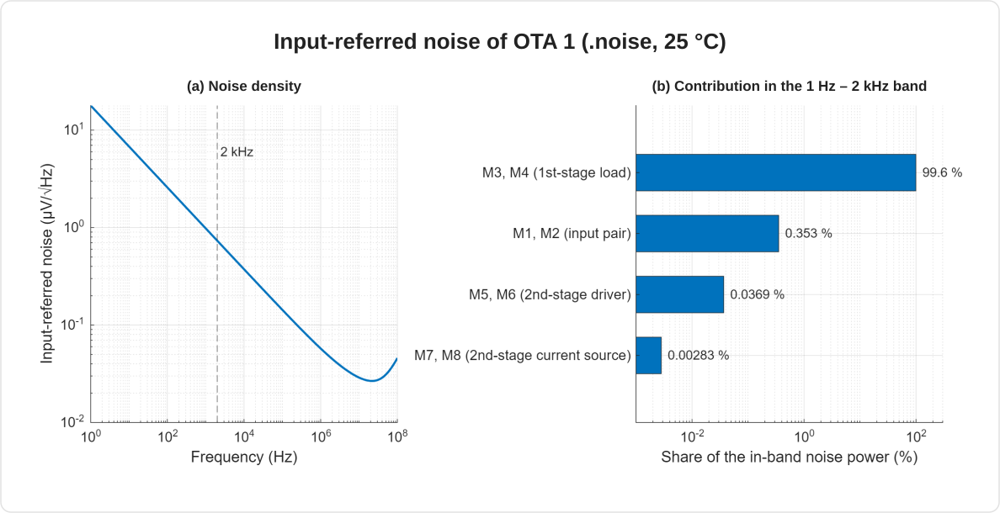
*(a) Input-referred noise density of OTA 1: 17.9 µV/√Hz at 1 Hz and 0.98 µV/√Hz at 1 kHz. (b) Share of each device pair in the 1 Hz – 2 kHz band.*

**Noise injection**
- kT/C: `trnoise` sources at both modulator inputs. Flicker: injected between chopper CH1 and the input of the 1st OTA.
- The `trnoise` parameters are checked in a standalone simulation of the sources (`tb_trnoise_check.spice`, 100 ms, `check_trnoise.m`; Welch PSD with a Hann window of $2^{16}$ points after interpolation to a uniform 0.2 µs grid).
  - kT/C source `trnoise(63.7u 488.28n 0 0)`: the white PSD of one source is $`2\,NA^2\,NT`$ = 3.96e-15 V²/Hz. Measured: 3.98e-15 V²/Hz at 10–100 kHz (1.00×) and 3.81e-15 V²/Hz at 1–10 kHz (0.96×). The two sources together give 1.6e-11 V² in the 2 kHz band (the 100–1000 Hz bin gives 0.80× only because there are few Welch bins at low frequency). The 63.7 µV is the value for $C_s$ = 4 pF; for the implemented 4.2 pF the table value is 1.53e-11 V², so the injected kT/C noise is about 3.5 % larger, which is slightly conservative.
  - Flicker source `trnoise(0 1u 0.85 66.4u)`: no white part (NA = 0), NT = 1 µs, exponent NALPHA = 0.85, amplitude NAMP = 66.4 µ; measured slope $f^{-0.81}$ and 9.7e-13 V²/Hz at 1 kHz (2.9e-12 at 100–300 Hz, 6.3e-13 at 1–3 kHz, 9.4e-14 at 10–30 kHz).
    - NAMP was set by proportional scaling: a standalone run with NAMP = 1 µ gives the PSD coefficient $`K = S(f)\,f^{0.85}`$ (mean over 1–100 kHz, 8.9e-14 V²), and $`NAMP = 1\,\mu \times \sqrt{K_{target}/K_{meas}}`$ with the target $K_{target}$ = 4e-10 V² (the 1st OTA `.noise` at 1 Hz, 2e-5 V/√Hz) gives 66.4 µ. The PSD scales with NAMP² and depends on NT, so the same NT = 1 µs as in the modulator was used.
    - The target was taken from an earlier OTA. For the current OTA (`.noise`, $I_{tail}$ = 30.8 µA) the PSD at 1 kHz is 9.67e-13 V²/Hz, which equals the injected 9.67e-13 V²/Hz. The injected noise is within 30 % of the OTA at 100–300 Hz (the OTA slope is $f^{-0.84}$ against $f^{-0.81}$) and within a few % at 1–30 kHz.
- Comparison runs: (A) no noise, (B) noise without chopper, (C) noise with chopper. For the first design, the run with noise and the chopper (C) was done for 32 ms, the run without noise (A) only for 2.4 ms, and B was not completed, because of the run time (see Limitations). The fixed circuit has only the 3.7 ms runs with and without noise (see SNDR).
- The flicker noise of the 2nd OTA is not injected. Referred to the modulator input it is attenuated by the gain of the 1st integrator ($\approx$ 98 at 1 kHz), and the estimate is 1e-12 – 3e-12 V² in band (a few % of the noise budget, about 0.1 – 0.3 dB).

## Limitations & Next Steps

**Limitations of the results**
- **The SNDR of the fixed circuit is not resolved.** The measured 68–70 dB belongs to the first design: an in-band floor, also present without noise, set by an error of about 0.5 % of the output that the chopper added at every polarity reversal (the alternation of the 1st-integrator step; a behavioral model with this error reproduces the floor). Its causes were chopper clock overlap and the output chopper flipping the OTA output node (see Integrator). Both are fixed: the 1st-integrator alternation dropped from 35–56 µV to 0.05 µV, and the floor of the 3.7 ms runs (with and without injected noise) is 6.0e-14 and 3.2e-14 FS²/Hz, against 4.2e-12 before and 4.1e-14 for the ideal model. The records are too short (about 6600 samples) for an SNDR, and the floor-based method gives only 92 dB even for the ideal model (see SNDR), so a 65536-sample coherent record is needed.
- **The chopper has to be simulated with its non-idealities.** Without it, the flicker noise of the OTA limits the SNDR to about 70 dB. With it, the flicker is estimated to drop by 28.6 dB, but in the first design the reversal error set the same limit. The 96 dB of the noise budget assumes that the fixed chopper leaves no such error.
- **The SNDR could not be measured over a full record.** The transistor-level modulator (2 OTAs, choppers, SC CMFB) took about 16 h for 32 ms (65536 cycles) with loose solver tolerances, and tighter tolerances make the run about 10 times slower (about 0.2 ms per hour).
- The noise budget gives $\approx$ 96 dB (ENOB 15.7), which would meet the requirement (95.2 dB) by about 0.9 dB and miss the design target (98.1 dB) by about 2 dB, but it does not include the in-band floor above, so it is valid only if that floor is removed. The OTA 1 noise remaining after the chopper is the largest term (2.6e-11 of 4.2e-11 V²). The estimate ignores the folding of the OTA thermal noise by the sampling, so it is probably optimistic.
- The chopper improvement of the flicker noise (28.6 dB) is an analytic estimate for an ideal chopper. The comparison runs without noise (A: only 2.4 ms) and without the chopper (B) were not completed.
- The noise of the 2nd OTA is not injected (estimated at 0.1 – 0.3 dB).
- Pre-layout only: no parasitic extraction, no process corners or temperature for the modulator (only for the switches and the OTA), the clocks and the references are ideal, and the power is a static `.op` value.

**Next steps**
- **Measure the SNDR of the fixed circuit** with a coherent 65536-sample record, with noise and the chopper (A / B / C: without noise, with noise and without the chopper, with both), and update the netlists, the OTA description and the figures to the fixed circuit. To fit the run time, run the checkpointed simulation (`stop` / `resume`) on a cloud machine, or replace the 2nd integrator and the switches by behavioral models for the long run. Then compare the SNDR with the 96 dB budget. If a floor remains, the chopper frequency can be lowered (the behavioral model gives about −7 dB at $f_s/8$ and −12 dB at $f_s/16$, but the flicker noise that remains in the band grows).
- **Measure the phase margin again** with CH2 inside the OTA: the TG of CH2 now sits in the Miller path of the 2nd stage (the Miller node impedance at high frequency is about $1/g_{m2}$), so the PM of 69.4° measured with the chopper at the OTA output may change.
- Reduce the noise of the 1st OTA (more $g_m$ of the input pair, a smaller $g_{m3}/g_{m1}$, a larger area of M3 / M4). The flicker corner of the OTA is a few MHz, above $f_{ch}$ = 1.024 MHz, so the noise that remains at $f_{ch}$ (3.2e-15 V²/Hz) is still mostly flicker, and it is the largest term of the budget after the chopper.
- The OTA power is large ($C_s$ = 4 pF is required by kT/C, so the load capacitance grows, and the 1st-stage OTA current is $I_{tail}$ = 29.4 µA and $I_{out}$ = 101.5 µA per side in the real circuit, 684 µW in total). The specs of the later stages (2nd integrator, 2nd-stage OTA) need to be relaxed to optimize the power.
- Consider Indirect Miller compensation [8] to reduce the current: connecting the Miller capacitor to an internal node (for example the cascode node) instead of the output reduces the $g_{m2}$ (and therefore $I_{out}$) needed for the same GBW / PM.

---

## Repository Structure

```
.
├── README.md / README.ko.md
├── docs/figures/                                                      figures used in this README (SVG cards with the PNG sources)
├── xschem/
│   ├── lib/Analog/                                                    symbols and schematics (OTA 1 / 2, integrators, switches, chopper)
│   ├── top/                                                           top-level schematics (2nd-order modulator)
│   └── testbenches/                                                   Xschem testbenches / netlists (OTA, OTA noise, modulator with trnoise)
├── netlists/                                                          ngspice testbenches (integrators, integrator chopper timing, TG / bootstrap switches, chopper, chopper flicker, trnoise check, run_corners.sh)
├── matlab/
│   ├── behav_model.m                                                  behavioral model and spec derivation
│   ├── spec_figures.m                                                 spec graphs (scaling, settling, gain vs. SQNR)
│   ├── analyze_tb_results.m                                           integrator results
│   ├── plot_switch_ron.m / analyze_bs_corners.m                       switch Ron figures, bootstrap corners and distortion estimate
│   ├── analyze_chopper.m / plot_ch_ota_bode.m / analyze_ch_flicker.m  chopper standalone, loop gain, flicker rejection
│   ├── check_trnoise.m / plot_ota_noise.m / plot_ota_bode.m           trnoise source check, OTA noise (PSD, per-device share), OTA loop gain
│   └── analyze_modulator_psd.m                                        modulator spectrum and SNDR
└── results/                                                           selected simulation outputs (the large ngspice dumps are not in git, see .gitignore; the netlists regenerate them)
```

---

## References

1. Analog Devices, *ADXL356/ADXL357 Data Sheet*, Rev. 0 (Table 1: sensitivity, noise density, bandwidth), [analog.com](https://www.analog.com/media/en/technical-documentation/data-sheets/adxl356-357.pdf)
2. Analog Devices, ADXL356 product page, [analog.com](https://www.analog.com/en/products/adxl356.html)
3. S. Pavan, R. Schreier, G. C. Temes, *Understanding Delta-Sigma Data Converters*, 2nd ed., Wiley-IEEE Press, 2017.
4. R. Schreier, J. Silva, J. Steensgaard, G. C. Temes, "Design-oriented estimation of thermal noise in switched-capacitor circuits," *IEEE Trans. Circuits Syst. I*, vol. 52, no. 11, pp. 2358–2368, Nov. 2005.
5. B. Razavi, "The bootstrapped switch [A circuit for all seasons]," *IEEE Solid-State Circuits Magazine*, vol. 7, no. 3, pp. 12–15, Summer 2015.
6. SkyWater SKY130 PDK documentation, [skywater-pdk.readthedocs.io](https://skywater-pdk.readthedocs.io)
7. Open-LUT (SKY130 MOS look-up tables), [open-lut.org](https://www.open-lut.org/)
8. V. Saxena, "Indirect feedback compensation techniques for multi-stage operational amplifiers," M.S. thesis, Dept. of Electrical Engineering, Boise State University, 2007. Available at [cmosedu.com](https://cmosedu.com/cmos1/bad_design/bad_design12/bad_design_12.htm)
