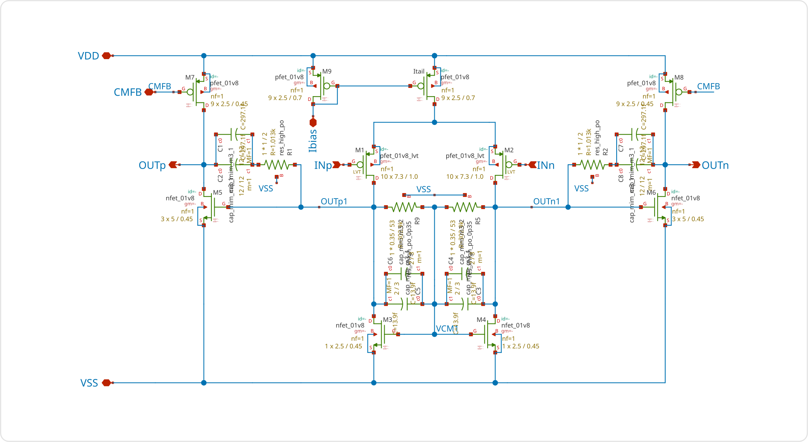
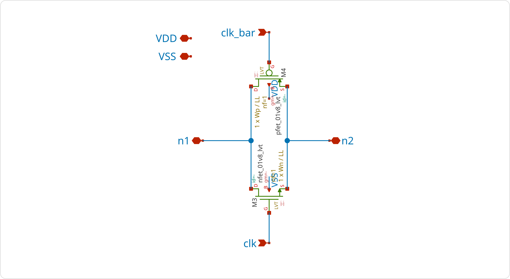
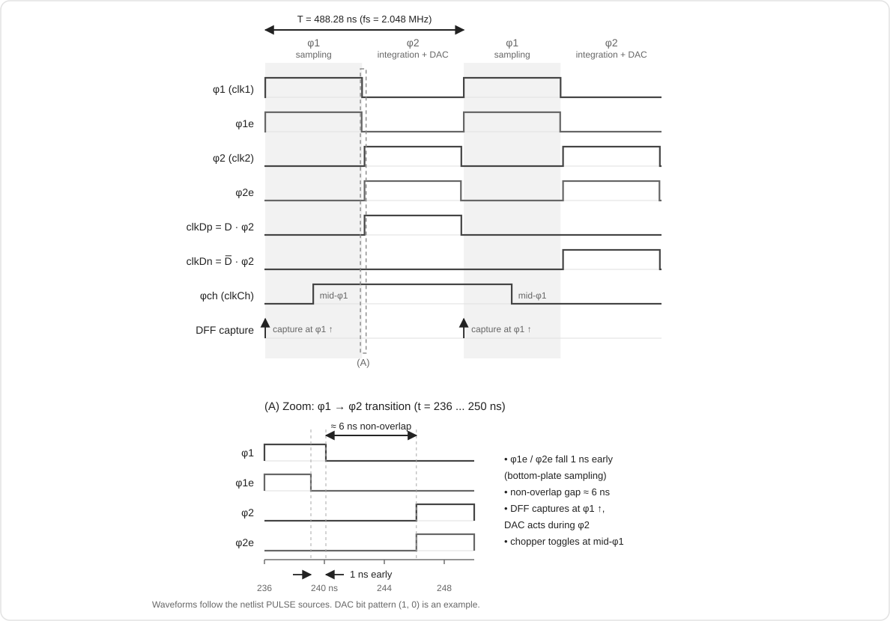
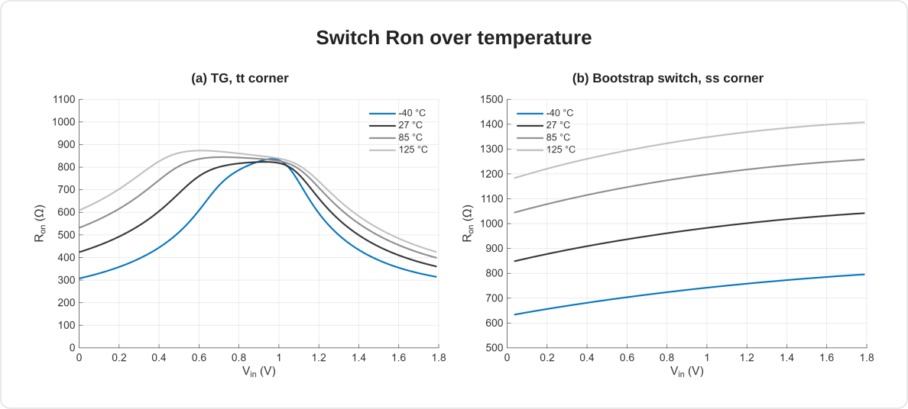
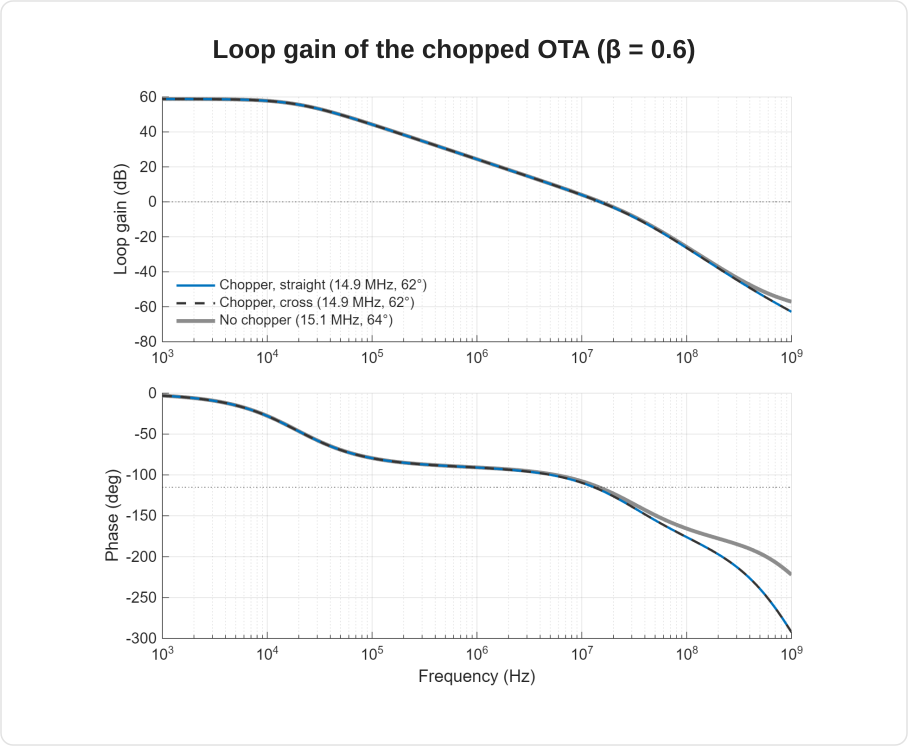
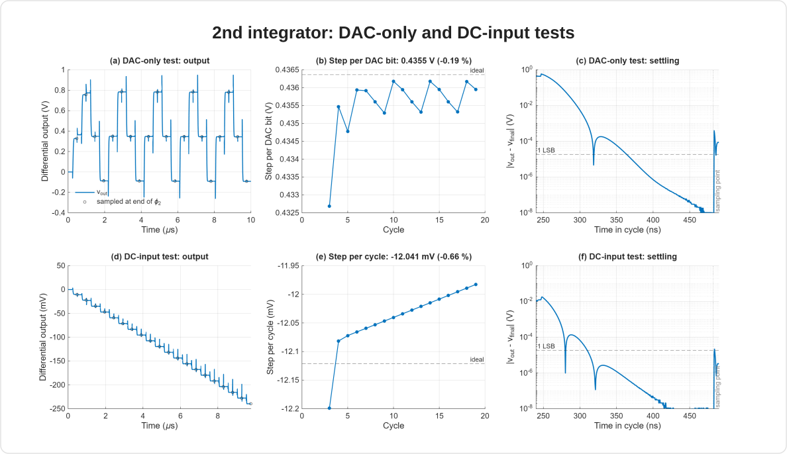

# 2nd-Order 1-bit Switched-Capacitor ΔΣ Modulator in SKY130

A transistor-level (SKY130, Xschem / ngspice) 2nd-order 1-bit fully differential switched-capacitor ΔΣ modulator for a MEMS accelerometer interface, with the specifications derived from the sensor requirements in MATLAB.

| Item | Value |
|---|---|
| Process / supply | SKY130A / 1.8 V |
| Architecture | 2nd-order, 1-bit, CIFB, fully differential SC, chopper in the 1st integrator |
| $f_s$ / OSR / BW | 2.048 MHz / 512 / 2 kHz |
| SNDR requirement / design target | $\ge$ 95.2 dB (15.5 bit) / $\approx$ 98.1 dB (16 bit) |
| Full scale | ±1.2 V differential (VREFp 1.5 V / VREFn 0.3 V), input −6 dBFS |
| Power | 684 µW (`.op`, static bias only) |

---

## Highlights

- The specifications (GBW, DC gain, slew rate, $C_s$, switch $R_{on}$) are derived step by step from the sensor noise and the 16-bit target (see Specifications and Circuit-level Requirements).
- SNDR: the final value comes from coherent 8 ms runs (375 Hz input, with and without injected noise), which are still being simulated: [estimating] dB. Non-coherent 13 ms records give 89.0 dB without and 89.6 dB with injected noise, the same as the ideal model on records of the same length, so that value is set by the record (see SNDR). The first design reached only 68–70 dB because the chopper added an error at every polarity reversal; its two causes (chopper clock overlap, and the output chopper flipping the OTA output node) are fixed (see Integrator).
- With kT/C and flicker noise and an ideal chopper, the noise budget estimates $\approx$ 96 dB (15.7 bit): above the requirement (95.2 dB) and below the design target (98.1 dB).
- Integrator tests: the 2nd integrator is within 0.7 % of the ideal coefficients. After the chopper fixes the 1st integrator has a DAC step of −0.10 % and an input step of −0.62 %, with no odd / even alternation (see Integrator).
- Switches: the bootstrap switch has a monotonic $R_{on}$ (at most 1.41 kΩ, below the 2.43 kΩ limit). The TG reaches 0.9 kΩ, above the 0.5 kΩ target of the summing-node switch, so its width has to be increased.

**Modulator results** (simulation)

| Item | Result | Note |
|---|---|---|
| SNDR | [estimating] dB | Coherent 8 ms records (375 Hz), mean of 4 runs with injected noise. Non-coherent 13 ms records: 89.0 dB, 89.6 dB with noise, limited by the record |
| ENOB | [estimating] bit | From the 8 ms runs |
| Noise budget estimate | $\approx$ 96 dB (15.7 bit) | Quantization + kT/C + chopped OTA noise, ideal chopper |
| Requirement / design target | ≥ 95.2 dB / 98.1 dB | 15.5 bit / 16 bit |
| Power | 684 µW | Static bias only. Comparator, clock and references are ideal |

---

## Specifications

This section derives the target spec from the sensor requirements. The system-level choices and the architecture follow, and the circuit-level requirements (capacitors, OTA, switches, chopper) are derived after them. The derivation follows the modeling code in `matlab/behav_model.m` (originally `SystemModeling/ADC.mlx`).

### Target Spec

| Item | Value | Note |
|---|---|---|
| Application | MEMS accelerometer interface | Reference sensor: ADXL356C (±10 g / ±40 g) |
| Input range | ±40 g | Sensor full scale = −6 dBFS ¹ (ADC full scale ≈ ±80 g) |
| Signal BW | 2 kHz | |
| Input amplitude | 40 g peak (28.3 g rms) | 0.6 V differential peak |
| Full scale (diff.) | ±1.2 V (VREFp 1.5 V / VREFn 0.3 V) | OTA swing > 0.3–1.5 V expected ² |
| VCM | 0.9 V | Midpoint of VDD (1.8 V) and VSS |
| ADC noise (rule of thumb) | At least 20 dB below the sensor noise | Avoid being the bottleneck |
| SNDR / ENOB | ≥ 95.2 dB (15.5 bit); design 98.1 dB (16 bit) | See the derivation below |

¹ −6 dBFS keeps the input inside the stable range of the 1-bit 2nd-order modulator and leaves headroom for overloads beyond ±40 g (see Dynamic range scaling). The sensor output level is assumed to be matched in front of the ADC (ideal).

² Based on $V_{DS,sat}$ from the PDK MOS LUT [6], [7].


*Signal chain from the reference sensor to the modulator. The sensor and the single-ended to differential conversion are treated as ideal.*

**Reference sensor (the MEMS itself is not implemented, so datasheet values are used)**

| Item | ADXL356C | Source |
|---|---|---|
| Range / sensitivity | ±10 g (80 mV/g) / ±40 g (20 mV/g) | Rev. 0 Table 1 (ratiometric to V1P8ANA) |
| Output | Single-ended, 0 g = 0.9 V (V1P8ANA / 2), 32 kΩ series resistance | Rev. 0 Table 1 |
| Noise density (±40 g) | 110 $\mu\mathrm{g}/\sqrt{\mathrm{Hz}}$ | Datasheet [1] (80 for ±10 g, 75 on the product page [2]) |
| Output BW | Internal low-pass 1.5 kHz (fixed), resonance about 5.5 kHz | Rev. 0 Table 1 |

- **AFE assumption**: an instrumentation amplifier scales the sensor output and an FDA converts it to differential (±0.8 V single-ended → 0.6 V differential peak, output CM 0.9 V). The noise and errors of the AFE are ignored (see Ideal Assumptions).
- **Design BW**: the sensor BW of 1.5 kHz plus a 0.5 kHz transition band for the decimation filter gives a signal band of 2 kHz.

**Required resolution from the sensor noise** (noise density 110 $\mu\mathrm{g}/\sqrt{\mathrm{Hz}}$)

| Item | Value |
|---|---|
| Sensor noise (BW 2 kHz) | 110 $\mu\mathrm{g}/\sqrt{\mathrm{Hz}}$ × $\sqrt{2000}$ $\approx$ 4.92 mg rms ¹ |
| Sensor SNR at full scale (40 g peak) | $`20\log(28.3\,\mathrm{g} / 4.92\,\mathrm{mg})`$ $\approx$ 75.2 dB |
| Required ADC noise | At least 20 dB below the sensor noise |
| Required SNDR | $\approx$ 95.2 dB ($\approx$ 15.5 bit) |
| Chosen resolution | 16 bit (SNDR 98.1 dB) ² |
| ADC noise at 98.1 dB (input-referred) | 28.3 g / 80,100 $\approx$ 353 µg rms ($\approx$ 7.9 $\mu\mathrm{g}/\sqrt{\mathrm{Hz}}$) |
| ADC noise relative to the sensor | $\approx$ 22.9 dB lower |

¹ The sensor BW is 1.5 kHz and the signal band is 2 kHz, so integrating over 2 kHz is conservative (about 1.2 dB higher than over 1.5 kHz).

² The required 15.5 bit is rounded up to the next integer bit, which gives about 3 dB of margin.

- Noise powers add, so an ADC whose noise is 20 dB below the sensor's costs only about 0.04 dB of SNR (0.4 dB if it is 10 dB below).

---

## Architecture

### System-level

**Noise budget**: 10 % of the total in-band noise is allotted to quantization noise and 90 % to thermal noise (a starting allocation).

**Why 2nd order and OSR 512** — the in-band quantization noise must meet the target SQNR (= SNDR 98.1 dB + 10 dB $\approx$ 108 dB, because it gets 10 % of the noise budget), for a 1-bit quantizer, a −6 dBFS input and the ideal model.

| Order / OSR | Ideal SQNR | Verdict |
|---|---|---|
| 1st / 512 | 71.8 dB | Not enough (about 12 bit) |
| 2nd / 128 | 88.2 dB | Not enough |
| 2nd / 256 | 103.3 dB | Not enough (99.2 dB with $k_{eff}$) |
| **2nd / 512** | **118.3 dB** | Enough (114.3 dB with $k_{eff}$, ENOB $\approx$ 17) |

- A 2nd-order modulator with OSR 512 is the smallest combination that reaches 16 bit (the OSR was searched in powers of two).
- A 3rd-order modulator would allow a lower OSR, but it needs one more OTA (more power), and a 1-bit 3rd-order loop can diverge (it is only conditionally stable and its stable input range shrinks). It was therefore not chosen.

**Why 1 bit**
- A 1-bit DAC has only two levels, so it is **inherently linear**: there is no DAC nonlinearity from capacitor mismatch and no need for correction such as DEM / DWA, which matters for 16-bit linearity. A multi-bit loop would need a flash quantizer and a matched multi-level capacitor DAC, and its DAC nonlinearity would go straight into the output.
- One comparator is enough, so the circuit is simple, small and low-power.
- The price of 1 bit is a larger quantization noise. Oversampling covers it: the signal band is only 2 kHz, so even with OSR 512 the sampling rate is just 2.048 MHz.

**Quantization noise modeling**
- The input is −6 dBFS with a differential peak of 0.6 V, so $P_{signal} = 0.18\ \mathrm{V^2}$, and OSR 512 gives an ENOB of $\approx$ 17.
- In-band quantization noise (Taylor approximation) [3]:

```math
IBQN=\frac{\pi^{2L}\,\Delta^2}{12\,(2L+1)\,OSR^{2L+1}}
```

- The effective gain of the 1-bit quantizer is $k_{eff} = 0.628$ (extracted from the behavioral simulation as the $y\cdot v$ covariance), so $IBQN_{actual} = IBQN / k_{eff}^2$. ENOB 17 is confirmed with this value as well.


*Discrete-time model of the modulator. Solid boxes are implemented at transistor level, the dashed box is an ideal assumption.*

- Fully-differential, 2nd-order, 1-bit CIFB structure ($a_1$ = 0.3, $c_2$ = 0.6, $a_2$ = 0.36)

**Coefficients**
- $x_1$ and $x_2$ are the outputs of the 1st and 2nd integrators. The standard MOD2 is scaled by $s_1$ and $s_2$ (the factors applied to $x_1$ and $x_2$), which gives the coefficients $a_1 = s_1$, $c_2 = s_2 / s_1$ and $a_2 = 2 s_2$.

**Dynamic range scaling**
- Dynamic range scaling (for the maximum allowed input of −3 dBFS): the standard MOD2 reaches $\max\lvert x_1\rvert \approx 3.17$ and $\max\lvert x_2\rvert \approx 6.27$. With $s_1 = 0.3$ and $s_2 = 0.18$ they drop to 0.95 / 1.13 while the bitstream stays identical (limits 1.0 / 1.2: 1.0 is the full scale, and 1.2 for $x_2$ is an assumed bound that needs an OTA 2 output swing wider than the reference range).
- For the normal −6 dBFS input the swing is smaller, $\max\lvert x_1\rvert \approx 0.82$ and $\max\lvert x_2\rvert \approx 0.76$ (there is margin because the coefficients were chosen for the worst-case input).


*Integrator output swing before and after dynamic range scaling (−3 dBFS input).*

**How each block is implemented**

| Block | Implementation |
|---|---|
| Integrators (× 2) | Fully differential, parasitic-insensitive SC integrator with separate $C_s$ and $C_d$; 2-stage Miller OTA |
| 1-bit DAC | $C_d$ switched to VREFp / VREFn by the output bit in $\phi_2$ |
| Quantizer | Comparator + DFF (ideal model) |
| Offset / flicker noise | Chopper in the 1st integrator ($f_{ch} = f_s / 2$) |
| CMFB | SC CMFB at the OTA output, resistive CMFB in the 1st stage of the OTA |
| Switches | Bootstrap (input sampling), TG (VCM, summing node, chopper), single MOS (DAC references) |
| Clocks | Two-phase non-overlapping clocks with early phases (bottom-plate sampling); the sources are ideal |

### Ideal Assumptions

Blocks that are modeled ideally instead of being implemented at transistor level, and the plan for them.

| Block | Modeled as | Planned implementation |
|---|---|---|
| Comparator | Ideal comparator + DFF | StrongARM + SR latch |
| Bias current | Ideal current source | Constant-gm bias |
| VREF / VCM generation | Ideal voltage sources (1.5 V / 0.3 V / 0.9 V) | Reference buffer |
| Clock generator | Ideal non-overlapping clocks | Digital clock generator (chopper clock: $f_s/2$ divider) |
| Sensor AFE | Instrumentation amplifier + FDA, ideal (±0.8 V → 0.6 V differential peak) | INA + FDA |
| Device noise | Not included in the transient simulation | Injected with ngspice `trnoise` (see Verification) |

### Transistor-level Blocks

#### OTA

*OTA of the 1st integrator, with the chopper CH2 between the 1st and the 2nd stage (*$C_c$ *= 1.19 pF)*


*OTA of the 2nd integrator (*$C_c$ *= 0.59 pF)*

- 2-stage OTA, PMOS (LVT) input pair, Miller compensation with a nulling resistor
- Design targets: DC gain ≥ 45.3 dB, GBW ≥ 17.6 MHz, PM $\approx$ 65.5° (see Circuit-level Requirements)
- Transistor sizes and operating points are in Circuit-level Requirements (OTA currents, $g_m$ and transistor sizing).

#### CMFB
The SC CMFB circuit is part of the SC Integrator schematic shown below.

- **OTA 2nd stage (output)**: SC CMFB (no static power and no loss of output swing, and the clock is already available; output CM target 0.9 V).
- **OTA 1st stage**: resistive CMFB. The resistor is about 300 kΩ (302.9 kΩ, res_xhigh_po), reduced from 5 MΩ to save area while the DC gain still meets the spec, and the capacitors (13.9 fF × 2) were sized roughly.
- **SC CMFB capacitors (OTA output stage)**: about 517 fF on the output nodes and about 139 fF on the VCM / Vbias side.
- **Output CM**: the SC CMFB reference is trimmed with $V_{bias}$. The final values are $V_{bias}$ = 0.62 V (1st integrator, output CM 0.9017 V) and $V_{bias}$ = 0.69 V (2nd integrator).

#### SC Integrator

*1st integrator (*$C_s = C_d$ *= 4.2 pF,* $C_i$ *= 14.0 pF)*


*2nd integrator (*$C_s : C_d : C_i$ *= 4.23 : 2.54 : 6.98 pF)*

- Fully-differential, parasitic-insensitive SC integrator with separate sampling ($C_s$) and DAC ($C_d$) capacitors
- Bottom-plate sampling with early phases ($\phi_{1e}$, $\phi_{2e}$) that turn off before $\phi_1$, $\phi_2$ (see Clocking)
- Capacitor ratio accuracy: identical MIM unit cells are stacked (cap_mim_m3_1 + cap_mim_m3_2), and the ratio is set by the number of units.

#### Chopper (1st integrator)

*Chopper (4 TGs, 2 per path)*

- The chopper moves the OTA offset and flicker noise to the chopper frequency, out of the signal band.
- **Two choppers**: CH1 sits at the OTA input (summing nodes), CH2 sits inside the OTA between the 1st-stage output (`OUTp1` / `OUTn1`) and the 2nd-stage gates (`ChOUTp1` / `ChOUTn1`). The Miller compensation wraps the 2nd stage only, so the OTA output and the Miller capacitors are not flipped. Only the 1st integrator has choppers. The 2nd stage and the SC CMFB are outside CH2.
- **Why not CDS?** Correlated double sampling also suppresses offset and flicker noise in discrete-time circuits and works well, but it needs extra capacitors, and the OTA phase margin would have to be redesigned from scratch. The chopper adds no capacitance to the signal path, so the OTA design can stay as it is.
- Clock $\phi_{ch}$ (`clkCh`, $f_{ch} = f_s / 2$). The polarity switches in the middle of $\phi_1$ and never during integration. $f_s/2$ is the highest chopping frequency available and is synchronous with the sampling clock.

#### Switches (Bootstrap / TG)

*Bootstrap switch*


*Transmission-gate switch (LVT)*

The measured $R_{on}$ curves are in Verification, section 2 (Switches).

| Location | Switch | Reason |
|---|---|---|
| Input sampling | Bootstrap NMOS (nfet_01v8 1 × 1 / 0.15, bootstrap capacitor $\approx$ 203 fF) | Minimizes the signal-dependent $R_{on}$ variation (distortion) [5] |
| Fixed nodes (VCM, $\phi_{1e}$ / $\phi_2$) | TG, LVT (Wn 3 / Wp 10 / L 0.35) | The node voltage is fixed, so linearity is not needed and only the worst-case $R_{on}$ (at 0.9 V) has to be met |
| Signal path, summing-node side of the OTA ($\phi_{2e}$) | TG, LVT (Wn 4 / Wp 14 / L 0.35) | Fixed virtual-ground node, inside the OTA loop → low $R_{on}$ needed |
| DAC references (VREFp / VREFn) | Basic switches: PMOS (1 × 2 / 0.15) → VREFp, NMOS (1 × 1 / 0.15) → VREFn | The references are close to VDD / VSS, so a single PMOS / NMOS is enough, with minimum area |
| Chopper | TG, LVT (Wn 4 / Wp 14 / L 0.35) × 4 | The chopper is outside the charge-transfer path, so the $R_{on}$ requirement is relaxed (see Chopper in Architecture) |

- The TG for the fixed nodes (3 / 10 / 0.35 µm) was not simulated separately.

#### Clocking
<br>
*Clock timing of the modulator (*$f_s$ *= 2.048 MHz,* $T$ *= 488.28 ns). (A) zooms in on the* $\phi_1 \to \phi_2$ *transition.*

| Clock | High interval (within one period) | Purpose |
|---|---|---|
| $\phi_1$ | about 2–240 ns | Sampling |
| $\phi_{1e}$ | about 2–239 ns | Turns off 1 ns before $\phi_1$ |
| $\phi_2$ | about 246–484 ns | Integration + DAC |
| $\phi_{2e}$ | about 246–483 ns | Turns off 1 ns before $\phi_2$ |
| $\phi_{ch}$ (`clkCh`) | Toggles once every two periods ($f_s/2$) | Chopper, toggles in the middle of $\phi_1$ |

- Two-phase non-overlapping clocks. The gap is about 6 ns for both $\phi_1 \to \phi_2$ and $\phi_2 \to$ next $\phi_1$.
- $\phi_{1e}$ / $\phi_{2e}$ turn off 1 ns before $\phi_1$ / $\phi_2$, which gives bottom-plate sampling (the switches on the summing-node side open first, so the charge is frozen).
- The chopper toggles at 120 ns + $k\cdot$488.28 ns, that is, in the middle of every $\phi_1$ (never during integration).
- Inside each block, the phase and DAC clocks go through NAND2 + INV to generate `clk` / `clk_b` (exact complements for the TGs). A dummy NAND2 is also placed in the paths that do not use the DAC, so all paths have the same delay. `Seed` is the second input of the first NAND of the clock cell: the DAC bit enters there for the DAC clocks, and it is tied to VDD for the other clocks, which makes the NAND an inverter with the same delay. The chopper clocks are the exception (next item).
- **The chopper clocks use a non-overlapping clock generator (NOC).** A NAND + INV pair overlaps by one inverter delay (about 143 ps). In the chopper this turns the straight and the crossed paths on together, which shorts OUTp to OUTn and redistributes the charge of $C_i$ (see Integrator). CH1 and CH2 therefore each have their own generator (`NonOverlappingClk`: NAND, cross-coupled NOR pair and delay chain, measured gap about 280 ps), driven from the same `clkCh_nd`. Inside the chopper the four TGs use four phases: `clk` and `clk_b` drive the NMOS gates and their inverses `phiA` / `phiB` drive the PMOS gates, so both PMOS are off in the gap.
- DAC clocks: $\mathrm{clkDp} = D\cdot\phi_2$, $\mathrm{clkDn} = \bar{D}\cdot\phi_2$ ($D$ = DFF output bit)
- Quantization: B-source comparator → DFF (`dfxbp_1`). The bit is captured at the rising edge of $\phi_1$ and drives the DAC in $\phi_2$ of the same period.


*Non-overlapping clock cell of the chopper clocks (`Seed` is tied to VDD).*

---

## Circuit-level Requirements

### Capacitors (kT/C)
- kT/C model [4], with 2 branches × 2 phases × 2 sides: $C_{s,min} = \dfrac{8kT}{P_{thermal}\cdot OSR}$ → **at least 2.57 pF**
- With margin, $C_s$ $\approx$ 4 pF is used (4.2 pF implemented), giving a kT/C noise of $\approx$ 1.6e-11 V². At the minimum of 2.57 pF the kT/C noise alone would use the whole thermal budget (2.5e-11 V²); with 4 pF it uses about 64 % and leaves the rest for the OTA noise.
- The remaining capacitors follow from the scaling coefficients (input / DAC coefficient = $C_s / C_i = C_d / C_i$).

| Stage | Coefficients | Capacitor ratio | Value |
|---|---|---|---|
| 1st | $a_1 = s_1 = 0.3$ | $C_s : C_d : C_i$ = 6 : 6 : 20 | 4.20 / 4.20 / 14.0 pF (unit 0.70 pF) |
| 2nd | $c_2 = s_2/s_1 = 0.6$, $a_2 = 2 s_2 = 0.36$ | $C_{s2} : C_{d2} : C_{i2}$ = 20 : 12 : 33 ($\approx$ 15 : 9 : 25) | 4.23 / 2.54 / 6.98 pF (unit 0.21 pF) |

- Each ratio is realized with an integer number of identical MIM unit cells.
- The 2nd-stage capacitors are not set by noise: the noise of the 2nd stage is attenuated by the gain of the 1st integrator, so they can be smaller (a next step, see Limitations).
- The capacitor ratios give the coefficients of the circuit: 1st stage $C_s / C_i = C_d / C_i$ = 6 / 20 = 0.3 (exactly $s_1$); 2nd stage $c_2 = C_{s2}/C_{i2}$ = 20 / 33 = 0.606 and $a_2 = C_{d2}/C_{i2}$ = 12 / 33 = 0.364 instead of 0.6 and 0.36. Both are 1.01 % larger, which is the same as $s_2$ = 0.1818, so the NTF (zeros at DC) and the SQNR do not change (115.6 dB in both cases) and only the swing of $x_2$ grows by 1 % ($\max\lvert x_2\rvert$ = 1.14 at −3 dBFS, limit 1.2).

### DC gain
**1) Finite gain → integrator leakage**

```math
I_i(z)=\frac{z^{-1}}{1-p_i z^{-1}},\qquad p_i=1-\mu_i,\qquad \mu_i=\frac{g_i}{A_0}
```

- $g_i$ = sum of the capacitor ratios attached to the summing node (input coefficient + DAC coefficient), parasitic capacitance ignored
- 1st: $g_1 = s_1 + s_1 = 0.6$, 2nd: $g_2 = s_2/s_1 + 2 s_2 = 0.96$

**2) Shift of the NTF zeros (low-frequency approximation)**

```math
D(z)=(z-p_1)(z-p_2)=(z-1)^2+(\mu_1+\mu_2)(z-1)+\mu_1\mu_2
```

```math
|\Delta NTF(e^{j\omega})|^2\approx(\mu_1+\mu_2)^2\,\omega^2
```

- The two stages act as one effective leakage $\mu_{eff} = \mu_1 + \mu_2 = (g_1 + g_2) / A_0$.

**3) Integrating the in-band quantization noise** ($\omega_B = \pi / OSR$)

```math
IBQN=IBQN_{ideal}+\Delta IBQN,\qquad \Delta IBQN=\frac{\Delta^2}{12k_{eff}^2}\cdot\frac{\pi^2(\mu_1+\mu_2)^2}{3\,OSR^3}
```

**4) Allowed $\mu$**: $\Delta IBQN$ = 1.94e-12 − 4.68e-13 = 1.48e-12 (normalized; 1.94e-12 is the quantization noise allowed at the target SQNR of 108.1 dB, with a signal power of 0.125 in units of FS = 1)

```math
\mu_{max}=\frac{6\,k_{eff}\,OSR^{3/2}\sqrt{\Delta IBQN}}{\pi\,\Delta}=8.4\times10^{-3}
```

**5) Minimum DC gain**

```math
A_0\ge\frac{g_1+g_2}{\mu_{max}}=\frac{0.6+0.96}{8.4\times10^{-3}}\approx186\;(45.3\text{ dB})
```

- The exact (root-sum-square) form gives $\sqrt{g_1^2 + g_2^2} / \mu_{max} \approx 135$ (42.6 dB), so the approximation above is about 2.7 dB conservative.


*SQNR versus OTA DC gain (conservative model,* $\mu_1+\mu_2$*) and the leakage contribution of each stage at the spec gain.*

**Topology** — a 2-stage Miller OTA is used for two reasons: the DC gain above and the output swing. The integrator output has to cover about 0.3–1.5 V from the 1.8 V supply (see Target Spec), which leaves about 0.3 V on each side. The output stage therefore cannot be cascoded, and the gain is obtained with two stages.

### GBW (Settling)
**1) Step response of a 2nd-order system and its error envelope** (underdamped, damping ratio $\zeta$, natural frequency $\omega_n$)

```math
v(t)=1-\frac{e^{-\zeta\omega_n t}}{\sqrt{1-\zeta^2}}\sin(\omega_d t+\phi)\;\;\Rightarrow\;\;\varepsilon(t)\le\frac{e^{-\zeta\omega_n t}}{\sqrt{1-\zeta^2}}
```

**2) Error budget** — the settling error is limited to half an LSB at $N = 16$ bit

```math
\varepsilon_{max}=2^{-(N+1)}=7.63\times10^{-6}
```

**3) Required number of time constants $n_\tau$**

```math
\zeta\omega_n T_{settle}\ge\ln\frac{1}{\varepsilon_{max}}+\ln\frac{1}{\sqrt{1-\zeta^2}}=n_\tau
```

**4) Choosing $\zeta = 0.707$ (PM $\approx$ 65.5°)** — for the 2-stage OTA chosen above (second pole $\omega_{p2}$), the loop gain is

```math
L(s)=\frac{\omega_u}{s\left(1+s/\omega_{p2}\right)},\qquad \omega_u=2\pi\beta\,GBW
```

```math
\omega_n^2=\omega_u\,\omega_{p2},\qquad \zeta=\frac{\omega_n}{2\omega_u}\;\Rightarrow\;\zeta=\tfrac{1}{\sqrt2}:\;\; \omega_{p2}=2\omega_u,\;\; \zeta\omega_n=\omega_u
```

- This is the maximally flat (Butterworth) response. Its step response has a small overshoot ($\approx$ 4.3 %), and it is a common choice for fast settling.
- With $\zeta = 1/\sqrt{2}$, the number of time constants is $n_\tau$ = 11.78 + 0.35 = **12.13**.

**5) GBW requirement**

```math
n_\tau=\omega_u T_{settle}=2\pi\beta\,GBW\,T_{settle}\;\Rightarrow\;GBW\ge\frac{n_\tau}{2\pi\beta\,T_{settle}}
```

- $\beta$: feedback factor of the 1st integrator (set by the capacitors / scaling coefficients, about 0.6)
- The phase time $T_{int} = 1 / (2f_s)$ = 244 ns is split into 75 % for linear settling ($T_{settle}$ = 183 ns) and 25 % for slewing (the split is a design choice).
- $`GBW \ge 12.13 / (2\pi \cdot 0.6 \cdot 183\,\mathrm{ns})`$ = **17.6 MHz**


*Settling error envelope of the 2nd-order response and the half-LSB limit.*

### Slew rate
**1) Worst-case step** — the largest output change of the 1st integrator in one phase occurs when the input peak and the DAC reference have opposite polarity (single-ended)

```math
\Delta V_{max}=s_1\,(A_{in}+V_{ref})=0.3\times(0.3+0.6)=0.27\;\text{V}
```

- $A_{in}$ = 0.3 V (normal −6 dBFS input, single-ended peak), $V_{ref}$ = 0.6 V ($V_{REFp} - V_{CM}$)

**2) Time allocation** — the phase time $T_{int}$ = 244 ns is split into 25 % for slewing ($T_{slew}$ = 61 ns) and 75 % for linear settling (183 ns, as in the GBW derivation); the split is a design choice.

**3) Required slew rate**

```math
SR\ge\frac{\Delta V_{max}}{T_{slew}}=\frac{0.27\text{ V}}{61\text{ ns}}=\mathbf{4.42\;V/\mu s}\;\;(+50\%\text{ margin}: 6.64\;V/\mu s)
```

- The extra step caused by an overload (sensor output up to −3.5 dBFS) is not included. The design is based on the normal −6 dBFS input.

### OTA currents, $g_m$ and transistor sizing
**1) Slew current conditions of the 2-stage Miller OTA**

```math
I_{tail}\ge SR\cdot C_c,\qquad I_{out}\ge SR\cdot(C_c+C_L)
```

- With $C_s$ = 4 pF the effective load is $C_L$ $\approx$ 6.8 pF × 1.2 margin, and $C_c / C_L = 0.15$ gives $C_c$ $\approx$ **1.22 pF**. $C_L$ is the total capacitance seen at the OTA output, roughly the CMFB capacitors at the output, the capacitors in the feedback path, and the $C_s$ of the next stage.
- Minimum slew currents: $I_{tail}$ ≥ 5.4 µA, $I_{out}$ ≥ 35.5 µA

**2) $g_m$ from the GBW** — target GBW 30 MHz (about 1.7× margin over the required 17.6 MHz)

```math
g_{m1}=2\pi\cdot GBW\cdot C_c\approx231\;\mu S,\qquad g_{m2}=\frac{g_{m1}}{C_c/C_L\text{ ratio}}=\frac{g_{m1}}{0.15}\approx1540\;\mu S
```

**3) Currents** [7] — $g_m/I_D = 15$ was chosen as follows: the $C_{gg}$ that satisfies the pole-approximation condition for Miller pole splitting is fixed first, $f_T$ follows from it, and $g_m/I_D$ is then decided.

```math
I_{tail}=\frac{2g_{m1}}{15}\approx30.8\;\mu A,\qquad I_{out}=\frac{g_{m2}}{15}\approx102.5\;\mu A
```

- These are about 3 to 6 times larger than the minimum slew currents (5.4 / 35.5 µA), so **the $g_m$ condition dominates** and the slew requirement is met automatically.
- The chain behind these currents: kT/C sets the capacitors, the capacitors set the load $C_L$, $C_L$ sets $C_c$, and $C_c$ and $C_L$ set $g_m$ and the currents. OTA 2 has a smaller $C_c$ (0.59 pF against 1.19 pF) and therefore about half of the currents.

**Transistor sizes** (the OTAs of the 1st and 2nd integrators have the same structure and sizes except for the compensation capacitor; m × W / L [µm])

| Device | Role | Type | Size |
|---|---|---|---|
| Itail, M9 | 1st-stage tail current source / bias mirror | pfet_01v8 | 9 × 2.5 / 0.7 |
| M1, M2 | Input pair | pfet_01v8_lvt | 10 × 7.3 / 1.0 |
| M3, M4 | 1st-stage load | nfet_01v8 | 1 × 2.5 / 0.45 |
| M5, M6 | 2nd-stage driver | nfet_01v8 | 3 × 5 / 0.45 |
| M7, M8 | 2nd-stage current source (SC CMFB controlled) | pfet_01v8 | 9 × 2.5 / 0.45 |
| R1, R2 | Nulling resistor | res_high_po | 1 kΩ (1.013 kΩ) |
| R5, R9 | 1st-stage resistive CMFB | res_xhigh_po_0p35 | 302.9 kΩ |
| C3–C6 | 1st-stage CMFB capacitors | cap_mim_m3_1 + m3_2 | 13.9 fF × 2 |
| $C_c$ | Miller compensation | cap_mim_m3_1 + m3_2 | 1st OTA 594.2 fF × 2 ($\approx$ 1.19 pF), 2nd OTA 297.1 fF × 2 ($\approx$ 0.59 pF) |

- The area of M3 / M4 is only about 1.1 µm², so the OTA flicker noise is concentrated in these devices (see Noise analysis).
- The $C_c$ of the 1st OTA ($\approx$ 1.19 pF) matches the modeled value ($\approx$ 1.22 pF).
- The sum of the OTA currents (about 232 µA + 121 µA) plus the bias branches matches the 380 µA measured from VDD.
- Device operating points of OTA 1 (`.op`, 25 °C; all devices are in saturation, $V_{DS} > V_{dsat}$):

| Device | $I_D$ | $g_m$ | $g_m/I_D$ | $V_{dsat}$ | $V_{DS}$ |
|---|---|---|---|---|---|
| Itail | 29.4 µA | 0.312 mS | 10.6 | 0.163 V | 0.382 V |
| M1, M2 (input pair) | 14.69 µA | 0.211 mS | 14.4 | 0.095 V | 0.652 V |
| M3, M4 (1st-stage load) | 14.69 µA | 0.180 mS | 12.2 | 0.131 V | 0.767 V |
| M5, M6 (2nd-stage driver) | 101.5 µA | 1.198 mS | 11.8 | 0.135 V | 0.902 V |
| M7, M8 (2nd-stage current source) | 101.5 µA | 0.776 mS | 7.6 | 0.232 V | 0.898 V |
| M9 (bias mirror) | 30.8 µA | 0.327 mS | 10.6 | 0.164 V | 1.129 V |

  The input pair has the largest $g_m/I_D$ (moderate inversion) to get the transconductance with a small current, while the PMOS current source M7 / M8 has the smallest $g_m/I_D$ so that it contributes little noise.

### Switch $R_{on}$
**1) Error budget → required number of RC time constants** — the RC settling error during sampling is limited to half an LSB ($N = 16$ bit)

```math
e^{-t/\tau}\le 2^{-(N+1)}\ \Rightarrow\ \frac{t}{\tau}\ge N_{err}=(N+1)\ln2=11.78
```

**2) Time and load capacitance** — the phase time of 244 ns is rounded down to 10 ns steps, so $t$ = 240 ns. The same switch drives $C_s$ and $C_d$, so $C_{eff} = C_s + C_d$.

**3) $R_{on}$ limit**

```math
R_{on}\le\frac{t}{N_{err}\,(C_s+C_d)}
```

| Condition | $C_{eff}$ | $R_{on}$ limit |
|---|---|---|
| $C_s = C_d$ = 4.2 pF (implemented) | 8.4 pF | **2.43 kΩ** |

- The switch type (TG, bootstrap or single MOS) depends on the location (see Switches in Architecture). $R_{on}$ is sized by simulation so that the RC time constants do not limit the settling.

### Chopper
- **Why it was added**: without the chopper the flicker noise of the OTA dominates the in-band noise: 1.9e-8 V² (SNR 69.8 dB), against 1.53e-11 V² for kT/C (100.7 dB). The OTA flicker alone would limit the SNDR to about 70 dB (see Noise analysis in Verification).
- Input-referred flicker noise of the 1st OTA (`.noise`, $I_{tail}$ = 30.8 µA, no chopper): 17.9 µV/√Hz at 1 Hz and 0.98 µV/√Hz at 1 kHz, following $f^{-0.84}$; 4.7e-9 V² in the 1 Hz – 2 kHz band (before the capacitor ratio).
- Chopper switches: the same TG as the summing-node switch (Wn 4 / Wp 14 / L 0.35 µm). The chopper is outside the charge-transfer path, so its $R_{on}$ requirement is relaxed.

### Derived spec summary
| Item | Required (modeling) | Design |
|---|---|---|
| Order / quantizer | 2nd / 1-bit | CIFB |
| $f_s$ / OSR / BW | — | 2.048 MHz / 512 / 2 kHz |
| Scaling $a_1$ / $c_2$ / $a_2$ | $\max\lvert x_1\rvert \le 1$, $\max\lvert x_2\rvert \le 1.2$ | 0.3 / 0.6 / 0.36 ($s_1$ = 0.3, $s_2$ = 0.18) |
| Quantizer gain $k_{eff}$ | — | 0.628 |
| In-band Q noise | — | 4.68e-13 (FS = 1; 6.7e-13 V²), SQNR 114.3 dB |
| Q : thermal budget | 1 : 9 | Q 2.8e-12 V² / thermal 2.5e-11 V² |
| 1st stage $C_s$ | ≥ 2.57 pF | 4.2 pF (4 pF designed) |
| OTA DC gain | ≥ 45.3 dB | |
| OTA GBW | ≥ 17.6 MHz | |
| Phase margin | $\approx$ 65.5° | |
| Slew rate | ≥ 4.42 V/µs (+50 %: 6.64) | |
| Switch $R_{on}$ (sampling) | ≤ 2.43 kΩ | Bootstrap 1 / 0.15 µm |
| Switch $R_{on}$ (summing node) | $\approx$ 0.5 kΩ | TG 4 / 14 / 0.35 µm |
| Supply / power | 1.8 V / 684 µW | |

---

## Verification

All results are from ngspice simulations (AC for the OTA, transient otherwise) with $C_s$ = 4.2 pF unless noted.
Sections based on the circuit before the chopper fixes (the 2nd chopper at the OTA output, the Miller capacitor around both stages): the OTA verification (1) and the modulator spectrum and SNDR of the first design (6). Their netlists and figures have not been regenerated. The chopper tests (3) and the 1st-integrator tests (4) use the fixed circuit.

### 1. OTA (standalone)
Closed-loop AC simulation of the OTA with the loop closed at DC only (inductors), 25 °C, tt (`tb_FD_OTA` for OTA 1, the same testbench with OTA 2). The loop gain is $T = A\beta$, and the crossover and the phase margin are read at $|T|$ = 0 dB. The feedback factor is $\beta_1$ = 0.6 for OTA 1 (measured with the capacitor network of the testbench) and $\beta_2 = C_{i2} / (C_{s2} + C_{d2} + C_{i2})$ = 33 / 65 = 0.508 for OTA 2 (independent of the unit capacitor); the OTA 2 testbench still uses $\beta$ = 0.6, so its loop gain is scaled by 0.508 / 0.6 (the phase is the same).

| Metric | Required | OTA 1 | OTA 2 |
|---|---|---|---|
| DC loop gain (`dc_loop_gain_db`) | ≥ 45.3 dB | 58.5 dB | 55.3 dB |
| Loop crossover $f_{u,loop}$ | ≥ 10.6 / 8.9 MHz ¹ | 14.57 MHz | 13.28 MHz |
| Phase margin | $\approx$ 65.5° ($\zeta$ = 0.707) | 65.0° | 62.5° |
| Output common mode | 0.9 V | 0.9020 V | 0.9023 V |
| 1st-stage tail current $I_{tail}$ | — | 29.4 µA | 14.8 µA |
| 2nd-stage current $I_{out}$ (per side) | — | 101.5 µA | 52.6 µA |

¹ Required $\beta\cdot GBW$ with GBW = 17.6 MHz: 10.6 MHz for OTA 1 ($\beta_1$ = 0.6) and 8.9 MHz for OTA 2 ($\beta_2$ = 0.508). Equivalent GBW = crossover / $\beta$: 24.3 MHz (OTA 1) and 26.1 MHz (OTA 2).

- Both OTAs meet the DC gain and the crossover. The phase margin of OTA 1 (65.0°) is at the target, and that of OTA 2 (62.5°) is 3.0° below the 65.5° target but above 60°. The integrator tests show that the output settles below 1 LSB before the sampling point (see Integrator).
- All devices of OTA 1 are in saturation (operating-point table in Circuit-level Requirements). The noise of the OTA is analyzed in Noise analysis.
- Not verified: the slew rate (≥ 4.42 V/µs) is not simulated separately, and the OTA was simulated at 25 °C and the tt corner only.


*Loop gain* $T = A\beta$ *of OTA 1 (*$\beta_1$ *= 0.6) and OTA 2 (*$\beta_2$ *= 0.508), 25 °C. The legend gives the DC loop gain, the crossover and the phase margin.*

### 2. Switches
$R_{on}$ is extracted from a slow input ramp with a 10 mV sense source ($R_{on} = 10\ \mathrm{mV} / \lvert i\rvert$) while the switch is on. Simulated sizes: TG $W_n / W_p / L$ = 4 / 14 / 0.35 µm (the size used at the summing node and in the chopper), bootstrap switch NMOS 1 / 0.15 µm.


*(a) TG at the tt corner and (b) bootstrap switch at the ss corner, −40 to 125 °C.*

**TG over corners** ($R_{on}$ over the whole $V_{in}$ sweep, minimum at the rails – peak at mid-range, in Ω):

| Temperature | tt | ss | ff |
|---|---|---|---|
| −40 °C | 307 – 836 | 252 – 903 | 194 – 431 |
| 27 °C | 360 – 823 | 301 – 815 | 224 – 454 |
| 85 °C | 398 – 844 | 332 – 812 | 249 – 490 |
| 125 °C | 424 – 873 | 352 – 830 | 266 – 520 |

- The worst case of the TG over all corners and temperatures is about 0.9 kΩ (ss, −40 °C). This is far below the 2.43 kΩ limit of the sampling switch, but above the 0.5 kΩ target of the summing-node switch (see Architecture), so the TG width has to be increased. The $R_{on}$ has a bell shape over $V_{in}$ with the peak at mid-range (about 0.9 V at tt).

**Bootstrap switch over corners** ($R_{on}$ over $V_{in}$ = 0.1 – 1.7 V, in Ω; `analyze_bs_corners.m`):

| Temperature | tt | ss | ff |
|---|---|---|---|
| −40 °C | 533 – 639 | 646 – 790 | 449 – 530 |
| 27 °C | 707 – 835 | 865 – 1037 | 591 – 691 |
| 85 °C | 865 – 1009 | 1063 – 1253 | 721 – 849 |
| 125 °C | 977 – 1141 | 1204 – 1403 | 815 – 1004 |

The worst case is ss at 125 °C with at most 1.40 kΩ, below the 2.43 kΩ limit of the sampling switch. The bootstrap $R_{on}$ rises monotonically with $V_{in}$ (about 15–20 % over the range), without the bell shape of the TG.

**Distortion from the $R_{on}$ curvature (estimate)**: the unsettled part of the sampled voltage, $`V_{in}\,e^{-t/(R_{on}(V_{in})\,C)}`$ with $C$ = 8.4 pF and $t$ = 240 ns, depends on $V_{in}$ through $R_{on}$. For a 0.3 V sine around 0.9 V the harmonics 2–9 are at −194 dBc in the worst case (ss, 125 °C), far below the 98 dB target. The charge injection and the clock feedthrough of the bootstrap are not included.

### 3. Chopper
- Standalone simulation (`tb_fixed_chopper_standalone.spice`: the 4-phase chopper driven by the non-overlapping clock generator, $f_{ch}$ = 1.024 MHz, 4 TGs of 4/14/0.35 µm, 1 kΩ source resistance and 0.5 pF load per output assumed, tt, 25 °C):
  - Modulation: a 20 kHz differential sine wave (0.6 V peak) appears at $f_{ch} \pm f_{in}$ with 0.65 / 0.64 of the input amplitude (ideal square-wave chopping: $2/\pi$ = 0.64). The input frequency leaks through unmodulated at −72.6 dB relative to the modulated tone, and the 2nd chopper moves it out of the signal band again.
  - Switching spike (zero input): 9.45 mV peak at a single output (common mode). The differential spike is 0.44 mV with a 5 % load mismatch between the two sides (the symmetric circuit alone cancels it). The output settles to within 50 µV in 4.7 ns at most, about 1 % of the half period (488 ns), so the spike is gone long before the integrator samples.
- Loop stability (`tb_fixed_ch_ota.spice`, OTA 1, 25 °C, tt, feedback network of the 1st integrator: $C_i$ = 14 pF, $C_s + C_d$ = 8.4 pF): both choppers are held in one state (straight / cross), CH1 at the OTA input and CH2 inside the OTA, with TGs of Wn/Wp/L = 4/14/0.35 µm. The loop crossover is 14.87 MHz and the PM is 61.8° in both states (DC loop gain 58.9 dB). The same OTA with both choppers replaced by short links (`tb_fixed_ota_nochop.spice`) gives 15.08 MHz and 64.2°, close to the OTA verification of section 1 (14.57 MHz, 65.0°). The choppers cost 1.4 % of the crossover and 2.4° of PM: the TG of CH2 sits in the Miller path of the 2nd stage. The PM stays above 60° and the crossover above the required $\beta \cdot GBW$ = 10.6 MHz.

*(a) Differential output spike at a chopper clock edge (zero input, 5 % load mismatch): 0.44 mV peak, settled within a few ns. (b) Differential output spectrum for a 20 kHz input: the signal is modulated to* $f_{ch} \pm f_{in}$ *around 1.024 MHz.*


*Loop gain of OTA 1 with the fixed choppers in both states and without the choppers: 14.87 MHz and PM 61.8° with the choppers (identical in both states), 15.08 MHz and PM 64.2° without them.*

### 4. Integrator (standalone)
- DAC-only and DC-input tests. The coefficients are extracted in MATLAB from the samples taken at the end of $\phi_2$ (circles).

**1st integrator** ($`C_s = C_d`$ = 4.2 pF, $`C_i`$ = 14.0 pF, $`V_{bias}`$ = 0.62 V; ideal DAC step $`0.3 \times 1.2\ \mathrm{V}`$ = 0.360 V, ideal input step −6.0 mV for 20 mV)


*1st integrator. Top row, DAC-only test: (a) differential output, (b) step per DAC bit and the ideal value (dashed), (c) output error within one cycle (log scale, 1 LSB = 18.3 µV). Bottom row, DC-input test: (d) output ramp, (e) step per cycle and the ideal value (dashed), (f) output error within one cycle. The DAC step settles below 1 LSB at about 400 ns and the DC-input step at about 300 ns, before the sampling point at 485 ns. Fixed circuit, flicker source of the integrator off.*

| Metric | Ideal | Fixed circuit | First design |
|---|---|---|---|
| DAC step | 0.360 V | 0.3597 V (−0.10 %) ¹ | 0.3623 V (+0.65 %) |
| Input step | −6.00 mV | −5.96 mV (−0.62 %) ² | −5.70 mV (−4.9 %) |
| Odd / even alternation of the input step | 0 | 0.05 µV rms ³ | 0.6–0.8 mV |
| Output CM | 0.9 V | 0.8987 V (ripple 1.7 mV) | 0.9017 V (ripple 1.3 mV) |
| Settling residue, last 40 ns of $\phi_2$ | < 0.5 LSB | DAC 3.6 µV (0.20 LSB), input < 0.01 µV | DAC 5.2 µV (0.28 LSB), input 3.7 µV (0.20 LSB) |

¹ Mean of 17 cycles. The step is 0.3594–0.3599 V and repeats with the 4-cycle DAC pattern.

² Mean of cycles 3–40 of a 20 µs run. The step shrinks linearly with the output (−5.990 mV at cycle 3, −5.967 mV at cycle 19), a pole error of about 2.2e-4 per cycle. An 81-cycle run (output up to 0.48 V) gives −5.94 mV (−1.0 %) on average and −5.996 mV extrapolated to Vo = 0.

³ From the 81-cycle run.

#### Chopper reversal error (1st integrator): finding and fix

The figure and the table above are from the fixed circuit. This section describes the error of the first design and how it was fixed.

**1) Symptom (first design)**
- The input step alternates between odd and even cycles, and the alternation grows with the output level (±0.3 mV at cycle 10, ±1.2 mV in the last of the 39 cycles, about 0.5 % of the output voltage).
- The mean step is −5.70 mV, 4.9 % below the ideal −6.00 mV.

**2) The chopper is the cause**

| Test | Alternation | Mean step |
|---|---|---|
| First design | 0.6–0.8 mV | −5.70 mV (−4.9 %) |
| Chopper clock held low | 0.00 mV | −5.97 mV (−0.5 %) |
| Flicker noise source of the integrator off | 0.81 mV rms | −5.71 mV |
| 2nd integrator (no chopper) | 0.01 mV | — |

- Holding the chopper removes the error, and switching the noise source off changes nothing, so the alternation comes from the chopper and not from noise.

**3) Cause 1: overlap of the chopper clocks**
- Symptom: a step of up to ±2 mV at every chopper edge (against 6 mV ideal), proportional to Vo and different for the two edges (+0.79 % and −0.30 %). Ideal switches or a different edge position did not change it.
- Cause: `clkCh` and `clkCh_b` came from a NAND followed by an inverter, so `clkCh` always lagged `clkCh_b` by one inverter delay. At one edge both were high for about 143 ps, so the straight and the crossed paths were on together, shorted OUTp to OUTn and redistributed the charge of $C_i$.
- Why only the chopper: the same overlap in the $\phi_1$ / $\phi_2$ clocks only joins the $C_s$ path for a moment (a gain error), and the source already leaves a 6 ns gap there.
- Fix: a non-overlapping clock (measured gap about 280 ps) for the chopper only, and four phases in the chopper, because with two signals both PMOS would be on during the gap (see Clocking). The phase and DAC clocks stay with NAND + INV: the TG needs exact complements, and a NOC DAC clock toggles the PMOS continuously when the DAC bit is 0.

**4) Cause 2: the output chopper flips the OTA output** (found after the overlap fix)
- Symptom: a pole error $\mu_{ch}$ = +1.6e-3 per cycle (the integrator pole moves off $z = 1$, so the step changes in proportion to Vo instead of staying constant; here it grows with |Vo|. With the chopper off it is −2.4e-4), a gain compression above about 250 mV (12 % at 460 mV, odd in ±VD) and a ±35–56 µV alternation.
- How it was narrowed down: the runs with the chopper off are linear (ideal OTA and transistor OTA). An ideal input chopper removes 75 % of the effect and an ideal output chopper about all of it. The waveform shows OUT pulled from +450 to −400 mV at the flip.
- Cause: at the flip, OUT is connected to the OTA output node (Miller capacitor and output-stage parasitics), which still holds the opposite polarity. During $\phi_1$ the virtual ground floats, so the effective capacitance at OUT is small, OUT moves by almost 2|Vo| and the virtual ground jumps by hundreds of mV. The input chopper TGs switch at that moment, and their channel charge, junction capacitance and the OTA input $C_{gs}$ are nonlinear, so charge that depends on Vo is injected. The result is a linear pole error at small Vo and compression at large Vo.
- Fix: the output chopper moves inside the OTA, between the 1st-stage output and the 2nd-stage gate, and the Miller compensation wraps only the 2nd stage. The OTA output node and the Miller capacitor no longer flip. Only the 1st-stage output does (about Vo / A2, a few mV). The chopper is used in the 1st integrator only, because the error of the 2nd integrator is suppressed by the gain of the 1st and by the noise shaping.

**5) Result of the fixes** (1st integrator; DC input of 20 mV unless noted)

| Metric | Before | After |
|---|---|---|
| Pole error $\mu_{ch}$ | +1.6e-3 per cycle | −2.2e-4 per cycle (the chopper-off level) |
| Linear range | Compression above 250 mV | Linear up to 480 mV (residual 0.16 µV) |
| $f_s/2$ alternation | 35–56 µV | 0.05 µV |
| Mean input step | −5.70 mV | −5.94 mV (−1.0 %), −5.996 mV extrapolated to Vo = 0 |
| DAC step (DAC-only test) | 0.3623 V (+0.65 %) | 0.3597 V (−0.10 %) |

- The +0.65 % DAC step of the first design came from one step in four being about 3 % larger (0.371 V against 0.359 V). With the fixed chopper it is gone, and only a variation of ±0.25 mV with the 4-cycle DAC pattern remains.

**2nd integrator** (ideal DAC step $= \tfrac{12}{33}\cdot 1.2\ \mathrm{V} = 0.436\ \mathrm{V}$, ideal input step per cycle $-12.1\ \mathrm{mV}$)


*2nd integrator, same layout as above. The step per cycle matches the ideal value after the first cycle. The DAC step settles below 1 LSB at about 360 ns and the DC-input step at about 310 ns of the 488 ns cycle, well before the sampling point at 485 ns. The spike at the sampling point is the switching transient of the clock edge.*

- The spikes are the switching transients at the clock edges; they settle before the end of $\phi_2$, where the output is sampled.

| Metric | Ideal | Result |
|---|---|---|
| DAC step (2nd integrator) | 0.436 V | 0.4355 V (−0.19 %) |
| Input step (2nd integrator) | −12.1 mV | −12.04 mV (−0.66 %) |
| Output CM (2nd integrator, $V_{bias}$ = 0.69 V) | 0.9 V | 0.9013 V ¹ |
| Settling residue, last 40 ns of $\phi_2$ (2nd integrator) | < 0.5 LSB | DAC 0.25 µV (0.014 LSB), input 0.01 µV |

¹ Ripple 1.4 mV; within 1 mV after 100 cycles (49 µs).

### 5. Noise analysis
The transient simulation does not include device noise, so the noise is analyzed separately and injected with ngspice `trnoise` sources.

**Noise budget** (input-referred, in band)

| Source | Power (V²) | SNR alone | Method |
|---|---|---|---|
| Quantization | 6.7e-13 V² | 114.3 dB | Behavioral model ¹ |
| kT/C | 1.53e-11 V² | 100.7 dB | $8kT/C_s$ ÷ OSR ² |
| OTA flicker, no chopper | 1.9e-8 V² | 69.8 dB | `.noise` × 4 ³ |
| OTA noise with chopper (estimate) | 2.6e-11 V² | 98.4 dB | `.noise` at $f_{ch}$ × 4 ⁴ |
| Total with chopper (estimate) | 4.2e-11 V² | 96.3 dB | Quantization + kT/C + chopped OTA |

¹ $k_{eff}$ = 0.628; 4.68e-13 in units of FS = 1 (1.2 V), × 1.44 to V². Budget: 2.8e-12 V².

² $8kT/C_s$ = 7.84e-9 V² (2 branches × 2 phases × 2 sides, 25 °C, $C_s$ = 4.2 pF), divided by OSR = 512.

³ 4.75e-9 V² (1 Hz – 2 kHz) times the capacitor ratio $\left(\dfrac{C_s+C_d}{C_s}\right)^2$ = 4.

⁴ Ideal chopper: the flicker noise moves to $f_{ch}$ = 1.024 MHz (see below).

- The OTA flicker noise is the bottleneck of the in-band noise, which is why the chopper was introduced (see Chopper in Circuit-level Requirements).
- Estimated improvement with an ideal chopper at $f_{ch}$ = 1.024 MHz: the flicker noise moves to $f_{ch}$, so only the noise density at $f_{ch}$ (3.2e-15 V²/Hz) remains in the band; at $f_{ch}$ the OTA noise is still mostly flicker, because the flicker corner is a few MHz. That is 6.5e-12 V² in 2 kHz, or 2.6e-11 V² with the capacitor ratio of 4, against 1.9e-8 V² without the chopper: an improvement of about 730 times (28.6 dB). The estimate assumes ideal chopping and ignores both the folding of the OTA thermal noise by the sampling and the chopper non-idealities, so the real improvement is smaller.
- Per-device contribution: the NMOS loads of the 1st stage dominate. The input-referred noise of OTA 1 in 1 Hz – 2 kHz (`.noise`, 25 °C) totals 4.75e-9 V² (68.9 µV rms):

| Device (pair) | Power (V²) | Share |
|---|---|---|
| M3, M4 (1st-stage load) | 4.73e-9 | 99.6 % |
| M1, M2 (input pair) | 1.68e-11 | 0.35 % |
| M5, M6 (2nd-stage driver) | 1.75e-12 | 0.04 % |
| M7, M8 (2nd-stage current source) | 1.3e-13 | 0.003 % |
| Itail, M9, CMFB resistors | < 1e-14 | ≈ 0 |

  The flicker noise is 98.6 % (M1 / M2) to 99.99 % (M3 / M4) of each device's contribution (the thermal part of the M3 / M4 pair is 5e-13 V²). The cause is the small area of M3 / M4 (about 1.1 µm²). The tail current source cancels in the differential output.


*(a) Input-referred noise density of OTA 1: 17.9 µV/√Hz at 1 Hz and 0.98 µV/√Hz at 1 kHz. (b) Share of each device pair in the 1 Hz – 2 kHz band.*

**Noise injection**
- kT/C: `trnoise` sources at both modulator inputs. Flicker: injected between chopper CH1 and the input of the 1st OTA.
- The `trnoise` parameters are checked in a standalone simulation of the sources (`tb_trnoise_check.spice`, 100 ms, `check_trnoise.m`; Welch PSD with a Hann window of $2^{16}$ points after interpolation to a uniform 0.2 µs grid).
  - kT/C source `trnoise(63.7u 488.28n 0 0)`: the white PSD of one source is $`2\,NA^2\,NT`$ = 3.96e-15 V²/Hz. Measured: 3.98e-15 V²/Hz at 10–100 kHz (1.00×) and 3.81e-15 V²/Hz at 1–10 kHz (0.96×). The two sources together give 1.6e-11 V² in the 2 kHz band (the 100–1000 Hz bin gives 0.80× only because there are few Welch bins at low frequency). The 63.7 µV is the value for $C_s$ = 4 pF; for the implemented 4.2 pF the table value is 1.53e-11 V², so the injected kT/C noise is about 3.5 % larger, which is slightly conservative.
  - Flicker source `trnoise(0 1u 0.85 66.4u)`: no white part (NA = 0), NT = 1 µs, exponent NALPHA = 0.85, amplitude NAMP = 66.4 µ; measured slope $f^{-0.81}$ and 9.7e-13 V²/Hz at 1 kHz (2.9e-12 at 100–300 Hz, 6.3e-13 at 1–3 kHz, 9.4e-14 at 10–30 kHz).
    - NAMP is scaled from a standalone run with NAMP = 1 µ so that the PSD matches the `.noise` result of the 1st OTA. For the current OTA the injected PSD equals the OTA at 1 kHz (9.67e-13 V²/Hz) and is within 30 % at 100–300 Hz.
- Comparison runs: (A) no noise, (B) noise without chopper, (C) noise with chopper. For the fixed circuit, A and C are run on coherent 8 ms records (4 runs each, the final result), and on 13 ms records as an example (see SNDR). B is not simulated because of the run time. For the first design, C was done for 32 ms and A only for 2.4 ms.
- The flicker noise of the 2nd OTA is not injected. Referred to the modulator input it is attenuated by the gain of the 1st integrator ($\approx$ 98 at 1 kHz), and the estimate is 1e-12 – 3e-12 V² in band (a few % of the noise budget, about 0.1 – 0.3 dB).

### 6. 2nd-order modulator: spectrum and SNDR
<!-- TODO: fill the [estimating] values and add the PSD figure when the 8 ms runs finish, then remove this comment. -->

**Setup**
- Input: −6 dBFS sine, coherent: $`f_{in} = k\,f_s / N`$ with $k$ = 3 and $N$ = 16384 → 375 Hz. The record is 8 ms (125 Hz per bin, 16 bins in the 2 kHz band).
- 4 runs with injected noise (kT/C and flicker, see Noise analysis) and 4 runs without. The SNDR is computed for each run. The table gives the mean and the spread, and the PSD in the figure is the average of the runs.
- The noise is integrated in band (0–2 kHz) with the DC and signal bins excluded. Window: [estimating] (`analyze_modulator_fixed.m`).
- ngspice options: `method = gear`, `reltol = 3e-6`, `vntol = 3e-8`, `abstol = 1e-12`, `trtol = 2`.
- Reference: the ideal behavioral model on the same record resolves 105.6 dB, so an SNDR near the design target (98.1 dB) can be measured.

**Result**

<!-- TODO: PSD figure of the 8 ms runs (average of the runs, with and without injected noise, against the ideal model) -->

| Case | Runs | SNDR (mean) | Spread (min – max) | ENOB | In-band floor (FS²/Hz) |
|---|---|---|---|---|---|
| Ideal behavioral model, same record | 1 | 105.6 dB | — | 17.2 bit | [estimating] |
| Circuit, no injected noise | 4 | [estimating] dB | [estimating] – [estimating] dB | [estimating] bit | [estimating] |
| Circuit, noise injected (final) | 4 | **[estimating] dB** | [estimating] – [estimating] dB | **[estimating] bit** | [estimating] |
| Requirement / design target | | ≥ 95.2 dB / 98.1 dB | | 15.5 / 16 bit | |

- 40 dB/dec noise shaping. Above about 20 kHz the shaped noise follows the ideal model.
- With injected noise the SNDR [meets / misses] the requirement (95.2 dB) by [estimating] dB and is [estimating] dB [above / below] the design target (98.1 dB).

**Noise breakdown**
- Without injected noise the circuit is [estimating] dB below the ideal model. This is the loss of the circuit itself (settling, finite gain, chopper residue).
- The injected noise costs a further [estimating] dB. This is the kT/C noise and the OTA noise that remains after chopping.
- The spread over the 4 noisy runs is [estimating] dB, so smaller differences are not significant.
- Not simulated: noise without the chopper. The chopper improvement of 28.6 dB stays an analytic estimate (see Noise analysis).

**Comparison with the noise budget**
- The budget estimates $\approx$ 96 dB (quantization + kT/C + chopped OTA noise, ideal chopper). The simulation gives [estimating] dB, a difference of [estimating] dB.
- [Reason for the difference: folding of the OTA thermal noise by the sampling, chopper non-idealities, ...]

**Example: non-coherent 13 ms records**
- Before the coherent runs, the fixed circuit was simulated on 13 ms records (343.75 Hz input, about 26000 samples, not coherent). They give 89.0 dB without and 89.6 dB with injected noise.
- The ideal behavioral model gives the same on records of the same length (89.0 and 90.0 dB, against 115.5 dB over 65536 samples). The value is therefore set by the leakage of the non-coherent signal and not by the circuit. The in-band floor at 3–6 kHz (3.3e-14 and 4.9e-14 FS²/Hz) is at the level of the ideal model (4.1e-14).
- This is why the final runs use a coherent record.


*Output PSD of the 13 ms runs (fixed circuit, with and without injected noise) and of the first design against the ideal model.*

**First design (before the chopper fixes)**
- The first design reached 68.4 dB with injected noise (32 ms record) and $\approx$ 70 dB without. The limit was an in-band floor about 100 times above the ideal model (4.2e-12 against 4.1e-14 FS²/Hz at 3–6 kHz), also present without noise.
- The floor came from the chopper reversal error. A behavioral model with the state error measured in the 1st-integrator test (±0.53 %, alternating in sign every cycle) reproduces it (about 1e-11 FS²/Hz). Causes and fixes: see Chopper reversal error in Integrator.


*First design: output spectrum (noise injected, 32 ms, 65536 samples) against the ideal behavioral model. (a) Above about 20 kHz the shaped noise of the two agrees. In band the floor is flat at about −92 dBFS per bin. (b) In band after the decimation filter.*

### 7. Summary of results

| Item | Required | Result | Status |
|---|---|---|---|
| OTA DC gain | ≥ 45.3 dB | OTA 1: 58.5 dB / OTA 2: 55.3 dB ¹ | Met |
| OTA GBW | ≥ 17.6 MHz | OTA 1: 24.3 MHz / OTA 2: 26.1 MHz ² | Met |
| Phase margin | $\approx$ 65.5° | OTA 1: 65.0° / OTA 2: 62.5° ¹ | OTA 2 is 3° low |
| Slew rate | ≥ 4.42 V/µs | — | Not simulated |
| Switch $R_{on}$ (sampling) | ≤ 2.43 kΩ | ≤ 1.41 kΩ (worst case) ³ | Met |
| Switch $R_{on}$ (summing node) | $\approx$ 0.5 kΩ | ≤ 0.9 kΩ ⁴ | Not met, width to be increased |
| 1st integrator steps | DAC 0.360 V, input −6.00 mV | 0.3597 V (−0.10 %), −5.96 mV (−0.62 %), fixed circuit | |
| 2nd integrator steps | DAC 0.436 V, input −12.1 mV | 0.4355 V (−0.19 %), −12.04 mV (−0.66 %) | |
| Settling residue | < 0.5 LSB | 1st: 0.20 LSB, 2nd: 0.014 LSB | Met |
| Noise budget | SNDR ≥ 95.2 dB | $\approx$ 96 dB (ideal chopper) | Estimate |
| SNDR | ≥ 95.2 dB (target 98.1 dB) | [estimating] dB with injected noise (coherent 8 ms runs). 89.0 dB, 89.6 dB with noise on non-coherent 13 ms records | 8 ms runs in progress |
| Power | — | 684 µW, 380 µA from VDD ⁵ | |

¹ 25 °C, closed-loop AC (loop gain with the feedback factor $\beta$); PM required for $\zeta$ = 0.707.

² Equivalent GBW = loop crossover / $\beta$: OTA 1 14.57 MHz with $\beta_1$ = 0.6, OTA 2 13.28 MHz with $\beta_2$ = 0.508. The required loop crossover is $\beta\cdot GBW$ = 10.6 MHz (OTA 1) and 8.9 MHz (OTA 2).

³ 0.85–1.04 kΩ at ss, 27 °C; the worst case is ss, 125 °C. The 2.43 kΩ limit is set by $C_s + C_d$ = 8.4 pF.

⁴ Over all corners and temperatures; the target is for a pole well above the loop crossover, so the width has to be increased (about 2×).

⁵ Static `.op`, bias only.

- The OTA rows are from the OTA testbench before the chopper fixes. With the fixed choppers the loop of OTA 1 has a crossover of 14.87 MHz and a PM of 61.8°, 2.4° less than without the choppers (see Chopper).

## Limitations & Next Steps

**Limitations of the results**
- **The final SNDR is still being simulated.** The coherent 8 ms runs (375 Hz, 16384 samples, 4 runs with and 4 without injected noise) can resolve 105.6 dB with the ideal model. Until they finish, only the non-coherent 13 ms records are available, and those are limited to about 89 dB by the leakage of the signal (see SNDR).
- **The SNDR could not be measured over a full record.** The transistor-level modulator (2 OTAs, choppers, SC CMFB) took about 16 h for 32 ms (65536 cycles) with loose solver tolerances, and tighter tolerances make the run about 10 times slower (about 0.2 ms per hour).
- The noise budget gives $\approx$ 96 dB (ENOB 15.7): about 0.9 dB above the requirement (95.2 dB) and about 2 dB below the design target (98.1 dB). The OTA 1 noise remaining after the chopper is the largest term (2.6e-11 of 4.2e-11 V²). The estimate assumes an ideal chopper and ignores the folding of the OTA thermal noise by the sampling, so it is probably optimistic.
- The chopper improvement of the flicker noise (28.6 dB) is an analytic estimate for an ideal chopper. The run with noise and without the chopper (B) was not completed.

**Next steps**
- **Repeat the OTA verification with the fixed circuit** (both OTAs, corners). With the choppers the PM of OTA 1 is 61.8°, below the 65.5° target, so the compensation may need a retune.
- Reduce the noise of the 1st OTA (more $g_m$ of the input pair, a smaller $g_{m3}/g_{m1}$, a larger area of M3 / M4). The flicker corner of the OTA is a few MHz, above $f_{ch}$ = 1.024 MHz, so the noise that remains at $f_{ch}$ (3.2e-15 V²/Hz) is still mostly flicker, and it is the largest term of the budget after the chopper.
- Reduce the OTA power (684 µW in total): the kT/C-driven $C_s$ = 4 pF makes the load large, so the specs of the later stage (2nd integrator and its OTA) should be relaxed.
- Consider Indirect Miller compensation [8] to reduce the current: connecting the Miller capacitor to an internal node (for example the cascode node) instead of the output reduces the $g_{m2}$ (and therefore $I_{out}$) needed for the same GBW / PM.

---

## Repository Structure

```
.
├── README.md / README.ko.md
├── docs/figures/                                                      figures used in this README (SVG cards with the PNG sources)
├── xschem/
│   ├── lib/Analog/                                                    symbols and schematics (OTA 1 / 2, integrators, switches, chopper)
│   ├── top/                                                           top-level schematics (2nd-order modulator)
│   └── testbenches/                                                   Xschem testbenches / netlists (OTA, OTA noise, modulator with trnoise)
├── netlists/                                                          ngspice testbenches (integrators, integrator chopper timing, TG / bootstrap switches, chopper, chopper flicker, trnoise check, run_corners.sh)
├── matlab/
│   ├── behav_model.m                                                  behavioral model and spec derivation
│   ├── spec_figures.m                                                 spec graphs (scaling, settling, gain vs. SQNR)
│   ├── analyze_tb_results.m / analyze_chopper_timing.m                integrator tests (2 x 3 figures), chopper reversal error
│   ├── plot_switch_ron.m / analyze_bs_corners.m                       switch Ron figures, bootstrap corners and distortion estimate
│   ├── analyze_chopper.m / plot_ch_ota_bode.m / analyze_ch_flicker.m  chopper standalone, loop gain, flicker rejection
│   ├── check_trnoise.m / plot_ota_noise.m / plot_ota_bode.m           trnoise source check, OTA noise (PSD, per-device share), OTA loop gain
│   └── analyze_modulator_psd.m / analyze_modulator_fixed.m            modulator spectrum and SNDR (first design / fixed circuit)
└── results/                                                           selected simulation outputs (the large ngspice dumps are not in git, see .gitignore; the netlists regenerate them)
```

---

## References

1. Analog Devices, *ADXL356/ADXL357 Data Sheet*, Rev. 0 (Table 1: sensitivity, noise density, bandwidth), [analog.com](https://www.analog.com/media/en/technical-documentation/data-sheets/adxl356-357.pdf)
2. Analog Devices, ADXL356 product page, [analog.com](https://www.analog.com/en/products/adxl356.html)
3. S. Pavan, R. Schreier, G. C. Temes, *Understanding Delta-Sigma Data Converters*, 2nd ed., Wiley-IEEE Press, 2017.
4. R. Schreier, J. Silva, J. Steensgaard, G. C. Temes, "Design-oriented estimation of thermal noise in switched-capacitor circuits," *IEEE Trans. Circuits Syst. I*, vol. 52, no. 11, pp. 2358–2368, Nov. 2005.
5. B. Razavi, "The bootstrapped switch [A circuit for all seasons]," *IEEE Solid-State Circuits Magazine*, vol. 7, no. 3, pp. 12–15, Summer 2015.
6. SkyWater SKY130 PDK documentation, [skywater-pdk.readthedocs.io](https://skywater-pdk.readthedocs.io)
7. Open-LUT (SKY130 MOS look-up tables), [open-lut.org](https://www.open-lut.org/)
8. V. Saxena, "Indirect feedback compensation techniques for multi-stage operational amplifiers," M.S. thesis, Dept. of Electrical Engineering, Boise State University, 2007. Available at [cmosedu.com](https://cmosedu.com/cmos1/bad_design/bad_design12/bad_design_12.htm)
